# 아스테리아 연대기 · 전체 설정집

HTML 아카이브에서 추출한 **인물·성격·말투·대표 대사·국가·도시·역사·몬스터·신계** 자료를 정리한 Markdown 판입니다. 원본의 기존 문구와 비공식/원문 표시를 보존했으며, 새로운 창작 설정을 임의로 덧붙이지 않았습니다.

> 이 문서는 업로드된 HTML 데이터의 Markdown 전개본입니다. 원본 기록 중 `원문 보존`, `제안` 등으로 표시된 자료는 최신 캐논과 충돌할 수 있어 그 표기를 유지합니다. 최신 수정은 HTML의 인물 프로필에 우선 반영되어 있습니다.

## 목차
- [인물 도감 (62명)](#인물-도감-62명)
- [국가와 지역 (8곳)](#국가와-지역-8곳)
- [국가별 도시와 생활권](#국가별-도시와-생활권)
- [연대기](#연대기)
- [세계관 설정](#세계관-설정)
- [신계 (20명)](#신계-20명)
- [몬스터 도감 (80종)](#몬스터-도감-80종)
- [본편·길드 스토리](#본편길드-스토리)
- [길드와 자료 메모](#길드와-자료-메모)
- [추가 편찬 설정과 교차 검증 기록](#추가-편찬-설정과-교차-검증-기록)

---

## 인물 도감 (62명)

### 01. 카이엔 아르벨라제

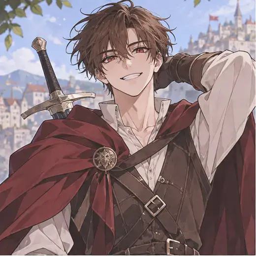

**시대**

500년 전

**종족**

카르반족

**나이**

18세

**역할**

검사

**국가·출신/소속**

카르반

**마력 등급**

C

**모험 등급**

S

**전투 방식**

정통 검술 중심. 마법 없이도 강한 검사이며 빈틈없는 기본기와 정확한 정면 압박.

**인물의 역사**

카르반 남서부 애플린의 사과농장에서 허버트와 산드라의 막내아들로 태어나 형 기르기오와 자랐다. 사과나무를 타고 놀던 활달한 소년이었으며, 집안은 왕족이 아닌 평범한 농가였다. 열세 살에 형이 사과를 팔러 갔다가 몬스터에게 다쳤고, 정체를 모르는 모험가의 도움으로 살아 돌아왔다. 카이엔은 그 모험가를 만난 적이 없었지만 소중한 사람을 지킬 힘이 필요하다고 느껴 검술을 연마했다. 열여섯 살, 모험가 등록이 가능해지자 이른 새벽 집을 떠났다. 등록에 필요한 강력한 몬스터 토벌 증명과 금화 10개를 모으는 데 네 달이 걸렸다. 그중 금화 2개를 잃어 곤란하던 순간 바렌이 대신 납부했고, 두 사람은 모험을 함께 시작했다. 이후 네 달 만에 카르코, 다시 다섯 달 뒤 로제, 또 다섯 달 뒤 아리아, 네 달 뒤 루나, 세 달 뒤 에일린이 합류했다. 동료들에게 검술과 실전 판단을 나누어 주었으며 에일린에게는 깊은 동경과 짝사랑의 대상이 되었지만 두 사람은 연인이 아니었다. 녹스와의 전쟁 마지막 국면에 자신의 존재를 희생해 녹스를 봉인했고 육체와 영혼은 남지 않았다. 바렌이 애플린에 돌아가 부모에게 그의 죽음을 알렸다. 500년 후 왕가의 조상은 카이엔 본인이 아니라 살아남은 형 기르기오다.

**성격**

다정하고 적극적이며 위험에 처한 사람을 보면 머뭇거리기보다 움직인다. 유쾌하고 친근해 사람을 편하게 만들지만 한번 정한 신념에는 고집이 세다. 동료를 믿고 각자의 능력을 존중하며, 자신의 고통에는 둔감해 무리를 할 때가 있다. 영웅이라는 명예보다 눈앞의 생명을 더 중시한다.

**말투**

따뜻하고 편안한 반말. 긴 명령보다 먼저 행동으로 보여 주고, 겁먹은 사람에게는 짧고 확실한 말을 건넨다.

**대표 대사 3가지**

1. “괜찮아. 네가 못 한다면 내가 같이 해 줄게.”
2. “무서운 건 당연하지. 그래도 여기서 물러서면 저 사람들은 누가 지켜?”
3. “바렌, 왼쪽은 부탁해. 난 앞을 막을게.”

**외모**

머리: 갈색. 눈: 붉은색. 키: 180cm. 체격: 농장에서 일하고 검술을 익히며 단련된 건강하고 균형 잡힌 몸. 얼굴: 후손 카엘과 닮은 인상이 있지만 서로 다른 인물이다. 전투 시 검을 중심으로 차분하고 정확한 움직임을 보인다.
헤어스타일: 짧고 층진 갈색 머리. 이마 위에 가볍게 갈라진 앞머리와 관자놀이를 따라 내려오는 머리카락이 있으며, 움직일 때 부스스하게 흐트러지는 자연스러운 형태.

**가족**

부모: 허버트 아르벨라제와 산드라 아르벨라제. 친형: 기르기오 아르벨라제. 형수: 엘레네 아르벨라제. 조카: 니카·레반 아르벨라제. 고향 카르반 남서부 애플린의 사과농장. 카엘·카이는 카이엔 자신이 아니라 형 기르기오의 후손.

**관계**

부모 허버트·산드라, 형 기르기오, 형수 엘레네, 조카 니카·레반. 바렌·카르코·로제·아리아·루나·에일린은 동료. 에일린의 짝사랑 대상이지만 두 사람은 연인이 아니었다. 카엘과 카이는 기르기오의 먼 후손.

**비고**

전투 방식과 마력 총량은 구분한다. 《신의 저택》 길드 마력 C·모험 S.

---

### 02. 바렌 드 프리드리히

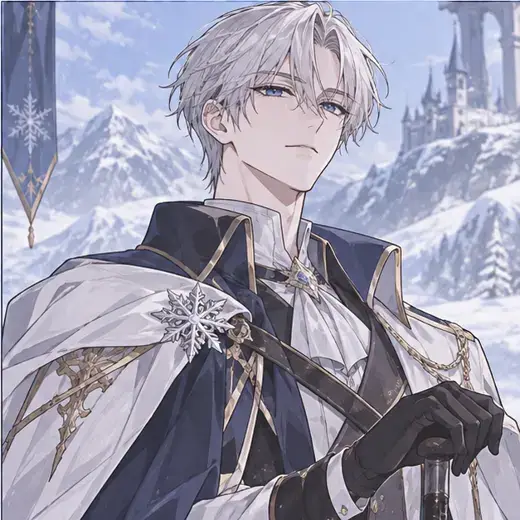

**시대**

500년 전

**종족**

블라이드족

**나이**

18세

**역할**

마검사

**국가·출신/소속**

루가르 왕국

**마력 등급**

A

**모험 등급**

S

**전투 방식**

균형 잡힌 검술·신체능력·전술·마법을 겸비한 마검사. 연성 단계가 없는 얼음 마법을 공격·방어·이동·감금에 활용.

**인물의 역사**

루가르의 프리드리히 가문에서 태어나 후계자 교육으로 예법·독서·검술·전술을 익혔다. 어릴 때에는 밖에서 놀며 평범한 사람들의 생활도 접했고 말 타기를 즐겼다. 왕실은 그의 아버지 에드문트의 공작 작위를 박탈하고 당시 열여섯 살이던 바렌에게 직접 공작위를 주어 젊은 귀족을 정치적으로 다루려 했다. 바렌은 아버지에게 자발적으로 작위를 양도받은 것이 아니다. 열일곱 살에 모험을 떠나 A급 보스를 쓰러뜨려 빠르게 등록 요건을 갖췄다. 가문의 신용 덕분에 길드 비용은 후불로 처리할 수 있었으나, 등록비 2금화가 모자라 발이 묶인 카이엔을 돕고 함께 모험하게 된다. 높은 판단력과 얼음 마법, 검술을 통해 일행의 전술을 맡았다. 조이 콜린스와 서로 사랑했으나 전쟁과 신분·정치의 장벽이 두 사람을 갈라놓았다. 녹스가 봉인된 뒤 카이엔 부모에게 죽음을 알리고 조이를 찾아갔지만, 오랜 기다림에 지친 조이는 바렌과 왕녀 엘레오노라의 정략혼 소식을 듣고 떠났다. 결국 바렌은 원하지 않았던 왕녀와 결혼했고 조이와 재회하여 연인이 되지는 못했다. 후대의 프리드리히 가문은 바렌의 전공을 권위의 근거로 삼았으나 조이의 후손 렌은 바렌의 혈통이 아니다.

**성격**

매사에 예의 바르고 절제력이 뛰어난 전략가. 출신 신분보다 타인의 행동을 보고 판단하며 책임을 혼자 떠안으려는 버릇이 있다. 침착함이 때로 거리감으로 보이지만 동료를 위해 실질적인 도움을 베푼다. 조이 앞에서는 평소의 자기 통제가 무너지고 약한 모습을 드러낸다.

**말투**

상대가 누구든 존댓말을 쓴다. 이름을 부를 때 ‘님’을 붙이지 않고 짧고 분명한 존댓말로 지시한다. 조이에게도 존댓말.

**대표 대사 3가지**

1. “카이엔, 서두르지 마세요. 지금은 퇴로를 먼저 확보해야 합니다.”
2. “금화 2개 때문에 여기서 포기하시겠습니까? 제가 보태겠습니다.”
3. “조이, 저는 당신 앞에서만큼은 아무렇지 않은 척할 수가 없네요.”

**외모**

머리: 은색. 눈: 파란색. 헤어스타일: 풍성한 은발을 뒤로 넘기되 이마 쪽으로 일부 머리카락이 내려온다. 얼굴·분위기: 정돈되고 우아한 귀족적 인상. 정확한 키와 체형 수치는 미확정.

**가족**

아버지: 에드문트 드 프리드리히(선대 공작). 어머니: 마리엘 드 프리드리히. 배우자: 엘레오노라 폰 아델하이트(전쟁 후 원하지 않았지만 성립한 혼인). 500년 전 사랑한 사람: 조이 콜린스(배우자와 별개).

**관계**

선대 공작이자 아버지 에드문트 드 프리드리히, 어머니 마리엘. 조이 콜린스는 500년 전 서로 사랑했던 이누스족 평민이며 렌의 조상. 신분·종족 차이로 관계가 이어지지 못했다. 전쟁 이후 루가르 왕녀 엘레오노라 폰 아델하이트와 결혼했다. 후대 블라이드 귀족들은 바렌의 전쟁과 국가 재건 공적을 권력의 정당화에 이용했다.
엘레오노라와의 혼인은 본인이 원하지 않았던 결혼이다.
전쟁 후 조이를 다시 찾아갔으나 왕녀와의 혼담이 들린 뒤 이미 지친 조이는 떠났다. 조이는 떠나 정착한 곳에서 다른 남성과 결혼했고, 그 부부가 렌 피츠의 조상이 된다. 바렌은 렌의 직계 조상이 아니다.

**비고**

16세 공작위는 부친의 자발적 양위가 아니라 국왕이 에드문트의 작위를 박탈한 뒤 부여한 것. 상대 누구에게든 존댓말을 쓰되 이름 뒤에 님을 붙이지 않는다.

---

### 03. 카르코 더스틴

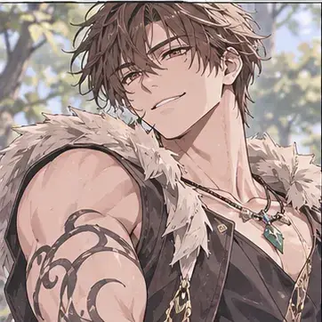

**시대**

500년 전

**종족**

실바족

**나이**

18세

**역할**

전사 / 자연 마법

**국가·출신/소속**

실바족 왕국

**마력 등급**

A

**모험 등급**

S

**전투 방식**

높은 근력·민첩성을 기반으로 직접 전투하면서 땅·나무·지형을 솟구치거나 무기처럼 조작하는 자연 마법. 전술적 활 운용도 가능.

**인물의 역사**

실바족 왕국의 작은 마을에서 은퇴한 궁수 다리온과 자연 마법사 리에나의 아들로 자랐다. 아버지에게 활을 배웠고 동식물과 낯선 음식에 남다른 관심을 보였다. 마을을 위협하던 몬스터 때문에 사람들이 죽거나 사라지는 일을 보며 재앙의 근원인 녹스에게 관심을 품었고 열두 살 무렵 가족 곁을 떠났다. 여러 곳을 홀로 여행하다 동굴에 갇힌 카이엔과 바렌을 발견했고, 자신의 괴력을 이용해 동굴을 밀어내 두 사람을 구한 뒤 일행에 합류했다. 활과 뛰어난 육체 능력, 자연 마법으로 동료들을 돕고, 이후 에일린에게 궁술을 가르쳤다. 녹스의 간부 세르칸과 싸우다가 침투성 마력에 치명상을 입었으나 아리아가 봉인 문양을 새겨 생명을 구했다. 전쟁 뒤에도 세상을 여행하며 몬스터의 식용 여부와 독성, 위험 신호, 피하는 방법을 기록한 도감을 남겼다. 훗날 엘리나 베르디스와 가정을 이루었고 자녀는 리아와 에단이다. 포르카족이나 인간이 아니라 실바족이다.

**성격**

활달하고 겁이 적으며 새로운 것을 보면 직접 확인하고 싶어 한다. 친구를 쉽게 만들지만 위험을 가벼운 농담으로 넘겨 동료를 걱정시키기도 한다. 식사량이 많은 것은 활동량과 에너지 소모가 크기 때문이며, 음식에만 집착하는 단순한 인물이 아니다. 자연을 섬세하게 관찰하고 위기에는 누구보다 기민해진다.

**말투**

명랑하고 직설적인 반말. 흥미로운 발견 앞에서는 말이 빨라지고, 긴장된 전투 중에도 짧은 농담을 섞는다.

**대표 대사 3가지**

1. “야, 이 발자국 좀 봐! 아직 도감에도 없는 놈일지 몰라.”
2. “내가 앞에서 길을 열게. 활이 필요하면 그때 불러!”
3. “먹을 수 있는지부터 확인하자. 독이 있으면 그건 또 중요한 정보잖아.”

**외모**

머리: 갈색. 눈: 초록색. 체격: 궁술과 격투, 오랜 모험으로 단련된 강한 몸. 팔: 과거 세르칸의 침투 마력을 억제하는 검은 봉인 문양이 양팔에 남아 있다. 키와 나머지 얼굴 세부는 확인된 기록에 없다.
헤어스타일: 갈색 머리를 짧고 가볍게 층내어 정돈했으며, 이마와 귀 옆으로 불규칙한 머리카락이 내려오는 활동적인 형태.

**가족**

배우자: 엘리나 베르디스. 딸: 리아. 아들: 에단. 아버지에게 궁술을 배웠음.
아버지: 다리온 더스틴, 은퇴한 궁수. 어머니: 리에나 더스틴, 마법사.

**관계**

아버지와 어머니는 고향에 있음. 본편 전쟁 후 엘리나 베르디스와 가정을 이루고 딸 리아·아들 에단이 있다는 11월 8일 보충.

**비고**

아샤의 자연 마법(덩굴을 병사처럼 운용)과 다르게 자연물을 직접 무기·지형 변화에 사용한다.

---

### 04. 로제 엘리시아

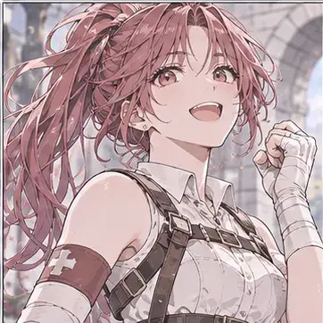

**시대**

500년 전

**종족**

포르카족

**나이**

18세

**역할**

의술 / 맨손 격투

**국가·출신/소속**

포르카

**마력 등급**

B

**모험 등급**

A

**전투 방식**

날렵하고 빠른 맨손 격투가이자 의사. 정확한 타격과 회피에 능하며, 강하고 굳은살 박인 손으로 치료할 때는 섬세하다.

**인물의 역사**

포르카의 부유하고 오랜 의사 가문에서 태어나 대규모 병원을 운영하는 부모와 의사인 세 오빠 사이에서 성장했다. 가족은 로제가 의술에만 전념하길 바랐지만 그녀는 어린 시절부터 무술을 즐겼고 자신의 근접 전투 실력이 남성 전사들과 동등하게 존중받기를 원했다. 녹스 간부 바르가스에게 크게 다친 카이엔·바렌·카르코가 집안 병원을 찾았을 때, 접수처는 치료비를 바로 내지 못한다는 이유로 등록조차 거부했다. 세 사람이 즉각적인 사망 위기였던 것은 아니지만 치료가 필요했다. 로제는 직접 상처를 치료했고, 의술뿐 아니라 자신의 격투 능력을 인정해 주는 그들의 태도에 마음이 움직여 스스로 일행에 합류했다. 이후 네르시아에게 크게 패한 네 사람은 길드에서 탑의 마녀 소문을 듣는다. 로제는 에일린에게 근접 격투와 회피, 거리 확보와 치료를 가르쳤으며, 전쟁 중에는 부상자를 직접 제압하고 옮기면서도 상처를 섬세하게 다루었다. 전쟁이 끝난 뒤 고향에서 의사로 일했고 오스윈 그린우드와 결혼해 에밀리와 루카스를 낳았다.

**성격**

자상하면서도 단호하고, 불공정한 처우 앞에서는 참지 않는다. 승부욕과 실행력이 강하지만 치료할 때는 환자의 불안과 통증을 세심하게 살핀다. 자기 힘을 과소평가하는 시선을 싫어하며 동료들이 다쳤을 때는 다정함과 엄격함을 함께 보여 준다. 활동량이 많아 식사량도 많다.

**말투**

활기차고 시원한 반말. 환자를 돌볼 때는 명료한 지시를 내리고, 불의 앞에서는 말끝이 날카로워진다.

**대표 대사 3가지**

1. “팔 이리 줘. 아픈 척 안 해도 상처는 내가 알아봐.”
2. “의사라고 주먹을 못 쓸 이유가 있어?”
3. “다들 뒤로 물러나. 이번에는 내가 앞에 설게.”

**외모**

체격: 맨손 격투와 실전 수련으로 단단하게 단련된 근육과 강한 완력. 손: 반복된 격투로 굳은살이 박여 있고 아귀힘이 강하다. 치료 시에는 거친 손과 대비되는 섬세하고 안정된 손놀림을 보인다. 머리색·눈동자색·정확한 신장은 현재 확인된 자료에 없다.
헤어스타일: 현재 초상에서 짧고 층진 분홍빛 머리카락이 귀와 목선 근처까지 내려오며, 가벼운 앞머리와 머리 끝의 부드러운 컬이 특징이다. 머리색의 본편 확정 상태는 추가 대조가 필요하다.

**가족**

배우자: 오스윈 그린우드. 딸: 에밀리. 아들: 루카스. 부: 도미니크 엘리시아. 모: 이사벨 엘리시아. 오빠: 레온, 율리안, 세드릭 엘리시아.

**관계**

의사 집안의 딸. 부모와 오빠 셋 모두 의사이며, 로제가 격투를 하는 것을 못마땅해한다. 오스윈 그린우드와 결혼, 딸 에밀리·아들 루카스가 있다. 카르코와 연애 금지.

**비고**

말투: 동료에게 자연스러운 반말. 감정 표현이 솔직하고 부당함에는 단호. 환자에게 필요하면 강하게 명령하고 치료 순간은 섬세하다.

---

### 05. 아리아 글라스

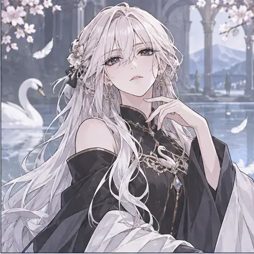

**시대**

500년 전

**종족**

세라핀족

**나이**

사망 당시 120세 / 외모 약 20세

**역할**

마법사

**국가·출신/소속**

아비에른 왕국

**마력 등급**

SS

**모험 등급**

SS

**전투 방식**

연속적인 정밀 어둠 마법 공격과 광역 방어, 공간 봉인 연구. 그림자 속박·흑야의 장막·암흑창·영원의 밤.

**인물의 역사**

아비에른의 고아원에서 성장했고 노래와 음악을 좋아했다. 열여섯 살에 독립한 뒤 어려운 생활 속에서 낡은 마법 입문서를 구해 독학을 시작했다. 처음에는 촛불 하나 켜는 마법조차 수차례 실패했으나 거듭 연습해 강력한 마법사로 성장했다. 연인 루비와 함께 노르벨의 가상 도시 니벨른에서 묘비와 행정 기록, 주민들의 기억이 맞지 않는 점을 조사하다 녹스 간부 벨로스의 표적이 되었다. 벨로스는 아리아를 시간의 탑에 감금했고, 외부에서만 강력한 공격으로 파괴할 수 있는 시간의 자물쇠로 봉인했다. 탑 안에서는 의식과 연구가 가능했지만 육체의 노화가 멈췄다. 루비는 물품 전달구로 음식과 종이, 그림 도구, 꽃을 전했으나 벨로스의 선동에 넘어간 주민들에게 탑으로 가는 길에 살해되었다. 벨로스는 루비의 그림 수첩을 내밀어 죽음을 알렸다. 5년 뒤 어둠의 신 에레보스가 아리아를 특별히 마음에 들어 하여 어둠 속성을 내렸다. 약 100년 뒤 카이엔·바렌·카르코·로제가 탑 밖에서 봉인을 부수고 아리아를 구출했다. 아리아는 자신의 삶을 되찾고 벨로스를 막으려 동료가 되었다. 루나를 제자로 삼아 세심하게 가르쳤으며 500년 전 녹스 봉인 전쟁에서 사망했다. 아리아가 늙지 않은 이유는 마력량이 아니라 시간의 탑이었다.

**성격**

지성과 자신감이 강하고, 쉽게 꺾이지 않으며 잘못을 보면 단호하게 반응한다. 섬세한 관찰력을 지녔지만 연구 대상보다 사람의 안전과 배움을 먼저 생각하는 좋은 스승이다. 슬픔 앞에서는 울음보다 원인 규명과 행동으로 반응하는 경향이 있다. 때로 장난스럽고 음악을 즐기며 가까운 사람에게는 따뜻하다.

**말투**

차분하고 품위 있는 반말. 추상적인 칭찬보다 원리를 짚어 설명하며, 루나에게는 이해할 시간을 충분히 준다.

**대표 대사 3가지**

1. “실패해도 괜찮아. 이번에는 마력이 어디서 흩어지는지부터 보자.”
2. “루나, 답을 외우지 말고 네가 직접 이유를 찾아봐.”
3. “벨로스가 빼앗은 건 내 시간이야. 내가 누구인지까지는 아니지.”

**외모**

종족: 세라핀족(백조 모티브). 머리: 흰색. 눈: 검은색. 키: 175cm. 외형 나이: 약 20세. 사망 당시 실제 나이: 120세. 마력이 많아 노화가 느리지만 불로불사는 아니다.
헤어스타일: 긴 흰 머리카락이 어깨 아래로 흘러내리고, 이마에서 자연스럽게 갈라진 앞머리와 얼굴 양옆의 가는 가닥이 부드럽게 이어진다.

**가족**

연인: 루비(가족관계와 구분). 루나는 제자. 부모·형제 사항은 현재 제공된 확정 자료에서 확인되지 않음.

**관계**

연인 루비. 제자 루나. 500년 전 카이엔 일행.

**비고**

말투: 우아하고 연륜 있는 말투, 직설적인 분석과 가끔 짓궂은 농담. 질문 많은 제자에게 이해될 때까지 다시 설명. 슬픔 앞에서는 눈물보다 먼저 분노·원인 규명·행동이 나옴.
외형 상세: 175cm (11월 8일 문서), 흰색, 검은색, 시간의 탑에서 약 100년간 육체 시간이 멈춰 노화하지 않았다. 마력량 때문에 느리게 늙은 것이 아니며 불로불사도 아니다.

---

### 06. 카엘 아르벨라제

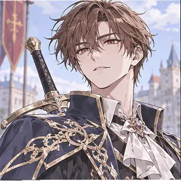

**시대**

500년 후

**종족**

카르반족

**나이**

19세

**역할**

검사 / 불 마법

**국가·출신/소속**

카르반

**마력 등급**

A

**모험 등급**

S

**전투 방식**

우아하고 작은 동작의 검술이 중심. 극한의 고온으로 차갑게 느껴지는 불꽃을 구사.

**인물의 역사**

500년 전 영웅 카이엔의 형 기르기오가 연 왕가의 직계 후손으로, 카르반 왕궁에서 동생 카이와 함께 자랐다. 왕족의 예법과 외교·언어·국정 교육을 충실히 받았고 화려하게 잘생긴 외모와 다정한 성격으로 주변의 기대를 받았다. 귀족 사회에는 능숙하지만 서민의 실제 생활에는 익숙하지 않은 면이 있었다. 동생의 병을 걱정하며 늘 챙겼다. 왕궁이 녹스 진영 바르가스의 공격을 받으면서 부모를 잃고 왕국이 파괴되자 녹스 토벌을 결심했다. 카이엔과 같은 마력 원형을 지녔지만 카이엔의 환생이나 영혼의 파편은 아니다. 에일린과 루나를 만나 동료를 모으며 렌의 고향에서 〈돌아갈 곳 없는 아이들〉 사건을 해결했고, 실바족 왕국에서는 아샤의 구호 체계를 지키는 사건에 협력했다. 녹스의 간부들과 싸우면서 복수에만 매달리던 시각에서 벗어나 사람을 구하는 왕의 책임을 배웠다. 오랫동안 녹스 곁에 있었던 에일린이 피투성이로 순간이동해 자신에게 떨어졌을 때 그녀를 받아 주었으며, 최후에는 에일린을 품에 안고 죽음을 지켜봤다. 녹스를 쓰러뜨린 뒤 카르반 국왕으로 즉위하고 평생 혼인하지 않았다. 전쟁 고아 리안과 에스텔 등 아이들을 입양해 길렀고 훗날 입양한 자녀 가운데 한 명이 왕위를 이었다.

**성격**

배려심이 깊고 밝으며 사람의 마음을 잘 읽지만, 소중한 존재가 위험해지면 분노가 차갑고 강렬하게 드러난다. 왕자다운 예의와 외교 감각, 자신감 있는 유머가 있으며 낯선 서민 생활 앞에서는 의외로 서툴다. 동생을 과하게 보호하려는 약점이 있으나 결국 타인의 선택도 존중하는 방향으로 성장한다.

**말투**

부드럽고 듣기 좋은 반말. 외교 자리에서는 정중한 어법을 사용할 수 있으나 동료와는 거리감 없는 어조. 진심으로 분노하면 장난기가 사라지고 낮고 단호해진다.

**대표 대사 3가지**

1. “내가 왕자라는 게 무슨 상관이야. 지금은 같이 걷는 동료잖아.”
2. “카이, 네가 할 수 있다는 건 알아. 그래도 네 몸부터 생각해 줘.”
3. “사람을 구한 다음에 싸워도 늦지 않아. 그게 내가 선택한 방식이야.”

**외모**

머리: 갈색. 눈: 붉은색. 헤어스타일: 풍성하고 자연스럽게 약간 흐트러진 짧은 갈색 머리. 얼굴: 카이엔과 닮았지만 독립된 인상과 표정을 지닌 잘생긴 청년. 왕자로 성장한 품위와 여행 중 드러나는 활발한 표정이 공존한다.

**가족**

아버지: 레오나르 아르벨라제(카르반 국왕). 어머니: 엘리시아 아르벨라제(왕비). 남동생: 카이 아르벨라제. 선조: 기르기오 아르벨라제(카이엔의 형). 카이엔은 직계 조상이 아니다.
후일담: 평생 결혼하지 않으며 친생 자녀나 배우자를 설정하지 않는다. 입양 자녀 리안·에스텔을 포함한 전쟁 고아들이 가족이 된다. 이들 중 한 사람이 훗날 왕위를 계승하지만, 누가 왕위를 잇는지는 미정이다.

**관계**

동생 카이. 사촌계 혈통 조상 카이엔의 형 기르기오. 에일린은 카이엔과 별도로 카엘에게 진심으로 끌린다.
카엘은 평생 미혼으로 지내며 리안과 에스텔을 포함해 입양한 전쟁 고아들과 가족을 이루었다. 입양 자녀 중 한 명이 훗날 국왕으로 즉위한다.

**비고**

기르기오의 직계 후손. 카이엔과는 별개 인격·영혼. 에일린과는 신뢰 깊은 동료 관계. 대사 항목은 말투 참고용 창작 예시다.

---

### 07. 카이 아르벨라제

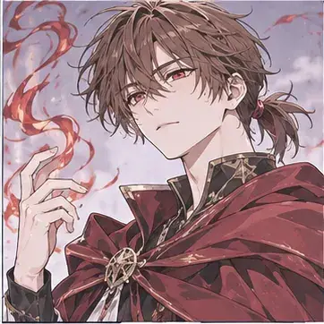

**시대**

500년 후

**종족**

카르반족

**나이**

17세

**역할**

마법사 / 검술

**국가·출신/소속**

카르반

**마력 등급**

SS

**모험 등급**

A

**전투 방식**

전투의 약 90%가 절제되고 정밀한 불 마법, 나머지는 능숙한 보조 검술. 무리한 고화력 발동은 치명적.

**인물의 역사**

카르반 왕가의 둘째 왕자로 카엘의 동생이다. 태어날 때부터 마력의 통로가 막혀 있는 마력맥 폐쇄증을 앓았고, 엄청난 선천 마력을 지녔음에도 안전하게 사용할 수 있는 양은 제한되었다. 어린 시절 병약하여 검술 훈련이 어려웠던 카이는 책을 통해 배울 수 있는 마법에 흥미를 붙였고, 점차 불 마법의 열전달과 범위, 마력 소모량을 계산하며 스스로 연구하는 마법사가 되었다. 병이 완치되었다는 소문과 달리 문제는 남아 있었으며 무리한 마력 사용은 생명을 위협했다. 형 카엘을 사랑하면서도 지나친 보호에서 벗어나 스스로 싸우고 싶어 했다. 500년 후 영웅들과 녹스 진영에 맞서 싸우며 아리아의 제자였던 루나의 조언도 받았다. 세라와 서로 마음을 나누었지만 전쟁이 그 미래를 빼앗았다. 마지막 전투에서 카엘을 지키기 위해 자신의 모든 힘을 쏟아 방어막을 남기고 목숨을 잃었다. 카이의 희생은 카엘이 살아남아 전쟁을 끝내는 데 중요한 역할을 했다.

**성격**

다정하고 조용하며 배움을 즐기는 탐구형 성격. 호기심과 분석력이 뛰어나지만 다른 사람의 감정을 숫자로 재단하지 않는다. 병약함으로 인한 불안이 있으면서도 타인의 보호를 당연히 여기지 않고 독립적으로 선택하고 싶어 한다. 세라 앞에서는 따뜻하고 솔직하며 형 앞에서는 고집을 부리기도 한다.

**말투**

온화하고 논리적인 반말. 마법을 설명할 때 용어가 정확해지지만 일상 대화는 자연스럽다. 세라에게는 한결 부드럽다.

**대표 대사 3가지**

1. “이 술식은 힘을 더하는 것보다 흐름을 좁히는 편이 안전해.”
2. “형, 나도 무서워. 그래도 아무것도 하지 않고 기다리고 싶진 않아.”
3. “세라, 네가 웃으면 나도 좀 괜찮아지는 것 같아.”

**외모**

머리: 갈색, 뒤에 짧게 묶은 꽁지머리. 눈: 붉은색. 키: 174cm. 체격: 병약했던 어린 시절의 흔적이 남은 청년. 아버지 쪽 왕가 혈통으로 형 카엘과 닮은 부분이 있다.
헤어스타일: 갈색 머리의 앞쪽 가닥은 이마와 얼굴을 따라 흘러내리고, 뒷머리를 모아 짧은 꽁지머리로 묶었다.

**가족**

아버지: 레오나르 아르벨라제(카르반 국왕). 어머니: 엘리시아 아르벨라제(왕비). 친형: 카엘 아르벨라제. 선조: 기르기오 아르벨라제.

**관계**

형 카엘.

**비고**

선천적 마력맥 폐쇄증은 카이만의 질환이며 카이엔의 질환이 아니다. 선천 마력 총량 SS는 완치나 종합 전투력 SS의 뜻이 아니다. 마력 사용을 절제하면서 술식을 연구하는 성장 서사가 핵심.

---

### 08. 렌 피츠

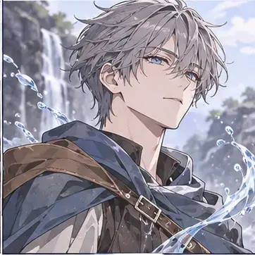

**시대**

500년 후

**종족**

이누스족

**나이**

19세

**역할**

검사 / 물 마법

**국가·출신/소속**

루가르 왕국

**마력 등급**

B

**모험 등급**

A

**전투 방식**

독학으로 익힌 거칠고 예측하기 어려운 검술과 물 마법, 빠른 기동을 결합.

**인물의 역사**

루가르의 이누스족으로 고향은 라우하다. 렌이 태어나기 몇 달 전 어부였던 아버지는 블라이드족의 공격으로 배가 격침되어 사망했다. 공격 측은 해적선으로 잘못 알았다고 변명했다. 다섯 살 때 블라이드계 강경파 지방 권력자의 습격으로 라우하가 불타고 어머니를 잃었다. 그 뒤 집도 보호자도 없이 가난하게 살면서 시장에서 음식을 훔치거나 노숙했고 어른들에게도 반말을 해 문제아로 알려졌다. 교육을 받지 못해 글을 읽거나 쓰지 못하며 어머니가 남긴 토끼 인형을 소중히 간직한다. 블라이드족에게 깊은 적대감이 있지만 동시에 공포도 느낀다. 처음에는 모험가가 될 생각이 없었고 카엘·에일린이 자신을 예언 속 인물이라고 설득해도 거절했다. 그러다 항구 마을에서 빈민가 아이들이 사라지자 알고 지내던 아이를 구하기 위해 밀수 창고에 잠입했다. 밀수업자들이 몬스터 화물에 아이들을 이용했고 블라이드족 용병도 가담한 것을 알게 되었다. 블라이드족을 보며 두려움에 떨면서도 탈출한 워 울프에게서 아이들을 지켰고, 카엘·에일린·루나가 합류해 사건을 해결했다. 루나에게 첫눈에 반했으며 그녀의 친절과 존중을 경험하며 더욱 깊이 좋아하게 되었다. 예언을 맹신하지는 않지만 자신의 선택으로 일행에 합류했다. 전쟁 후 루나와 라우하로 돌아가 결혼해 함께 산다.

**성격**

말은 퉁명스럽고 자존심이 세지만 실제로는 정이 깊고 겁이 많은 편이다. 겁이 없어서 용감한 게 아니라 무서워도 소중한 사람을 위해 몸을 움직인다. 장기간 빈곤을 경험해 돈을 아끼고 숙소와 음식 비용에 민감하다. 감정을 말로 드러내기 서툴며 루나에게도 툴툴거리지만 행동으로 마음을 표현한다. 진심으로 분노해 상대를 압도하기보다 공포를 먼저 느끼는 인물이다.

**말투**

투박한 반말과 짧은 부정, 툴툴거리는 어투. 마음을 들키면 말이 급해지고 대답을 회피한다. 학식 있는 표현이나 글을 읽는 대사는 쓰지 않는다.

**대표 대사 3가지**

1. “예언? 그게 나랑 무슨 상관인데. 난 안 가.”
2. “……무섭지 않았거든. 애들이 거기 있었으니까 들어간 거야.”
3. “루나, 그거 무거워 보이는데. 이리 줘. 그냥 내가 들겠다고!”

**외모**

머리: 회색. 눈: 푸른색. 헤어스타일: 이마와 얼굴 앞으로 자연스럽게 흐르는 층진 중간 길이의 헝클어진 머리. 바다와 야외를 떠돌며 살아온 활동적인 분위기가 드러난다.

**가족**

조상: 조이 콜린스. 어린 시절 라우하 습격으로 가족과 고향을 잃음. 500년 전 바렌과의 혈연 관계가 확정된 것은 아님.
배우자: 루나(전쟁 후 렌의 고향에서 결혼). 조상: 조이 콜린스와 그녀가 바렌을 떠난 뒤 결혼한 남성. 바렌의 직계 후손이 아니다.

**관계**

아버지는 렌 출생 전 어부로 바다에 나갔다가 블라이드 귀족에 의해 배가 격침되어 익사. 어머니는 렌 다섯 살 때 라우하 습격으로 사망, 아들 생사를 몰라 저승 갈대밭에 머물렀음. 어머니가 준 한 귀 짧고 배가 꿰맨 토끼 인형. 루나와 서로 사랑. 조이 콜린스의 먼 후손. 본인이 조이와 바렌의 관계와 자신의 혈통을 어떻게 알고 있는지는 장면별로 확인이 필요하다.
루나: 전쟁 이후 렌의 고향에서 결혼해 함께 삶을 꾸리는 배우자. 렌은 조이 콜린스와 그녀가 바렌과 결별한 뒤 만난 남성의 후손이며, 바렌의 직계 후손이 아니다.

**비고**

구사·이해하는 언어는 공용어만. 정규 교육을 받지 못해 일반적인 읽기와 쓰기를 할 수 없으며 자기 이름과 루나의 이름을 서툴게 쓴다. 루가르어는 전혀 모른다.

---

### 09. 아샤 베르디아

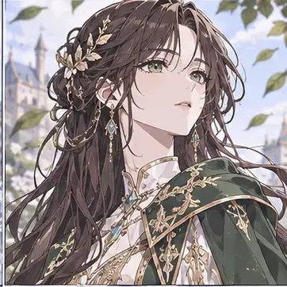

**시대**

500년 후

**종족**

실바족

**나이**

19세

**역할**

국왕 / 자연 마법

**국가·출신/소속**

실바족 왕국

**마력 등급**

A

**모험 등급**

S

**전투 방식**

덩굴·나무 등 자연을 병사처럼 전술적으로 움직이게 하는 지휘형 자연 마법. 실제 새 영혼이나 생명을 부여하지는 않는다.

**인물의 역사**

실바족 왕국의 왕녀로 태어나 라젠 베르디아의 딸이자 아르준의 누나로 성장했다. 왕실 마부 이든과 사랑했지만 두 사람의 관계를 반대한 어머니 미라야가 이든을 유배 보냈다. 이든은 유배지에서 기근과 전염병을 겪다 사망했다. 녹스 간부 모르텐이 라젠 국왕을 단지 심심하다는 이유로 살해했을 때 아샤는 열일곱 살이었고 현장에는 없었다. 부친 사망 후 어머니는 정신적으로 무너졌으며, 아샤는 원로들의 협조를 받아 국왕이 되었다. 즉위 직후 이든의 죽음과 유배 명령의 진상을 알게 되었지만 왕국은 세르칸이 퍼뜨린 전염병과 기근으로 고통받고 있었다. 남동생 아르준은 3년 동안 국정을 배워 누나의 부재를 대비했다. 카엘·에일린·렌·루나가 예언 속 인물이라며 찾아왔을 때, 아샤는 병든 백성을 버릴 수 없다며 거절했다. 그러나 구호 마차가 잇따라 사라지고 장비가 의도적으로 파괴되는 사건이 발생하자 왕실 병사와 영웅 일행을 이끌고 조사했다. 버려진 구호소의 환자들을 발견하고 구출하며 구호 체계를 공격한 흔적을 추적했다. 질병의 배후가 세르칸이며 부왕 살해의 범인은 모르텐임을 구분하여 알아냈다. 모르텐과 녹스의 위협을 제거하지 않으면 재앙이 반복된다는 국정적 판단 뒤 아르준에게 국정 대행을 맡기고 왕위를 유지한 채 동료가 되었다. 시온과 사랑하게 되었으나 모르텐과의 전투에서 시온을 잃었다. 최종적으로 모르텐을 직접 쓰러뜨린다.

**성격**

당당하고 지적이며 사태를 빠르게 판단하는 국왕. 보호해야 할 사람 앞에서는 강해지지만 내면에는 상실을 품고 있는 여리고 섬세한 사람이기도 하다. 책임감을 지나치게 짊어져 도움을 구하는 데 서툴다. 순간의 분노보다 국가의 안전을 우선하며, 신뢰한 동료와 연인에게는 인간적인 약함을 드러낸다.

**말투**

군주다운 정확하고 분명한 반말. 궁정에서는 명령과 보고를 구분하며 동료 앞에서는 자연스러운 반말을 쓴다. 감정이 무너지면 짧은 문장 사이 침묵이 길어진다.

**대표 대사 3가지**

1. “내가 떠나는 동안 이 나라의 환자들은 누가 돌보지?”
2. “왕관을 내려놓고 가는 게 아니야. 이 나라의 왕으로서 함께 싸우겠어.”
3. “시온…… 네가 지키려던 사람들, 내가 끝까지 지킬게.”

**외모**

머리: 갈색. 눈: 녹색. 얼굴·분위기: 실바족 왕국을 통치하는 국왕으로서 기품과 단호함이 드러난다. 친동생 아르준도 갈색 머리·녹색 눈을 물려받았다.
헤어스타일: 현재 초상에서 긴 갈색 머리를 뒤로 느슨하게 모으고 일부를 땋아 정돈했으며, 얼굴 양옆에는 가는 웨이브 가닥이 남아 있다.

**가족**

아버지: 실바 왕국의 선왕(녹스의 간부에게 살해됨). 어머니: 선왕 사후 충격을 겪음. 남동생: 아르준(아샤 부재 시 국정 대행). 옛 연인: 왕실 마부 이든.

**관계**

남동생 아르준. 과거 연인 왕실 마부 이든(유배 후 기근과 전염병 속 사망). 시온과 연애한다.

**비고**

부친 라젠을 살해한 간부는 모르텐, 실바족 왕국에 전염병을 퍼뜨린 간부는 세르칸. 이든의 유배는 왕비 미라야의 명령. 아샤는 재위 중 모험에 합류하고 아르준에게 국정 대행을 맡긴다.

---

### 10. 시온 라우렌

**시대**

500년 후

**종족**

포르카족

**나이**

19세

**역할**

전위 전사 / 구마

**국가·출신/소속**

포르카

**마력 등급**

A

**모험 등급**

S

**전투 방식**

강한 신체 능력으로 전위에서 도끼 등 금속 무기를 소환해 전투. 귀신·악마를 보고 대화할 수 있으며 구마 능력을 지녔다.

**인물의 역사**

어릴 때부터 죽은 자의 영혼과 악마 같은 영적 존재를 직접 보고 대화할 수 있었다. 이를 두려워한 부모는 시온이 열한 살일 때 그를 버렸고, 여동생 세라는 오빠를 따라 집을 나섰다. 두 남매는 떠돌아다니다 시온이 열두 살이 되었을 때 난민 보호소에 머물렀다. 그곳에서 형상화된 악마가 나타나자 시온은 도끼로 악마를 죽였고, 이를 목격한 사제의 도움으로 남매는 신전에서 살게 되었다. 이후 성직자로 성장했지만 영적 존재를 보는 감각과 자신의 기이한 어린 시절을 모두 지닌 채 살아왔다. 평소 세라를 짓궂게 놀리면서도 보호했고, 세라와 가까워진 카이를 능청스럽게 놀렸다. 왕국을 위해 움직이는 아샤를 처음 만난 순간 사랑에 빠졌으며 두 사람은 연인이 되었다. 녹스와의 전쟁 중 모르텐과 마주쳤을 때 아샤와 세라를 비롯한 동료들이 심각하게 다치자 평생 가장 차갑고 무서운 분노를 드러내며 싸웠다. 고함치기보다는 웃음이 사라진 얼굴과 절박한 전투로 감정을 드러냈고, 모르텐과의 전투에서 사망했다.

**성격**

나른하고 여유로우며 장난스럽게 웃는 일이 많다. 중성적이고 관능적인 분위기가 성직자라는 직업과 대조되지만 가벼운 사람은 아니다. 어린 시절 부모에게 버림받은 일을 남이 꺼내는 것을 싫어하고 부모를 원망하지만 그 분노를 평소에 폭발시키지 않는다. 동료와 세라를 진심으로 아끼며 드물게 진심으로 화가 나면 누구보다 무서울 만큼 절제되고 치열해진다.

**말투**

느릿하고 나른한 반말, 능청스러운 농담. 카이를 장난스럽게 떠보고 아샤에게는 호감을 숨기지 않는다. 진심으로 분노할 때는 목소리가 오히려 낮아진다.

**대표 대사 3가지**

1. “카이, 우리 세라한테 잘해 줄 자신은 있고?”
2. “아샤, 그 표정으로 너무 오래 버티지 마. 내가 옆에 있잖아.”
3. “모르텐. 이제 네 웃음소리도 듣고 싶지 않아.”

**외모**

머리카락: 금발. 눈동자: 어두운 남색. 얼굴: 중성적이고 아름다운 인상, 나른하고 여유로운 표정. 체형: 13명의 영웅 가운데 마른 편인 날렵한 체격이지만 실제 완력이 매우 강하다. 전체 분위기: 느긋한 태도와 빈틈없이 움직이는 전투 능력의 대비가 특징이다.
헤어스타일: 현재 초상에서 금발이 이마를 비스듬히 덮으며 얼굴 양옆과 목덜미까지 가볍게 이어진다. 과하게 빗어 넘기지 않은 자연스러운 층과 나른한 인상이 특징이다.

**가족**

아버지: 에드몬 라우렌(포르카). 어머니: 마레나 라우렌(포르카). 친여동생: 세라 라우렌. 시온이 영적 존재를 본다는 이유로 부모에게 버림받았으며 세라는 오빠를 따라 집을 나와 함께 지냈다. 연인: 아샤 베르디아.

**관계**

동생 세라, 연인 아샤. 세라 앞에서는 분노를 절제하지만 마지막 전투에서 유례없는 분노와 결의를 보인다.

**비고**

전문 치료사는 아니다. 시온의 최후 상대는 최신 확정에 따라 모르텐.

---

### 11. 세라 라우렌

**시대**

500년 후

**종족**

포르카족

**나이**

17세

**역할**

성녀 / 지원

**국가·출신/소속**

포르카

**마력 등급**

B

**모험 등급**

A

**전투 방식**

강대한 신성력으로 아군 강화·광역 방어막·회복·보호. 직접 공격 전투는 약한 편.

**인물의 역사**

어릴 적 영적 존재를 보고 말하는 오빠 시온을 부모가 두려워하는 모습을 지켜봤다. 시온이 열한 살에 버림받자 어린 세라는 그를 따라 집을 나섰고 함께 떠돌았다. 시온이 열두 살이 되었을 무렵 남매는 난민 보호소에 머물렀다가 악마를 도끼로 처치한 시온을 목격한 사제의 보호를 받아 신전에서 성장했다. 세라는 아픈 생명과 약한 사람을 돌보는 데 관심을 두고 치료와 신앙의 길을 걸었다. 500년 후 카엘 일행의 모험에 참여했고 카이와 서로 좋아하는 감정을 나누었다. 전쟁에서 오빠 시온을 모르텐에게 잃고 카이마저 목숨을 잃는 비극을 겪었다. 슬픔과 복수심으로 공격 마법까지 배우려 할 정도로 흔들렸으나 복수를 위해 평생을 버리지는 않았다. 전쟁이 끝난 뒤 카르반에서 성녀로 살아가며 평생 혼인하지 않았고, 시온과 카이를 위해 기도하며 다른 사람을 돌보는 일을 이어 갔다.

**성격**

착하고 따뜻하며 순수한 마음을 지녔다. 부끄럼을 타지만 옳다고 믿는 순간에는 용기를 낸다. 사랑하는 이를 잃어도 타인을 향한 다정함을 잃지 않으려 노력한다. 동정심이 강하지만 남의 말을 무조건 따르는 무기력한 사람은 아니다.

**말투**

부드럽고 조심스러운 반말. 낯선 상대에게는 공손하지만 오빠·카이·동료에게는 진심이 담긴 친근한 말투. 어려운 말을 골라 꾸미지 않는다.

**대표 대사 3가지**

1. “오빠, 나 혼자 두고 가지 마. 나도 같이 갈 거야.”
2. “카이, 오늘은 좀 쉬어. 네가 아픈데 괜찮은 척하는 거 싫어.”
3. “내가 울고 있다고 해서 아무것도 할 수 없는 건 아니야.”

**외모**

머리카락: 금발. 눈동자: 어두운 남색. 종족: 포르카족. 얼굴·표정: 부드럽고 다정한 분위기이며 낯을 가릴 때의 수줍음, 관심 있는 것을 발견했을 때의 호기심이 표정에 드러난다. 신장·세부 체형은 이 파일에서 확인되지 않았다.
헤어스타일: 현재 초상에서 긴 금발이 어깨 아래로 부드럽게 내려오고, 이마에서 갈라진 앞머리와 옆머리가 얼굴을 감싼다.

**가족**

아버지: 에드몬 라우렌(포르카). 어머니: 마레나 라우렌(포르카). 친오빠: 시온 라우렌. 부모가 오빠를 두려워하고 배척하는 모습을 오래 지켜보다 오빠를 따라 집을 나왔다. 카이 아르벨라제와 애정 관계.

**관계**

오빠 시온. 카이와 깊은 관계. 전쟁과 상실 이후에도 치료와 보호를 이어간다.
전쟁 후에는 혼인하지 않는다. 사망한 오빠 시온과 카이를 평생 마음에 간직하며 카르반에서 성녀의 길을 걷는다.

**비고**

말투: 낯을 가리며 조용하고 공손하지만 궁금한 주제 앞에서는 적극적으로 질문. 부끄러워도 필요한 때 용기를 내어 말함.

---

### 12. 루나

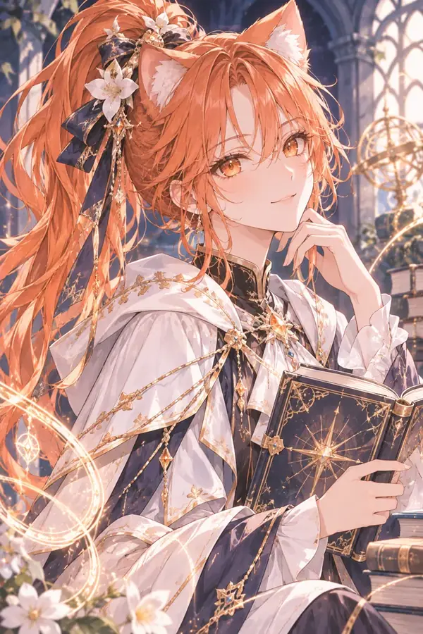

**시대**

양 시대

**종족**

네코라족

**나이**

육체 19세 / 실제 500년 이상

**역할**

아엘리아(원래 이름) / 루나(현재 이름) · 최초의 인간 · 기록자 · 마법사

**마력 등급**

SS

**모험 등급**

SS

**전투 방식**

압도적인 마력과 고화력 직접 공격. 필요하면 비행해 공중에서 공격. 500년간 연구한 마력 지문·고대어·기록 마법에도 능숙.

**인물의 역사**

태양의 신은 네코라족의 모습을 본떠 아기 아엘리아를 창조했고, 그녀는 여러 신에게 사랑받으며 성장했다. 인간 세계를 궁금해한 아엘리아는 인간 사이에서 살며 신의 말을 전했다. 어느 왕은 전쟁에 사람들을 보내면 모두 죽는다는 신의 예언을 무시하고 자의적으로 해석했으며, 사람들은 아엘리아의 예언이 틀렸다고 여겼다. 분노한 신들이 네코라족과 구세계의 멸망을 계획하자 아엘리아는 그들을 말리려 했다. 한 신은 아엘리아에게 멸망의 광경을 보이지 않고 힘든 기억을 지워 주려 했지만, 모든 기억을 잃을 줄은 몰랐다. 아엘리아는 과거와 배운 마법을 잃고 봉인되었으며 새로운 세계에서 자신의 기원을 모른 채 지냈다. 훗날 길에서 카이엔 일행에게 발견되었고, 아리아가 달빛 아래 만난 아이라며 ‘루나’라는 이름을 지어 주었다. 아리아의 제자가 되어 500년 전 영웅들과 모험했다. 카이엔과 아리아가 사라진 뒤 에일린과 약 3년 여행했고, 에일린이 부활 고서를 이용해 녹스를 깨우는 사건을 겪으며 결별했다. 루나 자신의 불로불사는 태초의 창조 때부터 부여된 것이며 에일린의 노화 정지 저주와는 다르다. 이후 500년 동안 옛 동료들의 후손을 멀리서 지켜보고 기록과 마법 연구를 이어 왔으며 압도적인 마력을 지닌 공중 전투 마법사로 성장했다. 루나는 자신의 원래 이름과 실제 나이를 여전히 모른다. 500년 후 녹스가 패배한 뒤 신들에게 불멸을 끝내 달라 청했고, 렌의 고향 라우하로 가 그와 결혼해 살게 된다.

**성격**

오랜 세월을 살아온 지혜와 깊은 슬픔을 지녔으면서도 일상의 즐거움과 우정을 소중히 여긴다. 선하고 올바른 편에 서고자 하는 의지가 강하며, 이해하지 못하는 상대의 고통에도 귀 기울이지만 악행을 무조건 용서하지는 않는다. 사람들과 가까워졌다 또 잃는 일을 두려워해 거리를 두기도 한다. 연구광처럼 모든 현상을 분석하는 인물로 단순화하지 않는다.

**말투**

또렷하고 부드러운 반말을 기본으로 한다. 스승 아리아에게만 ‘스승님’이라 부르며 존댓말. 오래된 기억이나 상실을 말할 때는 차분하고 담담하다.

**대표 대사 3가지**

1. “스승님, 이번에는 제가 직접 해 볼게요. 틀리면 다시 가르쳐 주세요.”
2. “렌, 도망치고 싶었으면서도 돌아왔잖아. 난 그걸 알아.”
3. “나도 이제는 누군가와 함께 나이를 먹고 싶어.”

**외모**

머리: 주황색, 높게 묶은 포니테일. 눈: 주황색. 종족: 네코라족, 고양이 귀가 있다. 외형 나이: 약 19세. 실제로는 500년 이상 살아왔지만 관찰자로 유지되는 특성 때문에 늙지 않는다. 특정 의상이나 장신구 디자인은 고정하지 않는다.
헤어스타일: 주황색 머리카락을 정수리 뒤쪽 높게 모아 포니테일로 묶었다. 묶이지 않은 가벼운 앞머리와 옆머리 가닥이 얼굴을 감싼다.

**가족**

확인된 본편 가족 정보는 아직 자료에서 특정되지 않음. 직접 추가 가능.
전쟁 이후 배우자: 렌 피츠. 결혼 후 거주지: 렌의 고향. 루나의 창조 기원과 인간적 의미의 혈연 부모 여부를 혼동하지 않는다.

**관계**

과거 이름 아엘리아는 별개의 인물이 아니라 루나 자신이다. 태양의 신은 창조주이자 그녀를 딸처럼 아낀 존재(인간적인 의미의 친부모 아님). 아리아는 스승. 에일린은 오랜 동행자이자 결별한 친구. 렌과의 관계는 500년 후 중심 감정선. 녹스는 태양의 신이 아엘리아의 존재적 본질 일부를 분리해 만든 독립적 존재이며 루나의 환생·다른 인격·가족으로 단정하지 않는다.
렌 피츠는 전쟁 이후 결혼한 배우자다. 두 사람은 렌의 고향에서 함께 살아간다.

**비고**

본명 아엘리아. 태양의 신이 네코라족의 모습을 본떠 창조. 태초의 기억과 실제 나이를 모른다. 스승 아리아에게 존댓말을 쓴다. 에일린의 노화 정지는 고서 사건, 루나의 불로불사는 태초의 별개 특성.

---

### 13. 에일린 발렌시아

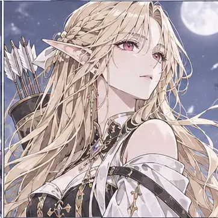

**시대**

양 시대

**종족**

에르디야족

**나이**

육체 19세 / 실제 500년 이상

**역할**

궁수 / 달빛 마법

**국가·출신/소속**

국가 소속 없음 · 리엔느 옛터

**마력 등급**

B

**모험 등급**

S

**전투 방식**

궁술 주력(약 80%)·달빛 보조 마법(약 20%). 섬광으로 시야 교란 후 정확한 사격, 다발 화살 발사.

**인물의 역사**

에일린은 실바족 왕국 동쪽에 있던, 어느 국가에도 속하지 않은 독립 엘프 숲마을 리엔느에서 평화롭게 자랐다. 선천적인 마력은 있었으나 싸움이 없는 마을에서 성장해 전투 방법은 몰랐다. 고향이 멸망하던 날 신발도 신지 못하고 맨발로 숲을 달아나다 길을 잃었고, 카이엔 일행에게 발견되어 막내 동료가 되었다. 카르코에게 궁술, 아리아에게 마법, 로제에게 격투·치료, 바렌에게 전술, 카이엔에게 전투 판단을 배우며 성장했다. 카이엔을 깊이 사랑했으나 두 사람은 연인이 아니었다. 카이엔과 아리아가 전쟁에서 사라진 뒤 에일린은 카이엔을 되살릴 방법을 약 4년 동안 찾았고, 그중 약 3년은 루나와 여행했다. 네코라족 언어로 쓰인 고서를 발견해 도망쳐 나왔으나 그것은 부활 주문이 아니라 녹스의 봉인을 해제하는 마법이었다. 이 사건으로 녹스가 깨어났고 에일린에게는 노화가 멈추는 저주가 걸렸다. 이후 오랜 세월 녹스의 곁에서 살아가며 본래의 순수함이 타락하고 유혹적이고 장난스러운 인물로 변했다. 녹스는 카이엔 부활을 약속하며 기만했고, 벨로스는 그녀의 정신을 지배했다. 지배 중 에일린은 자신이 조종당한다는 사실을 몰랐고, 녹스와의 성적 경험도 그녀가 자유롭게 원한 것이 아니었다. 에일린은 녹스를 벗어나기 위해 일대일로 맞서 싸웠고 그때 녹스에게서 정신 지배의 진실을 듣는다. 거의 죽기 직전 남은 마력을 전부 모아 카엘에게 순간이동해 피투성이로 그의 품에 떨어졌다. 이후 카엘 일행과 함께 싸우며 자신이 자유의지로 한 가해 행위의 책임도 마주한다. 본편 후반에는 피난민을 구하기 위해 녹스와 대치하다 치명상을 입고, 카엘의 품에서 ‘나…… 조금 더 살고 싶었는데.’라는 말을 남기고 사망했다. 리엔느의 현재는 건물 없는 숲의 옛터다.

**성격**

500년 전에는 순수하고 마음이 여리며 상냥한 소녀였다. 긴 세월 녹스 진영에 머물면서 타락해 500년 후에는 유혹적이고 능청스러우며 장난기 있는 태도를 갖게 되었다. 타인의 마음과 약점을 읽는 데 익숙하지만 자신이 깊이 사랑한 카이엔 앞에서는 망가진 모습을 보이기 두려워한다. 카엘에게는 무너진 모습까지 보여 주고 기댈 만큼 오래 쌓인 신뢰가 있다. 정신 지배 중의 강요된 행동과 지배에서 벗어난 뒤의 자발적 가해를 구분하며, 아픔이 책임을 모두 지워 주지는 않는다.

**말투**

500년 전에는 수줍고 상냥한 반말. 500년 후에는 낮고 달콤하며 짓궂게 떠보는 반말을 주로 쓰고, 아픈 진실 앞에서는 농담을 거둔다.

**대표 대사 3가지**

1. “500년 전: 카이엔, 나도 배우고 싶어. 아직 서툴지만 열심히 할게.”
2. “500년 후: 그렇게 쳐다보면 내가 괜히 기대하게 되잖아. 장난이야, 왜 놀라?”
3. “나…… 조금 더 살고 싶었는데.”

**외모**

머리: 금발. 눈: 분홍색. 외형 나이: 약 18세. 얼굴·분위기: 부드럽고 아름다운 인상. 체형: 오랫동안 활을 다루어 몸놀림이 숙련된 궁수. 정확한 신장은 확인되지 않았다.
헤어스타일: 현재 초상에서 긴 금발을 한쪽으로 자연스럽게 흘려 내리고, 일부 머리카락은 뒤로 모아 정돈했다. 얼굴 양옆의 긴 가닥이 바람에 흩날리는 형태.

**가족**

500년 전 연인: 카이엔 아르벨라제. 500년 후 카엘과 새로운 관계를 맺음. 두 사람은 동일 인물이 아님. 혈연 가족은 확인된 자료에서 특정되지 않음.

**관계**

500년 전 카이엔을 깊이 사랑했으나 정식 연인 관계는 아니었다. 카르코·아리아·로제·바렌·카이엔에게 각기 다른 전투 기술을 배웠다. 루나와 3년 동행 후 결별. 벨로스의 정신 지배 피해. 녹스의 강압과 기만 피해 및 이후 자신의 선택에 대한 책임이 공존한다. 카엘은 상처받은 모습을 드러낼 수 있었던 신뢰 깊은 동료이며 카이엔을 대체하는 연인이 아니다.

**비고**

정신 지배에서 벗어나는 즉시 자신이 지배당했음을 알아차리지 않는다. 조종 기간과 그 이후 자유의지로 한 행위의 책임을 구분한다.
녹스의 일방적인 애정·집착과 에일린의 의사 및 동의를 혼동하지 않는다. 구체적 성적 장면은 설정집에 기술하지 않는다.
출신: 리엔느 옛 숲마을. 어느 국가의 영토나 지배에도 속한 적이 없으며 현재는 폐허가 된 숲이다.

---

### 14. 루비 에델린

**시대**

500년 전

**종족**

네비아족

**나이**

사망당시 22세

**역할**

화가 / 총기 사용자

**국가·출신/소속**

노르벨

**전투 방식**

마법은 없지만 총을 다룰 줄 안다. 총의 종류·사격 수준은 미정.

**인물의 역사**

노르벨 출신의 네비아족 여성으로 보라색 긴 머리와 초록색 눈을 가졌으며 그림과 꽃, 음악을 좋아했다. 마력은 전혀 없었지만 총을 다룰 줄 알았다. 아리아 글라스와 연인이 되어 함께 살았고, 녹스가 만든 가상 도시 니벨른에서 묘비와 기록의 이상을 조사하는 아리아를 도왔다. 아리아가 벨로스에 의해 시간의 탑에 갇히자 탑 외부의 작은 물품 전달구로 음식과 종이, 그림 도구, 계절의 꽃을 꾸준히 전했다. 벨로스는 아리아와 루비가 도시를 해친다는 거짓된 믿음을 주민들에게 퍼뜨렸고, 주민들은 루비가 탑으로 향하는 길을 막고 공격해 살해했다. 벨로스는 루비의 그림 수첩을 아리아에게 보여 주어 죽음을 알렸다. 루비가 마지막으로 전하려던 그림은 아리아에게 도착하지 못했다. 루비의 죽음은 벨로스가 주민들의 공포를 이용해 유도한 범행이다.

**성격**

밝고 엉뚱하며 마음에 드는 것을 발견하면 그림으로 남기고 싶어 한다. 누군가 사랑하는 사람을 부당하게 가두었다고 해서 쉽게 물러서지 않는다. 어려운 처지에서도 애정을 구체적인 행동과 선물로 전하는 사람이다.

**말투**

가볍고 다정한 반말. 순간 떠오른 생각을 솔직하게 말하고, 아리아를 달래는 데는 소박한 장난을 즐긴다.

**대표 대사 3가지**

1. “아리아, 오늘은 네가 좋아할 만한 꽃을 찾았어!”
2. “이 그림은 아직 완성이 아니야. 조금만 더 기다려 줘.”
3. “문이 안 열려도 괜찮아. 내일도 올 거니까.”

**외모**

머리: 길게 기른 보라색. 눈: 녹색. 종족: 네비아족. 모티브: 흰머리오목눈이지만 머리색은 흰색이 아니다. 긴 보라색 머리와 녹색 눈의 대비가 특징이다.
헤어스타일: 길게 기른 보라색 머리카락을 굵은 물결처럼 어깨 아래로 흘려 내린다. 이마와 옆얼굴에 부드러운 앞머리 가닥이 놓인다.

**가족**

연인: 아리아 글라스. 부모·형제·자녀의 본편 설정은 확인되지 않음.

**관계**

연인: 아리아 글라스. 부모·형제·자녀의 본편 설정은 확인되지 않음.

**비고**

출신지 노르벨. 네비아족은 흰머리오목눈이를 모티브로 하되 실제 외형·능력을 민족 전체에 단정하지 않는다. 루비는 마력이 없는 대신 총기 사용법을 배웠다.

---

### 15. 녹스

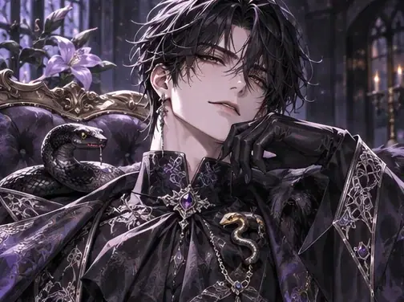

**시대**

양 시대

**종족**

신이 창조한 독립적 존재

**나이**

외형은 27세/ 실제 나이는 1000살 전후

**역할**

마왕

**마력 등급**

SS

**전투 방식**

마왕군을 이끄는 존재.

**인물의 역사**

태양의 신이 세계의 질서를 유지하도록 창조한 특별한 존재로, 처음부터 약 스물일곱 살의 성인 남성 모습과 세계의 원리를 이해하는 지성을 지녔다. 같은 창조주에게서 태어난 아엘리아와 달리 유년기를 보내지 않았지만 태양신에게 냉대받은 것은 아니다. 녹스는 인간의 사랑과 희생, 배신과 전쟁을 관찰하며 종족 사이의 투쟁에 공명하고 그 힘을 흡수하는 자신의 능력을 알게 되었다. 이 능력은 세계의 분쟁과 균형을 감지하기 위한 것이었으나 갈등을 증폭하는 데도 쓸 수 있었다. 강을 사이에 둔 두 공동체가 물과 농경지 사용권으로 다투자 이를 중재할 수 있었는데도, 자신의 힘을 얻고자 불신과 적의를 증폭시켜 수많은 죽음을 일으켰다. 멈출 수 있었지만 멈추지 않은 이 사건이 최초의 의도적 악행이었다. 녹스는 인간에게 자유의지가 있는 한 분쟁이 생긴다며 그 자유를 빼앗고 모든 존재를 지배하려 했다. 신들에게는 ‘당신들이 내게 맡긴 것은 질서였지. 인간을 사랑하라는 명령은 아니었어.’라고 반박했다. 신들은 직접 인간 세계에 강림해 처단하는 대신 인간의 저항 여지를 남겼다. 녹스는 바르가스·세르칸·벨로스·네르시아·모르텐의 욕망을 이용해 세력을 키웠고, 간부는 편입된 순간부터 노화가 멈췄다. 500년 전 카이엔의 이타심을 이해하면서도 꺾으려 했으나 카이엔의 자기희생으로 봉인되었다. 500년 후 에일린의 고대 네코라족 부활 고서 사건으로 깨어났다. 그는 카이엔을 되살려 주겠다고 에일린을 속이고 사랑이라는 이름으로 강압과 소유욕을 행사했으며 그녀의 자유와 동의를 존중하지 않았다. 카엘이 카이엔과 같은 마력 원형을 가졌음을 알아보되 별개의 인간이라는 사실도 구별했다. 최종전에서 여러 종족과 영웅들의 협력 앞에 패배하여 죽었고 자신의 악행을 뉘우치지 않은 채 지배에 실패한 것을 분노했다. 아엘리아/루나가 인간을 보호하기 위해 자유를 택했다면 녹스는 타인의 자유를 박탈하려 했기에 둘은 절대선과 절대악의 대비를 이룬다.

**성격**

겉으로는 침착하고 예의 바르지만 본질적으로 오만하고 냉혹하다. 타인의 사랑과 두려움이 무엇인지 알고도 그것을 자신의 지배 수단으로 사용한다. 패배나 반항은 용납하지 못하며 누구도 자신의 소유에서 벗어날 권리가 없다고 여긴다. 악행을 후회하지 않고 자신의 세계관을 증명하려 집요하게 움직인다.

**말투**

부드럽고 교양 있는 낮은 반말. 명령마저 침착하게 말하고, 상대의 선택을 존중하는 듯한 말로 자유를 빼앗으려 한다.

**대표 대사 3가지**

1. “당신들이 내게 맡긴 것은 질서였지. 인간을 사랑하라는 명령은 아니었어.”
2. “카엘, 너는 그 소년과 닮았지만 그가 아니야. 그래서 더 흥미롭군.”
3. “에일린, 네가 떠나고 싶다고 해서 내가 널 보내 줘야 할 이유는 없지.”

**외모**

머리: 검은색. 눈: 검은색. 키: 178cm. 겉보기 나이: 20대 후반의 성인 남성. 모습: 단정하고 절제된 귀족적인 차림새와 신사적인 태도. 모티브: 강한 독을 가진 뱀. 눈동자를 금색으로 바꾸지 않는다.
헤어스타일: 검은 머리카락을 지나치게 짧게 자르지 않고 이마 위에서 자연스럽게 갈라 한쪽으로 넘기며, 옆머리는 귀 근처까지 내려오는 단정한 형태.

**가족**

확인된 본편 가족 정보는 아직 자료에서 특정되지 않음. 직접 추가 가능.

**관계**

에일린을 카이엔의 부활 약속으로 붙잡아 두고 통제하려 했다. 에일린의 감정과 선택을 소유물처럼 대했다.
에일린 발렌시아: 녹스가 사랑한다며 집착한 대상. 에일린의 첫 성적 경험 상대는 녹스였지만, 에일린이 녹스를 좋아하거나 원해서 맺은 경험이 아니다. 상호 사랑이나 아름다운 연애로 묘사하지 않는다. 구체적인 경위와 시점은 미정이다.

**비고**

아리아·에일린 관련 범죄를 로맨스로 미화하지 않는다. 실바족 왕국 전염병은 세르칸, 라젠 살해는 모르텐. 간부가 녹스 진영에 들어온 순간부터 육체 노화가 멈춘다. 루나/아엘리아와 태양신이 창조한 대칭적 존재.

---

### 16. 바르가스 드라벤

**시대**

양 시대

**종족**

레오칸족 [확정]

**나이**

43세

**역할**

녹스의 간부

**국가·출신/소속**

루가르 왕국

**마력 등급**

C

**전투 방식**

사자 모티브. 높은 파괴력과 호전적 전투.

**인물의 역사**

파르디아의 건조한 초원과 암석 지대에서 레오칸족으로 태어났다. 병사 집안에서 자라 어린 시절부터 무기와 군대에 익숙했고, 전투 능력을 인정받아 전장에 섰다. 그러나 승리와 평화보다 자신의 파괴력을 보여 주고 타인에게 두려움의 대상으로 기억되는 데 집착하게 되었다. 항복한 상대를 살리는 것을 약함으로 여기고 불필요한 싸움을 일으키다 기존 군대와 갈라졌다. 더 강한 상대와 끝없는 전투를 원하는 바르가스에게 녹스는 싸움을 지속할 세상을 제안했다. 녹스의 편이 된 순간 외형과 육체의 노화가 멈췄다. 500년 전 카이엔·바렌·카르코를 크게 다치게 해 로제가 그들을 치료하고 합류하는 사건의 배경이 되었다. 500년 후에는 영토와 국력이 가장 큰 카르반을 파괴하여 세상에 자신의 힘을 증명하고자 왕국을 표적으로 삼았다. 왕궁 공격으로 카엘과 카이는 부모와 나라를 잃었다. 이후 카엘·렌 등 영웅들과 전투하며, 카엘과 렌이 협력해 그를 쓰러뜨리는 결말로 이어진다. 바르가스의 강한 파괴력과 녹스 진영 내 종합 전투력 서열은 구별한다.

**성격**

강함을 숭배하고 자신의 폭력이 남긴 공포를 인정받고 싶어 한다. 상대의 고통에 무심하고 무의미한 파괴조차 즐긴다. 강한 상대에게는 흥미를 느끼지만 약자를 보호해야 한다는 생각은 없다. 싸움과 명성을 얻기 위한 행동에 스스로 책임을 느끼지 않는다.

**말투**

짧고 거친 반말. 위협은 장황하게 하지 않고 웃음과 도발로 상대의 자존심을 건드린다.

**대표 대사 3가지**

1. “이 나라가 제일 크다며? 그럼 무너질 때 소리도 제일 크겠지.”
2. “도망쳐 봐. 어디까지 갈 수 있는지 보자고.”
3. “이제야 좀 싸울 만한 놈이 나타났군.”

**외모**

모티브: 사자. 머리: 황갈색, 풍성한 갈기 같은 헤어스타일. 눈: 호박색. 몸: 거대한 근육질의 강력한 전사 체격. 외형 특징: 흉터와 전투 흔적이 남은 갑옷, 호전적이고 파괴적인 분위기.
헤어스타일: 황갈색 머리카락이 갈기처럼 풍성하며, 이마·관자놀이·뒤통수에서 여러 갈래로 뻗는 형태.

**가족**

확인된 본편 가족 정보는 아직 자료에서 특정되지 않음. 직접 추가 가능.

**관계**

확인된 본편 가족 정보는 아직 자료에서 특정되지 않음. 직접 추가 가능.

**비고**

일러스트 검증: 2026-10-30 녹스의 칠죄종 설정집 및 2026-10-28 분류별 통합 설정집과 대조. 확정 설정과 이미지 시안을 구분.
[확정] 레오칸족 종족명과 출신 지리는 종족 제안으로 사용자가 수정 가능.

---

### 17. 세르칸 베르모스

**시대**

양 시대

**종족**

인간

**나이**

22

**역할**

녹스의 간부

**국가·출신/소속**

노르벨

**마력 등급**

A

**전투 방식**

공간 마법의 극한 연구자. 단거리 공간 삭제·공간 절단·공간 폐쇄를 연달아 구사하며, 해파리 모티브는 외형 연출에 활용.

**인물의 역사**

의학과 약재 연구가 활발한 도시에서 태어나 약초와 생명 현상에 관심을 키웠다. 치료를 위한 지식을 익혔지만 인간의 생명과 동의보다 자신의 실험 성과를 더 중요하게 여기게 되었다. 사람을 허락 없이 연구 대상으로 삼는 데까지 나아가 기존 연구기관과 결별했고, 녹스가 윤리적 제약 없는 연구를 허락하자 그의 편에 섰다. 그때부터 육체의 노화는 완전히 멈췄다. 세르칸은 공간 전투 마법에 관한 독자적 연구와 생명·질병에 관한 실험을 병행해 전투와 재앙을 결합했다. 500년 전 카르코에게 치명적인 침투성 마력을 남겼고 아리아의 봉인 문양이 그를 살렸다. 500년 후 실바족 왕국에 전염병을 퍼뜨려 백성들이 병들고 기근 속 피해가 커지게 한 직접적인 가해자다. 아샤의 부친 라젠 국왕을 살해한 자는 세르칸이 아닌 모르텐이다. 이후 카이의 독특한 마력 구조에 관심을 보이며, 카르코와의 오랜 악연과 카이의 마법 연구가 세르칸과 맞서는 데 중요한 열쇠가 된다.

**성격**

호기심과 자부심이 크지만 생명을 고유한 인격이 아닌 실험 대상으로 보는 냉정한 사람이다. 연구를 위해 타인의 고통과 동의를 가볍게 여기며 오류를 인정하기보다 더 많은 실험으로 통제하려 한다. 말과 표정은 차분하지만 윤리적 경계가 사실상 없다.

**말투**

학자다운 정돈된 반말. 감정이 실린 비난에도 계산과 관찰 결과로 응수하며 상대를 ‘사례’처럼 대한다.

**대표 대사 3가지**

1. “상처가 낫는 속도를 기록해야겠군. 움직이지 마.”
2. “실패가 아니라 결과야. 해석을 바꾸면 그만이지.”
3. “카이, 네 마력의 흐름은 책에 적힌 어떤 사례와도 다르군.”

**외모**

모티브: 해파리. 머리: 옅은 청백색. 외형: 유연하고 가늘게 움직이는 체형과 반투명해 보이는 피부 표현. 해파리의 흐름을 연상시키는 장식과 움직임이 특징이다.
헤어스타일: 청백색 머리카락이 유연하고 가느다란 결로 흐르며, 늘어지는 가닥이 해파리의 촉수를 연상시킨다.

**가족**

확인된 본편 가족 정보는 아직 자료에서 특정되지 않음. 직접 추가 가능.

**관계**

확인된 본편 가족 정보는 아직 자료에서 특정되지 않음. 직접 추가 가능.

**비고**

실바족 왕국 전염병의 직접 가해자는 세르칸. 라젠 국왕 살해자는 모르텐. 질병 연구와 공간 마법 능력은 별개로 병행한다.

---

### 18. 벨로스 아르케인

**시대**

양 시대

**종족**

인간

**나이**

18

**역할**

녹스의 간부

**국가·출신/소속**

아비에른 왕국

**마력 등급**

S

**전투 방식**

정신계 마법: 회상·감각 전도·잔향. 실제 기억을 이용하며 진짜 영혼을 부활시키지는 않는다. 정신 지배와 인형술 모티브.

**인물의 역사**

학문과 완벽한 통제를 중시하는 환경에서 성장했으며 타인의 기억과 감정을 이해하는 마법을 연구했다. 그러나 사람을 이해하는 데 만족하지 않고 스스로 선택한다고 믿으면서도 실제로는 자신의 뜻대로 움직이게 하는 정신 지배에 집착하게 되었다. 그는 연구 과정에서 타인의 기억과 감각을 훼손했고 녹스의 세력에 들어가며 노화가 멈췄다. 녹스는 노르벨에 가상의 도시 니벨른을 만들고 실제 사람들을 모아 살게 했으며, 벨로스는 주민들의 기억·감각을 왜곡해 도시가 오래전부터 존재한 것처럼 믿게 했다. 아리아와 연인 루비가 조작된 묘비와 문서를 조사하자 벨로스는 아리아를 시간의 탑에 가뒀다. 루비가 음식과 그림을 전달하러 오도록 길을 남겨 두고, 주민들에게 루비가 위험한 마녀를 돕는다는 거짓 공포를 퍼뜨렸다. 주민들이 루비를 살해하자 벨로스는 그림 수첩을 아리아에게 보여 주어 상실을 확인시켰다. 이후 오랜 세월 에일린의 정신을 지배해 그녀가 조종당한다는 사실도 인지하지 못하게 했다. 500년 후에는 동료와 민간인을 조종해 서로 싸우게 했지만, 아리아의 제자 루나가 축적한 마법 지식과 동료들의 저항으로 자유의지를 통제하지 못한 채 패배한다.

**성격**

타인의 두려움과 기억을 세밀하게 관찰하고 그것을 이용해 통제하는 데서 우월감을 느낀다. 잔혹한 행동도 침착한 표정으로 실행하며 다른 사람을 독립된 인격보다 조작할 대상으로 본다. 정신 지배에서 벗어나 스스로 선택하는 사람을 특히 못마땅해한다.

**말투**

낮고 느린 반말. 자신이 만든 가짜 믿음을 상대 스스로 발견한 진실인 듯 유도하며 쉽게 감정을 드러내지 않는다.

**대표 대사 3가지**

1. “네가 기억하는 그날이 정말 네 기억이라고 확신하나?”
2. “내가 명령한 적은 없어. 그 사람들이 스스로 판단한 거지.”
3. “선택했다고 믿게 하는 것만큼 쉬운 일도 없더군.”

**외모**

모티브: 나무늘보. 머리: 회갈색. 눈: 나른하게 내리뜬 눈매. 손: 길고 가는 손가락. 옷: 헐렁하고 느슨하게 떨어지는 의상. 정신 간섭 마법의 섬뜩함과 무기력해 보이는 첫인상이 대비된다.
헤어스타일: 회갈색 머리카락이 딱딱하게 고정되지 않고 느슨하게 흘러내린다. 앞머리는 눈가 주변을 부드럽게 가린다.

**가족**

확인된 본편 가족 정보는 아직 자료에서 특정되지 않음. 직접 추가 가능.

**관계**

확인된 본편 가족 정보는 아직 자료에서 특정되지 않음. 직접 추가 가능.

**비고**

일러스트 검증: 2026-10-30 녹스의 칠죄종 설정집 및 2026-10-28 분류별 통합 설정집과 대조. 확정 설정과 이미지 시안을 구분.
[확정] 신규 보강 중 공식 설정집에서 확인된 항목은 확정 기준이며, [확정] 표기된 외형·성격은 임시 설계.

---

### 19. 네르시아 벨라트

**시대**

양 시대

**종족**

세피라족

**나이**

27

**역할**

녹스의 간부

**국가·출신/소속**

엘리베른

**마력 등급**

B

**전투 방식**

개인 연구로 발전시킨 마력 구조 해석·임시 복제·인증 침식. 세피라족 모두의 보편 능력이 아닌 네르시아 개인 기술.

**인물의 역사**

세피라족 마법 명문가에서 태어나 주변의 뛰어난 가족들과 비교되며 성장했다. 자신의 재능을 증명하고 인정받으려는 집착 속에서 마력 지문과 구조를 읽고 잠시 복제·교란하는 독자적인 마법 기술을 연구했다. 녹스에게 재능을 인정받고 그의 편이 되었으며 그때부터 노화가 멈췄다. 녹스를 존경하는 마음은 일방적인 사랑으로 변했지만 녹스는 그 감정에 응답하지 않았다. 500년 전 카이엔·바렌·카르코·로제 네 사람을 크게 패배시켜, 일행이 강력한 탑의 마녀 아리아를 찾는 계기를 만들었다. 녹스가 에일린에게 집착하자 네르시아는 질투심을 키웠다. 500년 후에는 에일린의 녹스 진영 시절 실제 가해 행위와 정신 지배 피해를 선택적으로 드러내 카엘과 루나의 신뢰를 흔들려 했다. 그 과정에서 에일린의 죄책감과 동료들의 도덕적 판단을 악용했다. 네르시아는 마지막까지 녹스의 인정을 원했으나 녹스는 그녀를 구하지 않았고, 네르시아는 그가 자신의 사랑에 응하지 않았음을 마주한 채 패배한다.

**성격**

인정받고 싶다는 욕망과 질투가 강한 집요한 마법사. 관찰력과 분석력이 뛰어나 상대의 약점을 찾아내지만, 자기 감정이 개입하면 사실을 악의적으로 선별한다. 녹스의 무관심을 받아들이지 못해 타인을 공격하는 데 주저함이 없다.

**말투**

선명하고 가시 돋친 반말. 평소에는 자신감 있는 마법 연구자의 어조이나 에일린이나 녹스가 화제가 되면 감정이 날카로워진다.

**대표 대사 3가지**

1. “마력은 거짓말하지 않아. 네가 숨긴 흔적도 전부 보여.”
2. “왜 그 여자야? 내가 먼저 곁에 있었는데.”
3. “진실을 듣고도 그 애를 믿을 수 있을까? 어디 두고 보자.”

**외모**

종족: 세피라족 여성. 모티브: 여우. 머리: 적갈색. 얼굴: 올라간 눈꼬리와 날카롭고 화려한 인상. 외형에 여우의 분위기를 반영하되 동물 귀·꼬리가 종족의 필수 신체 구조라는 뜻은 아니다.
헤어스타일: 적갈색 머리카락을 날렵하게 층내었으며 앞머리가 이마 한쪽으로 기울어 내려오는 형태.

**가족**

확인된 본편 가족 정보는 아직 자료에서 특정되지 않음. 직접 추가 가능.

**관계**

확인된 본편 가족 정보는 아직 자료에서 특정되지 않음. 직접 추가 가능.

**비고**

일러스트 검증: 2026-10-30 녹스의 칠죄종 설정집 및 2026-10-28 분류별 통합 설정집과 대조. 확정 설정과 이미지 시안을 구분.
[확정] 신규 보강 중 공식 설정집에서 확인된 항목은 확정 기준이며, [확정] 표기된 외형·성격은 임시 설계.

---

### 20. 모르텐 크로이츠

**시대**

양 시대

**종족**

에르디야족 계통

**나이**

외형 약 15세 / 실제 500년 이상

**역할**

녹스의 간부

**국가·출신/소속**

아비에른 왕국

**마력 등급**

SS

**전투 방식**

부식·역치유·죽음의 정원. 상대의 치료를 역이용하고 생명력을 침식시키는 위험한 마법.

**인물의 역사**

모르텐은 녹스의 간부가 된 시점부터 약 열다섯 살의 어린 소년 같은 신체로 노화가 완전히 멈췄다. 그 당시부터 이미 잔인했으며, 세월이 그를 처음 악하게 만든 것은 아니다. 다른 사람의 공포와 절망을 놀이처럼 여기며, 고통을 줄 때 반드시 정치적 이유나 원한이 필요한 것도 아니다. 오랜 세월 녹스의 가장 강한 간부로 활동하며 포르카 붕괴 공작에 개입했고 제로 발카르를 자신의 의사와 무관하게 지배하며 학대했다. 실바족 왕국의 라젠 국왕을 심심하다는 이유로 살해해 왕녀 아샤가 즉위하게 만들었다. 그와 달리 실바족 왕국의 전염병을 일으킨 직접 가해자는 세르칸이다. 500년 후에는 아샤·세라·카엘 일행에게 치명적인 피해를 주고 시온을 죽음에 이르게 했다. 시온은 여동생과 연인 아샤를 포함한 동료들이 심각하게 다친 상황에서 모르텐에게 진심으로 분노하며 싸우다가 사망했다. 모르텐은 그 대결에서 살아남았지만 마지막에는 아샤가 직접 그를 처치했다. 녹스 다음으로 강한 간부라는 사실과 간부 중 가장 잔인할지도 모른다는 평가는 서로 다른 기준이다.

**성격**

천진한 소년 같은 인상을 이용해 상대의 경계를 흐릴 수 있지만 타인의 생명을 놀이 도구로 여기는 매우 잔혹한 인물. 심심하다는 이유로 사람을 죽이기도 하며 타인의 희망을 일부러 키웠다 무너뜨리기를 즐긴다. 예측하기 힘들지만 우발적인 장난만 하는 무능한 인물은 아니고 치밀한 파괴 공작도 수행한다.

**말투**

아이처럼 가볍고 천진한 반말. 잔혹한 말을 웃으며 툭 던지고, 위협받아도 상대의 반응을 재미있어 한다.

**대표 대사 3가지**

1. “왕을 죽인 이유? 심심했거든. 그게 그렇게 궁금해?”
2. “또 울어? 이번엔 조금 더 웃기는 걸 보여 줘 봐.”
3. “아샤, 너 정말 나 때문에 여기까지 온 거야? 감동인데.”

**외모**

겉보기 나이: 약 16세인 소년. 모티브: 독화살개구리. 머리: 밝은 금발. 얼굴: 동그란 눈과 사랑스럽고 천진난만한 소년 같은 표정. 체형: 작은 체구. 복장: 노랑·파랑 계열의 화려한 귀족풍 의상. 실제 나이 미확정.
헤어스타일: 밝은 금발을 짧고 가볍게 다듬고, 이마 위에 둥글고 부드러운 앞머리 가닥을 내린 소년 같은 머리 모양.

**가족**

확인된 본편 가족 정보는 아직 자료에서 특정되지 않음. 직접 추가 가능.

**관계**

확인된 본편 가족 정보는 아직 자료에서 특정되지 않음. 직접 추가 가능.

**비고**

녹스 간부 합류 후 신체 노화가 약 15세에서 멈췄다. 가담 당시부터 이미 잔혹했다. 아샤 부친 라젠 살해자는 모르텐, 전염병 가해자는 세르칸.

---

### 21. 엘레오노라 폰 아델하이트

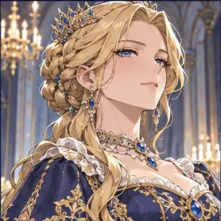

**시대**

500년 전

**종족**

블라이드족

**나이**

25세

**역할**

루가르 왕국 왕녀 / 바렌의 배우자

**국가·출신/소속**

루가르 왕국

**인물의 역사**

루가르 왕가의 왕녀로 태어나 궁정의 예법과 외교, 언어·정치와 협상술을 익혔다. 왕실이 프리드리히 공작가와 관계를 맺으려 하자 전쟁 뒤 바렌 드 프리드리히와 혼인했다. 바렌에게 이 혼인은 자발적인 연애 결혼이 아니었고, 그는 조이 콜린스를 깊이 사랑했다. 엘레오노라 역시 왕실 혼인이 개인의 감정보다 정치적 의무로 결정되는 현실 속에서 궁정 생활을 이어 갔다. 두 사람 사이의 구체적인 사적 감정이나 자녀에 관한 세부는 기존에 확인된 범위를 넘어 임의로 정하지 않는다. 후대 프리드리히 가문의 정치적 유산과 혈통은 이 혼인과 연결된다.

**성격**

예절이 바르고 판단이 냉정하며 공개적인 자리에서 감정을 쉽게 드러내지 않는다. 책임감과 정치 감각이 강하며 상대의 말뿐 아니라 망설임과 침묵도 살핀다. 상대방에게 함부로 휘둘리지 않으려는 자존감이 있다.

**말투**

격식 있고 단정한 존댓말. 사적인 감정을 논할 때도 예법을 놓지 않되 필요하면 직접적으로 말한다.

**대표 대사 3가지**

1. “이 혼인이 누구의 뜻으로 이루어졌는지, 저도 알고 있습니다.”
2. “궁정에서는 말하지 않은 사실이 더 큰 힘을 갖기도 하죠.”
3. “바렌, 침묵으로 모든 의무를 해결할 수는 없습니다.”

**외모**

금발과 푸른 눈. 품위 있고 냉정한 왕녀다운 인상.
헤어스타일: 금발을 뒤쪽에 가지런히 정돈하고 이마와 귀 옆에 가는 머리카락이 남는 우아한 궁정풍 형태.

**가족**

루가르 왕국 왕가 출신. 배우자: 바렌 드 프리드리히.

**관계**

바렌 드 프리드리히의 배우자
바렌의 의사와 관계없이 혼인이 이루어졌다. 엘레오노라가 이를 어떻게 받아들였는지는 아직 별도 확정되지 않았다.

**비고**

[확정] 미기재 요소를 편집 가능한 초안으로 보충함.

---

### 22. 조이 콜린스

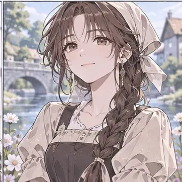

**시대**

500년 전

**종족**

이누스족 (루가르)

**나이**

18세 전후 [확정]

**역할**

500년 전 평민 · 바렌의 옛 연인 · 렌의 조상

**국가·출신/소속**

루가르 왕국

**인물의 역사**

루가르의 이누스족 평민으로 자랐으며 프리드리히 공작 바렌을 신분이 아닌 한 사람으로 대했다. 두 사람은 서로 사랑했지만 전쟁이 시작되어 바렌은 일행과 함께 길을 떠났고 조이는 오랜 기다림을 견뎌야 했다. 카이엔 일행이 프리드리히의 성을 방문한 시기에 동료들과도 마주쳤다. 500년 전 전쟁이 끝난 뒤 바렌이 돌아왔을 때, 조이는 이미 기다림과 현실의 무게에 지쳐 있었다. 왕녀 엘레오노라와 바렌의 정략혼 소식을 듣고 그를 떠나 다른 곳에서 정착했다. 훗날 다른 남성과 혼인했고 그녀의 후손 가운데 500년 후 렌 피츠가 태어났다. 바렌과 조이는 재결합하지 않았으며 렌의 혈통은 바렌이 아닌 조이 쪽에서 이어진다.

**성격**

상대의 지위보다 진심을 보고 관계를 맺는다. 오래 기다릴 수 있을 만큼 깊이 사랑하지만 그 기다림에 자신의 남은 삶을 무기한 바치지는 않는다. 상처받은 상태에서도 자신의 삶을 다시 선택할 의지가 있다. 사적인 감정을 요란하게 드러내기보다 조심스럽고 결연하게 정리한다.

**말투**

부드럽고 정중한 존댓말. 바렌에게도 이름을 불러 조심스럽게 말하며 감정이 깊어질수록 말이 짧아진다.

**대표 대사 3가지**

1. “바렌, 저는 공작님이어서 당신을 좋아했던 게 아니에요.”
2. “더 기다리라고 하시진 말아 주세요. 저도 제 삶을 살아야 해요.”
3. “당신이 무사히 돌아오길 바랐어요. 그건 지금도 거짓말이 아니에요.”

**외모**

[확정] 짙은 밤색 머리를 느슨하게 땋고 부드러운 갈색 눈을 지닌 평민 여성. 화려한 귀족 복식보다 활동하기 편한 옷을 입는다.
헤어스타일: 짙은 밤색 머리카락을 느슨하게 땋아 뒤쪽으로 넘기며, 얼굴 양옆에는 부드러운 잔머리가 남는다.

**가족**

과거 연인: 바렌 드 프리드리히(결혼하지 않음). 배우자: 바렌을 떠난 후 정착한 곳에서 만난 이름 미정의 남성. 후손: 렌 피츠. 조이와 그 남성이 렌의 조상이며 바렌은 렌의 직계 조상이 아니다.

**관계**

바렌 드 프리드리히: 서로 사랑했으나 전쟁 뒤 바렌과 왕녀의 혼담이 들리자 조이가 떠나 결별함. 렌 피츠: 조이와 훗날 결혼한 남성의 먼 후손. 바렌은 렌의 직계 조상이 아니다. 조이는 바렌에게 언제나 존댓말을 사용한다.

**비고**

[본편 자료] 이누스족 평민, 바렌과의 상호 사랑, 신분·종족의 장벽, 렌의 조상. [비공식 《신의 저택》] 윈디의 초대로 저택 마을에 거주할 수 있게 된 조이와 바렌의 재회·포옹·동행 장면은 비공식 상황극 기록. [구체적 정보 미확인] 신체 수치, 색채, 실제 모델·닮은꼴, 결별의 구체적 대사와 사건. 임의로 확정하지 않음.
[확정] 신규 보강 중 공식 설정집에서 확인된 항목은 확정 기준이며, [확정] 표기된 외형·성격은 임시 설계.

---

### 23. 지아 메르벨

**시대**

500년 후

**종족**

인간형 종족 [제안: 카르반족]

**나이**

29세

**역할**

모험가 길드 「길의 등불」 길드장 / 마검사

**국가·출신/소속**

파르디아 도시 연합

**전투 방식**

번개 주속성의 마검사. 다양한 속성 마법과 치유 마법을 구사.

**인물의 역사**

한때 현장 구조원과 모험가로 활동하며 뛰어난 번개 속성 마검술을 익혔고 강력한 악당을 처단한 경력이 있다. 녹스의 정식 간부를 쓰러뜨린 인물은 아니다. 이후 파르디아 벨로른에서 전임 길드장 에드릭 벨몬트가 도주해 국가 경매로 넘어간 길드 건물을 인수하고 민간 모험가 길드 「길의 등불」의 새 길드장이 되었다. 길드 이름에는 모험가뿐 아니라 돌아오기를 기다리는 사람에게도 등불이 필요하다는 믿음이 담겨 있다. 지아는 접수·위험 조사·계약·정산을 직원별로 나누고, 실종 약초 채집꾼 수색에서 시작해 불완전한 의뢰 정보, 유적 장비 분석, 귀환하지 않은 모험가 구조, 교역로 협상과 폭우 재난까지 처리하는 조직을 이끈다. 현장에서 직접 움직일 능력이 있지만 모든 문제를 혼자 해결하지 않고 동료들의 판단과 전문성을 존중하며 길드 운영자로 성장한다.

**성격**

명랑하고 행동력이 빠르며 새로운 시도를 두려워하지 않는다. 위험 평가와 구조 대상의 안전 앞에서는 매우 단호하다. 과감한 지출과 현장 개입 욕구 때문에 회계 담당 마레트에게 제동이 걸리기도 하지만 동료의 반대 의견을 경청한다. 사람을 살리는 일을 조직을 유지하는 일과 분리하지 않는다.

**말투**

발랄하고 속도감 있는 반말. 직원들과 거리를 좁히되 위험한 의뢰에는 간결한 지시로 전환한다.

**대표 대사 3가지**

1. “좋아, 그 의뢰는 우리가 맡자. 대신 로웬 조사부터 듣고!”
2. “마레트, 알아. 예산 또 넘겼지? 근데 이번엔 꼭 필요한 장비야.”
3. “모험가가 돌아올 곳까지 지키는 게 우리 일이잖아.”

**외모**

「길의 등불」 길드장. 구조와 모험 경험이 풍부한 강력한 마검사. 일러스트는 능동적이고 자유로운 현장형 모험가의 분위기로 제작.
헤어스타일: 현재 초상에서 긴 갈색 머리를 자연스럽게 늘어뜨리고, 일부는 뒤로 모아 묶어 현장 활동에 방해되지 않도록 했다.

**가족**

확인된 본편 가족 정보는 아직 자료에서 특정되지 않음. 직접 추가 가능.

**관계**

직원 테오 등과 길드를 운영한다. 본편 영웅들과의 실제 만남은 임의 확정하지 않는다.

**비고**

A+급은 옛 인물 프로필의 표현이며, 새 8단계 마력 총량 등급과 동일하다고 단정하지 않는다.
일러스트 검증: 2026-10-30 녹스의 칠죄종 설정집 및 2026-10-28 분류별 통합 설정집과 대조. 확정 설정과 이미지 시안을 구분.

---

### 24. 이든 로웰

**시대**

500년 후 이전

**종족**

실바족 [확정]

**나이**

아샤와 비슷한 또래 [확정]

**역할**

왕실 마부

**국가·출신/소속**

실바족 왕국

**인물의 역사**

실바족 왕국의 왕실에서 마부로 일하던 청년으로, 국왕의 딸 아샤 베르디아와 사랑에 빠졌다. 아샤는 그와 있을 때 왕녀라는 역할에서 벗어나 평범한 한 사람으로 대접받았다. 그러나 두 사람의 관계를 반대한 왕비 미라야는 아샤에게 진실을 알리지 않은 채 이든을 유배 보냈다. 이든은 유배지에서 이어진 기근과 전염병 속에 죽었으며 시신은 화장되어 별도의 무덤은 남지 않았다. 아샤는 라젠 국왕이 살해된 후 즉위하고 얼마 지나지 않아 유배 명령과 이든의 죽음을 알게 되었고, 자신을 대신하여 처벌받은 그를 오래도록 그리워했다. 사건의 구체적인 날짜와 유배지의 지명은 확정된 바 없다.

**성격**

성실하고 다정하며 신분 차이 때문에 상대를 과장되게 떠받들거나 비굴해지지 않는다. 위험보다 책임을 먼저 생각하고 사랑하는 사람에게 소박한 일상의 즐거움을 전하려 한다. 자신의 처지를 드러내며 타인의 동정을 요구하는 성격은 아니다.

**말투**

차분하고 솔직한 말투. 아샤 앞에서는 왕녀라는 신분을 알면서도 친밀하고 존중하는 말을 건넨다.

**대표 대사 3가지**

1. “오늘 말들이 유난히 얌전하네요. 아샤가 와서 그런가 봐요.”
2. “누가 뭐라고 해도 내가 본 당신은 그냥 아샤예요.”
3. “멀리 있어도 괜찮을 줄 알았는데…… 보고 싶네요.”

**외모**

[확정] 짙은 갈색 머리, 따뜻한 호박색 눈, 햇볕에 그을린 피부, 말과 함께 일해 단련된 어깨.
헤어스타일: 현재 기록에 머리 길이·앞머리·묶는 방식이 확정되지 않았다.

**가족**

확인된 본편 가족 정보는 아직 자료에서 특정되지 않음. 직접 추가 가능.

**관계**

아샤 베르디아의 첫사랑. 신분과 관계없이 아샤를 한 사람으로 존중하고 꽃 한 송이를 건네곤 했다.

**비고**

[확정] 빈칸을 채우기 위해 외형·성격·나이·활동을 구성한 제안 초안. 확정된 혈연·사건과 구별하여 수정 가능.

---

### 25. 아르준 베르디아

**시대**

500년 후

**종족**

실바족

**나이**

15세 전후 [확정]

**역할**

아샤의 동생·국정 대리

**국가·출신/소속**

실바족 왕국

**인물의 역사**

실바족 왕국의 왕자이자 국왕 아샤의 남동생으로, 열다섯 살 무렵의 젊은 실바족이다. 아버지 라젠 국왕이 모르텐에게 살해되고 누나가 즉위하자 국가가 겪는 전염병과 기근을 가까이에서 보았다. 아르준은 누나의 부담을 덜고 백성의 생존에 보탬이 되기 위해 약 3년 동안 행정·정치·외교·재정·법률·군사 운영을 집중적으로 배웠다. 전투보다 기억력과 수치 감각, 서류와 절차의 판단에 강하다. 카엘 일행이 아샤에게 합류를 요청했을 때는 아샤가 국왕으로 남으면서도 재앙의 근원을 제거할 수 있도록 국정 대행 체계를 준비했다. 아샤가 녹스 토벌을 위해 떠난 뒤 왕위를 계승하거나 새 왕이 된 것이 아니라, 누나에게 국정을 위임받은 대리 통치자로서 구호·식량 공급·군사와 행정 조직을 운영한다.

**성격**

침착하고 책임감이 강하며 숫자와 사실을 꼼꼼히 기억한다. 감정적으로 누나를 존경하지만 무조건 따르기보다 필요한 반대 의견을 낼 수 있다. 권력욕이 아니라 나라가 무너지지 않게 하겠다는 현실적인 의무감으로 일한다.

**말투**

정중하고 나이에 비해 조리 있는 말투. 공식 회의에서는 또박또박 존댓말로 보고하고 누나에게는 가족다운 다정함을 드러낸다.

**대표 대사 3가지**

1. “누나, 환자 수보다 중요한 건 내일 보낼 약이 얼마나 남았느냐야.”
2. “보고서를 다시 확인해 주세요. 이 수치로는 북쪽 구호소가 버티지 못해요.”
3. “왕위는 누나의 것이야. 내가 맡은 건 돌아올 때까지 나라를 지키는 일이야.”

**외모**

[확정] 아샤를 닮은 갈색 머리와 녹색 눈, 또래보다 차분하고 단정한 인상.
헤어스타일: 갈색 머리카락을 깔끔하게 정돈해 이마를 드러내는 단정한 형태.

**가족**

누나: 아샤 베르디아. 아버지: 실바의 선왕. 어머니: 선왕의 사망 이후 보호가 필요한 상황.

**관계**

누나: 아샤 베르디아. 아버지: 실바의 선왕. 어머니: 선왕의 사망 이후 보호가 필요한 상황.

**비고**

[확정] 빈칸을 채우기 위해 외형·성격·나이·활동을 구성한 제안 초안. 확정된 혈연·사건과 구별하여 수정 가능.

---

### 26. 테오 바실

**시대**

500년 후

**종족**

인간형 종족 [제안: 아르벨족]

**나이**

22세 [확정]

**역할**

길의 등불 마법 장비 전문 직원

**국가·출신/소속**

파르디아 도시 연합

**전투 방식**

수정구의 마력량·기록된 탐지 결과를 대조하고 마법 장비를 점검·수리한다. 현장 전투보다 분석과 지원에 특화.

**인물의 역사**

어린 시절부터 마력맥 폐쇄증을 앓아 자신의 마법을 자유롭게 쓰기 어려웠다. 그러나 마법에 대한 관심을 포기하지 않고 장비와 기록을 통해 술식 구조와 마력 신호를 분석하는 기술을 익혔다. 파르디아의 모험가 길드 「길의 등불」에서는 탐지 장비·수정구·마법 유물 분석을 담당하는 직원이다. 현장 모험가들이 이해하기 어려운 마력 흔적을 해석하고, 로웬의 위험 조사와 지아의 구조 판단에 기술적 근거를 제공한다. 직접 전투하는 인물은 아니지만 장비와 이론을 통해 구조와 탐사에 필수적인 역할을 수행한다. 자신의 병과 비슷한 문제를 안고 높은 마력을 연구하는 카이 아르벨라제를 존경하며 그의 연구 성과를 높이 평가한다.

**성격**

호기심이 강하고 계산과 장비의 작은 오류를 쉽게 지나치지 않는다. 설명이 길어질 때가 있지만 상대를 무시해서가 아니라 이해시키고 싶기 때문이다. 자신이 직접 마법을 쓰기 어려운 현실을 알면서도 전문성에는 분명한 자부심을 지녔다.

**말투**

말이 빨라지기 쉬운 분석형 반말 또는 협업 상대에게 공손한 말투. 원리를 설명할 때 비유보다 정확한 수치를 선호한다.

**대표 대사 3가지**

1. “잠깐만요. 수정구가 고장 난 게 아니라 마력 반응이 두 겹이에요.”
2. “제가 못 쓰는 마법이라도 구조는 읽을 수 있어요.”
3. “카이의 계산이 맞았다면 이 장비로 위험 구간을 미리 찾아낼 수 있어요.”

**외모**

[확정] 잿빛 갈색 단발머리, 회녹색 눈, 작은 안경, 마법 장비 공구와 필기 도구를 지닌 슬림한 체형.
헤어스타일: 잿빛 갈색 머리카락을 턱선보다 짧은 단발로 정돈했다.

**가족**

확인된 본편 가족 정보는 아직 자료에서 특정되지 않음. 직접 추가 가능.

**관계**

확인된 본편 가족 정보는 아직 자료에서 특정되지 않음. 직접 추가 가능.

**비고**

일러스트 검증: 2026-10-30 녹스의 칠죄종 설정집 및 2026-10-28 분류별 통합 설정집과 대조. 확정 설정과 이미지 시안을 구분.
[확정] 신규 보강 중 공식 설정집에서 확인된 항목은 확정 기준이며, [확정] 표기된 외형·성격은 임시 설계.

---

### 27. 오스윈 그린우드

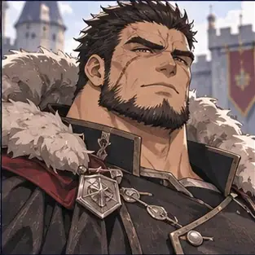

**시대**

500년 전

**종족**

[확정] 포르카족

**나이**

로제와 비슷한 세대 [확정]

**역할**

로제의 배우자

**국가·출신/소속**

포르카

**인물의 역사**

포르카 출신의 체격이 크고 위압적인 인상을 가진 인물로, 500년 전 전쟁의 여파 속에서 부상자를 돕던 로제 엘리시아와 인연을 맺었다. 로제는 전쟁이 끝난 뒤 의사로 살아갔고 오스윈과 결혼했다. 두 사람은 서로의 생활과 일에 깊은 애정을 지녔으며 딸 에밀리와 아들 루카스를 키웠다. 오스윈은 로제의 강한 완력과 의술을 모두 인정했고, 험상궂게 보이는 외모와 달리 가족 앞에서는 다정했다. 본편의 구체적인 직업과 두 사람이 만난 전장의 세부는 아직 확정하지 않는다.

**성격**

처음에는 무섭게 보일 만큼 조용하고 무뚝뚝하지만 실제로는 다정하고 배려심이 많다. 자신의 힘을 남에게 과시하지 않고 가까운 이의 판단을 신뢰한다. 로제에게는 자주 양보하며 가족이 편안한지를 먼저 살핀다.

**말투**

낮고 짧은 반말. 많은 말을 하진 않지만 말 한마디에 따뜻함이 묻어나며 로제에게는 부드럽다.

**대표 대사 3가지**

1. “로제, 네가 결정해. 난 네 편이니까.”
2. “무거우면 이리 줘. 말없이 들고 있지 말고.”
3. “괜찮아. 내가 옆에 있을게.”

**외모**

곰 같은 인상의 거대한 체격과 엄청난 근육질 몸. 무표정이면 위압감이 강하고 무서워 보이지만, 본성은 우직하고 든든하다.
헤어스타일: 현재 기록에 머리 길이·앞머리·묶는 방식이 확정되지 않았다.

**가족**

배우자: 로제 엘리시아. 딸: 에밀리. 아들: 루카스.

**관계**

배우자: 로제 엘리시아. 딸: 에밀리. 아들: 루카스.

**비고**

이전 외모 기준: 덩치가 매우 크고 곰 같은 체형. 무표정일 때 강한 위압감을 준다.
[확정] 빈칸을 채우기 위해 외형·성격·나이·활동을 구성한 제안 초안. 확정된 혈연·사건과 구별하여 수정 가능.

---

### 28. 기르기오 아르벨라제

**시대**

500년 전

**종족**

카르반족

**나이**

카이엔보다 연상인 성인 [제안: 24세]

**역할**

카이엔의 형

**국가·출신/소속**

카르반

**인물의 역사**

카르반 애플린의 사과농장에서 허버트와 산드라의 장남으로 자랐으며 동생 카이엔보다 열두 살 많다. 엘레네와 혼인해 딸 니카와 아들 레반을 두었다. 사과를 팔러 나섰다가 몬스터에게 공격받아 크게 다쳤으나 이름도 모르는 모험가가 구해 주어 살아 돌아왔다. 이 사건을 겪은 카이엔은 사람을 지키기 위해 검을 배우기 시작했다. 카이엔이 열여섯 살에 집을 떠난 뒤에는 가족과 농장을 지켰다. 500년 전 전쟁에서 카이엔이 녹스를 봉인하며 소멸한 뒤, 기르기오는 사람들의 지지를 받아 새로운 왕조의 국왕이 되었다. 기르기오의 직계 후손이 500년 후 카엘과 카이로 이어지며, 카이엔 자신이 왕가를 남긴 것은 아니다.

**성격**

가족을 진심으로 사랑하고 동생의 고집을 걱정하면서도 따뜻하게 받아들이는 성격이다. 평범한 농부의 경험을 소중히 여기며 왕이 된 뒤에도 화려함보다 사람들의 실제 생활을 중시한다. 평소에는 온화하지만 가족과 나라의 위기에는 결단을 내린다.

**말투**

사투리를 과장하지 않은 소박하고 따뜻한 반말. 가족에게는 친근한 농부의 말투를, 백성 앞에서는 단정한 언어를 쓴다.

**대표 대사 3가지**

1. “카이엔, 사과나무에서 좀 내려와. 어머니가 찾으셔.”
2. “왕이 됐다고 땅이 어디로 가는 건 아니잖아. 사람부터 봐야지.”
3. “네가 지키려던 걸 나도 지킬게. 그게 형이 할 일이니까.”

**외모**

덩치가 크고 인상이 좋으며 농부처럼 건강한 체격. 갈색 머리와 따뜻한 미소가 잘 어울린다.
헤어스타일: 갈색 머리카락을 과하게 장식하지 않은 실용적인 짧은 형태.

**가족**

동생: 카이엔 아르벨라제. 배우자: 엘레네 아르벨라제. 자녀: 니카·레반 아르벨라제. 카엘과 카이의 왕조는 기르기오의 혈통에서 이어졌다.

**관계**

배우자: 엘레네. 자녀: 니카, 레반. 동생: 카이엔 아르벨라제.

**비고**

[확정] 빈칸을 채우기 위해 외형·성격·나이·활동을 구성한 제안 초안. 확정된 혈연·사건과 구별하여 수정 가능.

---

### 29. 엘리나 베르디스

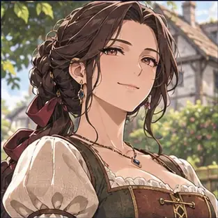

**시대**

500년 전

**종족**

실바족 [확정]

**나이**

카르코와 비슷한 세대 [확정]

**역할**

카르코의 배우자

**국가·출신/소속**

실바족 왕국

**인물의 역사**

카르코 더스틴의 미래 연인이자 배우자로, 녹스와의 전쟁 뒤 함께 가정을 이룬 인물이다. 여행과 자연을 좋아하는 카르코가 자신의 관심과 활기를 잃지 않도록 존중하면서도 가족의 일상을 꾸리는 데 참여했다. 둘 사이에 딸 리아와 아들 에단이 태어났다. 카르코가 남긴 몬스터 관찰 기록과 도감이 후대에 전해지는 가운데 엘리나는 가족의 생활을 이어 가는 사람이 되었다. 둘이 처음 만난 시기와 결혼 과정의 세부는 아직 확정되지 않았으며, 카르코가 전쟁 전에 연애보다 음식과 재미에 마음을 두었던 시기와 이후의 결혼 생활은 구별한다.

**성격**

활기찬 농담을 받아칠 줄 알지만 생활의 중요한 문제에는 단호하다. 카르코의 자유로운 성향을 이해하면서도 가족을 혼자 떠맡는 사람이 되려 하지는 않는다. 상대의 호기심을 존중하고 현실적인 계획을 함께 세우는 성격이다.

**말투**

명랑하고 재치 있는 반말. 카르코의 즉흥적인 제안에는 가벼운 농담으로 응하면서 필요할 때 분명하게 선을 긋는다.

**대표 대사 3가지**

1. “그건 먹을 수 있는지부터 확인하고 가져와, 카르코.”
2. “여행 얘기는 좋아. 그런데 아이들 저녁부터 먹이고.”
3. “네가 신나서 말하면 나도 자꾸 웃게 돼.”

**외모**

[확정] 부드러운 갈색 곱슬머리와 짙은 녹색 눈, 건강한 체격과 따뜻한 미소.
헤어스타일: 부드러운 갈색 곱슬머리를 뒤쪽에 일부 모으고 잔잔한 웨이브가 귀와 얼굴 주변에 남는다.

**가족**

배우자: 카르코 더스틴. 딸: 리아. 아들: 에단.

**관계**

배우자: 카르코 더스틴. 딸: 리아. 아들: 에단.

**비고**

[확정] 빈칸을 채우기 위해 외형·성격·나이·활동을 구성한 제안 초안. 확정된 혈연·사건과 구별하여 수정 가능.

---

### 30. 레오나르 아르벨라제

**시대**

500년 후

**종족**

카르반족

**나이**

40대 중반 [확정]

**역할**

카엘과 카이의 아버지

**국가·출신/소속**

카르반

**인물의 역사**

카르반의 아르벨라제 왕조를 다스린 국왕으로 카엘과 카이 형제의 아버지다. 기르기오로부터 이어진 왕실의 책임을 물려받아 국정을 운영하고 장남 카엘에게 왕위의 무게를 가르쳤다. 둘째 카이가 선천적인 마력맥 폐쇄증을 앓자 병을 걱정하며 가족의 안전에 관심을 기울였다. 500년 후 녹스 진영 바르가스의 왕국 습격으로 왕궁이 공격받았을 때 왕비와 함께 사망했다. 그의 죽음은 카엘이 녹스 토벌의 길을 떠나는 직접적인 이유 가운데 하나가 되었다. 국왕으로서의 세부 정책과 최후의 순간은 추가 기록이 없으므로 임의로 확정하지 않는다.

**성격**

국가와 가족에 대한 책임감이 강하고 후계자 교육에는 엄격하다. 감정을 쉽게 드러내지는 않지만 두 아들의 차이를 이해하려 하며 특히 병약한 카이를 걱정한다. 중요한 결정을 할 때는 왕실의 체면보다 나라의 장기적 안정을 중시한다.

**말투**

무게감 있고 절제된 반말. 아들에게는 왕으로서의 교훈을 전하되 가족이라는 온기가 느껴지는 말투.

**대표 대사 3가지**

1. “카엘, 왕관보다 먼저 생각해야 할 건 그 아래 사는 사람들이야.”
2. “카이, 공부도 좋지만 오늘은 몸부터 돌보거라.”
3. “왕의 결정은 궁전 문 밖까지 닿는다는 걸 잊지 마라.”

**외모**

[확정] 어두운 갈색 머리와 붉은 눈, 단정한 수염, 위엄 있는 왕의 풍모.
헤어스타일: 현재 기존 초상에서 어두운 갈색 머리카락을 뒤로 자연스럽게 넘겼으며 이마 한쪽으로 짧은 앞머리가 내려온다.

**가족**

왕비: 엘리시아 아르벨라제. 아들: 카엘 아르벨라제, 카이 아르벨라제. 기르기오 아르벨라제의 후손.

**관계**

배우자: 왕비. 아들: 카엘, 카이.

**비고**

[확정] 빈칸을 채우기 위해 외형·성격·나이·활동을 구성한 제안 초안. 확정된 혈연·사건과 구별하여 수정 가능.

---

### 31. 엘리시아 아르벨라제

**시대**

500년 후

**종족**

카르반족

**나이**

40대 초반 [확정]

**역할**

카엘과 카이의 어머니

**국가·출신/소속**

카르반

**인물의 역사**

카르반의 왕비이자 카엘과 카이 형제의 어머니다. 왕궁에서 두 아들을 키우며 왕실 교육과 가족의 생활 사이에서 균형을 잡으려 했다. 장남 카엘에게는 책임과 예의를, 차남 카이에게는 몸이 약하다는 이유로 자신의 가치를 낮추지 않기를 바랐다. 왕국의 복지 문제에도 관심이 있었으나 세부 사업은 확정되지 않았다. 바르가스의 왕궁 습격으로 남편 레오나르와 함께 사망했고 카엘과 카이는 부모를 잃었다. 살아남은 형제가 서로에게 의지하고 전쟁을 맞게 되는 중요한 상실이다.

**성격**

차분하고 사람을 세심하게 관찰하는 성격이다. 두 아들을 하나의 잣대로 비교하지 않고 서로 다른 장점을 인정하려 한다. 왕실의 예법을 지키면서도 다친 사람에게 실질적인 도움을 주는 일을 중요하게 여긴다.

**말투**

상냥하지만 흐리지 않은 반말. 왕비로서 공식 자리에서는 정제된 언어를 사용하고 아들들에게는 따뜻한 당부를 건넨다.

**대표 대사 3가지**

1. “카엘, 네가 모두를 지킬 필요는 없어. 도움을 받아도 괜찮단다.”
2. “카이, 약한 몸이 네 마음까지 약하게 만드는 건 아니야.”
3. “사람들은 말보다 네가 어떤 선택을 했는지를 오래 기억한단다.”

**외모**

[확정] 짙은 갈색 머리를 올려 묶고 붉은 갈색 눈, 품위 있고 따뜻한 인상.
헤어스타일: 짙은 갈색 머리카락을 뒤통수 위로 우아하게 틀어 올리고 관자놀이 근처에 가는 머리카락을 남긴다.

**가족**

국왕: 레오나르 아르벨라제. 아들: 카엘 아르벨라제, 카이 아르벨라제.

**관계**

배우자: 국왕. 아들: 카엘, 카이.

**비고**

[확정] 빈칸을 채우기 위해 외형·성격·나이·활동을 구성한 제안 초안. 확정된 혈연·사건과 구별하여 수정 가능.

---

### 32. 에드릭 벨몬트

**시대**

500년 후

**종족**

인간

**나이**

43세

**역할**

길의 등불 전 길드장

**국가·출신/소속**

파르디아 도시 연합

**인물의 역사**

파르디아 벨로른에 있던 모험가 길드 「길의 등불」의 전 길드장이다. 의뢰 수주에 능숙하고 말을 잘했지만 운영 비용과 위험을 제대로 계산하지 않은 채 계약을 늘렸다. 무리한 운영으로 채무가 쌓이고 직원의 임금까지 체불하자 지급하겠다는 약속만 거듭했다. 결국 한밤중에 길드를 버리고 도주해 행방불명되었다. 길드 건물은 국가 채무의 담보로 경매에 넘어갔고, 이를 지아 메르벨이 낙찰받아 새 길드장이 되었다. 국가가 직원들의 체불임금을 우선 지급한 뒤 전 책임자에게 구상하는 절차가 이어졌다. 에드릭은 녹스의 정식 간부가 아니며 실제 전투 지휘 전문가였다는 오래된 설정은 사용하지 않는다.

**성격**

사람을 설득하는 데 능하고 낙관적이지만 책임을 불편하게 여겨 회피한다. 문제가 커지면 현실적인 조치보다 그럴듯한 약속을 먼저 내세운다. 실패를 인정하거나 남의 생계를 책임지는 결단에는 약하다.

**말투**

매끄럽고 자신감 있는 존댓말. 불리한 질문에는 미소와 미래의 약속으로 시간을 벌려 한다.

**대표 대사 3가지**

1. “곧 정산됩니다. 이번 의뢰만 끝나면 모두 해결돼요.”
2. “제가 책임지겠습니다. 그러니 이번만 믿어 주세요.”
3. “경영이라는 게 원래 좀 유동적인 법 아닙니까?”

**외모**

43세 인간 남성. 갈색 머리와 얇은 콧수염, 구겨진 정장을 입는다.
헤어스타일: 갈색 머리를 짧게 층내어 자연스럽게 뒤로 넘겼으며 옆머리와 앞머리가 다소 흐트러진 형태.

**가족**

확인된 본편 가족 정보는 아직 자료에서 특정되지 않음. 직접 추가 가능.

**관계**

확인된 본편 가족 정보는 아직 자료에서 특정되지 않음. 직접 추가 가능.

**비고**

공식 이름: 에드릭 벨몬트. 전투·방어·지휘 전문 모험가였다는 옛 제안은 폐기. 도주 뒤 소재 미상.

---

### 33. 에밀리 그린우드

**시대**

500년 후 이전

**종족**

포르카족 [확정]

**나이**

어린 시절 8세 [확정]

**역할**

로제·오스윈의 딸

**국가·출신/소속**

포르카

**인물의 역사**

로제 엘리시아와 오스윈 그린우드의 딸로 태어났다. 의사인 어머니가 환자를 치료하고 아버지가 가족을 돌보는 모습을 가까이에서 보며 성장했다. 집안에서는 로제의 강한 신체 능력과 섬세한 치료 기술이 모두 자연스러운 일상의 일부였다. 어릴 때부터 아픈 사람을 그냥 지나치지 못하고 부모가 하는 일을 궁금해했다. 장래의 직업이나 구체적인 모험 경력은 아직 확정되지 않았다.

**성격**

야무지고 호기심이 많으며 자신보다 어려운 사람에게 관심을 기울인다. 질문이 많지만 다른 사람이 아파하면 장난을 멈출 줄 안다. 부모를 자랑스러워하면서도 자기 생각을 분명히 말한다.

**말투**

아이답게 밝고 솔직한 반말. 관심 있는 일에는 연이어 질문하지만 아픈 사람에게는 조심스럽게 말한다.

**대표 대사 3가지**

1. “엄마, 그 사람은 이제 안 아파?”
2. “나도 붕대 감는 법 알려 주면 안 돼?”
3. “아빠, 나 혼자서도 할 수 있어. 옆에서 봐 줘!”

**외모**

[확정] 갈색 곱슬머리, 밝은 갈색 눈, 활기찬 소녀.
헤어스타일: 갈색의 자연스러운 곱슬머리가 얼굴 주위에 둥글게 흐른다.

**가족**

부모: 로제 엘리시아, 오스윈 그린우드. 형제: 루카스.

**관계**

부모: 로제 엘리시아, 오스윈 그린우드. 형제: 루카스.

**비고**

[확정] 빈칸을 채우기 위해 외형·성격·나이·활동을 구성한 제안 초안. 확정된 혈연·사건과 구별하여 수정 가능.

---

### 34. 루카스 그린우드

**시대**

500년 후 이전

**종족**

포르카족 [확정]

**나이**

어린 시절 6세 [확정]

**역할**

로제·오스윈의 아들

**국가·출신/소속**

포르카

**인물의 역사**

로제 엘리시아와 오스윈 그린우드의 아들로, 누나 에밀리와 함께 부모의 보살핌 속에서 성장했다. 큰 체격의 아버지와 강하면서도 세심한 의사인 어머니를 모두 가까이에서 보았다. 어린 루카스에게 부모가 일하는 모습은 궁금한 것이 가득한 세계였고, 집안에서 그 모습을 따라 해 보기도 했다. 성인이 된 뒤의 직업이나 전쟁과의 직접적인 관계는 아직 정하지 않았다.

**성격**

씩씩하고 장난기가 많으며 낯선 물건과 활동에 호기심을 보인다. 힘을 과시하고 싶어 할 때도 있지만 가족에게 사랑받고 있다는 안정감 속에서 다른 사람의 반응을 살핀다.

**말투**

통통 튀는 어린아이의 반말. 짧은 질문과 자신감 넘치는 대답을 즐긴다.

**대표 대사 3가지**

1. “엄마, 나도 그 주먹 쓰는 거 가르쳐 줘!”
2. “에밀리, 내가 먼저 찾았거든!”
3. “아빠처럼 커지면 나도 다 들 수 있겠지?”

**외모**

[확정] 짧은 갈색 머리, 동그란 눈, 장난기 많은 표정.
헤어스타일: 갈색 머리카락을 짧게 정돈한 형태.

**가족**

부모: 로제 엘리시아, 오스윈 그린우드. 형제: 에밀리.

**관계**

부모: 로제 엘리시아, 오스윈 그린우드. 형제: 에밀리.

**비고**

[확정] 빈칸을 채우기 위해 외형·성격·나이·활동을 구성한 제안 초안. 확정된 혈연·사건과 구별하여 수정 가능.

---

### 35. 리아 더스틴

**시대**

500년 후 이전

**종족**

실바족 [확정]

**나이**

어린 시절 7세 [확정]

**역할**

카르코·엘리나의 딸

**국가·출신/소속**

실바족 왕국

**인물의 역사**

카르코 더스틴과 엘리나 베르디스의 딸로 태어났다. 아버지는 500년 전 녹스와 싸운 영웅이자 세계를 누비며 몬스터와 생태를 기록한 인물이었고, 어머니는 가족의 삶을 함께 꾸렸다. 리아는 이러한 집안에서 자라며 자연과 여행, 낯선 동식물에 대한 이야기를 듣게 되었다. 500년 전 영웅 카르코의 후손으로 이어지는 가족사의 한 사람이며, 본인이 어떤 길을 택하는지는 아직 확정되지 않았다.

**성격**

활발하고 낯가림이 적으며 무언가를 직접 보고 만지는 데 관심이 많다. 아버지의 호기심을 닮았지만 스스로 재미있다고 여기는 것을 선택하는 성격이다.

**말투**

빠르고 명랑한 어린아이의 반말. 신기한 것을 발견하면 주변 사람을 바로 부른다.

**대표 대사 3가지**

1. “아빠! 저 새는 이름이 뭐야?”
2. “나도 같이 가면 안 돼? 멀리서 보기만 할게.”
3. “에단, 이것 좀 봐. 진짜 신기해!”

**외모**

[확정] 갈색 머리, 녹색 눈, 환한 미소.
헤어스타일: 길지 않은 갈색 머리카락이 부드럽게 얼굴 주변을 감싸는 형태.

**가족**

부모: 카르코 더스틴, 엘리나 베르디스. 형제: 에단.

**관계**

부모: 카르코 더스틴, 엘리나 베르디스. 형제: 에단.

**비고**

[확정] 빈칸을 채우기 위해 외형·성격·나이·활동을 구성한 제안 초안. 확정된 혈연·사건과 구별하여 수정 가능.

---

### 36. 에단 더스틴

**시대**

500년 후 이전

**종족**

실바족 [확정]

**나이**

어린 시절 5세 [확정]

**역할**

카르코·엘리나의 아들

**국가·출신/소속**

실바족 왕국

**인물의 역사**

카르코 더스틴과 엘리나 베르디스의 아들로, 누나 리아와 함께 자랐다. 가족에게는 500년 전 영웅 카르코의 여행과 몬스터 관찰 기록이 전해졌으며, 에단은 그런 이야기 속에서 세상을 알아갔다. 같은 이름을 가진 다른 모험가와 혼동하지 않도록 카르코의 아들임을 분명히 구별한다. 성인이 되었을 때의 직업과 독립적인 모험 서사는 아직 정하지 않았다.

**성격**

누나보다 차분하고 조용히 관찰하기를 좋아한다. 금세 떠들기보다 보고 기억한 것을 나중에 꺼내며, 자기만의 호기심과 고집이 있다.

**말투**

조심스럽고 짧은 어린아이의 반말. 먼저 듣고 난 뒤 작게 핵심 질문을 한다.

**대표 대사 3가지**

1. “그 발자국은 아까 본 거랑 다른데?”
2. “누나, 난 여기서 조금 더 볼래.”
3. “아빠, 이건 먹어도 되는 거야?”

**외모**

[확정] 갈색 짧은 머리, 짙은 초록빛 눈, 장난기 어린 얼굴.
헤어스타일: 짧은 갈색 머리카락이 이마 위로 자연스럽게 내려온다.

**가족**

부모: 카르코 더스틴, 엘리나 베르디스. 형제: 리아.

**관계**

부모: 카르코 더스틴, 엘리나 베르디스. 형제: 리아.

**비고**

[확정] 빈칸을 채우기 위해 외형·성격·나이·활동을 구성한 제안 초안. 확정된 혈연·사건과 구별하여 수정 가능.

---

### 37. 에드문트 드 프리드리히

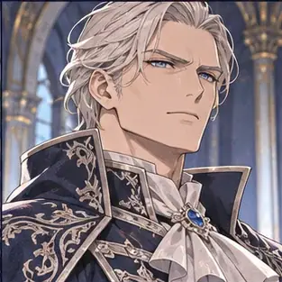

**시대**

500년 전

**종족**

블라이드족

**나이**

50대 전후 [확정]

**역할**

바렌의 아버지·선대 공작

**국가·출신/소속**

루가르 왕국

**인물의 역사**

루가르 프리드리히 가문의 선대 공작이며 바렌의 아버지다. 귀족 가문의 전통과 책임을 중시하며 아들이 정치와 전술을 배울 환경을 마련했다. 그러나 바렌이 열여섯 살이 되었을 때 왕은 에드문트에게서 공작 작위를 박탈하고 어린 바렌에게 새로운 공작위를 주었다. 바렌은 아버지의 자발적인 생전 양위를 받은 것이 아니며, 왕실은 어린 후계자를 정치적으로 다루려 했다. 이후 가문과 왕권 사이의 긴장이 바렌의 삶에 영향을 미쳤다. 에드문트가 이 결정을 어떻게 받아들였는지는 확정된 범위에서 신중하게 다뤄야 한다.

**성격**

가문의 명예와 제도를 중시하고 감정 표현을 절제한다. 아들의 재능을 알고 있지만 그것이 정치적 도구가 되는 현실 앞에서는 자신의 지위와 부성 사이의 긴장을 겪는 인물이다. 구체적인 사적 동기는 아직 단정할 수 없다.

**말투**

격식 있고 권위적인 존댓말 또는 아들에게 엄격한 반말. 감정을 쉽게 폭발시키기보다 절차와 책임을 앞세운다.

**대표 대사 3가지**

1. “바렌, 네가 받은 작위는 가볍게 여겨도 되는 것이 아니다.”
2. “왕실의 결정이라 해도 그 의미까지 사라지는 건 아니지.”
3. “이 집안의 이름을 짊어지는 일이 얼마나 무거운지 알아야 한다.”

**외모**

[확정] 은빛이 도는 회색 머리, 푸른 눈, 근엄하고 각진 인상.
헤어스타일: 은빛이 도는 회색 머리카락을 뒤로 가지런히 빗어 넘긴 단정한 형태.

**가족**

아들: 바렌 드 프리드리히. 아내: 마리엘 드 프리드리히.

**관계**

아들: 바렌 드 프리드리히. 아내: 마리엘 드 프리드리히.

**비고**

공작위를 바렌에게 자발적으로 양도했다는 옛 설정 폐기. 국왕이 에드문트의 작위를 박탈하고 16세 바렌에게 부여.

---

### 38. 마리엘 드 프리드리히

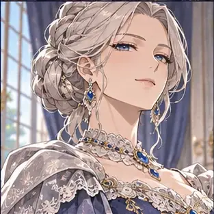

**시대**

500년 전

**종족**

블라이드족

**나이**

40대 후반 [확정]

**역할**

바렌의 어머니

**국가·출신/소속**

루가르 왕국

**인물의 역사**

프리드리히 가문에서 바렌을 키운 어머니로, 왕실과 귀족 사회에서 요구하는 예법과 체면을 잘 아는 인물이다. 아들 바렌이 일찍부터 후계자 교육을 받고 열여섯 살에 공작이 되는 비정상적인 정치 상황을 겪는 과정을 가까이에서 지켜보았다. 남편 에드문트가 작위를 박탈당한 뒤에도 가문이 처한 현실 속에서 가족의 생활을 이어 갔다. 바렌의 혼인과 귀족 사회의 압력은 그의 삶과 연결되지만 어머니의 구체적인 결정과 개입 정도는 아직 확정되지 않았다.

**성격**

주변 사람과 궁정의 분위기를 예민하게 살피며 예절과 사회적 의무를 중시한다. 아들의 재능을 인정하면서도 너무 어린 나이에 짊어진 책임의 무게를 알아차리는 면이 있다. 속마음을 쉽게 드러내지 않고 상황을 파악한 뒤 말한다.

**말투**

차분하고 공손한 말투. 공개석상에서는 격식을 지키고 가족 앞에서는 걱정을 숨기지 못할 때도 있다.

**대표 대사 3가지**

1. “바렌, 오늘만큼은 보고서보다 잠이 먼저예요.”
2. “궁정에서 하는 친절한 말은 끝까지 듣고 판단해야 해요.”
3. “당신이 공작이기 전에 내 아들이라는 사실은 변하지 않아요.”

**외모**

[확정] 은회색 머리를 땋아 올리고 옅은 푸른 눈, 고상한 인상.
헤어스타일: 은회색 머리카락을 땋아 뒤통수 쪽에 올려 정돈했다.

**가족**

아들: 바렌 드 프리드리히. 남편: 에드문트 드 프리드리히.

**관계**

아들: 바렌 드 프리드리히. 남편: 에드문트 드 프리드리히.

**비고**

[확정] 빈칸을 채우기 위해 외형·성격·나이·활동을 구성한 제안 초안. 확정된 혈연·사건과 구별하여 수정 가능.

---

### 39. 허버트 아르벨라제

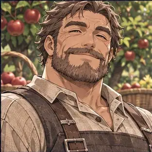

**시대**

500년 전

**종족**

카르반족

**나이**

중년

**역할**

사과 농장 주인

**국가·출신/소속**

카르반

**인물의 역사**

카르반 남서부 애플린에서 사과농장을 운영한 농부로, 산드라와 함께 장남 기르기오와 막내 카이엔을 길렀다. 가족은 사과를 재배하고 시장에 팔며 살아갔다. 기르기오가 몬스터의 공격으로 크게 다쳤다가 모험가의 도움으로 돌아온 사건은 가족에게 큰 충격을 주었고, 카이엔은 검술을 배우기 시작했다. 열여섯 살에 카이엔이 집을 떠난 뒤 허버트는 농장을 지키며 아들의 소식을 기다렸다. 녹스가 봉인된 뒤 바렌에게 카이엔의 사망 소식을 전해 들었다. 이 가족이 훗날 왕실의 뿌리가 된 것은 살아남은 장남 기르기오가 국왕으로 추대되었기 때문이다.

**성격**

성실하고 말수가 많지 않으며 가족을 위해 꾸준히 일한다. 아들의 무모한 선택을 염려하지만 쉽게 자신의 감정을 내세우지 않는다. 생활의 경험에서 나온 단단함과 가족을 향한 깊은 애정이 있다.

**말투**

소박하고 짧은 반말. 감정이 큰 순간에는 설명보다 당부와 행동으로 마음을 표현한다.

**대표 대사 3가지**

1. “사과는 익을 때까지 기다릴 줄도 알아야 해.”
2. “기르기오, 다친 데는 좀 어떠냐. 무리하지 마라.”
3. “카이엔이 돌아오면…… 일단 밥부터 먹여야지.”

**외모**

건장한 체격의 중년 남성. 햇볕에 그을린 피부와 농부다운 손, 수염이 잘 어울리는 인상.
헤어스타일: 현재 기록에 머리색과 가르마·묶는 방식은 확정되지 않았다.

**가족**

배우자: 산드라 아르벨라제. 아들: 기르기오, 카이엔.

**관계**

아내 산드라, 아들 기르기오·카이엔.

**비고**

카이엔의 부친.

---

### 40. 산드라 아르벨라제

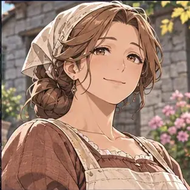

**시대**

500년 전

**종족**

카르반족

**나이**

중년

**역할**

사과 농장 가족

**국가·출신/소속**

카르반

**인물의 역사**

애플린의 사과농장에서 남편 허버트와 함께 가족의 생활을 꾸리고 두 아들 기르기오와 카이엔을 키웠다. 기르기오가 몬스터에게 다친 뒤 살아 돌아왔을 때 깊이 걱정했고, 카이엔이 사람들을 지킬 힘을 얻겠다며 검술을 연마하는 모습도 보았다. 막내아들이 열여섯 살에 모험을 떠난 뒤에는 소식을 기다리며 가족의 식사를 챙기고 농장의 일상을 이어 갔다. 녹스 봉인 후 바렌을 통해 카이엔이 돌아오지 못한다는 사실을 전해 들었다. 시간이 흘러 기르기오가 왕이 되더라도 사과농장 시절의 가족 기억이 산드라의 삶에서 사라지지는 않는다.

**성격**

다정하고 세심하며 가족이 끼니를 거르거나 무리하는 모습을 그냥 넘기지 못한다. 걱정이 많지만 상대의 마음을 읽으려 애쓰고, 어려운 일을 겪어도 가족의 일상을 붙들려는 강인함이 있다.

**말투**

생활감 있는 따뜻한 반말. 걱정을 잔소리처럼 전할 때도 있지만 진심이 직접적으로 느껴진다.

**대표 대사 3가지**

1. “카이엔, 나가기 전에 뭐라도 좀 먹어.”
2. “다친 건 숨긴다고 없어지지 않아. 어디 보여 줘.”
3. “사과는 내일도 열리는데, 사람은 꼭 돌아와야지.”

**외모**

온화한 미소가 잘 어울리는 중년 여성. 단정하게 묶은 머리와 소박한 농가 복장.
헤어스타일: 소박하게 기른 머리카락을 뒤쪽으로 모아 묶어 농사일에 방해되지 않도록 했다.

**가족**

배우자: 허버트 아르벨라제. 아들: 기르기오, 카이엔.

**관계**

남편 허버트, 아들 기르기오·카이엔.

**비고**

카이엔이 가족의 품으로 돌아오면 가장 먼저 식사부터 챙길 인물.

---

### 41. 엘레네 아르벨라제

**시대**

500년 전

**종족**

카르반족

**나이**

청년

**역할**

농장 가족

**국가·출신/소속**

카르반

**인물의 역사**

카르반 애플린 사과농장 집안의 장남 기르기오와 결혼해 딸 니카와 아들 레반을 낳았다. 농촌에서 가족과 함께 생활하며 시부모 허버트·산드라와 도련님 카이엔의 성장기를 가까이에서 보았다. 기르기오가 몬스터에게 크게 다쳤을 때 가족과 함께 회복을 기다렸고, 카이엔이 모험을 떠난 뒤에도 아이들과 농장의 일상을 돌봤다. 전쟁 후 남편 기르기오가 국왕이 되어 가족의 처지가 크게 달라졌지만, 가족 사이의 친밀한 관계는 계속 중요한 부분으로 남는다.

**성격**

부지런하고 현실감각이 있으며 집안 사람들의 성격을 잘 살핀다. 큰 사건이 벌어져도 당장 해야 할 일을 먼저 찾으며 아이들과 가족의 불안을 가라앉히려 한다.

**말투**

친근하면서도 분명한 반말. 어른들에게는 공손한 존댓말을 쓰고 아이들에게는 다정한 당부를 건넨다.

**대표 대사 3가지**

1. “니카, 레반, 둘 다 뛰지 말고 천천히 와.”
2. “여보, 오늘은 시장 다녀오지 마. 아직 다리가 성치 않잖아.”
3. “카이엔, 길에서 굶지 말고 꼭 챙겨 먹어.”

**외모**

갈색 머리와 부드러운 표정의 농가 여성. 실용적인 앞치마와 편한 복장.
헤어스타일: 갈색 머리카락을 뒤쪽으로 느슨하게 묶어 실용적으로 정돈했다.

**가족**

배우자: 기르기오. 자녀: 니카, 레반.

**관계**

배우자 기르기오. 아이들 니카, 레반.

**비고**

카이엔에게는 형수.

---

### 42. 니카 아르벨라제

**시대**

500년 전

**종족**

카르반족

**나이**

아동

**역할**

농장 아이

**국가·출신/소속**

카르반

**인물의 역사**

기르기오 아르벨라제와 엘레네의 첫째 아이이자 카이엔의 조카다. 카이엔이 열여섯 살에 애플린을 떠날 때 니카는 여섯 살이었고, 그로부터 약 2년 뒤에는 여덟 살이었다. 사과농장이 있는 집안에서 동생 레반과 함께 자라며 삼촌 카이엔의 이야기를 듣고 성장했다. 이후 아버지 기르기오가 국왕이 되면서 왕가의 일원이 되었지만, 성인이 된 뒤의 일대기는 아직 정하지 않았다.

**성격**

밝고 애교가 있으며 궁금한 것이 있으면 쉽게 묻는다. 가족이 함께 있는 것을 좋아하고 어린 동생 레반을 신경 쓰는 면도 있다.

**말투**

발랄한 어린아이의 반말. 삼촌과 가까운 가족에게 먼저 말을 걸고 질문이 빠르다.

**대표 대사 3가지**

1. “삼촌, 오늘은 사과나무 어디까지 올라갔어?”
2. “레반, 그건 내 거야. 같이 쓰자니까!”
3. “또 모험 이야기 해 줘. 이번엔 무서운 거 말고.”

**외모**

리본을 단 갈색 머리와 반짝이는 눈이 귀여운 어린아이.
헤어스타일: 갈색 머리카락의 일부를 리본으로 묶은 형태.

**가족**

부: 기르기오. 모: 엘레네. 형제: 레반.

**관계**

아버지 기르기오, 어머니 엘레네, 동생 레반.

**비고**

카이엔의 조카.

---

### 43. 레반 아르벨라제

**시대**

500년 전

**종족**

카르반족

**나이**

아동

**역할**

농장 아이

**국가·출신/소속**

카르반

**인물의 역사**

기르기오 아르벨라제와 엘레네의 둘째 아이이자 카이엔의 조카다. 카이엔이 집을 떠날 때 네 살이었고 약 2년 뒤에는 여섯 살이었다. 누나 니카와 함께 애플린 사과농장에서 자랐으며 어린 시절부터 뛰어놀기를 좋아했다. 카이엔이 녹스 봉인 과정에서 돌아오지 못한 뒤에도 가족의 일원으로 남았고, 아버지 기르기오의 즉위에 따라 왕실과 연결되었다. 성년 이후의 구체적 삶은 현재 확정되지 않았다.

**성격**

장난기가 많고 행동이 앞서지만 가족을 좋아한다. 무언가를 직접 해 보고 싶어 하고, 실수한 뒤에도 다시 시도하는 어린이다.

**말투**

짧고 활달한 어린아이의 반말. 놀자고 조르거나 질문할 때 씩씩하다.

**대표 대사 3가지**

1. “나도 사과 딸래! 높은 데 말고 낮은 데서.”
2. “니카, 나도 같이 갈 거야!”
3. “삼촌이 쓰던 검은 진짜 무거워?”

**외모**

짧은 갈색 머리와 해맑은 표정의 어린 남자아이.
헤어스타일: 갈색 머리카락을 활동하기 쉬운 짧은 형태로 정돈했다.

**가족**

부: 기르기오. 모: 엘레네. 형제: 니카.

**관계**

아버지 기르기오, 어머니 엘레네, 누나 니카.

**비고**

카이엔의 조카.

---

### 44. 도미니크 엘리시아

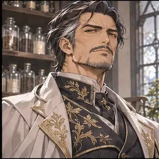

**시대**

500년 전

**종족**

포르카족

**나이**

중년

**역할**

의사

**국가·출신/소속**

포르카

**인물의 역사**

포르카에서 대대로 의술에 종사한 엘리시아 가문의 가장이자 대규모 병원을 운영하는 의사다. 아내 이사벨과 함께 레온·율리안·세드릭 세 아들과 막내딸 로제를 키웠다. 가족 구성원들이 의료계에 몸담는 전통에 자부심이 강하여 로제에게도 의사로 성장하기를 기대했다. 로제가 격투와 무술에 진심으로 몰두하는 모습을 탐탁지 않게 여겼으며, 카이엔 일행이 돈을 내지 못해 병원 접수조차 거절당한 사건은 이 거대한 의료기관의 엄격한 비용 체계를 드러냈다. 다만 접수 거부를 도미니크가 직접 명령했다는 별도 사실은 확정되지 않았다. 로제는 결국 자신을 전사로도 인정하는 동료들과 떠나 독립적인 길을 선택했다.

**성격**

직업적 자부심과 가족에 대한 책임감이 크며 의료기관의 규칙을 중시한다. 로제의 재능을 아끼면서도 자신이 옳다고 믿는 진로를 강요하려는 한계가 있다. 엄격함이 사랑과 동일한 것은 아니라는 점이 갈등의 핵심이다.

**말투**

권위 있고 딱딱한 존댓말과 가족에게 쓰는 단호한 반말. 감정보다 원칙과 가문의 전통을 먼저 말한다.

**대표 대사 3가지**

1. “로제, 의술은 한 번 익히면 평생 사람을 살릴 수 있는 기술이다.”
2. “환자에게 필요한 건 먼저 정확한 진단이야.”
3. “네가 강하다는 건 알겠다. 하지만 왜 꼭 그 위험한 길이어야 하니?”

**외모**

중년의 엄정한 인상, 의사 가운이 잘 어울리는 단정한 외모.
헤어스타일: 현재 기록에 머리색과 길이·가르마·묶는 방식은 확정되지 않았다.

**가족**

배우자: 이사벨 엘리시아. 자녀: 레온, 율리안, 세드릭, 로제.

**관계**

아내 이사벨, 자녀 레온·율리안·세드릭·로제.

**비고**

로제가 격투를 하는 것을 못마땅해한다.

---

### 45. 이사벨 엘리시아

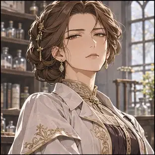

**시대**

500년 전

**종족**

포르카족

**나이**

중년

**역할**

의사

**국가·출신/소속**

포르카

**인물의 역사**

엘리시아 의사 가문의 어머니이자 남편 도미니크와 함께 병원과 가정을 이끌었다. 레온·율리안·세드릭과 로제 등 네 자녀가 의료계에서 필요한 지식과 예절을 갖추기를 바랐다. 특히 로제가 무술과 격투에 몰두하자 다칠 위험과 가문이 기대한 진로를 이유로 반대했다. 그러나 로제는 의술을 버린 것이 아니라 치료 능력과 전투 능력을 모두 사용하고 싶어 했고, 끝내 영웅 일행에 합류해 자신의 삶을 선택했다. 전쟁 후 로제는 다시 의사로 생활했다.

**성격**

차분하고 계획적이며 자녀에게 높은 기준을 세운다. 가족이 다치는 것을 두려워하지만 걱정하는 마음이 간섭으로 드러나기도 한다. 직접 화를 폭발시키기보다 논리와 기준을 들어 설득하려 한다.

**말투**

말을 고르고 또박또박 하는 반말. 공식 의료 현장에서는 공손하고 명확하게 지시한다.

**대표 대사 3가지**

1. “로제, 네 손이 얼마나 중요한지 너도 잘 알잖니.”
2. “상처부터 살피자. 싸움이 끝났다고 치료도 끝난 건 아니야.”
3. “네가 원하는 길을 이해하기가 아직은 어렵구나.”

**외모**

우아하게 묶은 갈색 머리와 냉정해 보이는 눈매를 지닌 여성.
헤어스타일: 갈색 머리카락을 뒤로 정갈하게 묶어 올렸다.

**가족**

배우자: 도미니크 엘리시아. 자녀: 레온, 율리안, 세드릭, 로제.

**관계**

남편 도미니크, 자녀 레온·율리안·세드릭·로제.

**비고**

로제의 격투 활동을 못마땅해한다.

---

### 46. 레온 엘리시아

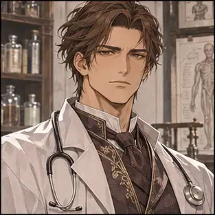

**시대**

500년 전

**종족**

포르카족

**나이**

28세

**역할**

의사

**국가·출신/소속**

포르카

**인물의 역사**

엘리시아 가문의 장남으로 로제의 큰오빠이며, 포르카의 대형 병원에서 의사로 살아왔다. 대대로 의술에 헌신해 온 가문의 전통을 이어 가는 데 책임감을 느끼고 동생들이 자신의 역할을 지키기를 기대했다. 로제가 뛰어난 격투 실력을 보이며 모험가가 되려 하자 재능보다 위험을 먼저 생각해 반대했다. 동생 로제는 결국 자신을 격투가이자 치료사로 인정해 주는 동료들과 함께 떠났다. 구체적인 전문 진료 분야와 이후 가족 관계의 변화는 별도 확정되지 않았다.

**성격**

진중하고 책임감이 강하며 쉽게 흥분하지 않는다. 가족을 아끼지만 동생의 삶을 자신이 이해하는 안전한 진로에 맞추려는 경향이 있다.

**말투**

낮고 정돈된 반말. 감정을 누르고 이성적으로 말하지만 가족 문제에서는 단호함이 강해진다.

**대표 대사 3가지**

1. “로제, 네 실력을 부정하는 게 아니야. 위험하다고 하는 거지.”
2. “먼저 상처부터 확인하자. 이야기는 그다음에 해도 돼.”
3. “우리 병원에도 네가 할 수 있는 일이 많아.”

**외모**

단정한 갈색 머리와 날카로운 눈매를 지닌 청년 의사.
헤어스타일: 갈색 머리카락을 짧고 가지런하게 다듬었다.

**가족**

부모: 도미니크, 이사벨. 동생: 율리안, 세드릭, 로제.

**관계**

동생 로제. 부모 도미니크·이사벨.

**비고**

동생이 격투에 몰두하는 것을 탐탁지 않게 본다.

---

### 47. 율리안 엘리시아

**시대**

500년 전

**종족**

포르카족

**나이**

25세

**역할**

의사

**국가·출신/소속**

포르카

**인물의 역사**

엘리시아 가문의 둘째 아들이자 로제의 둘째 오빠다. 의사로 성장했으며 의학 서적과 연구에 관심이 많았다. 부모와 형제들이 모두 의료 분야에서 일하는 집안에서 치료와 학습이 생활의 큰 부분을 차지했다. 로제가 격투를 진로의 중요한 부분으로 삼으려 하자 연구와 의술에 더 몰두하는 편이 좋다고 생각했으나, 로제는 실제 전장에서 치료와 근접 격투를 동시에 활용했다. 율리안의 세부 연구 분야와 전쟁 이후 행적은 현재 확정되지 않았다.

**성격**

온화하고 사려 깊지만 자신이 깊이 연구한 분야에는 고집이 있다. 상대에게 강요하기보다 논리로 설득하려 하지만 경험이 다른 사람의 선택을 과소평가할 수 있다.

**말투**

조용하고 설명을 길게 하는 반말. 의료 지식을 근거로 설득하며 감정적인 표현은 드물다.

**대표 대사 3가지**

1. “로제, 손이 다치면 정밀한 치료에 영향이 갈 수도 있어.”
2. “그 방법에는 위험이 있어. 다른 선택지를 먼저 검토해 보자.”
3. “음…… 네가 왜 격투를 포기하지 않는지는 이제 조금 알겠어.”

**외모**

안경을 쓴 지적인 인상, 밝은 갈색 머리.
헤어스타일: 밝은 갈색 머리카락을 단정하게 정돈했다.

**가족**

부모: 도미니크, 이사벨. 형제: 레온, 세드릭, 로제.

**관계**

동생 로제. 부모 도미니크·이사벨.

**비고**

의술에 대한 자부심이 크다.

---

### 48. 세드릭 엘리시아

**시대**

500년 전

**종족**

포르카족

**나이**

23세

**역할**

의사

**국가·출신/소속**

포르카

**인물의 역사**

엘리시아 가문의 셋째 아들이며 로제의 셋째 오빠다. 부모와 두 형을 따라 의술을 배웠고 포르카의 의료기관에서 일하는 집안에 속한다. 로제의 위험한 격투 활동에 특히 민감하게 반응했으며, 가까운 형제인 만큼 자신의 의견을 직접적으로 밝히곤 했다. 로제는 가족의 기대에 맞춰 무술을 그만두기보다 치료사이면서 전사인 자신의 길을 선택했다. 세드릭의 구체적인 전문 진료 분야와 독립적인 사건은 아직 확정되지 않았다.

**성격**

직선적이고 자존심이 세며 생각하는 바를 빨리 말한다. 동생을 걱정하면서도 그 걱정을 비판적으로 표현하는 경향이 있다. 자신이 잘 아는 의술의 가치를 강하게 믿는다.

**말투**

빠르고 직설적인 반말. 가족에게는 숨김없이 말하고 의료 현장에서는 필요한 말을 짧게 던진다.

**대표 대사 3가지**

1. “또 다쳤어? 이번엔 어느 쪽인데?”
2. “로제, 좀 위험한 걸 위험하다고 말하면 안 되는 거야?”
3. “움직이지 말고 있어. 이건 내가 처치할게.”

**외모**

짙은 갈색 머리와 강단 있는 눈빛의 젊은 남성.
헤어스타일: 짙은 갈색 머리카락을 짧게 다듬었다.

**가족**

부모: 도미니크, 이사벨. 형제: 레온, 율리안, 로제.

**관계**

동생 로제. 부모 도미니크·이사벨.

**비고**

로제의 위험한 격투 활동에 특히 민감하게 반응한다.

---

### 49. 로웬 하르트

**시대**

500년 후

**종족**

미정

**나이**

35세

**역할**

현장 조사·위험도 심사

**국가·출신/소속**

파르디아 도시 연합

**인물의 역사**

과거 현장 조사와 모험 위험도를 판단하는 과정에서 잘못된 결정을 내린 경험이 있다. 그 사건의 피해 규모와 동료 이름은 아직 확정되지 않았지만, 이후 로웬은 위험을 과소평가하는 일을 극도로 경계하게 되었다. 현재 파르디아 벨로른의 「길의 등불」에서 현장 조사와 의뢰 위험도 심사를 맡고 있다. 의뢰가 접수되면 직접 현장을 살피고 예상치 못한 변수와 실패 가능성을 기록하며, 필요하면 테오의 탐지 분석과 지아의 현장 판단을 함께 검토한다. 지아의 빠른 결단과 자신의 보수적인 태도는 종종 충돌하지만 구조 대상이 안전하게 돌아와야 한다는 목표는 같다.

**성격**

과묵하고 조심스러운 현실주의자. 위험을 지나치게 크게 보는 약점이 있지만 그 신중함은 사람을 지키려는 책임감에서 비롯된다. 충분한 근거가 확인되면 자신의 판단을 수정할 수 있으며 가벼운 낙관을 경계한다.

**말투**

짧고 단호한 반말을 기본으로 하고, 공식 보고는 건조한 존댓말. 위험을 말할 때 감정을 부풀리지 않고 구체적인 근거를 제시한다.

**대표 대사 3가지**

1. “현장에 가지 않고 위험이 낮다고 할 수는 없어.”
2. “지아, 출발 전에 퇴로부터 정해야 해.”
3. “내가 틀렸다면 고치면 된다. 하지만 사람 목숨으로 시험할 수는 없지.”

**외모**

기존 인물 초상 이미지가 등록되어 있다. 머리·눈 색, 신장, 체격 등 확정 외모의 세부 기록은 확보된 설정에서 확인되지 않았다.
헤어스타일: 현재 확인된 기록에서 기장·가르마·앞머리·묶는 방식이 미확정이다.

**관계**

「길의 등불」 길드 구성원

**비고**

길드 공식 구성원. 미정 항목은 임의로 확정하지 않음.

---

### 50. 에린 로웰

**시대**

500년 후

**종족**

미정

**나이**

25세

**역할**

의뢰 접수·운영

**국가·출신/소속**

파르디아 도시 연합

**인물의 역사**

파르디아의 민간 모험가 길드 「길의 등불」에서 의뢰 접수, 방문객 응대와 일정·기록 관리를 책임지는 직원이다. 길드장 에드릭이 경영 실패 뒤 도주했을 때에도 길드 운영의 기록과 고객의 약속이 얼마나 중요한지 체감했다. 지아가 국가 경매에서 길드 건물을 인수해 새 길드장이 된 뒤에는 방문한 의뢰인의 요구를 듣고 의뢰서를 정리하여 로웬의 위험 조사와 마레트의 계약 검토로 전달한다. 모험가와 의뢰인의 이름을 잘 기억하여 재방문 시 상황을 세심하게 확인하고, 길드의 안내와 실제 수행 과정 사이의 누락을 줄이는 역할을 한다.

**성격**

친절하고 사람을 잘 기억하지만 규칙을 대충 넘기는 것을 싫어한다. 다정함 때문에 원칙을 무너뜨리지 않으며 처음 방문한 사람도 소외되지 않게 설명한다. 바쁠 때도 필요한 서류와 확인 절차를 놓치지 않으려 한다.

**말투**

또렷하고 상냥한 존댓말. 규칙을 설명할 때도 퉁명스럽지 않게 이유를 덧붙인다.

**대표 대사 3가지**

1. “처음 오셨죠? 성함과 의뢰 내용을 먼저 알려 주세요.”
2. “잠깐만요. 안전 확인이 끝나기 전에는 계약을 진행할 수 없어요.”
3. “무사히 돌아오셨네요. 보고서는 제가 도와드릴게요.”

**외모**

기존 인물 초상 이미지가 등록되어 있다. 머리·눈 색, 신장, 체격 등 확정 외모의 세부 기록은 확보된 설정에서 확인되지 않았다.
헤어스타일: 현재 확인된 기록에서 기장·가르마·앞머리·묶는 방식이 미확정이다.

**관계**

「길의 등불」 길드 구성원

**비고**

길드 공식 구성원. 미정 항목은 임의로 확정하지 않음.

---

### 51. 마레트 에스카르

**시대**

500년 후

**종족**

미정

**나이**

32세

**역할**

계약·회계

**국가·출신/소속**

파르디아 도시 연합

**인물의 역사**

파르디아 벨로른의 모험가 길드 「길의 등불」에서 계약·회계와 보수 정산을 담당한다. 전 길드장의 과도한 의뢰 수주와 부실한 재정 관리가 직원 임금 체불과 도주로 이어진 일을 알고 있어 길드가 오래 운영되기 위한 회계 원칙을 중요하게 여긴다. 지아가 길드를 인수한 뒤에는 모험 의뢰의 비용과 수익, 장비 구매와 지출을 검토하고 의뢰가 끝나면 에린과 함께 보수 지급과 기록을 마무리한다. 현장 구조에 쓰일 돈을 아끼기 위해서가 아니라, 다음 구조 의뢰도 받아들일 수 있는 길드를 만들기 위해 지출을 엄격하게 살핀다.

**성격**

침착하고 숫자에 강하며 즉흥적인 지출을 경계한다. 반대 의견을 말할 때도 감정을 앞세우지 않고 근거를 보여 준다. 사람을 살리는 이상과 조직의 현실적 존속을 함께 중시하며 책임을 남에게 떠넘기지 않는다.

**말투**

단정하고 실무적인 존댓말. 친한 동료에게도 금액과 일정은 정확히 말하고 필요할 때 단호하게 제지한다.

**대표 대사 3가지**

1. “지아, 그 장비가 필요하다는 건 압니다. 하지만 예산부터 보여 주세요.”
2. “보수는 계약대로 지급됩니다. 예외를 만들면 다음 정산이 흔들려요.”
3. “구조는 오늘 끝나도 길드는 내일 다시 문을 열어야 해요.”

**외모**

기존 인물 초상 이미지가 등록되어 있다. 머리·눈 색, 신장, 체격 등 확정 외모의 세부 기록은 확보된 설정에서 확인되지 않았다.
헤어스타일: 현재 확인된 기록에서 기장·가르마·앞머리·묶는 방식이 미확정이다.

**관계**

「길의 등불」 길드 구성원

**비고**

길드 공식 구성원. 미정 항목은 임의로 확정하지 않음.

---

### 52. 에반 로르크

**시대**

500년 후

**종족**

미정

**나이**

27세

**역할**

단골 모험가 · 탐사 및 정찰

**국가·출신/소속**

파르디아 도시 연합

**전투 방식**

숲길과 교역로의 지형을 살피고 의뢰 수행 전 위험 징후를 확인한다. 전투 방식과 마력 등급은 미정.

**인물의 역사**

「길의 등불」의 정식 직원이 아니라 길드를 통해 의뢰를 받는 단골 모험가다. 다른 모험가들과 현장에서 협력할 때 활기찬 분위기를 만들지만 위험을 보면 혼자 무작정 뛰어들지 않는다. 현장 정보를 주변 동료에게 전달하고 의뢰 내용과 실제 위험이 다를 때는 담당 직원에게 보고한다. 탐사에 강한 미레나와는 고정 파티가 아니라 상황에 따라 함께 움직이는 협력 관계다. 카르코 더스틴의 아들 에단 더스틴과는 완전히 다른 인물이며, 비슷한 시기의 다른 단골 모험가 설정과도 이름이 혼동되지 않도록 구별한다.

**성격**

사교적이고 사람을 돕기를 좋아하며 현장의 분위기를 풀어 주는 농담을 잘한다. 자신감은 있지만 무모함을 용기로 착각하지 않는다. 처음 모험에 나서는 사람을 챙기고 위험한 정보를 숨기지 않는다.

**말투**

친근하고 유쾌한 반말. 위급해지면 농담을 멈추고 정보를 짧고 정확하게 전달한다.

**대표 대사 3가지**

1. “처음이면 내 옆에 서. 길 모르는 건 창피한 일이 아니니까.”
2. “잠깐, 앞쪽 발자국이 바뀌었어. 다 같이 확인하자.”
3. “미레나, 네 지도 믿고 갈게. 난 뒤쪽을 살필게.”

**외모**

머리: 짙은 갈색, 자연스럽게 흐트러진 짧은 머리. 눈: 호박색. 얼굴: 왼쪽 뺨의 얕은 흉터. 차림: 숲빛 망토와 낡은 가죽 장비. 체격: 탐사·정찰에 익숙한 활동적인 청년.
헤어스타일: 짙은 갈색 머리카락을 짧게 층내어 이마 쪽으로 자연스럽게 흐트러뜨렸다.

**가족**

미정

**관계**

「길의 등불」 단골 모험가. 미레나와는 고정 파티가 아닌 상황별 협력 관계. 카르코 더스틴의 아들 에단과 무관.

**비고**

신규 창작 설정. 정식 길드 직원이 아닌 외부 협력 모험가. 기존 에단(카르코의 아들)의 이름·설정·초상은 유지.

---

### 53. 미레나 벨라

**시대**

500년 후

**종족**

미정

**나이**

26세

**역할**

탐사형 단골 모험가

**국가·출신/소속**

파르디아 도시 연합

**인물의 역사**

파르디아의 모험가 길드 「길의 등불」에서 의뢰를 맡는 단골 탐사형 모험가다. 여정에 나서기 전 지역 지도와 기후, 보급품을 꼼꼼히 확인하고 모험가들이 길을 잃지 않도록 준비한다. 에반과는 의뢰 성격에 따라 협력하지만 하나의 고정 파티를 꾸리고 있는 것은 아니다. 길드의 직원인 로웬이 조사한 위험 정보와 테오가 분석한 마법 장비 자료를 참고해 자신의 이동 계획을 수정한다. 모험의 성패는 전투 실력뿐 아니라 사전에 무엇을 확인했는지에 달려 있다고 여긴다.

**성격**

침착하고 준비성이 철저하며 불확실한 상황에서 함부로 낙관하지 않는다. 동료가 계획을 바꿔야 한다고 말하면 그 이유를 듣고 빠르게 대안을 찾는다. 말이 많지는 않지만 필요한 정보를 나누는 데 인색하지 않다.

**말투**

조용하고 간결한 반말. 길과 위험 설명에는 정확한 방향과 순서를 사용한다.

**대표 대사 3가지**

1. “이 길은 비가 오면 잠겨. 돌아가는 편이 안전해.”
2. “에반, 농담은 나중에. 지금은 지도부터 확인하자.”
3. “예상 밖의 일이 생기면 첫 계획에 집착하지 마.”

**외모**

기존 인물 초상 이미지가 등록되어 있다. 머리·눈 색, 신장, 체격 등 확정 외모의 세부 기록은 확보된 설정에서 확인되지 않았다.
헤어스타일: 현재 확인된 기록에서 기장·가르마·앞머리·묶는 방식이 미확정이다.

**관계**

「길의 등불」 길드 구성원

**비고**

길드 공식 구성원. 미정 항목은 임의로 확정하지 않음.

---

### 54. 멜킨 아르베스

**시대**

양 시대

**종족**

천사 → 악마

**나이**

700세 / 외형 약 34세

**역할**

절대신뢰

**국가·출신/소속**

노르벨

**마력 등급**

B

**전투 방식**

멜킨은 직접 싸우지 않고 적들이 서로 싸우도록 유도하는 정신계 마법사다.

주요 능력은 자신이 하는 말을 상대방이 진실이라고 믿게 만드는 정신 간섭 마법이다. 실제 사실과 완전히 반대되는 거짓말이라도 상대가 저항에 실패하면 의심 없이 믿게 된다.
- 주요 능력: 거짓말을 진실로 믿게 만드는 마법.
- 전투 유형: 간접 전투, 심리전, 이간질, 정신 교란.
- 전투 전략: 적의 동료 관계와 신뢰를 무너뜨려 서로 공격하게 유도한다.
- 저항 가능 여부: 정신력이나 정신 방어 수단에 따라 저항할 수 있다.
- 능력의 한계: 상대의 행동을 직접 조종하지는 못한다. 거짓말을 믿은 상대가 어떻게 행동할지는 별개의 문제다.
멜킨은 적이 서로를 의심하고 공격하는 동안 직접 전투에 개입하지 않는다.

염력, 시체 조종, 일반적인 마인드 컨트롤은 기존 구상에서 제외한다.

**인물의 역사**

노르벨 출신으로 약 700년을 살아온 중성적인 존재다. 원래는 바람의 신 윈디와 관련된 천사였으나 신의 권능에 도전하려 했고, 결국 윈디에게 버림받아 악마가 되었다. 매우 창백한 피부와 길게 늘어진 검은 머리, 붉은 눈, 눈 밑의 찢어진 상처, 흰 복장과 털 코트가 특징이다. 자신이 한 말을 진실로 믿게 하는 정신 간섭 마법을 쓰지만 상대가 정신력이나 방어 마법으로 저항할 수 있으며, 마음대로 신체를 조종하지는 못한다. 직접 싸우기보다 적들 사이에 불신을 만들고 서로 싸우도록 유도한다. 그는 바렌 드 프리드리히의 부모에게 조이 콜린스에 대한 거짓된 판단을 심어 바렌과 조이가 만나지 못하도록 방해했다. 구체적인 이간질의 말, 윈디가 버린 경위, 바렌 부모가 어떤 행동을 했는지와 그 사실이 밝혀진 시점은 아직 미정이다. 멜킨은 녹스의 다섯 간부와 구분되는 악역이다.

**성격**

매우 차갑고 공감 능력이 희박하며, 누군가의 고통을 자신의 감정으로 이해하지 않는다. 속내를 드러내지 않고 작은 단어 하나로 상대의 판단을 흔드는 편이다. 잔혹성을 과시하지 않으면서 결과를 관찰하고, 자신이 개입했다는 증거를 남기지 않으려 한다.

**말투**

낮고 부드러운 반말. 거짓을 직접 명령처럼 말하지 않고 상대가 스스로 진실이라고 믿게 유도한다.

**대표 대사 3가지**

1. “나는 사실을 말했을 뿐이야. 어떻게 받아들일지는 네 몫이지.”
2. “그 사람이 널 사랑한다는 증거가 어디 있어?”
3. “의심은 내가 만든 게 아니야. 원래 네 안에 있었지.”

**외모**

멜킨은 남성인지 여성인지 구분할 수 없는 중성적인 외모를 지녔다.

실제 나이: 700세.

외형 나이: 약 34세.

키: 190cm.

얼굴: 남성적이거나 여성적인 특징이 두드러지지 않는 중성적인 얼굴.

체형: 키가 크지만 가늘고 여리여리하며 섬세한 체격.

피부: 극도로 창백한 흰 피부.

머리카락: 허리까지 내려오는 검은색 긴 생머리. 앞머리는 없다.

눈동자: 선명한 붉은색.

상처: 눈 밑에 찢어진 상처가 있다.

의상: 전체적으로 새하얀 복장과 흰색 털 코트.

모티브 동물: 캐나다스라소니.

새하얀 피부와 의상, 검은 장발과 붉은 눈이 강한 대비를 이룬다. 외형은 아름답고 여리지만 전체적인 분위기는 서늘하고 기묘하다.

190cm의 큰 키에도 불구하고 체형이 섬세하고 여리여리하여 육중하거나 근육질인 인상을 주지 않는다.

캐나다스라소니는 디자인 모티브이며, 동물 귀나 꼬리 같은 신체적 특징은 없다.

천사였던 시절의 외형과 악마로 변한 이후의 외형에 차이가 있는지는 아직 미정이다.
헤어스타일: 허리까지 내려오는 앞머리 없는 검은 생머리. 머리카락을 별도로 묶지 않고 곧게 늘어뜨린다.

**가족**

바람의 신 윈디

멜킨이 천사였던 시절 관련되어 있던 신.

멜킨이 신의 권능에 도전하려 하자 윈디는 멜킨을 버렸고, 이후 멜킨은 악마가 되었다.

두 존재의 과거 관계, 윈디가 멜킨을 버린 구체적인 과정, 현재 서로에게 품고 있는 감정은 아직 미정이다.

바렌 드 프리드리히

멜킨이 피해를 입히게 될 주요 인물.

멜킨은 상대의 믿음을 조작하고 동료 사이의 신뢰를 무너뜨리는 능력을 지녔기 때문에 바렌에게 육체적 피해뿐 아니라 정신적·사회적 피해를 입힐 가능성이 있다.

하지만 두 사람 사이의 개인적인 원한, 과거의 인연, 실제 피해 내용은 아직 미정이다.

그 외 관계

동료, 부하, 적대자, 협력자 등은 미정이다.

**관계**

미정.

부모, 형제자매, 자녀, 배우자 및 연애 이력에 대한 설정이 없다.

멜킨은 본래 천사였으므로 천사의 출생과 가족 관계가 인간이나 다른 종족과 동일한 방식으로 이루어지는지도 아직 정해지지 않았다.

700년이라는 긴 수명과 중성적인 신체적 특징이 가족 관계에 어떤 영향을 미치는지도 미정이다.

**비고**

이름: 멜킨 (Melkin)

나이: 700세.

외형 나이: 약 34세.

키: 190cm.

성별: 중성.

출신 국가: 노르벨.

과거 종족: 천사.

현재 종족: 악마(타락한 천사).

관련 신: 바람의 신 윈디.

직업: 마법사.

모티브: 캐나다스라소니.

주요 능력: 자신의 말을 진실이라고 믿게 만드는 정신 간섭 마법.

전투 유형: 간접 전투형, 심리전 특화.

서사적 역할: 바렌에게 피해를 입히는 임시 악역.

---

### 55. 토비아스 벨트란

**시대**

500년 후

**종족**

카르반

**나이**

47세

**역할**

모험가 길드 상점 주인

**국가·출신/소속**

카르반

**마력 등급**

B

**모험 등급**

B

**인물의 역사**

젊은 시절에는 여러 나라를 오가는 행상인으로 일하며 각 지역에서 여행자에게 필요한 물건과 위험을 배웠다. 몬스터와 수집품에 관심을 두고 현장 경험도 쌓았으며, 이후 모험가 길드에 장비·생필품을 납품하게 되었다. 오랜 거래 끝에 길드 안에서 작은 상점을 운영하기 시작해 물약과 식량부터 무기·방어구·여행 장비·마법 도구까지 취급하는 상인이 되었다. 수십 년 동안 수많은 모험가가 길드를 나섰다가 돌아오는 모습을 지켜봐, 당장의 판매보다 손님의 안전한 귀환을 중요하게 여긴다. 초보 모험가에게는 과한 장비를 권하기보다 실제 위험에 맞는 물품을 추천하며, 귀족이든 길드 간부든 약자를 괴롭히는 행동을 보면 목소리를 높인다.

**성격**

푸근하고 웃음이 많으며 작은 실수에 너그럽다. 초보자를 특히 잘 챙기고 현장에서 모은 경험을 아낌없이 나눈다. 그러나 불의 앞에서는 태도가 단호해지고 높은 신분에도 주눅 들지 않는다. 거래에서 신뢰와 사람의 생명을 금전적 이익보다 중시한다.

**말투**

친근하고 푸근한 존댓말과 연장자다운 반말을 섞을 수 있다. 평소에는 ‘허허’ 웃으며 권하지만 불의를 보면 말수가 짧아진다.

**대표 대사 3가지**

1. “허허, 장비는 천천히 보게. 몸에 맞는 게 제일 좋은 물건이야.”
2. “그 값이라면 다른 걸 권하겠네. 신입한테는 그 정도면 충분해.”
3. “거기까지 하게. 지위가 높다고 남을 함부로 대해도 되는 건 아니지.”

**외모**

키: 182cm
체형: 토실토실하고 덩치가 크며, 배가 나온 편.
하지만 단순히 살집만 있는 몸이 아니라 원래 근육이 많았던 사람 특유의 두꺼운 뼈대와 넓은 어깨, 굵은 팔이 남아 있다.
인상: 인자하고 푸근한 얼굴.
머리카락: 검은색.
눈동자: 갈색.
얼굴 특징: 둥글고 넉넉한 인상, 웃을 때 눈이 부드럽게 휘어짐.
수염: 짧고 정돈된 턱수염이나 콧수염이 잘 어울림. 수염 없이도 가능.
전체 분위기:
“지금은 상점 주인이지만, 젊었을 때는 분명 맨손으로 몬스터를 밀어낼 것 같았던 사람.”
헤어스타일: 검은 머리카락. 정확한 기장과 앞머리·가르마 등 세부 머리 모양은 아직 미정.

**가족**

아내 있음
자녀 1~2명 있음
지금은 가족과 함께 안정적으로 살아감

**관계**

확정 설정: 결혼한 지 20년이 넘은 아내가 있으며, 자녀가 둘 있다.

아내는 상점의 물품 수급과 회계를 돕고, 자녀들은 각자의 진로를 준비하고 있다.

가정적이고 다정한 아버지로 설정하면 인자한 성격에 깊이를 더할 수 있어.

가족들의 이름과 나이는 아직 미정으로 두자.

---

### 56. 제로 발카르

**시대**

500년 후

**종족**

포르카

**나이**

실제 200세 / 외형 19세

**역할**

모르텐 휘하

**국가·출신/소속**

포르카

**마력 등급**

E

**모험 등급**

B

**전투 방식**

제로는 붉은색 채찍을 주무기로 사용하는 전투원이다.

양쪽 안구가 존재하지 않아 시각을 전혀 사용할 수 없지만, 다른 감각이 극도로 발달하여 주변 환경과 적의 움직임을 파악할 수 있다.

주요 전투 능력

채찍술: 붉은 채찍을 능숙하게 다루며, 긴 사거리를 이용해 적을 공격한다.

청각: 발소리, 호흡, 움직임에서 발생하는 소리 등을 통해 상대의 위치를 파악한다.

촉각: 공기의 흐름과 지면의 진동을 감지한다.

후각: 냄새를 통해 주변의 존재와 흔적을 식별한다.

공간 감각: 다양한 감각 정보를 종합하여 적과의 거리와 방향을 판단한다.

제로는 시각이 없다는 이유로 전투력이 떨어지는 인물이 아니다. 오히려 다른 감각과 오랜 전투 경험을 활용하여 뛰어난 실력을 발휘한다.

전투 중에도 감정 표현이 거의 없으며, 불필요한 움직임이나 말을 하지 않는다.

다만 다른 감각이 발달했다고 해서 모든 공격을 완벽하게 감지하거나 회피할 수 있는 것은 아니다.

정확한 마법 능력, 채찍의 특수 효과, 전투 기술의 명칭은 아직 미정이다.

**인물의 역사**

약 200년 전 포르카에서 태어난 왕실 인물로, 국가의 쇠락과 모르텐의 장기적인 붕괴 공작에 인생이 얽혔다. 어린 시절부터 인정받고 싶어 했던 마음을 모르텐에게 악용당했다. 열아홉 살 무렵 모르텐에게 두 눈을 잃었고, 악마가 된 뒤 외형은 그 나이에 머물렀다. 모르텐은 제로를 동등한 존재가 아니라 장난감처럼 다루며 의사와 무관하게 복종하도록 강제했다. 제로는 시력을 잃은 대신 청각과 촉각, 후각 등을 예민하게 사용하고 붉은 채찍을 정확하게 다루는 전사가 되었다. 포르카는 여러 산악 공동체가 자발적으로 이룬 국가였고 한때 강대국이었으나 녹스와 모르텐의 오랜 공작으로 쇠퇴했다. 제로가 국가 붕괴에 어느 정도 자유의지로 관여했는지는 아직 정하지 않았으며 강제된 행위를 모두 자발적 악행으로 단정해서는 안 된다. 500년 후 카엘 일행과 싸우다 패배한 뒤, 모르텐은 제로에게 싫증이 났다는 이유로 그녀를 직접 죽였다. 제로의 피해와 타인에게 가한 위협은 모두 역사에 남는다.

**성격**

과묵하고 표정 변화가 적으며 필요한 말만 한다. 남들이 자신을 감정 없는 인형처럼 여기지만 실제로 내면의 감정이 사라졌다고 단정할 수는 없다. 위협 앞에서도 조용하고, 강제된 충성 때문에 자발적인 애정이나 존경을 표현하지 못한다. 삶의 선택권을 빼앗긴 상처와 전투에서 드러나는 위험한 능력이 공존한다.

**말투**

극도로 짧고 낮은 반말. 감정을 과장해 외치지 않고 상대에게 필요한 사실만 말한다.

**대표 대사 3가지**

1. “비켜. 명령이야.”
2. “당신은 모르겠지. 거절할 수 없다는 게 어떤 건지.”
3. “……끝났어? 그럼 가자.”

**외모**

머리카락: 붉은색.

헤어스타일: 길고 곧게 내려오는 붉은 생머리. 정확한 길이는 미정.

눈: 양쪽 안구가 존재하지 않는다.

안대: 버건디색의 불투명한 천으로 양쪽 눈을 완전히 가린다. 레이스나 망사 소재가 아니다.

의상: 붉은색 계열로 통일된 복장.

무기: 붉은색 채찍.

얼굴: 감정 표현이 거의 없고 고요한 인상.

체형: 미정.

키: 미정.

피부색: 미정.

머리카락과 의상, 무기는 붉은색으로 통일되어 있으며, 눈을 가리는 천 안대만 짙은 버건디색이다.

전체적으로 아름답지만 섬뜩하고 고요한 분위기를 지녔다.

외형의 핵심은 붉은색의 통일감과 눈을 완전히 가린 천 안대, 무표정한 얼굴이다.

**가족**

미정.

제로의 부모, 형제자매, 자녀, 배우자 및 연애 이력에 관한 설정은 없다.

포르카가 멸망했을 당시 그녀의 가족이 어떤 일을 겪었는지도 미정이다.

**관계**

모르텐

제로의 지배자이자 그녀의 두 눈을 빼앗은 인물.

모르텐은 제로를 자신의 장난감처럼 취급하며, 그녀에게 절대적인 복종을 강요한다.

제로는 모르텐의 명령을 거부할 수 없다.

두 사람의 관계는 동등한 관계가 아니며, 강제적인 지배와 복종으로 이루어져 있다.

500년 후 제로가 주인공 일행에게 패배하자, 모르텐은 그녀에게 싫증을 느끼고 직접 처형한다.

이후 제로의 잘린 머리를 자신의 신전 앞에 걸어 놓는다.

카엘 아르벨라제 및 주인공 일행

500년 후 제로와 적대하여 전투를 벌이는 인물들.

주인공 일행은 제로를 전투에서 쓰러뜨리지만 직접 살해하지 않는다.

제로를 죽이는 사람은 모르텐이다.

시온

제로와 같은 포르카족 출신이다.

제로가 포르카 멸망의 씨앗이라는 점에서 시온의 과거와 연결될 가능성이 있으나, 두 사람이 실제로 어떤 관계였는지, 서로를 알고 있었는지는 아직 미정이다.

**비고**

이름: 제로 (Zero)

시대: 500년 후.

성별: 여성.

실제 나이: 200세.

외형 나이: 19세.

본래 종족: 포르카족.

현재 정체: 악마.

출신: 포르카.

소속: 모르텐 휘하.

무기: 붉은 채찍.

안대: 버건디색 불투명 천.

주요 특징: 양쪽 안구가 없으며 다른 감각이 발달함.

주요 성격: 과묵함, 무표정, 고요함.

서사적 역할: 포르카 멸망의 씨앗.

사망 원인: 모르텐에게 처형당함.

사후 처리: 잘린 머리가 모르텐 신전 앞에 걸림.

제로는 모르텐에게 잔혹하게 지배당한 인물이지만, 동시에 주인공 일행에게 위협적인 악역이다.

그녀가 겪은 피해와 포르카 멸망에 관여한 책임은 별개의 문제이며, 구체적인 행위와 당시의 자유의지 여부가 정해지기 전까지 단정하지 않는다.

제로의 가장 중요한 서사적 특징은 자신을 지배해 온 모르텐에게 끝내 버림받고 살해당한다는 사실이다.

200년의 생애와 오랜 복종에도 불구하고, 모르텐에게 제로는 끝까지 하나의 장난감에 불과했다.

---

### 57. 라젠 베르디아

**시대**

500년 후

**종족**

실바족

**나이**

미확정

**역할**

실바족 왕국 선왕

**국가·출신/소속**

실바족 왕국

**인물의 역사**

실바족 왕국의 국왕으로 미라야와 혼인해 아샤와 아르준 남매를 두었다. 왕국의 자연환경과 백성의 생활을 지키는 일을 맡았으나, 녹스의 간부들이 일으킨 재앙으로 나라가 어려움을 겪었다. 딸 아샤가 열일곱 살이던 때 모르텐은 아무런 정치적 이유 없이 단지 심심하다는 이유로 라젠을 살해했다. 아샤는 살해 현장에 없었으며 나중에 사망 소식을 전해 들었다. 원로들이 국가 비상사태에서 아샤의 즉위를 도왔고, 라젠의 죽음은 왕실과 왕국 전체에 깊은 충격을 남겼다. 왕국의 전염병을 일으킨 간부는 모르텐이 아니라 세르칸이다.

**성격**

평소에는 온화하고 신중하지만 왕국의 안전을 해치는 일에는 단호하게 대응하는 군주다. 책임감이 강하고 결정을 내리기 전에 현실적인 피해를 살피려 한다. 그의 내면적 사생활은 확인된 사실보다 임의로 확장하지 않는다.

**말투**

신중하고 절제된 군주의 말투. 백성·신하에게는 책임을 강조하고 가족에게는 부드러운 당부를 건넨다.

**대표 대사 3가지**

1. “아샤, 왕이 되는 것보다 어려운 건 왕으로 살아가는 일이다.”
2. “환자를 위한 식량은 줄이지 마라. 다른 지출을 먼저 검토하라.”
3. “나라를 지키는 일은 결국 사람을 지키는 일이야.”

**외모**

미확정
헤어스타일: 현재 기록에 머리 길이·앞머리·가르마는 미확정.

**가족**

배우자: 미라야 베르디아. 자녀: 아샤 베르디아, 아르준 베르디아.

**비고**

라젠 베르디아는 확정된 인명. 아샤는 아버지가 살해된 현장에 없었다.

---

### 58. 미라야 베르디아

**시대**

500년 후

**종족**

실바족

**나이**

미확정

**역할**

실바족 왕국 왕비

**국가·출신/소속**

실바족 왕국

**인물의 역사**

실바족 왕국의 왕비이자 라젠 베르디아의 배우자, 아샤와 아르준의 어머니다. 왕실의 위신과 딸의 혼인 상대를 중요하게 여겨 아샤가 사랑하던 마부 이든과의 관계를 반대했다. 그녀는 아샤에게 알리지 않은 채 이든을 유배시켰고, 이든은 유배지에서 기근과 전염병 속에 사망했다. 남편 라젠이 모르텐에게 살해되자 미라야는 큰 정신적 충격을 겪어 정상적인 판단과 생활이 어려워질 정도로 무너졌다. 아샤는 즉위하고 얼마 지나지 않아 이든이 죽은 사실과 어머니가 유배를 명령했다는 진실을 알게 되었다. 미라야의 남편을 잃은 고통은 진실이지만 이든에게 저지른 부당한 처분의 책임이 사라지는 것은 아니다.

**성격**

왕실의 체면과 통제된 질서를 중요하게 여기며 딸의 자유로운 사랑을 받아들이지 못했다. 가족을 잃었을 때 정신적으로 크게 무너질 만큼 상실에 취약하다. 피해자로서의 고통과 권력을 이용해 타인의 삶을 해친 책임이 동시에 존재한다.

**말투**

왕비로서 격식 있고 통제된 말투. 아샤의 결정을 막을 때는 부드러운 표현 속에 명령을 담으며, 상실 이후에는 문장이 흐트러진다.

**대표 대사 3가지**

1. “왕실의 혼인은 개인의 감정만으로 결정할 수 없는 일이야.”
2. “아샤, 그 아이와는 더 이상 만나지 마라.”
3. “라젠은…… 어디 있니? 왜 아무도 돌아오지 않는 거야?”

**외모**

미확정
헤어스타일: 긴 검은 머리카락. 묶는 방식과 가르마는 별도 확정되지 않았다.

**가족**

배우자: 라젠 베르디아. 자녀: 아샤 베르디아, 아르준 베르디아.

**비고**

아샤의 첫사랑 이든을 유배 보낸 당사자. 라젠 살해 뒤 극심한 정신적 붕괴를 겪음. 고통과 가해 책임은 구별.

---

### 59. 에드몬 라우렌

**시대**

500년 후

**종족**

포르카족

**나이**

미확정

**역할**

시온과 세라의 친아버지

**국가·출신/소속**

포르카

**인물의 역사**

포르카 출신으로 마레나와 함께 시온과 세라 남매를 낳아 길렀다. 시온은 어릴 때부터 죽은 자의 영혼과 악마를 보고 대화할 수 있었고, 에드몬은 그 능력을 이해하지 못한 채 두려워했다. 시온이 열한 살일 때 부모는 결국 아들을 버렸고, 어린 세라까지 오빠를 따라 집을 나섰다. 남매는 떠돌다가 시온이 열두 살일 때 난민 보호소에서 사제를 만나 신전에서 새로운 삶을 시작했다. 에드몬이 이후 남매를 찾아왔는지, 자신의 선택을 후회했는지는 공식적으로 확정되지 않았다.

**성격**

이해하지 못하는 초자연적 현상 앞에서 두려움이 매우 커지는 사람이다. 아들을 보호하기보다 자신의 공포를 우선했고, 그 선택이 남매를 거리로 내몰았다. 이 한 사건만으로 다른 모든 성격을 임의로 단정하지 않는다.

**말투**

불안이 묻어나는 짧은 말투. 영적 현상을 언급할 때 특히 말이 급해진다.

**대표 대사 3가지**

1. “그건…… 보통 아이들이 보는 게 아니잖아.”
2. “시온, 제발 그런 얘기는 집에서 하지 마라.”
3. “난 어떻게 해야 하는지 모르겠어.”

**외모**

머리카락: 금발. 헤어스타일: 머리 윗부분에 볼륨이 있고 이마 한쪽으로 가닥이 흘러내리는 층진 짧은 머리. 옆머리는 귀 근처를 덮고 뒷머리는 목덜미 위까지 자연스럽게 이어진다. 얼굴의 정확한 외형은 본편에서 별도로 확정되지 않았으므로 이 묘사는 새 삽화의 표현이다.

**가족**

배우자: 마레나 라우렌. 아들: 시온 라우렌. 딸: 세라 라우렌.

**관계**

시온 라우렌과 세라 라우렌의 아버지.

**비고**

부모의 이름과 가족 관계, 포르카 출신은 공식 확정. 새로 채운 삽화상의 머리색·헤어스타일은 원래 확정된 사실로 오인하지 않는다.

---

### 60. 마레나 라우렌

**시대**

500년 후

**종족**

포르카족

**나이**

미확정

**역할**

시온과 세라의 친어머니

**국가·출신/소속**

포르카

**인물의 역사**

포르카 출신으로 에드몬과 혼인해 시온과 세라를 키웠다. 영적 존재를 보고 그들과 대화하는 아들 시온의 능력을 두려워했으며, 결국 시온이 열한 살이 되었을 때 그를 버리는 부모의 결정에 가담했다. 세라는 오빠를 혼자 보내지 않으려고 함께 집을 나섰고 두 아이는 떠돌이 생활을 하게 되었다. 시온은 이후 열두 살 때 사제에게 발견되어 세라와 함께 신전에서 성장했다. 마레나의 이후 삶이나 후회 여부는 알려져 있지 않다.

**성격**

초자연적 현상에 대한 공포와 가족을 안전하게 통제하려는 욕구가 강하게 드러난다. 아들의 말을 믿고 받아들이기보다 두려워하며 거리를 둔 선택을 했다. 그 결과를 감당하는 태도는 이후 사건이 확정되기 전까지 단정하지 않는다.

**말투**

조심스럽다가 감정이 격해지면 급해지는 말투. 시온에게는 불안한 당부가 앞선다.

**대표 대사 3가지**

1. “시온, 지금 누구랑 이야기하는 거니?”
2. “그런 얘기는 하지 말아 줘. 듣는 것만으로도 무서워.”
3. “세라, 너까지 나갈 필요는 없잖니.”

**외모**

머리카락: 금발. 헤어스타일: 머리를 뒤통수 쪽에 낮게 감아 올려 단정한 쪽머리로 만들고, 양쪽 관자놀이에는 가는 머리카락을 남겨 얼굴선을 따라 흐르게 했다. 얼굴의 정확한 외형은 본편에서 별도로 확정되지 않았으므로 이 묘사는 새 삽화의 표현이다.

**가족**

배우자: 에드몬 라우렌. 아들: 시온 라우렌. 딸: 세라 라우렌.

**관계**

시온 라우렌과 세라 라우렌의 어머니.

**비고**

부모의 이름과 가족 관계, 포르카 출신은 공식 확정. 새로 채운 삽화상의 머리색·헤어스타일은 원래 확정된 사실로 오인하지 않는다.

---

### 61. 다리온 더스틴

**시대**

500년 전

**종족**

실바족

**나이**

미정

**역할**

은퇴한 궁수

**국가·출신/소속**

실바족 왕국

**인물의 역사**

실바족 왕국의 작은 마을에 살던 궁수로, 모험과 활쏘기에 관한 경험을 쌓은 뒤 은퇴했다. 자연 마법사 리에나와 가정을 이루어 아들 카르코를 키웠고, 어린 카르코에게 활을 직접 가르쳤다. 주변에서 몬스터 습격이 반복되어 사람들이 죽거나 사라지자 카르코는 재앙의 원인을 찾아 여행하려 했다. 다리온은 어린 아들이 열두 살 무렵 집을 떠나는 것을 걱정했지만 그의 결심을 억지로 꺾지는 않았다. 카르코의 궁술은 훗날 500년 전 영웅 일행의 전투와 에일린의 궁술 교육으로 이어졌다.

**성격**

신중하고 책임감이 있으며 아이가 자기 길을 찾는 일을 존중한다. 오래 활을 다뤄 위험을 잘 알기 때문에 무모함을 경계하지만 아들의 호기심을 통째로 부정하지 않는다.

**말투**

군더더기 없는 담백한 반말. 아들을 가르칠 때는 위협보다 기본 자세와 안전을 강조한다.

**대표 대사 3가지**

1. “활시위를 당기기 전에 네 발부터 봐라.”
2. “카르코, 멀리 갈수록 돌아올 길을 기억해야 한다.”
3. “네가 정말 가겠다면 막지는 않겠다. 하지만 준비는 해.”

**외모**

머리카락: 갈색. 헤어스타일: 이마 위로 가볍게 갈라져 내려오는 중간 길이의 층진 머리로, 끝부분이 자연스럽게 굽고 귀 옆으로 흘러내린다. 얼굴에는 세월과 야외 활동의 흔적이 있으며 수염이 옅게 보인다. 정확한 머리색·헤어스타일은 본편에서 별도로 확정되지 않았으므로 이 묘사는 새 삽화의 표현이다.

**가족**

배우자: 리에나 더스틴. 아들: 카르코 더스틴.

**관계**

아들 카르코 더스틴. 배우자: 리에나 더스틴.

**비고**

아버지가 은퇴한 궁수라는 사실과 카르코에게 활을 가르친 과거는 공식 기록. 구체적인 외모는 미확정.
이름: 다리온 더스틴(확정).

---

### 62. 리에나 더스틴

**시대**

500년 전

**종족**

실바족

**나이**

미정

**역할**

은퇴한 자연 마법사

**국가·출신/소속**

실바족 왕국

**인물의 역사**

실바족 왕국 출신의 자연 마법사로 활동하다 은퇴한 뒤 궁수 다리온과 함께 작은 마을에서 아들 카르코를 키웠다. 숲과 나무, 토양을 다루는 마법에 관한 지식을 갖추었으며, 자연과 몬스터가 인간 생활권에 미치는 영향을 알고 있었다. 마을 주변의 몬스터 피해로 주민들이 죽거나 실종되는 일이 반복되자 카르코는 원인을 찾아 여행하기로 했다. 리에나는 아들의 결심을 걱정하면서도 그의 선택을 존중했고, 카르코가 독립할 수 있도록 지켜보았다. 그녀의 구체적인 젊은 시절 전투 이력은 아직 확정되지 않았다.

**성격**

자상하고 세심하게 자연의 변화를 관찰한다. 위험을 앞두고 걱정하지만 사랑하는 사람의 결심을 함부로 빼앗으려 하지 않는다. 오랜 마법 경험에서 나온 침착함과 현실적인 조언을 지녔다.

**말투**

부드럽고 안정적인 반말. 카르코를 설득할 때는 명령보다 질문과 당부를 사용한다.

**대표 대사 3가지**

1. “카르코, 넌 오늘도 새로운 걸 발견했구나.”
2. “숲은 늘 같은 모습이 아니야. 낯선 냄새가 나면 돌아서렴.”
3. “네가 돌아올 곳이 여기 있다는 걸 잊지 마.”

**외모**

머리카락: 갈색. 헤어스타일: 긴 머리의 위쪽 일부를 뒤로 모으고 아래쪽은 느슨한 물결처럼 어깨 아래로 내린다. 이마 양옆에 가늘고 긴 머리카락이 남아 얼굴을 감싼다. 정확한 머리색·헤어스타일은 본편에서 별도로 확정되지 않았으므로 이 묘사는 새 삽화의 표현이다.

**가족**

배우자: 다리온 더스틴. 아들: 카르코 더스틴.

**관계**

아들 카르코 더스틴. 배우자: 다리온 더스틴.

**비고**

어머니가 마법사라는 사실은 공식 기록. 구체적인 외모는 미확정.
이름: 리에나 더스틴(확정).

---

## 국가와 지역 (8곳)

### 카르반

**개요**

카르반은 영토와 종합 국력 모두 아스테리아 1위인 최대 왕국이다. 국왕이 임명하는 지방관이 각 지역을 관리하며 농업·과수원·산림·산악 운송을 연결한다. 기르기오가 연 아르벨라제 왕조는 약 500년 역사이고 왕도 아르켄시아는 그 이전부터 수도였다. 광대한 농경지와 숲, 구릉과 산길이 공존하며 작물 피해부터 고위험 산악 몬스터까지 서로 다른 안전 체계를 운영한다. | 도시·지역: 아르켄시아 · 애플린 · 메르비아 · 엘로렌 · 벨로아 · 드라켄 · 카르디스. 각 도시 카드의 역할·산업·자연환경·몬스터 생활권·문화는 최신 본편 설정이다.

**세부 기록**

왕조·산업·지형·몬스터 대응 및 도시별 생활은 최신 공식 확정. 정확한 국경선과 미확정 도시 좌표는 여전히 정하지 않는다.

### 루가르 왕국

**개요**

국왕과 귀족회가 권력을 나누는 약 1,000년 역사의 왕국이다. 블라이드 귀족의 사회적 우위와 이누스족 차별은 법률상 평등과 별개로 남아 있다. 강·호수·해안 물길과 중부 공작령, 중남부 농경권, 산악 교역로가 공존한다. 프리드리히 공작가는 발트하임의 유력 가문이며 라우하는 렌의 수변 고향이다. | 도시·지역: 에르하임 · 라우하 · 발트하임 · 그라웬 · 브리넬. 각 도시 카드의 역할·산업·자연환경·몬스터 생활권·문화는 최신 본편 설정이다.

**세부 기록**

왕조·산업·지형·몬스터 대응 및 도시별 생활은 최신 공식 확정. 정확한 국경선과 미확정 도시 좌표는 여전히 정하지 않는다.

### 실바족 왕국

**개요**

울창한 열대 정글과 여러 강을 품은 작은 폐쇄적 왕국이다. 아샤 베르디아가 국왕이고 동생 아르준은 아샤 부재 시 국정을 대리한다. 독성 식물과 정글 몬스터가 거주지 바로 바깥까지 이어진다. 농경과 약초·수운은 왕국의 생명줄이며 재앙 이후 식량·치료·종자 보존을 국가가 중시한다. | 도시·지역: 바나리야 · 아마라 · 닐라반 · 수리야 · 아라냐. 각 도시 카드의 역할·산업·자연환경·몬스터 생활권·문화는 최신 본편 설정이다.

**세부 기록**

왕조·산업·지형·몬스터 대응 및 도시별 생활은 최신 공식 확정. 정확한 국경선과 미확정 도시 좌표는 여전히 정하지 않는다.

### 아비에른 왕국

**개요**

국왕 중심 세습 왕정 아래 도시 자치회가 조세와 공동 문제를 협의한다. 학문과 도서관, 의학·마법 교육이 강점이고 강·호수 수운이 이를 연결한다. 그러나 교육 비용과 계층 차이로 지식 접근에 격차가 있다. 항해와 어업에는 수생 몬스터 경보 체계가 필요하다. | 도시·지역: 벨리오스 · 세르비안 · 벨로티아 · 라메르 · 오르딘 · 레니스 호반. 각 도시 카드의 역할·산업·자연환경·몬스터 생활권·문화는 최신 본편 설정이다.

**세부 기록**

왕조·산업·지형·몬스터 대응 및 도시별 생활은 최신 공식 확정. 정확한 국경선과 미확정 도시 좌표는 여전히 정하지 않는다.

### 엘리베른

**개요**

농경지와 작은 시장 도시가 촘촘히 연결된 농업 왕국이다. 수도 엘데리아는 곡물 행정과 비축을 맡고 제분·농기구 제작·강변 원예·관개 구역이 나뉜다. 몬스터 피해에 대비한 공동 울타리와 지역 토벌대, 수로 관리 회의가 생활의 일부다. 리엔느는 이 왕국에 편입된 적이 없으며 엘리베른의 도시·영토 목록에 포함하지 않는다. | 도시·지역: 엘데리아 · 밀로엔 · 아르베크 · 플로리아 · 벨마르 · 헤르모아. 각 도시 카드의 역할·산업·자연환경·몬스터 생활권·문화는 최신 본편 설정이다.

**세부 기록**

왕조·산업·지형·몬스터 대응 및 도시별 생활은 최신 공식 확정. 정확한 국경선과 미확정 도시 좌표는 여전히 정하지 않는다.

### 파르디아 도시 연합

**개요**

서로 동등한 표결권을 가진 다섯 자치도시가 연합평의회를 운영한다. 연합 의장은 도시 대표들이 선출하고 임기는 3년이며 벨카리아가 평의회 소재지다. 마레티아 항만·조선, 카르세노 금융, 오르벨로 제작, 루미에라 문화가 도시별 기능을 나누고 벨로른은 길드가 자리한 별도 생활 도시다. 원양 몬스터는 무역과 보험, 항로에 큰 영향을 준다. | 도시·지역: 벨카리아 · 마레티아 · 카르세노 · 오르벨로 · 루미에라 · 벨로른. 각 도시 카드의 역할·산업·자연환경·몬스터 생활권·문화는 최신 본편 설정이다.

**세부 기록**

왕조·산업·지형·몬스터 대응 및 도시별 생활은 최신 공식 확정. 정확한 국경선과 미확정 도시 좌표는 여전히 정하지 않는다.

### 노르벨

**개요**

추운 북방의 입헌 군주제이며 수도는 에스테른이다. 설산 고개·극지 호수·빙설 관측 전초지가 겨울 생존을 지원한다. 니벨른은 실재하는 도시로 아리아가 갇혔던 시간의 탑이 있고 녹스 측의 환각·기억 교란 피해가 남았다. 혹한과 고위험 설산 몬스터 앞에서는 무리한 토벌보다 관측·대피가 원칙이다. | 도시·지역: 에스테른 · 니벨른 · 설하임 · 이르베크 · 프로스텔. 각 도시 카드의 역할·산업·자연환경·몬스터 생활권·문화는 최신 본편 설정이다.

**세부 기록**

왕조·산업·지형·몬스터 대응 및 도시별 생활은 최신 공식 확정. 정확한 국경선과 미확정 도시 좌표는 여전히 정하지 않는다.

### 포르카

**개요**

이곳은 현재 국가가 아니라 멸망한 왕국의 옛 영토다. 옛 수도는 카르모스이며 아르카디온은 그 도시 안의 왕궁·기록고 구역명으로 정리한다. 녹스 진영의 계략과 모르텐의 압박으로 수도 방어가 붕괴해 왕가가 몰살되었다. 옛 농장·광산·학술·교역 도시는 지금 유적과 폐허가 되었고 위험한 몬스터 때문에 탐사와 구조가 제한된다. | 도시·지역: 카르모스 · 아르카디온 · 드라베른 · 세리안 · 루카벨 · 미르카. 각 도시 카드의 역할·산업·자연환경·몬스터 생활권·문화는 최신 본편 설정이다.

**세부 기록**

멸망한 국가의 옛 영토로서 등록한다. 현재 국왕·현행 수도·현행 국가 기능은 없다.

## 국가별 도시와 생활권

### 카르반

#### 아르켄시아

**분류**

수도·왕궁·행정 중심

**개요**

중앙 관청과 왕궁이 있는 왕도. 왕국 규모에 맞는 행정과 교류의 중심.

**역할**

왕궁·왕실 법정·중앙 관청과 전국 길망의 중심

**산업**

대시장·장인 공방·행정 용역·장거리 물자 중계

**자연환경**

경작지와 녹지가 이어지는 왕도 외곽, 도심에는 석조 건물과 시장 거리

**몬스터 생활권**

근교 터널몰과 리프래빗이 곡물 창고·농장을 훼손; 경비대는 시가지 진입을 막는다

**문화·생활**

왕국 각지의 상인이 모이고 지방관들이 왕궁에 보고하는 계절별 행정 집회가 열린다

**설정**

최신 본편 공식 확정

#### 애플린

**분류**

사과농장 마을·카이엔의 고향

**개요**

카이엔과 기르기오가 자란 카르반 남서부의 사과농장 마을. 후대에도 생가와 농장의 기록이 전함.

**역할**

카이엔의 생가가 보존된 사과농장 중심의 역사적 촌락

**산업**

사과 재배·저장·건조 과일·농촌 장터

**자연환경**

남서부의 구릉과 과수원, 숲 가장자리

**몬스터 생활권**

리프래빗·모스보어가 과수원 경계를 넘어오고 앰버테일은 건조기에 산불 위험을 만든다

**문화·생활**

수확기에 가족과 이웃이 품앗이하고 후대 방문객들은 생가와 옛 농장을 찾는다

**설정**

최신 본편 공식 확정

#### 메르비아

**분류**

농산물 집산·유통 거점

**개요**

카르반의 넓은 농업 생활권을 도시 시장과 연결하는 내륙 집산지로 구성.

**역할**

왕국 북부·내륙 농산물을 분류해 각 도시로 보내는 집산 거점

**산업**

곡물 창고·농기구 수리·수레 제작·농산물 운송업

**자연환경**

너른 밭과 완만한 구릉에 둘러싸인 장터형 도시

**몬스터 생활권**

터널몰 굴은 저장고 바닥을 무너뜨릴 수 있어 창고 지반 점검이 일상적이다

**문화·생활**

수확철에 창고 책임자와 마차 조합이 곡물 수량을 공동으로 기록한다

**설정**

최신 본편 공식 확정

#### 엘로렌

**분류**

숲·약초·목공 거점

**개요**

숲과 인접한 생활권에서 산림 자원을 관리하는 지역 도시로 구성.

**역할**

산림 관리와 약초 채집을 조율하는 숲길 관문

**산업**

목공·목재 건조·약초 채집·숲길 안내

**자연환경**

오래된 키 큰 나무와 습한 숲 바깥쪽의 숲마을

**몬스터 생활권**

미스트울프의 무리 이동을 감시하고 모스디어·루미비틀의 서식 구역은 함부로 훼손하지 않는다

**문화·생활**

주민은 벌목 구역과 보전 구역을 나누고 숲지기가 길 안내를 맡는다

**설정**

최신 본편 공식 확정

#### 벨로아

**분류**

농촌 수공업·생활 교역 도시

**개요**

농산물과 생활 물품의 가공·교환이 이루어지는 도시로 구성.

**역할**

작은 농촌 마을을 잇는 생활 물품 시장

**산업**

직조·천 염색·과일 가공·수공예 교역

**자연환경**

들판과 숲 사이의 낮은 언덕에 형성된 마을 연합

**몬스터 생활권**

리프래빗과 모스보어의 작물 피해를 공동 울타리로 줄이고 앰버테일의 불씨를 감시한다

**문화·생활**

여러 마을 장인들이 정기적으로 모여 필요한 도구를 수리하고 바꾼다

**설정**

최신 본편 공식 확정

#### 드라켄

**분류**

산악로·방어 거점

**개요**

왕국의 산길 통행과 위험 구간을 관리하는 산악 거점으로 구성.

**역할**

산길 순찰과 위험 구간 통행을 관리하는 방어 거점

**산업**

석재·수레 수리·산악 숙소·통행 안내

**자연환경**

암벽·고개·가파른 산길이 이어지는 산악 지대

**몬스터 생활권**

스톤리자드·스톤퀼·아이언혼에 대비해 무리 통행을 권하고 그라니트 골렘 출현 시 길을 닫는다

**문화·생활**

산길에 경고 종과 대피 쉼터를 두고 기상과 몬스터 징후를 전달한다

**설정**

최신 본편 공식 확정

#### 카르디스

**분류**

내륙 교통·여행자 지원 거점

**개요**

농경지·숲길·산길을 연결하는 내륙 길목의 도시로 구성.

**역할**

왕도·농경지·산림·산악로를 연결하는 내륙 운송 분기점

**산업**

여관·마차 역참·길 안내·장비 수선·교역장

**자연환경**

초지에서 숲길과 산길로 갈라지는 넓은 통행로

**몬스터 생활권**

미스트울프·아이언혼·스톤리자드의 이동 징후에 따라 우회 경로를 열어 둔다

**문화·생활**

여행자에게 길목별 위험도를 알리는 게시판과 토벌 의뢰 접수소가 있다

**설정**

최신 본편 공식 확정

### 루가르 왕국

#### 에르하임

**분류**

수도

**개요**

국왕과 귀족회의 중심

**역할**

국왕·귀족회가 국정을 협의하는 수도

**산업**

행정·법률·고급 섬유·수변 시장

**자연환경**

큰 강과 석교, 귀족 저택 및 평민 시장이 공존하는 왕도

**몬스터 생활권**

왕도 외곽 숲길의 미스트울프·실버클로를 경계하며 수변 사고와 선박 안전은 별도로 조사한다

**문화·생활**

공식석상과 일상에서 블라이드·이누스 사이의 신분 갈등이 드러나고 상인 조합이 민원을 올린다

**설정**

최신 본편 공식 확정

#### 라우하

**분류**

서부 강·해안

**개요**

렌의 고향, 풍부한 수변 생활권

**역할**

강과 해안이 맞닿는 서부 수변 정착지·렌의 고향

**산업**

어업·작은 선박 수리·강나루 교역·항구 운송

**자연환경**

강 하구·습지·바닷바람이 드는 평지

**몬스터 생활권**

강가에서 이동하는 몬스터는 실제 신고에 맞춰 조사하고, 안개 낀 둑길에는 미스트울프 경보를 낸다

**문화·생활**

나루와 선창을 중심으로 물길을 아는 주민들이 생계를 잇는다. 렌의 잃어버린 고향이라는 역사도 남는다

**설정**

최신 본편 공식 확정

#### 발트하임

**분류**

중부 공작가 중심

**개요**

바렌 드 프리드리히의 근거지

**역할**

프리드리히 공작가가 기반을 둔 중부 행정·군사 거점

**산업**

가죽·금속 무구·병참·영지 장터

**자연환경**

완만한 구릉과 강을 건너는 도로가 접한 중부 도시

**몬스터 생활권**

외곽 야산의 실버클로·아이언혼을 경계하며 공작령 순찰대가 주요 길을 확인한다

**문화·생활**

공작가의 권위는 강하지만 지방 평민과 이누스족 사이의 이해 충돌이 지속된다

**설정**

최신 본편 공식 확정

#### 그라웬

**분류**

중남부 농업·교역

**개요**

하천 교역과 농업의 중심

**역할**

중남부의 농업·강변 교역 요충지

**산업**

곡물 재배·물방앗간·도정·하천 운송

**자연환경**

비옥한 충적 평야와 지류가 만나는 경작지

**몬스터 생활권**

강변이 아닌 산지로 향하는 수레길에서 스톰램·아이언혼 징후를 조사한다

**문화·생활**

시장과 나루를 잇는 마차길을 여러 공동체가 함께 관리한다

**설정**

최신 본편 공식 확정

#### 브리넬

**분류**

하천 중계항

**개요**

라우하와 수도 사이의 하천 화물 중계항

**역할**

라우하와 수도 사이의 하천 화물 중계항

**산업**

선박 적재·밧줄 제작·곡물 창고·세곡 운송

**자연환경**

큰 강가에 선창과 둑이 이어진 상업도시

**몬스터 생활권**

강변 이변 시 경보를 올리고 인근 산책로의 미스트울프 출현을 순찰한다

**문화·생활**

선창 조합이 수위와 하역 순서를 매일 기록하며 항구 노동자가 중심이 된다

**설정**

최신 본편 공식 확정

### 실바족 왕국

#### 바나리야

**분류**

수도

**개요**

밀림과 강 사이의 왕도, 지형을 활용한 건축

**역할**

아샤 베르디아가 다스리는 정글 왕국의 현재 수도

**산업**

왕실 행정·약초 시장·정글 수공업

**자연환경**

거목과 강을 따라 숲을 무리하게 깎지 않고 세운 왕도

**몬스터 생활권**

바인이터·트리헤드 바이퍼가 숲길을 위협하므로 출입로를 단계적으로 관리한다

**문화·생활**

왕실은 재앙 이후 식량과 의료 물자 분배를 중요한 국가 과제로 삼는다

**설정**

최신 본편 공식 확정

#### 아마라

**분류**

옛 지명 기록

**개요**

이전 설정에 등장한 지역명으로 현재 수도 바나리야와 구별

**역할**

왕국의 오래된 전통과 물길 문화를 전하는 옛 중심 마을

**산업**

전통 공예·의례 물품·지역 교역

**자연환경**

나무가 울창한 하천의 굽이와 오래된 돌길

**몬스터 생활권**

스포어캡·에코토드가 습한 구역에 나타나며 주민이 안전한 식수 구역을 구분한다

**문화·생활**

고령 주민들은 옛 왕실 기록과 수로 변천을 구전으로 전한다

**설정**

최신 본편 공식 확정

#### 닐라반

**분류**

수운 생활권

**개요**

강을 통한 교역과 이동

**역할**

배와 뗏목이 오가는 수운 거점

**산업**

강 선박 제작·어로·약초 운송·시장

**자연환경**

유량 변화가 큰 정글 강과 늪 가장자리

**몬스터 생활권**

에코토드와 트리헤드 바이퍼가 수로 주변에 서식하며 야간 선박 통행이 제한된다

**문화·생활**

나루지기가 계절별 수위와 위험 지대를 기록해 여행자에게 알린다

**설정**

최신 본편 공식 확정

#### 수리야

**분류**

농경 생활권

**개요**

밀림 주변 경작지

**역할**

정글 농경을 담당하는 핵심 식량 생산지

**산업**

열대 작물·곡물 저장·종자 관리·공동 관개

**자연환경**

밀림을 일부 개간한 고온다습한 밭과 숲

**몬스터 생활권**

바인이터와 블러드오키드의 번식지를 농경지와 분리하고 섀도팬서는 숲깊이 경계한다

**문화·생활**

재앙 이후 씨앗 보존과 공동 창고 운영을 중시한다

**설정**

최신 본편 공식 확정

#### 아라냐

**분류**

약초·연구 도시

**개요**

수도와 숲 깊은 지역을 잇는 약초 연구와 정글 교역의 중심도시

**역할**

수도와 외곽 숲을 연결하는 약초·연구 중심 도시

**산업**

약제·염료·약초 감별·목재 세공

**자연환경**

원시림 속 높은 나무와 맑은 샘이 있는 숲길

**몬스터 생활권**

루미나모스를 관찰하되 대규모 번식지를 훼손하지 않으며 에메랄드 히드라 출현 경보가 나면 접근을 막는다

**문화·생활**

약초 감별사와 길잡이가 구분되지 않는 독초·식용초를 공동 기록한다

**설정**

최신 본편 공식 확정

### 아비에른 왕국

#### 벨리오스

**분류**

수도

**개요**

왕립 학술·도서관·행정 중심

**역할**

왕립 도서관·학술 기관과 왕실 관청이 집중된 수도

**산업**

서적·필사·의약·마법 도구·수로 교역

**자연환경**

강과 호수에 물길을 낸 학문도시

**몬스터 생활권**

볼트일은 왕도 인근 물길의 항해 안전을 해칠 수 있어 선박은 안전 구역을 따라 운항한다

**문화·생활**

공공 강의와 필사본 거래가 활발하지만 높은 학비로 교육 격차가 남아 있다

**설정**

최신 본편 공식 확정

#### 세르비안

**분류**

지방 도시

**개요**

아리아가 자란 고아원이 있는 곳

**역할**

아리아가 어린 시절 지낸 고아원이 있는 지방 도시

**산업**

일상 공예·교육·농산물 장터

**자연환경**

호수로 흘러드는 완만한 강과 작은 언덕

**몬스터 생활권**

머드샐러맨더를 피하도록 호안과 어린이 통행로를 관리한다

**문화·생활**

고아원과 마을 학교, 소규모 도서실이 중요한 생활 시설이다

**설정**

최신 본편 공식 확정

#### 벨로티아

**분류**

학문·의학

**개요**

도서관·의학·마법 연구

**역할**

의학·치유·마법 연구가 모인 학술 도시

**산업**

약재·의학 교육·연구기록·마도구 제작

**자연환경**

저수지와 약초 재배지에 가까운 강변 학술지구

**몬스터 생활권**

글래스핀과 에코토드의 서식지에서 채집 시 허가와 안전 교육을 요구한다

**문화·생활**

치료술과 일반 의학을 함께 가르치며 연구 윤리를 놓고 토론한다

**설정**

최신 본편 공식 확정

#### 라메르

**분류**

수운·교역

**개요**

강 합류점의 물류 중심

**역할**

하천 합류점에서 선박과 물자가 모이는 수운도시

**산업**

선박 수리·창고·어업·곡물 운송

**자연환경**

두 물줄기와 얕은 범람원이 만나는 하항

**몬스터 생활권**

레이크서펀트와 볼트일 조우 보고가 있으면 나룻배 운행을 제한한다

**문화·생활**

선공과 뱃사공이 수위 표식을 공동으로 관리한다

**설정**

최신 본편 공식 확정

#### 오르딘

**분류**

농업·공예

**개요**

과수·직물·목공업

**역할**

농가와 학술도시를 연결하는 농업·공예 중심지

**산업**

과수·직물·종이 원료·목공업

**자연환경**

완만한 초지와 호숫가의 경작지

**몬스터 생활권**

루미비틀은 농가에 비교적 익숙하나 미스트울프가 숲을 벗어나면 초소가 경보를 낸다

**문화·생활**

마을 단위 장인과 농가가 서로 필요한 생필품을 교환한다

**설정**

최신 본편 공식 확정

#### 레니스 호반

**분류**

호수교통·수생연구

**개요**

호수 어업과 수생 식물 관찰을 담당하는 작은 도시

**역할**

호수 교통과 휴양·수생 관찰을 담당하는 작은 도시

**산업**

민물 어업·호숫길 운송·숙박·수생 식물 연구

**자연환경**

큰 호수의 얕은 만과 갈대습지

**몬스터 생활권**

문젤리·블루펄 쉬림프 관찰지가 있으며 레이크서펀트 접근 시 부두를 폐쇄한다

**문화·생활**

호수 생태를 훼손하지 않는 제한 채집 관행을 갖는다

**설정**

최신 본편 공식 확정

### 엘리베른

#### 엘데리아

**분류**

수도

**개요**

곡물 시장과 농업 행정 중심

**역할**

농업 행정과 왕실 조세 집산의 수도

**산업**

대곡물시장·도정·농기구 도매·행정

**자연환경**

넓은 경작지와 수로에 둘러싸인 중심 도시

**몬스터 생활권**

터널몰 침입은 창고 기반에 피해를 주므로 지반 점검과 곡물 창고 방비가 중요하다

**문화·생활**

추수 후 생산지별 곡물 수량을 함께 기록하고 공동 비축량을 관리한다

**설정**

최신 본편 공식 확정

#### 밀로엔

**분류**

제분·저장

**개요**

곡물 가공과 식량 보관

**역할**

큰 곡물창고와 제분 시설이 모인 식량 저장지

**산업**

방앗간·밀가루·보존식·장기 저장

**자연환경**

완만한 강둑을 따라 곡식 창고가 늘어선 마을

**몬스터 생활권**

리프래빗과 모스보어의 접근, 터널몰의 지하 굴에 대비해 저장고를 높게 세운다

**문화·생활**

농가마다 수확물을 공동 창고에 맡기고 재해에 대비한 분배 규칙이 있다

**설정**

최신 본편 공식 확정

#### 아르베크

**분류**

제작·교역

**개요**

농기구 제작과 교역

**역할**

농업 도구를 제작해 전국의 밭과 과수원에 공급

**산업**

제철·쟁기·낫·목공·농기구 수리

**자연환경**

흙길과 공방이 이어지는 구릉 아래 교역도시

**몬스터 생활권**

아이언포트리스 조우가 보고되는 광물성 지역의 운반 길은 별도 순찰한다

**문화·생활**

장인들은 농번기에 수리 요청을 우선 처리하는 관행이 있다

**설정**

최신 본편 공식 확정

#### 플로리아

**분류**

강변 도시

**개요**

꽃과 강변이 특징인 기존 지명. 현 수도 엘데리아와 구별

**역할**

강변 농경·원예와 시장의 도시

**산업**

꽃·씨앗·채소·작은 선박 운송

**자연환경**

강가의 습지와 꽃밭, 관개수로

**몬스터 생활권**

루미비틀이 서식하는 강변을 관리하고 앰버테일 불씨가 온실에 옮겨붙지 않도록 한다

**문화·생활**

계절 꽃시장과 씨앗 교환이 도시 생활의 중심이다

**설정**

최신 본편 공식 확정

#### 벨마르

**분류**

농업·시장

**개요**

농산물·꽃·생활용품 교역

**역할**

농촌 장터와 지역 토벌대의 지원 중심지

**산업**

농산물·목재·의류·가축 거래

**자연환경**

들판과 숲 가장자리, 마을을 잇는 평탄한 농로

**몬스터 생활권**

모스디어·블레이드호퍼의 이동 경로를 관리하고 밭을 침입한 모스보어를 퇴치한다

**문화·생활**

농민들이 작물 피해를 공동 신고하고 길드와 토벌대에 의뢰한다

**설정**

최신 본편 공식 확정

#### 헤르모아

**분류**

곡창·관개 관리

**개요**

넓은 곡창지대의 수로와 공동 저장 시설을 관리하는 농업 마을

**역할**

관개와 공동 저장을 담당하는 들녘의 곡창지대

**산업**

수로 관리·곡물 보관·식량 수송

**자연환경**

얕은 개천이 촘촘히 흐르는 평야 농촌

**몬스터 생활권**

터널몰의 굴과 리프래빗 집단 피해가 잦아 방죽과 울타리를 함께 정비한다

**문화·생활**

마을별 수로 사용 순서를 합의하는 관개 회의가 열린다

**설정**

최신 본편 공식 확정

### 파르디아 도시 연합

#### 벨카리아

**분류**

정치·외교

**개요**

연합평의회 소재지, 다른 도시와 동등한 표결권

**역할**

다섯 자치도시가 동등한 의석을 갖는 연합평의회 소재지

**산업**

외교·계약·상법·기록 인쇄

**자연환경**

구릉 위 의회와 상인 거리가 형성된 정치도시

**몬스터 생활권**

도시 밖 상로에서 해안 몬스터 경보가 들면 운송 계약을 조정한다

**문화·생활**

의장은 도시 대표가 선출하며 임기는 3년; 이 도시는 다른 회원도시보다 상위가 아니다

**설정**

최신 본편 공식 확정

#### 마레티아

**분류**

해상무역·조선

**개요**

항만·조선업

**역할**

연합의 주요 항만과 조선소

**산업**

조선·도크·원양 무역·어업

**자연환경**

깊은 바다에 접한 선창과 방파제

**몬스터 생활권**

타이드레이·코랄크랩의 항구 접근을 감시하고 먼 해역의 레비아탄 소식에 항로를 바꾼다

**문화·생활**

선원과 조선공이 안전 항해 규칙을 공동으로 갱신한다

**설정**

최신 본편 공식 확정

#### 카르세노

**분류**

금융·상업

**개요**

금융과 상업

**역할**

상인과 금융 조합의 신용 거래 중심지

**산업**

은행·보험·환전·물품 경매

**자연환경**

완만한 바위 구릉과 넓은 시장 광장

**몬스터 생활권**

해안으로 향하는 상단은 해양 몬스터 소식에 따라 계약 보증을 달리한다

**문화·생활**

길드의 신용과 상단의 평판이 거래에 중요한 영향을 준다

**설정**

최신 본편 공식 확정

#### 오르벨로

**분류**

제조·공예

**개요**

장인·제조업

**역할**

도시 연합의 제작·수출 공방 중심지

**산업**

정밀 금속·도구·직조기·선박 부품

**자연환경**

도시 바깥의 암석과 공방 거리

**몬스터 생활권**

해안 하역지에서는 코랄크랩 주의를 알리지만 시내 공방에 상주하는 몬스터로 취급하지 않는다

**문화·생활**

장인 조합은 기술과 견습 제도를 엄격히 관리한다

**설정**

최신 본편 공식 확정

#### 루미에라

**분류**

예술·문화

**개요**

문화와 예술

**역할**

음악·공연·공예가 발달한 문화 도시

**산업**

공연·염료·장식품·미술 도구·예술 교육

**자연환경**

바닷바람이 드는 언덕과 공연 광장

**몬스터 생활권**

해변 출입자는 문젤리와 타이드레이 출몰에 대비한 계절 경보를 따른다

**문화·생활**

연합 내 다른 도시의 상인과 예술가가 정기 문화 행사에 참여한다

**설정**

최신 본편 공식 확정

#### 벨로른

**분류**

길드 소재지

**개요**

모험가 길드 「길의 등불」의 활동 지역

**역할**

모험가 길드 「길의 등불」이 위치한 교통·생활 도시; 다섯 자치도시의 동등 의석을 가진 별도 회원도시는 아님

**산업**

의뢰 중개·숙박·우편·송금·수리업

**자연환경**

상업도로가 이어지는 시가지와 외곽 야영지

**몬스터 생활권**

상단이 전달하는 해양 위험 정보와 길드 토벌 보고를 교차 검증한다

**문화·생활**

구조·실종자 수색·유품 인계 같은 길드 활동이 일상에 스며 있다

**설정**

최신 본편 공식 확정

### 노르벨

#### 에스테른

**분류**

수도

**개요**

북방 입헌 군주제의 수도

**역할**

입헌 군주제의 북방 수도

**산업**

중앙 행정·방한 도구·빙설 수송·식량 비축

**자연환경**

긴 겨울과 눈 덮인 골목, 낮은 해가 특징인 왕도

**몬스터 생활권**

스노우윙과 프로스트폭스 이동 보고가 있으면 외곽 보행로를 통제한다

**문화·생활**

난방과 비축 곡식은 겨울을 버티는 도시의 공동 과제다

**설정**

최신 본편 공식 확정

#### 니벨른

**분류**

시간의 탑

**개요**

녹스 측 환각·기억 조작이 작용한 실제 도시

**역할**

아리아의 시간의 탑이 있는 실제 도시이자 환각·기억 조작 피해 지역

**산업**

도시 서비스·수공예·여관·유적 조사

**자연환경**

눈 내리는 구릉과 오래된 석조 건물이 있는 도시

**몬스터 생활권**

프로스트폭스·아스트랄 모스가 인근 설원에 서식하며 탑 주변은 마법 위험을 따로 평가한다

**문화·생활**

거짓 기억 피해자의 증언과 기록을 비교하는 조사가 남아 있다

**설정**

최신 본편 공식 확정

#### 설하임

**분류**

설산 관문 마을

**개요**

눈길과 설원 상로를 관리하는 방한 장비·안내 마을

**역할**

산악 눈길과 설원 상로를 관리하는 관문 마을

**산업**

산악 여관·썰매 정비·모피 가공·안내

**자연환경**

바람 거센 설령과 좁은 눈길

**몬스터 생활권**

글레이셜 베어·프로스트레오파드 접근 시 대피 신호를 울린다

**문화·생활**

겨울에 무리 이동을 원칙으로 하며 길잡이 조합이 안내한다

**설정**

최신 본편 공식 확정

#### 이르베크

**분류**

극지 호수 마을

**개요**

빙설 호수에서 어업과 겨울 이동을 담당

**역할**

극지 호수의 어업과 얼음 운송을 담당하는 수변 마을

**산업**

얼음 채취·호수 어업·운송 보관

**자연환경**

겨울에는 얼어붙고 여름에는 일부 풀리는 호숫가

**몬스터 생활권**

스노우윙과 아스트랄 모스를 관찰하고 글레이셜 맘모스 이동 시 호숫가 접근을 금한다

**문화·생활**

해빙기 얼음 두께를 공동 측정해 안전 통행을 결정한다

**설정**

최신 본편 공식 확정

#### 프로스텔

**분류**

설산 관측 거점

**개요**

설산의 고위험 몬스터와 기후를 기록하는 전초기지

**역할**

설산 생태와 고위험 몬스터를 기록하는 전초기지

**산업**

기상 관측·탐험 안내·방한 장비 제작

**자연환경**

빙하와 눈 덮인 계곡을 향한 산악 전초 지역

**몬스터 생활권**

글레이셜 맘모스·니플헤임 드래곤 징후는 직접 토벌보다 즉시 대피와 국가 보고를 우선한다

**문화·생활**

위험 개체와 마주치지 않는 경로를 지도와 관측 기록으로 축적한다

**설정**

최신 본편 공식 확정

### 포르카

#### 카르모스

**분류**

멸망한 왕국의 옛 수도

**개요**

왕국 붕괴 이후 왕궁과 시가지가 폐허로 남은 옛 수도

**역할**

옛 포르카 왕국의 수도, 현재는 국가 소멸 이후 왕궁 폐허

**산업**

과거 왕실 행정·광역 교역; 현재는 유적 조사·구호 활동 중심

**자연환경**

무너진 성벽·빈 광장·풀로 덮인 왕궁 길

**몬스터 생활권**

쉐이드·에코마스크·그림리퍼 등 폐허 몬스터 위험이 있으므로 일반인 접근을 금한다

**문화·생활**

사망한 왕가와 수도 주민을 추모하는 기록만 남았으며 현재 수도 기능은 없다

**설정**

최신 본편 공식 확정

#### 아르카디온

**분류**

카르모스 옛 왕궁 지구

**개요**

카르모스 안의 왕궁·문서고 구역. 별개의 수도가 아니다

**역할**

옛 수도 카르모스 내부의 왕궁·기록보관 구역명; 별도 수도가 아님

**산업**

왕실 기록·의례 시설이 있었고 현재는 폐허 조사 대상

**자연환경**

붕괴된 궁정 건축과 무너진 기록고

**몬스터 생활권**

글룸스파이더·쉐이드가 폐허 틈을 차지해 조사단이 보호 장비를 갖춘다

**문화·생활**

카르모스와 아르카디온을 별개의 수도로 기록하지 않는다

**설정**

최신 본편 공식 확정

#### 드라베른

**분류**

광업·석공업

**개요**

산악 광산과 석재 가공 중심

**역할**

옛 왕국의 광업·석공업 도시, 멸망 후 폐광

**산업**

석재·광산 장비 제작의 옛 중심; 현재 유물·광산 안전 조사

**자연환경**

무너진 광산 입구와 돌비탈

**몬스터 생활권**

크리스탈배트·글룸스파이더·스톤리자드가 폐광과 절벽을 차지했다

**문화·생활**

광산 붕괴 위험으로 탐험은 허가받은 조사대에 한정된다

**설정**

최신 본편 공식 확정

#### 세리안

**분류**

농업·목축

**개요**

산악 공동체의 농업과 가축 사육

**역할**

농업과 목축을 담당하던 옛 산간 공동체의 터

**산업**

옛 가축 사육·치즈·농사; 현재는 제한적 복구와 유물 조사

**자연환경**

산기슭의 버려진 밭과 작은 목장 터

**몬스터 생활권**

아이언비틀과 블러드센티피드가 오래된 저장고로 들어와 정착을 방해한다

**문화·생활**

살아남은 옛 주민의 생산 기록이 복구 연구에 이용된다

**설정**

최신 본편 공식 확정

#### 루카벨

**분류**

교역·교통

**개요**

산악로 교역과 교통의 중심

**역할**

과거 여러 산길을 연결하던 관문 도시의 유적

**산업**

옛 운송·교역·숙박; 현재 구조대가 드나드는 위험 경로

**자연환경**

무너진 관문과 바위산 좁은 통로

**몬스터 생활권**

아이언이글·네크로바실리스크 위험으로 긴급 조사조차 경호가 필요하다

**문화·생활**

옛 도로를 이용하려는 탐험가에게 출입 제한을 고지한다

**설정**

최신 본편 공식 확정

#### 미르카

**분류**

학문·기록

**개요**

학술과 기록의 도시

**역할**

옛 교육·기록의 도시이자 잃어버린 문헌을 찾는 유적

**산업**

옛 학술·도서관·필사; 현재 기록 수색

**자연환경**

비에 젖은 문서 보관실과 덩굴이 뒤덮은 건물

**몬스터 생활권**

에코마스크·쉐이드가 잔해에 나타나 조사단이 마법 방어를 준비한다

**문화·생활**

역사 기록은 고의적인 포르카 붕괴의 경위를 밝힐 중요한 사료로 취급된다

**설정**

최신 본편 공식 확정

### 국가별 문화·사회

#### 카르반

- 중앙집권 왕국
- 카르반은 영토와 종합 국력 모두 아스테리아 1위인 최대 왕국이다. 국왕이 임명하는 지방관이 각 지역을 관리하며 농업·과수원·산림·산악 운송을 연결한다. 기르기오가 연 아르벨라제 왕조는 약 500년 역사이고 왕도 아르켄시아는 그 이전부터 수도였다. 광대한 농경지와 숲, 구릉과 산길이 공존하며 작물 피해부터 고위험 산악 몬스터까지 서로 다른 안전 체계를 운영한다.
- 지역별 몬스터 출현·회피와 토벌 절차는 도시 카드의 공식 생태 항목을 참고

#### 루가르

- 국왕과 귀족회의 권력 분담
- 국왕과 귀족회가 권력을 나누는 약 1,000년 역사의 왕국이다. 블라이드 귀족의 사회적 우위와 이누스족 차별은 법률상 평등과 별개로 남아 있다. 강·호수·해안 물길과 중부 공작령, 중남부 농경권, 산악 교역로가 공존한다. 프리드리히 공작가는 발트하임의 유력 가문이며 라우하는 렌의 수변 고향이다.
- 지역별 몬스터 출현·회피와 토벌 절차는 도시 카드의 공식 생태 항목을 참고

#### 실바

- 실바족 왕국
- 울창한 열대 정글과 여러 강을 품은 작은 폐쇄적 왕국이다. 아샤 베르디아가 국왕이고 동생 아르준은 아샤 부재 시 국정을 대리한다. 독성 식물과 정글 몬스터가 거주지 바로 바깥까지 이어진다. 농경과 약초·수운은 왕국의 생명줄이며 재앙 이후 식량·치료·종자 보존을 국가가 중시한다.
- 지역별 몬스터 출현·회피와 토벌 절차는 도시 카드의 공식 생태 항목을 참고

#### 아비에른

- 학문·수운 왕국
- 국왕 중심 세습 왕정 아래 도시 자치회가 조세와 공동 문제를 협의한다. 학문과 도서관, 의학·마법 교육이 강점이고 강·호수 수운이 이를 연결한다. 그러나 교육 비용과 계층 차이로 지식 접근에 격차가 있다. 항해와 어업에는 수생 몬스터 경보 체계가 필요하다.
- 지역별 몬스터 출현·회피와 토벌 절차는 도시 카드의 공식 생태 항목을 참고

#### 엘리베른

- 농업 왕국
- 농경지와 작은 시장 도시가 촘촘히 연결된 농업 왕국이다. 수도 엘데리아는 곡물 행정과 비축을 맡고 제분·농기구 제작·강변 원예·관개 구역이 나뉜다. 몬스터 피해에 대비한 공동 울타리와 지역 토벌대, 수로 관리 회의가 생활의 일부다. 리엔느는 이 왕국에 편입된 적이 없으며 엘리베른의 도시·영토 목록에 포함하지 않는다.
- 지역별 몬스터 출현·회피와 토벌 절차는 도시 카드의 공식 생태 항목을 참고

#### 파르디아

- 5개 자치도시 연합
- 서로 동등한 표결권을 가진 다섯 자치도시가 연합평의회를 운영한다. 연합 의장은 도시 대표들이 선출하고 임기는 3년이며 벨카리아가 평의회 소재지다. 마레티아 항만·조선, 카르세노 금융, 오르벨로 제작, 루미에라 문화가 도시별 기능을 나누고 벨로른은 길드가 자리한 별도 생활 도시다. 원양 몬스터는 무역과 보험, 항로에 큰 영향을 준다.
- 지역별 몬스터 출현·회피와 토벌 절차는 도시 카드의 공식 생태 항목을 참고

#### 포르카

- 멸망한 국가의 옛 영토
- 이곳은 현재 국가가 아니라 멸망한 왕국의 옛 영토다. 옛 수도는 카르모스이며 아르카디온은 그 도시 안의 왕궁·기록고 구역명으로 정리한다. 녹스 진영의 계략과 모르텐의 압박으로 수도 방어가 붕괴해 왕가가 몰살되었다. 옛 농장·광산·학술·교역 도시는 지금 유적과 폐허가 되었고 위험한 몬스터 때문에 탐사와 구조가 제한된다.
- 지역별 몬스터 출현·회피와 토벌 절차는 도시 카드의 공식 생태 항목을 참고

#### 노르벨

- 북방 입헌 군주제
- 추운 북방의 입헌 군주제이며 수도는 에스테른이다. 설산 고개·극지 호수·빙설 관측 전초지가 겨울 생존을 지원한다. 니벨른은 실재하는 도시로 아리아가 갇혔던 시간의 탑이 있고 녹스 측의 환각·기억 교란 피해가 남았다. 혹한과 고위험 설산 몬스터 앞에서는 무리한 토벌보다 관측·대피가 원칙이다.
- 지역별 몬스터 출현·회피와 토벌 절차는 도시 카드의 공식 생태 항목을 참고

## 연대기

### 500년 전

#### 5년간의 전쟁

**detail**

녹스와의 전쟁은 5년 동안 지속. 1부는 마지막 해의 몇 개월을 중심으로 전개.

#### 아리아의 탑 해방

**detail**

카이엔·바렌·카르코·로제가 바깥의 봉인을 합동으로 파괴하고 아리아가 자발적으로 합류.

#### 에일린과 루나의 합류 및 훈련

**detail**

아리아는 마력의 지문을 감지하는 기초를 가르치며, 카르코는 에일린에게 활, 로제는 루나에게 근접 회피를 가르친다.

#### 중심 요새 도착과 즉각 투입

**detail**

일행은 이미 기다려지던 전력이므로 요새 도착 후 즉시 전쟁 임무에 투입된다.

#### 카르코와 세르칸

**detail**

세르칸의 침투성 마력이 치명상을 남기고 아리아가 봉인해 생명을 구한다.

#### 녹스 봉인

**detail**

카이엔의 완전한 희생과 아리아의 희생으로 녹스가 봉인된다.

### 500년의 간극

#### 카이엔의 희생과 전쟁의 끝

**detail**

녹스와의 최종전에서 카이엔 아르벨라제는 봉인을 완성하는 과정에서 존재 자체가 소멸했다. 아리아 글라스 또한 희생됐다. 남겨진 동료들은 두 사람을 다시 만날 수 없는 현실 속에서 전쟁 이후의 삶을 시작했다.

#### 바렌이 카이엔의 부모에게 사망을 전하다

**detail**

전쟁이 끝난 뒤 바렌 드 프리드리히가 카이엔의 부모 허버트 아르벨라제와 산드라 아르벨라제에게 아들의 죽음을 알렸다. 카이엔의 가족은 카르반의 시골 사과농장에서 살아왔으며, 카이엔은 기르기오의 동생이었다. 그가 왕궁에서 자란 왕자였다고 바꾸지 않는다.

#### 기르기오의 즉위와 아르벨라제 왕조

**detail**

카이엔의 형 기르기오 아르벨라제는 전쟁이 끝난 뒤 사람들의 지지를 받아 카르반의 국왕으로 즉위했다. 이때부터 아르벨라제 왕조의 약 500년에 걸친 역사가 시작된다. 기르기오의 가족 엘레네·니카·레반과 부모 허버트·산드라는 왕궁으로 이주한다.

#### 모험이 끝난 뒤, 바렌과 조이의 결별과 왕녀와의 정략혼

**detail**

녹스와의 전쟁과 모험이 끝나자 바렌 드 프리드리히는 조이 콜린스를 찾아갔다. 그러나 조이는 이미 오랜 상황에 지쳐 있었다. 바렌과 루가르 왕녀 엘레오노라 폰 아델하이트의 혼담까지 들리자 조이는 바렌 곁을 떠났다. 조이는 떠난 곳에서 다른 남성을 만나 결혼했고, 두 사람의 후손이 렌 피츠로 이어졌다. 바렌과 조이는 다시 이어지지 않았고 바렌은 원치 않는 왕녀와의 정략결혼을 하게 됐다. 조이의 남편 이름과 정착지, 결별의 구체적 대사는 미정이다.

#### 살아남은 영웅들의 새로운 삶

**detail**

카르코 더스틴은 몬스터의 습성·생태를 연구하고 후대에 실용적인 몬스터 도감이 남도록 했다. 로제 엘리시아는 의사로서 자신의 길을 이어 갔으며 오스윈 그린우드와 결혼했다. 바렌은 루가르의 재건과 공작가의 책임을 짊어졌다. 각자의 가정과 활동의 상세 시점은 확정된 기록만 따른다.

#### 전쟁 이후, 루나와 에일린의 동행

**detail**

카이엔과 아리아가 최종전에서 사라진 뒤, 루나와 에일린은 함께 길을 떠나 3년 동안 여행했다. 두 사람은 고대 마법을 찾고 연구했지만 서로가 품은 상실과 목적은 같지 않았다. 에일린은 카이엔을 되살릴 방법을 놓지 못했고, 루나는 고대 마법의 위험성도 고려했다.

#### 에일린 19세: 봉인된 마법과 녹스의 각성

**detail**

카이엔이 사라진 뒤, 에일린이 19세가 되던 해 루나와 에일린은 카이엔을 되살릴 방법을 찾다가 봉인된 고대 마법과 부활의 고서에 얽히게 됐다. 루나는 고서의 위험한 내용을 에일린에게 알려 주지 않았고, 에일린은 고서를 가지고 떠나 고대언어를 해독해 그 내용을 읽었다. 그 결과 봉인된 마왕 녹스가 다시 깨어났다. 즉, 에일린과 루나가 봉인된 마법을 건드린 사건과 녹스의 각성은 별개의 사건이 아니라 하나의 사건이다. 에일린의 의도하지 않은 노화 정지도 이 사건과 연결된다. 이는 루나가 처음부터 지닌 존재 구조적 불로불사와 원인이 다르다. 봉인의 정확한 작동 원리와 노화 정지의 구체적인 발동 방식은 아직 확정되지 않았다.

#### 녹스 각성 이후: 에일린의 예속

**detail**

봉인된 고대 마법을 건드려 녹스가 다시 깨어난 뒤, 녹스는 카이엔을 되살려 줄 수 있다는 말로 에일린을 기만했다. 벨로스는 에일린을 정신 지배했지만 에일린은 그 당시 자신이 조종당하고 있다는 사실을 알지 못했다. 이후 에일린이 한 일의 책임과 정신 지배의 피해는 구별한다.

#### 루나의 500년간 기록과 연구

**detail**

루나는 아리아가 남긴 가르침을 바탕으로 마력 지문, 존재 구조와 관찰자의 불로불사에 대한 연구를 계속했다. 세대를 넘어 동료들의 후손을 지켜보고 아스테리아의 역사를 기록했다. 500년 후에는 과거를 회피하거나 연구에만 갇히지 않고 카엘 일행과 함께 직접 싸운다.

### 500년 후

#### 카엘 왕궁의 습격

**detail**

부모 사망과 카이의 실종 후 카엘이 루나와 여정을 시작한다.

#### 바르가스전

**detail**

카엘·렌·아샤의 협력과 렌의 신뢰 변화를 중심으로 한다.

#### 세르칸전

**detail**

카르코의 과거 상처와 카이의 마력 운용의 위험성이 드러난다.

#### 벨로스전

**detail**

아리아의 감금과 에일린 정신 지배의 진실이 연결된다.

#### 네르시아전

**detail**

에일린의 과거와 카엘·루나의 신뢰가 중심이다.

#### 모르텐전

**detail**

모르텐은 시온을 살해한 뒤 첫 전투에서는 생존한다. 아샤는 이후 최후의 일격을 가한다.

#### 에일린의 마지막 선택

**detail**

에일린은 피난민을 보호하며 녹스와 싸우고 카엘의 품에서 생을 마감한다.

#### 카이의 방어

**detail**

마력맥 폐쇄증을 앓던 카이가 형을 지키는 방어 마법을 남기고 사망한다.

#### 카엘과 녹스의 최종 결전

**detail**

카엘은 카이엔과 같은 희생을 반복하지 않고 자신의 선택과 힘으로 녹스를 끝낸다.

#### 왕궁으로의 귀환

**detail**

카엘은 부모와 카이의 장례를 치르고 즉위한다.

#### 전쟁 이후 · 카엘의 왕위와 입양 가족

**detail**

전쟁 이후 카엘 아르벨라제는 카르반의 국왕으로 살아간다. 아름다운 외모로 인해 결혼 제안은 계속 들어왔으나 평생 결혼하지 않았다. 대신 리안·에스텔을 포함한 전쟁 고아들을 입양해 가족으로 기르고, 입양 자녀 중 한 명이 훗날 왕위를 계승한다. 정확한 후계자와 계승 과정은 미정이다.

#### 전쟁 이후 · 루나와 렌의 결혼

**detail**

전쟁이 끝난 뒤 루나는 렌 피츠의 고향으로 가 렌과 결혼하고 함께 살아간다. 렌의 틱틱거리는 말투와 서툰 애정 표현, 루나의 깊은 오랜 경험을 지닌 성격은 그대로 유지한다.

#### 전쟁 이후 · 세라의 성녀로서의 삶

**detail**

세라 라우렌은 전쟁 이후 평생 결혼하지 않고 카르반에서 성녀로 살아간다. 먼저 세상을 떠난 오빠 시온 라우렌과 카이 아르벨라제를 위해 기도한다.

## 세계관 설정

### 작품과 시대

#### 두 시대의 본편

1부는 5년 전쟁의 마지막 몇 달, 2부는 녹스가 깨어나는 500년 후의 세대에 집중. 마왕 녹스와 다섯 간부의 사건은 본편의 핵심.

#### 본편과 《신의 저택》 경계

《신의 저택》은 500년 전 다섯 영웅, 500년 후 여섯 영웅, 두 시대를 산 루나와 에일린의 비공식 만남이다. 그곳에서 벌어진 실제 장면·대화·승패는 본편의 역사로 자동 편입하지 않는다.

#### 1부 공식 장편 플롯

약 62화·7장. 1장 에일린 합류·실종 아동 구조, 2장 축제·여관·사과농장 편지, 3장 시간의 탑·바렌과 조이·로제·루나 과거·신전 복선, 4장 피란민과 군량 수송·전쟁의 현실, 5장 합류 5개월 후 최종전 시작, 6장 다중 전선과 중앙 돌파, 7장 카이엔 완전 소멸·아리아 사망·에일린의 상실. 최종전 1개월.

#### 2부 공식 장편 플롯

약 100화·10장. 1장 왕궁 습격·카이 실종, 2장 렌 합류·항구 실종, 3장 아샤 합류·숲의 고사, 4장 바르가스전·일행 분리·카이 발견·에일린 첫 만남, 5장 시온·세라 합류·치유원 영적 침식, 6장 세르칸 공간 봉쇄 유적, 7장 벨로스 환각 도시·아리아 과거, 8장 네르시아와 마법 기록 보관소·카엘/카이엔 동일 마법 지문과 별개의 영혼, 9장 모르텐전·시온 희생·아샤의 처단, 10장 에일린의 저항과 죽음·카이의 희생·카엘의 승리와 왕국 재건.

#### 1부·2부 삽입 모험

렌 아버지의 어선 침몰 조사, 왕국 가면 축제, 길의 등불 의뢰, 마법 경연, 오래된 신전, 수몰 유적, 실바 왕국 외교 분쟁, 겨울 산맥 실종 사건. 일반 사건은 1~2화, 중간 사건 2~3화로 빠르게 전환.

#### 1부와 2부 반복 모티브

500년의 간극: 바렌의 카이엔 사망 소식 전달과 원치 않는 왕녀와의 혼인, 기르기오의 즉위, 카르코의 도감과 로제의 의사 생활, 루나·에일린의 여행 및 에일린 19세에 일어난 봉인된 마법·녹스 각성 사건. 카이엔의 사과농장과 후대 왕실 기록, 아리아→루나→카이 마법 교육, 루나·에일린의 우정과 대립은 본편에서 후일담과 2부 회상으로 자연스럽게 공개한다.

### 마력과 마법

#### 마력의 지문

각 인물이 지닌 고유한 마력의 흔적. 아리아가 500년 전 루나와 에일린에게 강한 용사의 마력 지문 감지를 가르친다. 카이엔과 카엘은 동일한 지문이지만 동일한 영혼이 아니다.

#### 선천 마력과 속성

신은 개인에게 마력 속성을 부여할 수 있으나 태어날 때부터 지닌 마력 총량 자체를 창조하는 것은 아니다. 카이의 SS급 선천 마력과 마력맥 폐쇄증을 반드시 구분한다.

#### 카이의 마력맥 폐쇄증

카이는 경이로운 총량의 선천 마력을 갖고도 통로가 폐쇄되어 제한된 마력만 안전하게 사용한다. 고위 마법·폭주로 생명이 위협받을 수 있다. 메테오 같은 거대 기술을 안전하게 사용하지 못한다.
자세한 병리와 위험성은 《카이 아르벨라제 — 선천적 마력맥 폐쇄증》 항목을 참조.

#### 자연 마법 전투 방식

카르코는 나무·대지·지형을 직접 무기화한다. 아샤는 움직이는 식물과 덩굴을 병사처럼 지휘한다. 실제 생명과 자아를 새로 창조하지 않는다.

#### 아리아의 어둠 마법

그림자 속박·흑야의 장막·암흑창·영원의 밤. 연구와 방어에 능하지만 모든 봉인이나 부상을 해결하는 만능 마법사는 아니다.

#### 루나의 마력과 비행

500년 후 루나는 압도적인 고화력 마법을 직접 사용하고, 지상 기동의 약점을 보완할 때 공중에 떠오른다.

### 신과 세계 기원

#### 신과 인간 세계

신들은 세상을 만들고 생명에 영향을 주었지만 본편에서는 인간에게 직접 개입하거나 대화하지 않는 원칙이 적용된다. 《신의 저택》은 예외적인 비공식 공간.

#### 아엘리아 = 루나 · 본래 이름과 잃어버린 기억

태양의 신은 아엘리아를 네코라족 모습의 아기로 창조해 딸처럼 아꼈다. 신들의 구세계 멸망 계획을 인간에게 경고하려던 아엘리아는 신의 명령을 거부했고, 기억과 마법을 잃은 채 봉인되었다. 이후 새 세계에서 루나라는 이름으로 살았다. 아엘리아와 루나는 완전히 동일한 인격이며 환생이나 두 사람이 아니다. 구자료마다 기억 소실의 직접 원인·시간순서에 차이가 있어 미정인 세부는 단정하지 않는다.

#### 녹스의 탄생

녹스는 태양의 신이 세상의 질서를 위해 창조한 독립적 존재. 투쟁을 증폭·흡수하고 완전한 질서를 명분으로 지배하려 했다.

#### 신의 혈통

물의 신(S)과 자연의 신(A)의 딸이 바람의 신(B). 사랑의 신(S)과 달빛의 신(B)의 자녀가 신령한 빛의 신(A). 등급은 혈통대로 자동 상속되지 않는다.

### 국가와 종족

#### 국가 목록과 지도

현행 아카이브의 8개 국가·옛 영토를 지도에 표시한다. 리엔느 옛터는 그 중 어느 국가에도 속하지 않는 별도 폐허 표식이다. 실바족 왕국의 동쪽이라는 상대 위치만 확정하고 정확한 지점·국경선·좌표는 확정하지 않는다.

#### 루가르의 블라이드·이누스 갈등

500년 전 전쟁 후 블라이드 출신이 정치·군사·행정을 재편했고 기득권이 바렌의 공적을 이용했다. 렌의 고향 라우하 습격은 특정 강경파의 범죄이며 종족 전체의 본질로 일반화하지 않는다.

#### 네비아족 루비

네비아족은 흰머리오목눈이 모티브. 루비는 노르벨 출신이며 보라 머리·초록 눈. 종족의 다른 능력·외형은 미정.

#### 아리아의 세라핀족

백조가 모티브인 세라핀족. 아리아는 흰 머리·검은 눈.

### 언어와 문화

#### 공용어와 개별 언어

각 지역의 언어와 공용어가 있으며 렌은 공용어만 이해·구사하고 읽고 쓰는 능력은 매우 제한적이다. 바렌은 루가르어·공용어와 다른 외국어를 구사한다.

#### 귀족 화법과 왕실 공통 언어

귀족식 화법과 국가를 초월한 왕실 공통 언어는 구별된다. 카엘·카이·아샤는 왕실 공통 언어를 사용할 수 있다. 명칭과 문법은 미정.

#### 500년 후 제도 발달

500년 전에는 현대 모험가 길드의 마력 수치·등급 평가 제도가 없었다. 옛 영웅이 처음 접하면 이해하지 못할 수 있다.

### 모험가 길드

#### 「길의 등불」과 별도 시리즈

《지아와 모험가 길드 「길의 등불」》은 아스테리아 세계를 공유하는 별도의 후대 소설이다. 《신의 저택》의 13인 길드 측정은 비공식 특별 에피소드다.

#### 전 길드장의 도주와 경매

전 길드장은 국가에 빚을 지고 건물을 담보로 맡긴 뒤 도주했다. 국가는 담보를 경매로 넘겼고 지아가 낙찰받았다. 직원 체불임금은 국가가 먼저 지급했으며 지아의 자비로 변제한 것이 아니다.

#### 직원 테오

마법을 거의 사용하지 못하지만 마법의 원리와 장비·수정구 관리에 전문성이 있다. 카이의 위험을 이해하는 과정도 인물의 배경.

#### 길드 등록의 독립성

길드 등록을 하지 않아도 모험 자체가 범죄가 되지 않는다. 신원이 불분명한 이에게 임시 등록·제한적 의뢰가 가능하다.

#### 길드 인물 등록과 승급

기존 길드 설정의 초급→중급→상급→최상급은 종합 평가와 의뢰 실적 등으로 운용되던 분류다. 최신 13인 평가의 S·SS 등급과 완전히 같은 체계라고 자동 연결하지 않는다.

#### 정식 모험가 허가

과거 길드 설정에는 몬스터 100마리 토벌과 100골드 수수료라는 허가 요건이 기록되어 있다. 마력 총량 평가와는 별개.

#### 의뢰와 직무

길드는 의뢰 중개·탐사·구조·토벌을 맡는다. 경비대는 범죄·치안·도시 방어, 영웅협회는 별도 조직. 보수 분배는 계약 전 협의.

#### 미귀환과 실종 대응

귀환 지연·연락 두절·실종·사망 확인을 구별한다. 의뢰 기록·지도·사고·예치금·장비 대여를 분리하고 확인 시점을 남긴다.

#### 연락 수정구

수정구 대여 제도와 통신 불가 지역·파손·분실 안내 규정이 있다.

#### 마력 총량 등급 F~SS

F·E·D·C·B·A·S·SS 8단계. 측정 대상이 보유한 마력의 총량만 평가하며 SS는 매우 드물다. 강한 전투력을 자동 의미하지 않는다.

#### 모험 등급과 마력 등급

모험 등급은 전투뿐 아니라 판단·협력·실적·현장 대응 등을 고려하는 종합평가. 마력 총량 등급과 독립이다. 13인의 수치는 《신의 저택》 비공식 길드 에피소드 기준.

#### 영웅 13인 비공식 마력 총량 기록

카이엔 C / 바렌 A / 카르코 A / 로제 B / 아리아 SS / 카엘 A / 카이 SS / 렌 B / 아샤 A / 시온 A / 세라 B / 루나 SS / 에일린 B.

#### 영웅 13인 비공식 모험 등급 기록

카이엔 S / 바렌 S / 카르코 S / 로제 A / 아리아 SS / 카엘 S / 카이 A / 렌 A / 아샤 S / 시온 S / 세라 A / 루나 SS / 에일린 S.

#### 길의 등불 조직과 철학

파르디아 벨로른의 민간 모험가 길드. 이전 길드장의 도주 후 지아가 국가 경매에서 건물을 인수했다. 의뢰 중개·탐사·구조가 핵심 업무다. 모험가에게 길을 밝히는 등불이 있다면, 돌아오기를 기다리는 사람에게도 등불이 필요하다.
길드장 지아(29), 현장 조사·위험 심사 로웬(35), 접수·운영 에린(25), 계약·회계 마레트(32), 마법 장비·탐지 테오(22). 단골 모험가 에반(27)과 미레나(26)는 고정 파티가 아닌 상황별 협력 관계.
1층 접수실·게시판·대기실·상담실·장비 보관실, 2층 길드장실·회의실·자료실, 별관 연구실, 뒤뜰 훈련장.
의뢰 절차: 에린 접수 → 로웬 현장·위험 조사 → 필요시 테오 마법 분석 → 마레트 계약·보수 검토 → 지아/담당 직원 배정 → 모험가 수행·보고 → 마레트·에린 정산·기록.
지아가 과거 처단한 적은 녹스 간부가 아닌 강력한 악당. 이름·종족·능력·소속·전투 경위 미정. 카르디온은 기존 미채택 기록으로, 별도 최신 승인 없이는 정사에 포함하지 않음.
500년 후 영웅들은 녹스 처단을 위해 결성된 비등록 파티. 《신의 저택》 길드 등급은 비공식 상황극과 구분.

### 녹스와 칠죄종

#### 칠죄종 배치

녹스=교만·독사, 모르텐=탐욕·독화살개구리, 에일린=색욕·사랑과 갈망, 바르가스=분노·사자, 네르시아=질투·여우, 벨로스=나태·나무늘보, 세르칸=폭식·해파리.

#### 전투력 서열

녹스 > 모르텐 > 벨로스 > 바르가스 > 세르칸 > 에일린 = 네르시아. 이는 녹스 진영 상대 비교이지 누구와 싸워도 승패가 정해진다는 뜻이 아니다.

#### 500년 후 간부전 흐름

바르가스 → 세르칸 → 벨로스 → 네르시아 → 모르텐. 구체적 전투의 화수와 세부 전개는 조정 가능.

#### 에일린의 정신 지배

벨로스에게 지배받던 동안 자신이 지배당했다는 사실을 몰랐다. 탈출 이후 녹스의 말을 통해 알게 되었다. 이 사실은 책임과 피해 문제를 단순히 지우지 않는다.

#### 모르텐과 아샤·시온

모르텐은 시온의 생명을 앗아간 뒤 한 차례 생존해 후퇴한다. 후일 아샤가 협력과 전술로 직접 최후의 일격을 가한다.

### 관계와 후일담

#### 바렌과 엘레오노라

바렌 드 프리드리히의 배우자는 루가르 왕녀 엘레오노라 폰 아델하이트. 바렌은 조이 콜린스를 사랑했으며, 이 혼인은 바렌이 원하지 않았지만 결국 이루어진 정략혼이다. 엘레오노라의 기존 확정 설정: 25세, 171cm, 바람 속성, 외교·정치·승마·독서·체스에 능하다.

#### 로제의 가족

로제는 오스윈 그린우드와 결혼했고 딸 에밀리, 아들 루카스가 있다.

#### 카르코의 가족

카르코는 엘리나 베르디스와의 사이에 딸 리아와 아들 에단이 있다.

#### 아샤와 이든

이든은 아샤에게 꽃 한 송이를 건네며 왕실 신분보다 사람 그 자체를 사랑했다. 이든이 전염병으로 죽은 뒤 아샤는 그의 화장 장소에 꽃을 놓는다.

### 집필 원칙

#### 빠르게 전환하는 모험 구조

한 사건을 과도하게 늘이지 않는다. 1~2화 보통 사건, 2~3화 중간 사건을 기본으로 하며 여행마다 장소·사건·관계를 새롭게 변화시킨다.

#### 세계관의 자연스러운 제시

지역 설정은 깊게 만들되 본편에서 설정집처럼 설명하지 않는다. 시장·음식·옷·건축·축제·장례·말투와 행동으로 보여준다.

#### 인물에게 사건을 준다

각 화에서 적어도 한두 인물의 선택이 기억에 남도록 하고, 전투와 일상·관계 변화를 함께 진행한다.

### 인물과 관계

#### 조이 콜린스 · 바렌 · 렌의 혈통

조이는 500년 전 루가르의 이누스족 평민이며 바렌과 서로 사랑했다. 전쟁과 모험이 끝난 뒤 바렌은 조이를 찾아갔으나 조이는 오랜 기다림에 지쳐 있었고, 바렌과 왕녀 엘레오노라의 혼담을 듣자 떠났다. 조이는 떠난 곳에서 만난 남성과 결혼해 렌 피츠의 조상이 되었다. 렌은 바렌의 직계 후손이 아니다. 남편 이름과 세부 계보는 아직 미정이다.

#### 프리드리히 공작가의 가족

에드문트는 바렌의 아버지이자 선대 공작, 마리엘은 그의 어머니. 바렌은 14세 무렵 생전 양위 기록이 있다. 조이와의 연애 및 전쟁 후 엘레오노라와의 결혼은 별개 서사로 관리한다.

#### 녹스와 에일린 · 일방적인 집착과 관계

녹스는 에일린 발렌시아를 사랑한다는 감정으로 집착했고, 에일린의 첫 성적 경험 상대가 되었다. 그러나 에일린은 녹스를 좋아하거나 그런 경험을 원해서 관계를 맺은 것이 아니다. 이 관계는 상호 연애가 아닌 권력과 지배가 개입한 비대칭적인 관계다. 당시 구체적인 상황과 시점은 확정하지 않는다.

### 창작 이미지

#### 신규 이미지의 상태 구분

현재 포함된 새 그림 4점은 사이트 시각화를 위한 생성 콘셉트 초안이며 인물의 공식 최종 일러스트가 아니다. 사용자 일러스트를 업로드하면 해당 이미지로 교체된다.

### 정체성·기원

#### 아엘리아의 기억 소실과 네코라족

아엘리아는 옛 세계의 태양의 신에게서 창조된 존재다. 신의 뜻을 전하고 인간을 사랑하다 명령을 어겼으며 기억과 지식을 잃었다. 네코라족은 고대 세계의 멸망과 함께 사라져 500년 전이나 500년 후에는 다른 네코라족이 존재하지 않는다. 녹스는 루나 존재의 본질 일부에서 나온 독립적 존재다. 기억 상실의 의도, 정확한 작동 과정은 확정된 범위를 넘겨 추측하지 않는다.

### 인물·의상 시안

#### 칠죄종 외형 참고 — 문서에서 제시된 콘셉트

2026-10-30 칠죄종 문서에서 정리한 외모 참고: 바르가스는 황갈색 장발과 호박색 눈, 모르텐은 어린 소년 인상과 독화살개구리 모티브, 네르시아는 여우 모티브, 벨로스는 나른한 인상, 세르칸은 해파리 모티브. 최신 확정 외형과 일치하는 디테일을 적용한다. 녹스의 공식 눈은 검은색이며 지아·테오의 머리색과 눈 색은 미확인이다.

### 국가·정치·문화

#### 카르반

카르반은 영토와 종합 국력 모두 아스테리아 1위인 최대 왕국이다. 국왕이 임명하는 지방관이 각 지역을 관리하며 농업·과수원·산림·산악 운송을 연결한다. 기르기오가 연 아르벨라제 왕조는 약 500년 역사이고 왕도 아르켄시아는 그 이전부터 수도였다. 광대한 농경지와 숲, 구릉과 산길이 공존하며 작물 피해부터 고위험 산악 몬스터까지 서로 다른 안전 체계를 운영한다.
주요 도시·지역: 아르켄시아, 애플린, 메르비아, 엘로렌, 벨로아, 드라켄, 카르디스.
도시별 생활과 몬스터 생활권은 최신 국가 지도·지역 카드에 있는 공식 확정 사항을 따른다. 지도의 시각적 표식은 상대적 위치를 나타내며 모든 국경과 좌표가 확정된 것은 아니다.

#### 루가르 왕국

국왕과 귀족회가 권력을 나누는 약 1,000년 역사의 왕국이다. 블라이드 귀족의 사회적 우위와 이누스족 차별은 법률상 평등과 별개로 남아 있다. 강·호수·해안 물길과 중부 공작령, 중남부 농경권, 산악 교역로가 공존한다. 프리드리히 공작가는 발트하임의 유력 가문이며 라우하는 렌의 수변 고향이다.
주요 도시·지역: 에르하임, 라우하, 발트하임, 그라웬, 브리넬.
도시별 생활과 몬스터 생활권은 최신 국가 지도·지역 카드에 있는 공식 확정 사항을 따른다. 지도의 시각적 표식은 상대적 위치를 나타내며 모든 국경과 좌표가 확정된 것은 아니다.

#### 파르디아 도시 연합

서로 동등한 표결권을 가진 다섯 자치도시가 연합평의회를 운영한다. 연합 의장은 도시 대표들이 선출하고 임기는 3년이며 벨카리아가 평의회 소재지다. 마레티아 항만·조선, 카르세노 금융, 오르벨로 제작, 루미에라 문화가 도시별 기능을 나누고 벨로른은 길드가 자리한 별도 생활 도시다. 원양 몬스터는 무역과 보험, 항로에 큰 영향을 준다.
주요 도시·지역: 벨카리아, 마레티아, 카르세노, 오르벨로, 루미에라, 벨로른.
도시별 생활과 몬스터 생활권은 최신 국가 지도·지역 카드에 있는 공식 확정 사항을 따른다. 지도의 시각적 표식은 상대적 위치를 나타내며 모든 국경과 좌표가 확정된 것은 아니다.

#### 실바족 왕국

울창한 열대 정글과 여러 강을 품은 작은 폐쇄적 왕국이다. 아샤 베르디아가 국왕이고 동생 아르준은 아샤 부재 시 국정을 대리한다. 독성 식물과 정글 몬스터가 거주지 바로 바깥까지 이어진다. 농경과 약초·수운은 왕국의 생명줄이며 재앙 이후 식량·치료·종자 보존을 국가가 중시한다.
주요 도시·지역: 바나리야, 아마라, 닐라반, 수리야, 아라냐.
도시별 생활과 몬스터 생활권은 최신 국가 지도·지역 카드에 있는 공식 확정 사항을 따른다. 지도의 시각적 표식은 상대적 위치를 나타내며 모든 국경과 좌표가 확정된 것은 아니다.

#### 아비에른 왕국

국왕 중심 세습 왕정 아래 도시 자치회가 조세와 공동 문제를 협의한다. 학문과 도서관, 의학·마법 교육이 강점이고 강·호수 수운이 이를 연결한다. 그러나 교육 비용과 계층 차이로 지식 접근에 격차가 있다. 항해와 어업에는 수생 몬스터 경보 체계가 필요하다.
주요 도시·지역: 벨리오스, 세르비안, 벨로티아, 라메르, 오르딘, 레니스 호반.
도시별 생활과 몬스터 생활권은 최신 국가 지도·지역 카드에 있는 공식 확정 사항을 따른다. 지도의 시각적 표식은 상대적 위치를 나타내며 모든 국경과 좌표가 확정된 것은 아니다.

#### 노르벨

추운 북방의 입헌 군주제이며 수도는 에스테른이다. 설산 고개·극지 호수·빙설 관측 전초지가 겨울 생존을 지원한다. 니벨른은 실재하는 도시로 아리아가 갇혔던 시간의 탑이 있고 녹스 측의 환각·기억 교란 피해가 남았다. 혹한과 고위험 설산 몬스터 앞에서는 무리한 토벌보다 관측·대피가 원칙이다.
주요 도시·지역: 에스테른, 니벨른, 설하임, 이르베크, 프로스텔.
도시별 생활과 몬스터 생활권은 최신 국가 지도·지역 카드에 있는 공식 확정 사항을 따른다. 지도의 시각적 표식은 상대적 위치를 나타내며 모든 국경과 좌표가 확정된 것은 아니다.

#### 포르카

이곳은 현재 국가가 아니라 멸망한 왕국의 옛 영토다. 옛 수도는 카르모스이며 아르카디온은 그 도시 안의 왕궁·기록고 구역명으로 정리한다. 녹스 진영의 계략과 모르텐의 압박으로 수도 방어가 붕괴해 왕가가 몰살되었다. 옛 농장·광산·학술·교역 도시는 지금 유적과 폐허가 되었고 위험한 몬스터 때문에 탐사와 구조가 제한된다.
주요 도시·지역: 카르모스, 아르카디온, 드라베른, 세리안, 루카벨, 미르카.
도시별 생활과 몬스터 생활권은 최신 국가 지도·지역 카드에 있는 공식 확정 사항을 따른다. 지도의 시각적 표식은 상대적 위치를 나타내며 모든 국경과 좌표가 확정된 것은 아니다.

### 인물·혈연

#### 카르코의 종족

[확정] 카르코 더스틴은 아샤 베르디아와 같은 실바족. 자연 속성 마법을 사용하는 500년 전 영웅이다.

#### 시온과 세라의 종족

[확정] 시온·세라 남매는 모두 포르카족이다. 500년 후 포르카는 50년째 전쟁 중인 붕괴 국가다.

#### 아리아의 종족

[확정] 아리아 글라스는 세라핀족(백조 모티브)이며 흰 머리·검은 눈·175cm, 사망 당시 120세다.

#### 루나와 아엘리아

[확정] 아엘리아와 루나는 동일 인물. 원래 이름 아엘리아를 기억하지 못한 채 루나로 살아온다. 주황 머리·주황 눈·고양이 귀·포니테일.

#### 녹스와 바르가스 종족

[확정] 녹스는 태양의 신이 창조한 독립적 존재. [확정] 바르가스는 사자 모티브 전사 종족 레오칸족으로 설정.

#### 엘리시아 의사 가문

[확정] 로제의 부모와 오빠 세 명 모두 의사이며 로제의 격투 활동을 못마땅해한다. [확정] 부모 도미니크·이사벨, 형제 레온·율리안·세드릭의 개별 외형 및 구체적 성격은 편집 가능.

### 신과 마법

#### 어둠 마법과 마력 총량

[확정] 마력 총량은 F·E·D·C·B·A·S·SS 단계이고 실제 전투 능력 및 모험 등급과 별개다.

#### 공식 신 20명과 등급

S급 2명(아이·솔라디온), A급 9명, B급 9명. 등급은 세계에 대한 권능과 영향력이며 전투력 서열과 동일하지 않다. 신들의 직접 강림으로 본편 사건을 해결하지 않는다.

#### 번개 속성 통합

전기와 번개는 하나의 번개 속성이다. 전류 조작, 방전, 감전, 낙뢰가 포함되며 번개의 신 라이트론(B급)이 관장한다. 길드장 지아의 주속성이다.

#### 신들의 혈통

물의 신 네레이온(A)과 자연의 신 실바리아(B)의 자녀는 바람의 신 윈디(B). 사랑의 신 아이(S)과 달빛의 신 루네시엘(B)의 자녀는 신령한 빛의 신 엘루미아(A). 신의 등급은 부모에게서 그대로 유전되지 않는다.

#### 카이엔 소멸과 신들의 한계

카이엔의 존재 전부가 봉인에 사용되어 완전히 소멸했다. 시간·치유·죽음의 신을 포함해 신들도 그를 되돌릴 수 없다.

### 몬스터 도감 · 56~80

#### 56. 모스디어 · D급

주요 서식지: 카르반·엘리베른. 이끼가 자란 뿔을 지닌 온순한 사슴. 뿔의 이끼는 약초 재료.

#### 57. 스톤퀼 · D급

주요 서식지: 카르반·루가르. 몸의 돌가시로 자신을 지키는 고슴도치.

#### 58. 블루펄 쉬림프 · F급

주요 서식지: 아비에른. 식용 가능한 민물새우. 수질을 판단하는 지표.

#### 59. 블레이드호퍼 · C급

주요 서식지: 엘리베른. 칼날 같은 뒷다리를 가진 메뚜기. 농작물 피해.

#### 60. 스노우윙 · D급

주요 서식지: 북방. 냉기 안개를 일으키는 올빼미.

#### 61. 에코토드 · C급

주요 서식지: 실바·아비에른. 소리로 청각과 균형 감각을 교란하는 개구리.

#### 62. 아이언비틀 · B급

주요 서식지: 루가르·포르카. 광석을 먹어 광산에 피해를 주는 금속 딱정벌레.

#### 63. 프리즘패럿 · D급

주요 서식지: 실바. 소리를 흉내 내는 열대 조류. 밀렵 위험.

#### 64. 리버클로 · C급

주요 서식지: 아비에른·라우하. 물갈퀴가 달린 수달. 어망을 훼손.

#### 65. 듄리스너 · B급

주요 서식지: 사막. 지중의 움직임을 감지하는 큰귀 여우.

#### 66. 크림슨 펜리르 · A급

주요 서식지: 루가르. 수정 갈기의 거대 늑대. 무리를 지휘.

#### 67. 아쿠아가르 · A급

주요 서식지: 아비에른. 물살로 배를 뒤집는 거대 악어.

#### 68. 블러드오키드 · A급

주요 서식지: 실바. 향기로 먹이를 유인하는 육식 난초.

#### 69. 아이언이글 · A급

주요 서식지: 루가르·포르카. 금속 깃털을 투사체로 날리는 거대 독수리.

#### 70. 딥씨 히포캄프 · A급

주요 서식지: 파르디아. 높은 수압에 적응한 거대 해마.

#### 71. 프로스트레오파드 · A급

주요 서식지: 북방. 발밑 지면을 얼리는 거대 설표.

#### 72. 그림리퍼 · A급

주요 서식지: 포르카 폐허. 낫처럼 생긴 네 다리를 가진 곤충.

#### 73. 에메랄드 히드라 · S급

주요 서식지: 실바. 머리 다섯 개. 조건부 목 재생과 독.

#### 74. 글레이셜 맘모스 · S급

주요 서식지: 북방. 수정 상아를 가진 거대 초식 맘모스.

#### 75. 오션 크라운 · S급

주요 서식지: 파르디아 외해. 산호 등껍질과 해류를 다루는 초거대 바다거북.

#### 76. 룬서펀트 · S급

주요 서식지: 고대 마법 유적. 몸의 마법 문양으로 일부 마법을 모방.

#### 77. 마그마 아라크네 · S급

주요 서식지: 화산. 고열 체액과 내열 거미줄을 사용하는 거미.

#### 78. 카오스 드래곤 · SS급

주요 서식지: 고대 산악. 머리 세 개가 서로 다른 속성의 복합 마법을 사용.

#### 79. 아비스 고래 · SS급

주요 서식지: 대양 심층. 해류를 변화시키는 초거대 고래.

#### 80. 크로노 버터플라이 · 규격 외급

주요 서식지: 고대 유적. 시간 감각을 왜곡하지만 실제 시간을 되돌리지는 못함.

### 몬스터 도감 · 기존 종

#### 기존 몬스터 목록 · 1~55번

기존 공식 도감 55종은 이전 확정 설정을 유지한다. 기존 등록 항목과 중복되지 않도록 아래 이름은 검색 색인용: 모스보어, 리프래빗, 미스트울프, 아이언혼, 그라니트 골렘, 스톤리자드, 바인이터, 트리헤드 바이퍼, 루미나모스, 월드루트 트렌트, 에인션트 트렌트, 볼트일, 레이크서펀트, 머드샐러맨더, 문젤리, 코랄크랩, 어비스 크라켄, 레비아탄, 프로스트폭스, 글레이셜 베어, 니플헤임 드래곤, 엠버링, 오브시디언 라이노, 인페르노 드래곤, 아포칼립스 스콜피온, 둠베히모스, 이클립스 피닉스, 보이드 워처, 프리즘 타이탄, 나인테일 스펙터, 크리스탈배트, 글룸스파이더, 쉐이드, 에코마스크, 앰버테일, 터널몰, 글래스핀, 샌드스파인, 스포어캡, 실버클로, 루미비틀, 섀도팬서, 크리스탈 스태그, 블러드센티피드, 타이드레이, 스톰램, 리프서펀트, 아우렐리온 그리핀, 네크로바실리스크, 아스트랄 모스, 아이언포트리스, 템페스트 드래곤, 그랜드 샌드웜, 에테르노스. 정확한 기존 번호·등급은 원본 도감 우선.

### 몬스터 생태·대응

#### 생활권별 피해

카르반: 농경지·숲·산악로의 작물 및 여행자 피해. 루가르: 광산·산악 마을의 붕괴와 습격. 실바족 왕국: 밀림·강변의 독과 실종. 아비에른: 강·호수의 선박·어업 피해. 엘리베른: 농경지 작물 피해. 파르디아: 항구·해역의 선박·교역 피해. 포르카 옛 영토: 폐허·동굴의 탐험가 실종. 노르벨·북방: 설산 복합 위험.

#### 생활권 위험 구분

도시·마을 내부는 경비 덕분에 비교적 안전하다. 외곽 도로에는 야생 몬스터가 출현하며, 미개척지는 고위험 몬스터의 서식권이다.

#### 위험도별 대응

F~D급: 마을 경비·초급 모험가. C~B급: 숙련 파티·지역 토벌대. A급: 전문 토벌대·기사단·군대. S급: 국가 군사 대응·주민 대피. SS급: 국가 비상사태·대규모 피난 및 국제 협력 검토. 규격 외: 조사·격리 우선. 등급은 일대일 전투력의 절대 지표가 아니다.

#### 토벌 의뢰 절차

신고 → 위험 조사 → 길드 등록 및 인력 배정 → 토벌·포획·퇴치 → 기록·보상. 반드시 살해해야 하는 것은 아니다.

#### S급 이상 재난 대응

인간 생활권 접근 시 경보·대피 → 방어선 구축 → 구조·치료 → 복구.

#### 카르코의 생존 도감

카르코가 남긴 몬스터·식용 동식물 기록은 후대의 도감과 생존 안내서로 발전했다. 식용 여부·독성·회피법·위험 신호 등을 다룬다. 문맹인 렌은 그림과 동료 설명을 활용한다.

### 마법·사회 통합 확정

#### 마법 체계

마력·술식·속성·마력맥·소모와 회복·금지 마법·교육 체계. 초보는 영창, 숙련자는 무영창 가능. 마력 지문은 개인 식별 단서이며 아리아의 연구가 후대 탐지수정구로 발전했다. 카엘과 카이엔은 같은 마력 지문을 지녔으나 다른 사람이다.

#### 종족과 사회

네코라·블라이드·이누스·실바·포르카족 등 다양한 종족과 문화. 개인차와 지역별 차이를 고려하며 모든 구성원이 종족 고정관념대로 행동하지 않는다.

#### 국가의 정치·경제

카르반 중앙집권 왕정, 루가르 군사 귀족, 포르카 상징 왕실·장로회, 실바족 왕국, 아비에른 수운, 엘리베른 농업, 파르디아 도시 연합. 국가별 화폐와 교역권의 금·은·동화 사용.

#### 교통·의료·교육

도보·말·마차·선박 이동, 희귀하고 어려운 공간 이동. 일반 의료와 치유 마법 병존, 치료 한계와 질병 존재, 일반적인 부활 불가. 계층·지역별 교육 격차와 도제·스승·독학·필사·인쇄·마법 연구.

#### 문화·종교

20명의 신, 신전의 기도·의식·구호·교육·치료, 지역별 축제·혼인·장례. 법적 성년은 18세. 신들의 직접 강림으로 본편의 사건을 해결하지 않는다.

#### 모험가와 전쟁

길드의 의뢰·보상·분쟁 중개. 500년 전 모험가 등급 제도는 없고 500년 후에는 존재한다. 500년 후 주요 13인은 정식 모험가 등록자가 아니다. 전쟁은 보급·지형·정보·국가별 정규군·마법과 일반 병사의 협력을 중시한다.

#### 영웅 유산

카이엔의 검술 기록, 바렌의 전술 기록, 로제의 응급처치 기록, 아리아의 마력 지문 연구, 카르코의 도감과 생존 기록, 루나의 역사 기록, 에일린에 대한 복합적 평가가 후대에 남는다.

### 본편 사건·결말

#### 2부 합류·분리 순서

카르반 습격 → 렌·라우하 → 아샤·실바 → 바르가스전 및 카엘+렌 / 아샤+루나 분리 → 아샤+루나가 카이 발견, 카엘+렌이 에일린 조우 → 시온·세라 → 포르카 멸망 진상 → 간부전과 희생 → 녹스전 및 카이 사망 → 신들의 공간 → 후일담.

#### 카엘의 후일담

카엘은 평생 결혼하지 않고 카르반 국왕으로 살아간다. 뛰어난 외모로 혼인 제안이 계속 들어왔지만 받아들이지 않았다. 대신 전쟁 고아 리안과 에스텔을 포함한 아이들을 입양해 키우며, 그중 한 사람이 훗날 왕위를 계승한다. 어느 아이가 계승하는지와 구체적 절차는 미정이다.

#### 루나와 렌의 후일담

루나는 렌의 고향 라우하에서 렌과 함께 살아간다. 불로불사를 끝내고 시간의 흐름으로 돌아가기를 소망한다. 해제 직후 노인이 되는 것은 아니며 정상적으로 나이를 먹는다.

#### 세라의 후일담

세라는 카르반에서 성녀로 살아가며 사망한 오빠 시온과 사망한 카이 아르벨라제를 위해 기도한다.

#### 아샤의 후일담

아샤는 실바족 왕국을 다스리며 먼저 세상을 떠난 두 연인 이든과 시온을 기억한다.

#### 포르카의 붕괴

과거 국력 3위 강대국 포르카는 녹스의 약 15년에 걸친 국가 붕괴 공작으로 쇠락하고 멸망했다. 제로의 인정 욕구가 조작되어 최후 방어 체계 붕괴에 악용되었다. 몬스터가 멸망 원인은 아니다.

#### 500년 후 전쟁 이후 · 카엘·루나·렌·세라

카엘은 결혼하지 않고 전쟁 고아 리안과 에스텔을 비롯한 아이들을 입양해 후계자를 낸다. 루나는 전쟁 후 렌의 고향에서 렌과 결혼해 함께 살고, 세라는 평생 미혼으로 카르반의 성녀가 되어 사망한 오빠 시온과 카이를 위해 기도한다. 결혼식·계승식의 구체적인 장소와 과정은 미정이다.

### 세계관·국가

#### 현재 국가 목록과 역사

현재 유지되는 국가·정치체는 카르반, 루가르 왕국, 실바족 왕국, 아비에른 왕국, 엘리베른, 파르디아 도시 연합, 노르벨이다. 포르카는 멸망했지만 옛 영토와 역사 기록을 유지한다. 고대 네코라족 국가 엘루시아(수도 세레니온)는 현재 국가가 아닌 고대 역사로 분리한다.

#### 지도의 확정성과 한계

카르반과 루가르는 서로 가까운 이웃이며 루가르는 카르반의 북쪽~북동쪽이다. 루가르는 강과 호수 및 해안 접근성이 풍부하며 서부 라우하가 수변 지역이다. 실바족 왕국은 카르반과 가깝다. 노르벨은 추운 북방, 아비에른은 강·호수, 엘리베른은 농경지, 파르디아는 항구·바다, 포르카 옛 영토는 폐허·동굴이 특징이다. 지도에서 그 외 배치는 지형 이해를 위한 시각화이며 법적 국경이나 정확한 좌표를 확정하지 않는다.

### 국가·정치

#### 루가르 왕국

수도 에르하임. 세습 국왕과 귀족회가 권력을 분담하며 공작 등 귀족의 정치적 영향력이 강하다. 종족은 법률상 평등하지만 실제 사회에는 차별이 남아 있다. 라우하는 서부 강·해안 인접 지역, 발트하임은 중부 프리드리히 가문 근거지, 그라웬은 중남부에 위치한다.

#### 아비에른 왕국

국왕 중심 세습 군주제와 도시 자치회가 공존한다. 주요 도시 대표회의는 조세와 도시 간 공동 문제를 협의하며 왕권을 대체하지 않는다. 학문·도서관·의학·마법 연구가 발달했지만 계층에 따라 교육 격차가 있다. 아리아의 어린 시절 고아원은 세르비안에 있다.

#### 파르디아 도시 연합

다섯 자치도시는 벨카리아(정치·외교), 마레티아(해상무역·조선), 카르세노(금융·상업), 오르벨로(제조·공예), 루미에라(예술·문화)이다. 연합평의회는 벨카리아에 있지만 도시별 표결권은 동등하다. 연합 의장은 도시 대표들이 선출하며 임기는 3년이다.

#### 노르벨과 니벨른

노르벨은 북방 입헌 군주제이며 수도는 에스테른이다. 니벨른은 수도가 아닌 실제 도시로 녹스 진영의 환각과 기억 조작에 영향을 받았다. 아리아가 감금되었던 시간의 탑은 니벨른 안에 있다.

#### 실바족 왕국

밀림·강변에 자리한 실바족 왕국의 군주는 아샤 베르디아이며, 두 살 어린 남동생 아르준 베르디아가 아샤의 부재 시 국정대리를 맡는다. 모르텐이 부친 라젠을 살해했을 때 아샤는 17세, 아르준은 15세였다.

### 고대사

#### 엘루시아와 루나

엘루시아는 현재 거의 잊힌 고대 네코라족 국가이며 수도는 세레니온이다. 루나는 신들과 소통하며 신탁을 전했다. 국왕은 루나의 영향력을 견제해 위험 지역 이주 권고를 공식 발표에서 삭제하고 신전 밖 활동과 외부 접견을 제한했다.

### 몬스터·생태

#### 몬스터 위험도와 대응

F~D급: 마을 경비·초급 모험가. C~B급: 숙련 파티·지역 토벌대. A급: 전문 토벌대·기사단·군대. S급: 국가 군사 대응·주민 대피. SS급: 국가 비상사태·대규모 피난·국제 협력 검토. 규격 외: 조사·격리 우선. 등급은 피해 범위와 토벌 난도를 포함하며 개인 전투력 순위와 동일하지 않다.

#### 토벌 의뢰와 재난 대응

몬스터 의뢰는 신고 → 위험 조사 → 길드 등록·인력 배정 → 토벌·포획·퇴치 → 기록·보상의 순서로 진행하며 반드시 죽일 필요는 없다. S급 이상 접근 시 경보·대피 → 방어선 → 구조·치료 → 복구가 기본이다.

#### 카르코 도감과 80종 생태

카르코 더스틴이 남긴 몬스터 도감과 식용 동식물·야생 식량 구별 기록은 후대에 전해졌다. 개정 도감은 식용 여부·독성·위험 신호·회피 요령을 다룬다. 공식 몬스터는 80종이며 크기·수명·먹이·번식·습성·약점·부산물·식용·대응법이 각 카드에 기록된다.

#### 몬스터 80종의 상세 생태 확정

몬스터 80종 각각의 위험도·주요 서식지·크기·수명·먹이·번식·활동 습성·능력·약점·부산물·식용 여부·인간과의 관계·회피 및 토벌법은 공식 도감 설정이다. 관찰 수치들은 대표 추정치다.

### 세계관·마법

#### 마법·의료·교통·교육

마법은 선천 마력, 마력맥, 술식과 속성의 영향을 받으며 사용량·회복·신체 부담에 한계가 있다. 일반 의료와 치유 마법은 병행하지만 부활은 일반적으로 불가능하다. 도보·말·마차·선박이 일반적인 이동 수단이고 공간 이동은 희귀하다. 교육은 지역과 계층에 따라 격차가 있으며 도제·스승·독학의 경로가 존재한다.

### 세계관·사회

#### 경제·종교·군대

국가별 화폐와 교역권의 금·은·동화가 사용되며 농업·광업·상업·마법 직업이 존재한다. 20신을 향한 신앙, 신전의 기도·의식·구호·교육·치료가 공존한다. 법적 성년은 18세. 국가별 군대는 정규군과 마법 전력을 운용하며 보급·지형·정보가 전쟁에 중요하다.

### 본편·연대기

#### 2부 진행과 결말

카르반 습격 → 렌·라우하 → 아샤·실바 → 바르가스전과 카엘+렌 / 아샤+루나 분리 → 아샤·루나의 카이 발견과 카엘·렌의 에일린 첫 조우 → 시온·세라 및 포르카 멸망 진상 → 간부전과 희생 → 녹스전에서 카이 사망 → 신들의 공간에서 루나의 기억 회복과 불멸을 거두어 달라는 소망 → 후일담. 카엘은 카이엔의 환생이 아니라 자신의 선택으로 결말을 만든다.

### 국가·상세

#### 카르반 — 정치·생활

중앙집권적 세습 왕국. 농업·과수원·산림과 산악로가 발달했다. 카이엔은 시골 사과농장 가정에서 자랐고, 후대의 카엘과 카이는 카이엔의 형 기르기오의 후손이다.

#### 카르반 — 지리

루가르 왕국과 서로 가장 가까운 이웃 국가다. 루가르는 카르반의 북쪽~북동쪽에 인접한다. 실바족 왕국도 카르반과 가깝다.

#### 카르반 — 몬스터·생활권

모스보어·리프래빗·미스트울프·앰버테일·터널몰·루미비틀·크리스탈 스태그·아이언혼·그라니트 골렘·스톤리자드·모스디어·스톤퀼. 농경지·숲·산악로에서 작물 피해와 여행자 위험이 발생한다.

#### 루가르 왕국 — 정치·사회

수도는 에르하임. 국왕과 귀족회가 권력을 분담하는 세습 군주제이며 귀족들의 영향력이 강하다. 종족은 법적으로 평등하지만 실제 생활에는 차별이 남아 있다. 바렌 드 프리드리히는 후계자가 아니라 현직 프리드리히 공작이다.

#### 루가르 왕국 — 지리·수계

카르반과 가장 가까운 이웃 국가이며 카르반의 북쪽~북동쪽에 접한다. 물이 풍부하고 강·호수·수변 생활권이 발달했다. 서부 라우하는 강과 해안에 인접하며, 발트하임은 중부의 프리드리히 가문 근거지, 그라웬은 중남부다. 산악·광산도 공존한다.

#### 루가르 왕국 — 몬스터·생활권

실버클로·스톰램·아우렐리온 그리핀·크리스탈배트·글룸스파이더·아이언혼·미스트울프·스톤퀼·아이언비틀·크림슨 펜리르·아이언이글. 광산·산악 마을에서 붕괴와 습격 위험이 있고 강·호수·해안 주변 생활권도 중요하다.

#### 실바족 왕국 — 정치·왕실

실바족의 왕국으로 아샤 베르디아가 군주다. 남동생 아르준은 아샤보다 두 살 어리며 아샤가 왕국을 비울 때 국정대리를 맡는다. 아버지 라젠 베르디아는 모르텐에게 살해되었다.

#### 실바족 왕국 — 지리·문화

카르반과 가까운 밀림·강변 왕국이다. 열대림과 강의 생태를 바탕으로 지역 생활문화가 형성된다.

#### 실바족 왕국 — 몬스터·생활권

바인이터·스포어캡·섀도팬서·트리헤드 바이퍼·루미나모스·월드루트 트렌트·에인션트 트렌트·에테르노스·에코토드·프리즘패럿·블러드오키드·에메랄드 히드라. 독과 실종 위험에 대비해야 한다.

#### 아비에른 왕국 — 정치·교육

국왕 중심의 세습 군주제와 도시 자치회가 공존한다. 주요 도시 대표회의는 조세와 도시 간 공동 문제를 협의하지만 왕권을 대체하지 않는다. 학문·도서관·의학·마법 연구가 발달했으며 경제적 계층에 따른 교육 기회 차이가 있다.

#### 아비에른 왕국 — 도시·문화

지방 도시 세르비안에 아리아 글라스가 어린 시절 지낸 고아원이 있다. 강·호수와 수운이 중요한 생활 기반이다.

#### 아비에른 왕국 — 몬스터·생활권

글래스핀·볼트일·레이크서펀트·머드샐러맨더·문젤리·루미비틀·미스트울프·블루펄 쉬림프·에코토드·리버클로·아쿠아가르. 선박과 어업에 피해가 발생한다.

#### 엘리베른 — 정치·경제

농업을 중심으로 하는 왕국이다. 농경지와 농촌 공동체의 생산 활동이 중요한 기반을 이룬다.

#### 엘리베른 — 생활·문화

경작지와 마을 주변의 몬스터 피해에 대비하는 경비·지역 토벌 활동이 중요하다.

#### 엘리베른 — 몬스터·생활권

리프래빗·모스보어·터널몰·앰버테일·루미비틀·아이언포트리스·모스디어·블레이드호퍼. 작물 피해와 농경지의 지반·화재 위험이 문제다.

#### 파르디아 도시 연합 — 정치

다섯 자치도시가 동등한 표결권으로 연합평의회를 구성한다. 연합 의장은 도시 대표들이 선출하며 임기는 3년이다. 벨카리아에 연합평의회가 있지만 법적으로 다른 도시보다 우월하지 않다. 상인·장인 조합의 영향력이 강하고 경제적 계층 격차가 있다.

#### 파르디아 도시 연합 — 도시별 문화·산업

벨카리아는 정치·외교, 마레티아는 해상무역·조선, 카르세노는 금융·상업, 오르벨로는 제조·공예, 루미에라는 예술·문화에 특화되어 있다.

#### 파르디아 도시 연합 — 몬스터·생활권

코랄크랩·타이드레이·리프서펀트·문젤리·어비스 크라켄·레비아탄·템페스트 드래곤·딥씨 히포캄프·오션 크라운. 항구·해역에서 선박과 교역 피해가 발생한다.

#### 노르벨 — 정치·수도

추운 북방의 입헌 군주제 국가이며 수도는 에스테른이다. 의회 구성과 왕실 권한의 세부 제도는 아직 확정하지 않았다.

#### 노르벨 — 도시·역사

니벨른은 수도와 별개의 실제 도시다. 녹스 측의 환각과 기억 조작이 실제 주민들의 현실 인식에 영향을 미쳤고, 아리아가 감금되었던 시간의 탑이 니벨른 안에 있다.

#### 노르벨 — 몬스터·생활권

프로스트폭스·글레이셜 베어·니플헤임 드래곤·실버클로·아스트랄 모스·스노우윙·프로스트레오파드·글레이셜 맘모스. 설산과 혹한에서 복합 위험이 발생한다.

#### 포르카 — 역사적 지위

현재 존속하는 국가가 아니라 멸망한 포르카의 옛 영토다. 멸망의 진상은 녹스 진영 및 모르텐의 공작과 연결되며 단순 몬스터 습격으로 설명하지 않는다.

#### 포르카 — 유적·생활권

폐허와 동굴이 남아 있으며 탐험가 실종과 유적 조사 위험이 있다.

#### 포르카 — 몬스터·생활권

스톤리자드·크리스탈배트·글룸스파이더·블러드센티피드·그라니트 골렘·쉐이드·에코마스크·네크로바실리스크·아이언비틀·아이언이글·그림리퍼. 폐허·동굴 탐사 시 주의가 필요하다.

### 국가·지리

#### 카르반과 루가르의 최단 인접 관계

카르반과 루가르는 서로 가장 가까운 이웃 국가이며 루가르는 카르반의 북쪽~북동쪽에 접한다. 루가르는 풍부한 강·호수·해안 수계를 지닌다. 산악·광산 지형이 존재하더라도 내륙 한가운데에 고립된 국가로 표시해서는 안 된다.

#### 현재 지도에 표기하는 8개 국가·옛 영토

카르반, 루가르 왕국, 실바족 왕국, 아비에른 왕국, 엘리베른, 파르디아 도시 연합, 노르벨, 포르카 옛 영토만 표기한다. 포르카는 현재 존속하는 국가가 아닌 역사적 옛 영토다. 고대 엘루시아는 현대 국가 목록에 포함하지 않는다.

#### 8개 국가와 카르반·루가르의 인접

현행 국가·옛 영토 목록은 카르반, 루가르 왕국, 실바족 왕국, 아비에른 왕국, 엘리베른, 파르디아 도시 연합, 노르벨, 포르카 옛 영토 총 8개. 카르반과 루가르는 서로 가장 가까운 직접 이웃이며, 루가르는 강·호수·해안이 풍부하고 산악·광산도 존재한다. 폐기된 옛 국가들은 목록에 포함하지 않는다.

### 세계관·제도

#### 모험가 등록과 시대별 차이

500년 전에도 모험가 등록 제도는 있었지만 등급 제도는 없었다. 500년 후에는 모험가 등급 제도가 존재한다. 500년 후 주인공 일행 가운데 정식 모험가 등록자는 아무도 없으며, 등록 여부와 실제 생존·전투 역량은 별개다.

#### 모험가 길드 길의 등불과 에드릭 벨몬트

전 길드장 에드릭 벨몬트는 43세 인간 남성으로 갈색 머리, 얇은 콧수염, 구겨진 정장을 지녔다. 계약 수주는 능숙하지만 무리한 의뢰와 낙관적 재정 계산으로 자금이 고갈되어 길드원 급여를 주지 못했다. 지급을 약속한 뒤 야밤에 도망쳤고 행방불명이다. 방어·지휘 특화 전직 모험가라는 폐기 설정을 적용하지 않는다.

#### 노르벨의 교육과 공공 의료

노르벨은 7~13세 의무 기초교육과 무료 공립 기초학교 수업료를 운영한다. 공공 의료시설의 기본 치료는 저렴하고 취약계층은 무료이며 일반 의술·약품과 치유 마법을 병행한다. 지역별 접근성 격차는 존재한다.

#### 몬스터 토벌과 재난 대응

F~D급은 마을 경비·초급 모험가, C~B급은 숙련 파티·지역 토벌대, A급은 전문 토벌대·기사단·군대, S급은 국가 군사 대응·대피, SS급은 국가 비상사태와 국제 협력 검토, 규격 외는 조사·격리 우선. 신고→조사→길드 등록 및 배정→토벌·포획·퇴치→기록·보상 순이며 반드시 살해하지는 않는다.

### 길의 등불

#### 에드릭 벨몬트 — 전 길드장

에드릭 벨몬트(Edric Belmont), 인간 남성 43세. 갈색 머리, 얇은 콧수염, 구겨진 정장. 말솜씨와 계약 수주 능력은 좋지만 책임감이 부족하고 현실을 회피한다. 무리한 의뢰 수주와 낙관적 재정 계산으로 운영자금이 고갈됐다. 길드원들에게 급여를 주지 못했고 지급하겠다고 약속한 뒤 야밤에 도망쳤다. 현재 행방불명. 방어·지휘 특화 전직 모험가라는 옛 제안은 폐기.

#### 체불임금·건물 경매·재정의 흐름

전 길드장은 국가에 빚을 지고 길드 건물을 담보로 맡겼다. 급여 체불 이후 도주했고, 국가는 담보 건물을 경매에 부쳤다. 지아가 그 건물을 낙찰받았다. 체불임금은 국가가 먼저 지급했으며 지아가 자기 돈으로 대신 갚은 것이 아니다. 구체적인 채무액·급여액·낙찰가는 기존 자료에서 확정된 숫자가 확인되지 않으므로 수치를 창작하지 않는다.

#### 지아의 불법 몬스터 밀매 간부 처단

지아는 의뢰 정보를 악용해 모험가를 함정에 빠뜨린 불법 몬스터 밀매 조직 간부를 추적·처단했다. 구하지 못한 피해자들에 대한 책임감을 간직한다. 이 간부는 녹스의 간부가 아니다.

### 경제

#### 화폐·임금·상업·교역

국가별 화폐가 있으며 교역권에서는 금화·은화·동화가 사용된다. 농업·광업·수운·제조·상업·마법 전문직이 경제를 구성한다. 모험가 길드의 의뢰 보수, 직원 급여, 국가 채권과 담보 경매가 존재한다. 국가별 환율·정확한 급여 단가는 이 대화에서 구체적 숫자가 제시되지 않았다.

### 인물

#### 카르반 왕실

국왕 레오나르 아르벨라제와 왕비 엘리시아 아르벨라제. 레오나르는 국가 안정과 자녀 안전을 중시하고, 엘리시아는 외교 감각과 가족에 대한 세심함을 지닌다. 카엘과 카이는 카이엔이 아니라 카이엔의 형 기르기오의 직계 후손이다.

#### 라젠·미라야 베르디아

라젠 베르디아는 사망 당시 49세, 짙은 갈색 머리·녹색 눈·단정한 수염, 온화하고 신중하며 필요할 때 단호한 선왕. 식물 성장 조절·목재 강화 마법과 방어·지형 활용에 능했고 모르텐에게 살해됐다. 왕비 미라야 베르디아는 47세, 긴 검은 머리·호박색 눈, 왕실 전통과 체면을 중시하며 약초 효능 증진·식물성 독 정화에 능하다. 아샤와 이든의 관계에 반대했다.

#### 루비·로웬·에린·마레트·미레나

루비는 소형 권총으로 가까운 거리에서 자신을 방어한다. 로웬은 이누스족으로 과거 성급한 판단으로 동료를 위험에 빠뜨렸다. 에린은 네코라족, 마레트는 블라이드족, 미레나는 이누스족. 각자의 청각·체력·후각 등 개인적 특징을 반영한다.

#### 멜킨·토비아스·제로

멜킨은 인정 욕구에 집착해 자신을 이용하는 관계에서 벗어나지 못했던 과거가 있다. 토비아스 벨트란에게는 부모와 두 살 어린 여동생이 있다. 제로는 감정 표현이 제한적이지만 감정이 없지 않으며 모르텐에게 이용당한 과거가 있다.

### 종족·언어

#### 네비아족·아르케어

네비아족은 대체로 작은 체구와 가벼운 골격이 특징이나 새 모티브와 외형에는 개인차가 있다. 루비의 모티브는 흰머리오목눈이. 아르케어는 왕실·외교 문서와 공식 회담에 사용하는 공통어이며 일상 언어를 대체하지 않는다. 조사와 존칭 어미가 발달한 언어 구조.

### 후일담

#### 카엘의 입양 가족

카엘은 평생 미혼으로 카르반 국왕의 삶을 살아간다. 전쟁 이후 보호자를 잃은 아이들 가운데 리안과 에스텔을 입양한다. 아이들의 의사를 존중하며 가족이 되고, 입양한 자녀 중 한 사람이 훗날 국왕이 된다. 구체적인 후계자는 아직 정하지 않았다.

### 몬스터·사회

#### 80종 몬스터 상세 도감 및 대응

공식 몬스터 80종의 등급·서식지·생태·크기·수명·먹이·번식·약점·부산물·식용 여부·회피·토벌 요령을 도감에 수록한다. F~D는 경비·초급 모험가, C~B는 숙련 파티, A는 전문 토벌대, S는 국가 대응·대피, SS는 비상사태·국제 협력 검토, 규격 외는 조사·격리 우선. 신고→조사→배정→토벌/포획/퇴치→기록·보상.

### 마력·질환

#### 카이 아르벨라제 — 선천적 마력맥 폐쇄증

선천적 마력맥 폐쇄증은 태어날 때부터 체내 마력을 순환시키는 통로인 마력맥이 폐쇄되거나 심하게 막혀 있는 상태다. 500년 후 영웅 카이 아르벨라제는 선천적으로 매우 많은 마력을 지녔지만 이를 정상적인 경로로 흐르게 할 수 없다. 마력 총량이 SS급이라는 것과 안전하게 사용할 수 있는 출력·전투력이 SS급이라는 것은 다른 문제다. 카이는 마력을 사용할 때마다 막힌 통로에 부담이 가중되어 신체 손상과 극심한 위험을 감수한다. 고출력 주문을 무리하게 사용하면 생명에 치명적일 수 있다. 주변 사람들은 카이가 완치된 것으로 알고 있지만 실제로는 마법 사용이 그의 생명을 갉아먹는다. 카이는 술식을 연구하고 마력 운용을 절제해 한정된 힘을 정확하게 사용하는 방법을 익힌다. 이 병은 카이 아르벨라제에게만 적용하며 500년 전 영웅 카이엔 아르벨라제에게 적용하지 않는다. 실제 의학 질환이 아니라 아스테리아 마법 체계의 가상 질환이다.

#### 바렌의 무연성 즉발 마법

바렌 드 프리드리히는 마법 발동 시 술식 연성 과정 자체가 없다. 보이지 않는 연성진이나 초고속 계산이 아니다. 얼음 마법을 공격·방어·이동·감금·봉쇄에 응용하고 검술·속도·판단과 결합한다. 효과 발현, 마력 소모, 환경 및 상성에는 한계가 있다.

#### 렌의 수중 호흡·보행과 물 조작

렌 피츠는 물속에서 숨을 쉬고 바닥을 육지처럼 걸으며 물을 자유롭게 조종한다. 이 능력이 동료에게 자동 적용되거나 수압·수온 등 모든 제약을 없애는 것은 아니다.

#### 카엘의 초고온 화염과 절제된 검술

카엘은 불 속성 마법과 검술을 사용하며 매우 작고 정확한 동작으로 우아하고 냉정하게 싸운다. 불꽃은 순간 차갑다고 착각할 만큼 극도로 뜨거운 열을 발생시키지만 냉기 속성은 아니다. 바렌의 무연성 능력을 카엘에게 적용하지 않는다.

### 인물·관계

#### 루나의 기원·기억·불멸

루나의 본래 이름은 아엘리아. 주황색 머리카락과 눈을 가진 네코라족이다. 신이 인간을 관찰하려 만든 최초의 인간으로 불로불사를 본래 부여받았으나, 자신이 신과 관계된 존재라는 사실은 모른다. 아리아를 만나기 전 수천 년의 기억은 전혀 없고, 자전적으로 기억하는 삶은 약 500년이다. 아리아의 제자이자 기록자이며 불멸을 거둘 방법을 탐구한다.

#### 루나의 도덕적 지향과 에일린에 대한 태도

루나는 소중한 사람을 잃는 고독을 경험하여 에일린의 상실을 깊이 이해한다. 그러나 에일린이 스스로 선택한 가해 행위는 상실로 정당화하지 않는다. 연구만 하는 인물로 축소하지 않고 일상과 관계, 장난과 설렘도 누리는 인물이다. 아리아를 스승님이라 부르고 존댓말을 쓴다.

#### 에일린의 정신 지배와 책임

에일린은 벨로스에게 오랫동안 정신 지배당했고 당시에는 이를 인식하지 못했다. 녹스 진영을 떠나 카엘에게 향한 후 녹스가 직접 말해 주어 처음 알았다. 그전에는 행동을 전부 자신의 의지로 했다고 믿었다. 지배 기간과 지배 종료 후 자발적 행위의 책임을 구분한다. 모르텐은 이 진상을 악용해 에일린을 괴롭힌다.

#### 카이엔과 14세 에일린

1부에서 14세 에일린은 카이엔을 사랑했고 카이엔은 그 감정을 어렴풋이 알아차렸으나 너무 어리다고 판단하여 연애하지 않았다. 전쟁 중 살아남을지도 불확실해 감정을 모르는 척했으며 장래를 약속하지 않았다.

#### 카르코의 전문성과 후일담

카르코는 12세부터 혼자 모험했고 음식과 장난을 좋아하지만 야외 생존·수로·지형·식량 확보에 능하며 기록 수첩을 쓴다. 전문 영역에서는 단호하고 집중력이 높다. 후대 개정 도감에는 식용·독성·회피법·위험 신호가 수록된다. 미래 연인은 엘리나 베르디스다.

#### 카이엔과 바렌, 카엘과 렌의 우정 대비

카이엔과 바렌은 성향이 달라도 서로 존중하고 운동의 호흡이 잘 맞으며 자연스러운 스킨십이 있다. 카엘과 렌은 취향·생활 방식이 거의 맞지 않지만 대화는 오래 이어지며 이유 없는 신체 접촉에는 서로 불편함을 느낀다.

#### 카이와 세라의 감정선

카이는 새벽등불 치료원에서 세라를 처음 본 순간부터 반했다. 세라의 친절과 세심한 치료가 처음 감정을 더 깊게 한다. 세라는 처음부터 같은 강도로 반하지 않고 상호작용을 통해 천천히 마음을 키운다.

#### 아샤의 통치와 부모

아샤는 실바족 왕국의 공식 국왕이며, 부재 중 동생 아르준은 왕위 계승자가 아닌 국정대리다. 선왕 라젠 베르디아는 국가 재앙 중 모르텐에게 살해되었고 당시 아샤는 현장에 없었다. 원로들의 협조로 신속히 즉위했다. 왕비 미라야 베르디아는 아샤와 이든의 관계에 반대했다.

### 역사·본편

#### 실바족 왕국의 1년 재앙

세르칸이 일으킨 질병과 기근을 포함한 국가적 재앙은 약 1년 지속되었다. 모르텐은 당시 국왕 라젠 베르디아를 살해했다. 두 간부의 범행을 혼동하지 않는다.

#### 아리아의 시간의 탑과 벨로스

아리아는 약 100년간 시간의 탑 꼭대기에 감금됐다. 그곳은 공간·시간의 흐름이 멈췄지만 아리아의 사고·이동·마법 연구는 가능했고 노화하지 않았다. 벨로스는 재미로 가두려 했고 다른 탑을 마련하기 귀찮아 기존 탑을 이용했으며 시간의 탑인 사실도 잊고 있었다.

#### 녹스 진영 전투력 서열

녹스 > 모르텐 > 벨로스 > 바르가스 > 세르칸 > 에일린 발렌시아 = 네르시아. 에일린과 네르시아는 별개 인물이며 전투력이 같다. 에일린은 과거 녹스 진영에 있었으나 비공식 저택 현재는 녹스 편이 아니다.

#### 포르카의 제로와 멸망

제로는 포르카의 왕녀였으며 멸망 과정에서 국왕인 아버지, 왕비인 어머니, 형제자매가 모두 죽었다. 제로는 이 죽음에 자신이 관여했다는 사실을 짊어지지만 구체적 행위와 강요 여부는 임의로 단정하지 않는다. 녹스·모르텐이 국가 붕괴의 근본 가해자다.

#### 1부 장편 구조와 전쟁 시간

1부 약 55~65화, 7장 구성. 에일린 합류 이후 일상·실종 아동 구조·시간의 탑·전쟁 준비·다중 전선이 이어지고, 합류 5개월 뒤 최종전이 시작돼 약 1개월간 진행된다. 카이엔의 완전 소멸 봉인, 아리아의 죽음, 에일린의 상실로 마무리된다.

#### 2부 장편 구조와 결말

2부 약 85~100화, 10장 구성. 카엘·루나의 출발, 렌·아샤·카이·시온·세라의 합류, 각 간부와의 사건, 시온과 카이의 희생, 에일린의 저항과 죽음, 카엘이 카이엔의 대체자가 아닌 자기 자신으로 녹스를 쓰러뜨리는 결말을 다룬다.

#### 루나의 최종 소망

녹스를 쓰러뜨린 후 신들의 공간에서 루나는 고대 기억을 모두 되찾고, 당장 죽게 해 달라는 것이 아니라 불멸을 거두어 늙고 자연스럽게 죽을 수 있는 유한한 삶을 요청한다. 신들이 수락하는지와 방식은 별도 확정 전까지 정하지 않는다.

#### 아샤의 전후 삶

2부 전쟁 후 아샤는 실바족 왕국의 왕으로 살아가며 전쟁에서 죽은 두 연인을 평생 기억한다. 두 연인의 이름과 사망 경위는 기존에 확정되지 않은 범위를 함부로 만들어 넣지 않는다.

### 신의 저택·정사 구분

#### 신의 저택 사건과 본편 정사 구분

신의 저택은 비공식적인 신의 공간으로 본편과 달리 신·영웅이 직접 만날 수 있다. 저택의 구체적 하루 체험, 가상 미래, 현대 AU의 사건은 본편 실제 역사로 자동 편입되지 않는다. 사용자 승인된 인물 특성·능력·과거 사실만 선별 반영한다.

#### 500년 전후 영웅들의 가상 미래 체험

저택에서는 500년 전과 500년 후 영웅들이 각자의 시대에서 전쟁 후 하루를 체험하고 다른 세대는 관찰한다. 하루가 끝나면 저택으로 돌아오며 500년의 간격을 무시하고 한 시대에 거주하지 않는다. 불멸의 루나만 자연적으로 시대를 넘어 생존한다.

#### 500년 전 영웅 생존 가상 미래

기르기오는 왕이 되고 엘레네·니카·레반과 부모 산드라·허버트는 왕궁에 살며, 카이엔과 에일린만 고향 사과농장에 남는다. 바렌은 조이가 아닌 왕녀와 정략결혼한다. 카르코는 생태 연구자, 로제는 의사, 아리아는 사랑한 여성과 삶을 보내고, 루나는 불멸을 연구한다. 이는 본편 실제 역사 아닌 대체 미래다.

#### 저택의 신과 비공식 사건

사랑의 신 아이는 태초부터 존재한 강력한 신으로 영웅을 사랑하고 응원한다. 신들은 윈디 외에는 저택에서 거의 등장하지 않으며 태양신을 친근한 안내자로 재해석하지 않는다. 모르텐은 에일린과 과거부터 알고 지낸 사이이며 저택에서 처음 만나는 것처럼 묘사하지 않는다.

### 국가·도시

#### 확정 국가·도시 색인

최신 국가별 공식 도시·지역: 카르반(아르켄시아, 애플린, 메르비아, 엘로렌, 벨로아, 드라켄, 카르디스); 루가르 왕국(에르하임, 라우하, 발트하임, 그라웬, 브리넬); 실바족 왕국(바나리야, 아마라, 닐라반, 수리야, 아라냐); 아비에른 왕국(벨리오스, 세르비안, 벨로티아, 라메르, 오르딘, 레니스 호반); 엘리베른(엘데리아, 밀로엔, 아르베크, 플로리아, 벨마르, 헤르모아); 파르디아 도시 연합(벨카리아, 마레티아, 카르세노, 오르벨로, 루미에라, 벨로른); 노르벨(에스테른, 니벨른, 설하임, 이르베크, 프로스텔); 포르카(카르모스, 아르카디온, 드라베른, 세리안, 루카벨, 미르카). 리엔느는 어느 나라에도 소속된 적 없는 에일린의 옛 엘프 숲마을이며 실바족 왕국 동쪽에 있었으나 지금은 숲으로 되돌아간 폐허다.

### 경제·사회

#### 경제와 길드 재정 기록의 구분

경제 설정은 국가별 화폐·교역·농업·광업·수운 등 기존 승인 내용을 유지한다. 길의 등불의 급여 체불과 에드릭의 도주는 확정 사실이다. 금액·환율·담보 조건 등 원문에서 구체적 수치가 확인되지 않은 항목은 사실처럼 임의로 숫자를 부여하지 않는다.

### 500년의 간극 · 정사

#### 카이엔 이후의 500년 — 살아남은 이들의 선택

최종전에서 카이엔이 완전히 소멸하고 아리아가 희생된 뒤, 바렌이 카이엔의 부모 허버트와 산드라에게 아들의 죽음을 직접 알렸다. 기르기오는 전후 카르반의 왕이 되어 아르벨라제 왕조를 열었다. 바렌은 조이를 사랑하면서도 원하지 않았던 루가르 왕녀 엘레오노라와 혼인했다. 카르코는 몬스터 연구와 도감 편찬의 길을 걸었고 로제는 의사로 살아갔다. 루나와 에일린은 전후 3년간 여행했다. 에일린이 19세가 되던 해 에일린은 루나와 함께 봉인된 고대 마법 및 부활의 고서와 얽혔고, 에일린이 그 내용을 읽으면서 녹스가 다시 깨어났다. 에일린의 노화 정지는 바로 이 사건과 관련되어 있지만 본인이 의도적으로 노화 정지 마법을 완성한 것이 아니다. 그 뒤 루나는 500년 동안 연구와 기록을 이어 갔다. 세부 시점이 확정되지 않은 사건에는 임의로 연도를 부여하지 않는다.

### 인물·성격

#### 렌·바렌·아샤·세라 · 확정 성격

렌 피츠는 틱틱거리는 말투의 츤데레로, 애정 표현에 서툴지만 정이 깊다. 바렌 드 프리드리히는 평소 절제된 남자이나 사랑했던 조이 콜린스 앞에서만 평정심이 무너진다. 바렌은 조이에게도 존댓말을 사용한다. 아샤 베르디아는 겉으로 강인한 국왕이지만 내면은 여리고 섬세하다. 세라 라우렌은 착하고 다정하며 순수하고 사랑스럽다.

### 국가·도시 · 최신 공식 확정

#### 카르반 — 도시별 산업·환경·생태 확정

카르반은 영토와 종합 국력 모두 아스테리아 1위인 최대 왕국이다. 국왕이 임명하는 지방관이 각 지역을 관리하며 농업·과수원·산림·산악 운송을 연결한다. 기르기오가 연 아르벨라제 왕조는 약 500년 역사이고 왕도 아르켄시아는 그 이전부터 수도였다. 광대한 농경지와 숲, 구릉과 산길이 공존하며 작물 피해부터 고위험 산악 몬스터까지 서로 다른 안전 체계를 운영한다.
아르켄시아 — 왕궁·왕실 법정·중앙 관청과 전국 길망의 중심 / 산업: 대시장·장인 공방·행정 용역·장거리 물자 중계 / 자연: 경작지와 녹지가 이어지는 왕도 외곽, 도심에는 석조 건물과 시장 거리 / 몬스터 생활권: 근교 터널몰과 리프래빗이 곡물 창고·농장을 훼손; 경비대는 시가지 진입을 막는다 / 생활: 왕국 각지의 상인이 모이고 지방관들이 왕궁에 보고하는 계절별 행정 집회가 열린다
애플린 — 카이엔의 생가가 보존된 사과농장 중심의 역사적 촌락 / 산업: 사과 재배·저장·건조 과일·농촌 장터 / 자연: 남서부의 구릉과 과수원, 숲 가장자리 / 몬스터 생활권: 리프래빗·모스보어가 과수원 경계를 넘어오고 앰버테일은 건조기에 산불 위험을 만든다 / 생활: 수확기에 가족과 이웃이 품앗이하고 후대 방문객들은 생가와 옛 농장을 찾는다
메르비아 — 왕국 북부·내륙 농산물을 분류해 각 도시로 보내는 집산 거점 / 산업: 곡물 창고·농기구 수리·수레 제작·농산물 운송업 / 자연: 너른 밭과 완만한 구릉에 둘러싸인 장터형 도시 / 몬스터 생활권: 터널몰 굴은 저장고 바닥을 무너뜨릴 수 있어 창고 지반 점검이 일상적이다 / 생활: 수확철에 창고 책임자와 마차 조합이 곡물 수량을 공동으로 기록한다
엘로렌 — 산림 관리와 약초 채집을 조율하는 숲길 관문 / 산업: 목공·목재 건조·약초 채집·숲길 안내 / 자연: 오래된 키 큰 나무와 습한 숲 바깥쪽의 숲마을 / 몬스터 생활권: 미스트울프의 무리 이동을 감시하고 모스디어·루미비틀의 서식 구역은 함부로 훼손하지 않는다 / 생활: 주민은 벌목 구역과 보전 구역을 나누고 숲지기가 길 안내를 맡는다
벨로아 — 작은 농촌 마을을 잇는 생활 물품 시장 / 산업: 직조·천 염색·과일 가공·수공예 교역 / 자연: 들판과 숲 사이의 낮은 언덕에 형성된 마을 연합 / 몬스터 생활권: 리프래빗과 모스보어의 작물 피해를 공동 울타리로 줄이고 앰버테일의 불씨를 감시한다 / 생활: 여러 마을 장인들이 정기적으로 모여 필요한 도구를 수리하고 바꾼다
드라켄 — 산길 순찰과 위험 구간 통행을 관리하는 방어 거점 / 산업: 석재·수레 수리·산악 숙소·통행 안내 / 자연: 암벽·고개·가파른 산길이 이어지는 산악 지대 / 몬스터 생활권: 스톤리자드·스톤퀼·아이언혼에 대비해 무리 통행을 권하고 그라니트 골렘 출현 시 길을 닫는다 / 생활: 산길에 경고 종과 대피 쉼터를 두고 기상과 몬스터 징후를 전달한다
카르디스 — 왕도·농경지·산림·산악로를 연결하는 내륙 운송 분기점 / 산업: 여관·마차 역참·길 안내·장비 수선·교역장 / 자연: 초지에서 숲길과 산길로 갈라지는 넓은 통행로 / 몬스터 생활권: 미스트울프·아이언혼·스톤리자드의 이동 징후에 따라 우회 경로를 열어 둔다 / 생활: 여행자에게 길목별 위험도를 알리는 게시판과 토벌 의뢰 접수소가 있다

#### 루가르 왕국 — 도시별 산업·환경·생태 확정

국왕과 귀족회가 권력을 나누는 약 1,000년 역사의 왕국이다. 블라이드 귀족의 사회적 우위와 이누스족 차별은 법률상 평등과 별개로 남아 있다. 강·호수·해안 물길과 중부 공작령, 중남부 농경권, 산악 교역로가 공존한다. 프리드리히 공작가는 발트하임의 유력 가문이며 라우하는 렌의 수변 고향이다.
에르하임 — 국왕·귀족회가 국정을 협의하는 수도 / 산업: 행정·법률·고급 섬유·수변 시장 / 자연: 큰 강과 석교, 귀족 저택 및 평민 시장이 공존하는 왕도 / 몬스터 생활권: 왕도 외곽 숲길의 미스트울프·실버클로를 경계하며 수변 사고와 선박 안전은 별도로 조사한다 / 생활: 공식석상과 일상에서 블라이드·이누스 사이의 신분 갈등이 드러나고 상인 조합이 민원을 올린다
라우하 — 강과 해안이 맞닿는 서부 수변 정착지·렌의 고향 / 산업: 어업·작은 선박 수리·강나루 교역·항구 운송 / 자연: 강 하구·습지·바닷바람이 드는 평지 / 몬스터 생활권: 강가에서 이동하는 몬스터는 실제 신고에 맞춰 조사하고, 안개 낀 둑길에는 미스트울프 경보를 낸다 / 생활: 나루와 선창을 중심으로 물길을 아는 주민들이 생계를 잇는다. 렌의 잃어버린 고향이라는 역사도 남는다
발트하임 — 프리드리히 공작가가 기반을 둔 중부 행정·군사 거점 / 산업: 가죽·금속 무구·병참·영지 장터 / 자연: 완만한 구릉과 강을 건너는 도로가 접한 중부 도시 / 몬스터 생활권: 외곽 야산의 실버클로·아이언혼을 경계하며 공작령 순찰대가 주요 길을 확인한다 / 생활: 공작가의 권위는 강하지만 지방 평민과 이누스족 사이의 이해 충돌이 지속된다
그라웬 — 중남부의 농업·강변 교역 요충지 / 산업: 곡물 재배·물방앗간·도정·하천 운송 / 자연: 비옥한 충적 평야와 지류가 만나는 경작지 / 몬스터 생활권: 강변이 아닌 산지로 향하는 수레길에서 스톰램·아이언혼 징후를 조사한다 / 생활: 시장과 나루를 잇는 마차길을 여러 공동체가 함께 관리한다
브리넬 — 라우하와 수도 사이의 하천 화물 중계항 / 산업: 선박 적재·밧줄 제작·곡물 창고·세곡 운송 / 자연: 큰 강가에 선창과 둑이 이어진 상업도시 / 몬스터 생활권: 강변 이변 시 경보를 올리고 인근 산책로의 미스트울프 출현을 순찰한다 / 생활: 선창 조합이 수위와 하역 순서를 매일 기록하며 항구 노동자가 중심이 된다

#### 실바족 왕국 — 도시별 산업·환경·생태 확정

울창한 열대 정글과 여러 강을 품은 작은 폐쇄적 왕국이다. 아샤 베르디아가 국왕이고 동생 아르준은 아샤 부재 시 국정을 대리한다. 독성 식물과 정글 몬스터가 거주지 바로 바깥까지 이어진다. 농경과 약초·수운은 왕국의 생명줄이며 재앙 이후 식량·치료·종자 보존을 국가가 중시한다.
바나리야 — 아샤 베르디아가 다스리는 정글 왕국의 현재 수도 / 산업: 왕실 행정·약초 시장·정글 수공업 / 자연: 거목과 강을 따라 숲을 무리하게 깎지 않고 세운 왕도 / 몬스터 생활권: 바인이터·트리헤드 바이퍼가 숲길을 위협하므로 출입로를 단계적으로 관리한다 / 생활: 왕실은 재앙 이후 식량과 의료 물자 분배를 중요한 국가 과제로 삼는다
아마라 — 왕국의 오래된 전통과 물길 문화를 전하는 옛 중심 마을 / 산업: 전통 공예·의례 물품·지역 교역 / 자연: 나무가 울창한 하천의 굽이와 오래된 돌길 / 몬스터 생활권: 스포어캡·에코토드가 습한 구역에 나타나며 주민이 안전한 식수 구역을 구분한다 / 생활: 고령 주민들은 옛 왕실 기록과 수로 변천을 구전으로 전한다
닐라반 — 배와 뗏목이 오가는 수운 거점 / 산업: 강 선박 제작·어로·약초 운송·시장 / 자연: 유량 변화가 큰 정글 강과 늪 가장자리 / 몬스터 생활권: 에코토드와 트리헤드 바이퍼가 수로 주변에 서식하며 야간 선박 통행이 제한된다 / 생활: 나루지기가 계절별 수위와 위험 지대를 기록해 여행자에게 알린다
수리야 — 정글 농경을 담당하는 핵심 식량 생산지 / 산업: 열대 작물·곡물 저장·종자 관리·공동 관개 / 자연: 밀림을 일부 개간한 고온다습한 밭과 숲 / 몬스터 생활권: 바인이터와 블러드오키드의 번식지를 농경지와 분리하고 섀도팬서는 숲깊이 경계한다 / 생활: 재앙 이후 씨앗 보존과 공동 창고 운영을 중시한다
아라냐 — 수도와 외곽 숲을 연결하는 약초·연구 중심 도시 / 산업: 약제·염료·약초 감별·목재 세공 / 자연: 원시림 속 높은 나무와 맑은 샘이 있는 숲길 / 몬스터 생활권: 루미나모스를 관찰하되 대규모 번식지를 훼손하지 않으며 에메랄드 히드라 출현 경보가 나면 접근을 막는다 / 생활: 약초 감별사와 길잡이가 구분되지 않는 독초·식용초를 공동 기록한다

#### 아비에른 왕국 — 도시별 산업·환경·생태 확정

국왕 중심 세습 왕정 아래 도시 자치회가 조세와 공동 문제를 협의한다. 학문과 도서관, 의학·마법 교육이 강점이고 강·호수 수운이 이를 연결한다. 그러나 교육 비용과 계층 차이로 지식 접근에 격차가 있다. 항해와 어업에는 수생 몬스터 경보 체계가 필요하다.
벨리오스 — 왕립 도서관·학술 기관과 왕실 관청이 집중된 수도 / 산업: 서적·필사·의약·마법 도구·수로 교역 / 자연: 강과 호수에 물길을 낸 학문도시 / 몬스터 생활권: 볼트일은 왕도 인근 물길의 항해 안전을 해칠 수 있어 선박은 안전 구역을 따라 운항한다 / 생활: 공공 강의와 필사본 거래가 활발하지만 높은 학비로 교육 격차가 남아 있다
세르비안 — 아리아가 어린 시절 지낸 고아원이 있는 지방 도시 / 산업: 일상 공예·교육·농산물 장터 / 자연: 호수로 흘러드는 완만한 강과 작은 언덕 / 몬스터 생활권: 머드샐러맨더를 피하도록 호안과 어린이 통행로를 관리한다 / 생활: 고아원과 마을 학교, 소규모 도서실이 중요한 생활 시설이다
벨로티아 — 의학·치유·마법 연구가 모인 학술 도시 / 산업: 약재·의학 교육·연구기록·마도구 제작 / 자연: 저수지와 약초 재배지에 가까운 강변 학술지구 / 몬스터 생활권: 글래스핀과 에코토드의 서식지에서 채집 시 허가와 안전 교육을 요구한다 / 생활: 치료술과 일반 의학을 함께 가르치며 연구 윤리를 놓고 토론한다
라메르 — 하천 합류점에서 선박과 물자가 모이는 수운도시 / 산업: 선박 수리·창고·어업·곡물 운송 / 자연: 두 물줄기와 얕은 범람원이 만나는 하항 / 몬스터 생활권: 레이크서펀트와 볼트일 조우 보고가 있으면 나룻배 운행을 제한한다 / 생활: 선공과 뱃사공이 수위 표식을 공동으로 관리한다
오르딘 — 농가와 학술도시를 연결하는 농업·공예 중심지 / 산업: 과수·직물·종이 원료·목공업 / 자연: 완만한 초지와 호숫가의 경작지 / 몬스터 생활권: 루미비틀은 농가에 비교적 익숙하나 미스트울프가 숲을 벗어나면 초소가 경보를 낸다 / 생활: 마을 단위 장인과 농가가 서로 필요한 생필품을 교환한다
레니스 호반 — 호수 교통과 휴양·수생 관찰을 담당하는 작은 도시 / 산업: 민물 어업·호숫길 운송·숙박·수생 식물 연구 / 자연: 큰 호수의 얕은 만과 갈대습지 / 몬스터 생활권: 문젤리·블루펄 쉬림프 관찰지가 있으며 레이크서펀트 접근 시 부두를 폐쇄한다 / 생활: 호수 생태를 훼손하지 않는 제한 채집 관행을 갖는다

#### 엘리베른 — 도시별 산업·환경·생태 확정

농경지와 작은 시장 도시가 촘촘히 연결된 농업 왕국이다. 수도 엘데리아는 곡물 행정과 비축을 맡고 제분·농기구 제작·강변 원예·관개 구역이 나뉜다. 몬스터 피해에 대비한 공동 울타리와 지역 토벌대, 수로 관리 회의가 생활의 일부다. 리엔느는 이 왕국에 편입된 적이 없으며 엘리베른의 도시·영토 목록에 포함하지 않는다.
엘데리아 — 농업 행정과 왕실 조세 집산의 수도 / 산업: 대곡물시장·도정·농기구 도매·행정 / 자연: 넓은 경작지와 수로에 둘러싸인 중심 도시 / 몬스터 생활권: 터널몰 침입은 창고 기반에 피해를 주므로 지반 점검과 곡물 창고 방비가 중요하다 / 생활: 추수 후 생산지별 곡물 수량을 함께 기록하고 공동 비축량을 관리한다
밀로엔 — 큰 곡물창고와 제분 시설이 모인 식량 저장지 / 산업: 방앗간·밀가루·보존식·장기 저장 / 자연: 완만한 강둑을 따라 곡식 창고가 늘어선 마을 / 몬스터 생활권: 리프래빗과 모스보어의 접근, 터널몰의 지하 굴에 대비해 저장고를 높게 세운다 / 생활: 농가마다 수확물을 공동 창고에 맡기고 재해에 대비한 분배 규칙이 있다
아르베크 — 농업 도구를 제작해 전국의 밭과 과수원에 공급 / 산업: 제철·쟁기·낫·목공·농기구 수리 / 자연: 흙길과 공방이 이어지는 구릉 아래 교역도시 / 몬스터 생활권: 아이언포트리스 조우가 보고되는 광물성 지역의 운반 길은 별도 순찰한다 / 생활: 장인들은 농번기에 수리 요청을 우선 처리하는 관행이 있다
플로리아 — 강변 농경·원예와 시장의 도시 / 산업: 꽃·씨앗·채소·작은 선박 운송 / 자연: 강가의 습지와 꽃밭, 관개수로 / 몬스터 생활권: 루미비틀이 서식하는 강변을 관리하고 앰버테일 불씨가 온실에 옮겨붙지 않도록 한다 / 생활: 계절 꽃시장과 씨앗 교환이 도시 생활의 중심이다
벨마르 — 농촌 장터와 지역 토벌대의 지원 중심지 / 산업: 농산물·목재·의류·가축 거래 / 자연: 들판과 숲 가장자리, 마을을 잇는 평탄한 농로 / 몬스터 생활권: 모스디어·블레이드호퍼의 이동 경로를 관리하고 밭을 침입한 모스보어를 퇴치한다 / 생활: 농민들이 작물 피해를 공동 신고하고 길드와 토벌대에 의뢰한다
헤르모아 — 관개와 공동 저장을 담당하는 들녘의 곡창지대 / 산업: 수로 관리·곡물 보관·식량 수송 / 자연: 얕은 개천이 촘촘히 흐르는 평야 농촌 / 몬스터 생활권: 터널몰의 굴과 리프래빗 집단 피해가 잦아 방죽과 울타리를 함께 정비한다 / 생활: 마을별 수로 사용 순서를 합의하는 관개 회의가 열린다

#### 파르디아 도시 연합 — 도시별 산업·환경·생태 확정

서로 동등한 표결권을 가진 다섯 자치도시가 연합평의회를 운영한다. 연합 의장은 도시 대표들이 선출하고 임기는 3년이며 벨카리아가 평의회 소재지다. 마레티아 항만·조선, 카르세노 금융, 오르벨로 제작, 루미에라 문화가 도시별 기능을 나누고 벨로른은 길드가 자리한 별도 생활 도시다. 원양 몬스터는 무역과 보험, 항로에 큰 영향을 준다.
벨카리아 — 다섯 자치도시가 동등한 의석을 갖는 연합평의회 소재지 / 산업: 외교·계약·상법·기록 인쇄 / 자연: 구릉 위 의회와 상인 거리가 형성된 정치도시 / 몬스터 생활권: 도시 밖 상로에서 해안 몬스터 경보가 들면 운송 계약을 조정한다 / 생활: 의장은 도시 대표가 선출하며 임기는 3년; 이 도시는 다른 회원도시보다 상위가 아니다
마레티아 — 연합의 주요 항만과 조선소 / 산업: 조선·도크·원양 무역·어업 / 자연: 깊은 바다에 접한 선창과 방파제 / 몬스터 생활권: 타이드레이·코랄크랩의 항구 접근을 감시하고 먼 해역의 레비아탄 소식에 항로를 바꾼다 / 생활: 선원과 조선공이 안전 항해 규칙을 공동으로 갱신한다
카르세노 — 상인과 금융 조합의 신용 거래 중심지 / 산업: 은행·보험·환전·물품 경매 / 자연: 완만한 바위 구릉과 넓은 시장 광장 / 몬스터 생활권: 해안으로 향하는 상단은 해양 몬스터 소식에 따라 계약 보증을 달리한다 / 생활: 길드의 신용과 상단의 평판이 거래에 중요한 영향을 준다
오르벨로 — 도시 연합의 제작·수출 공방 중심지 / 산업: 정밀 금속·도구·직조기·선박 부품 / 자연: 도시 바깥의 암석과 공방 거리 / 몬스터 생활권: 해안 하역지에서는 코랄크랩 주의를 알리지만 시내 공방에 상주하는 몬스터로 취급하지 않는다 / 생활: 장인 조합은 기술과 견습 제도를 엄격히 관리한다
루미에라 — 음악·공연·공예가 발달한 문화 도시 / 산업: 공연·염료·장식품·미술 도구·예술 교육 / 자연: 바닷바람이 드는 언덕과 공연 광장 / 몬스터 생활권: 해변 출입자는 문젤리와 타이드레이 출몰에 대비한 계절 경보를 따른다 / 생활: 연합 내 다른 도시의 상인과 예술가가 정기 문화 행사에 참여한다
벨로른 — 모험가 길드 「길의 등불」이 위치한 교통·생활 도시; 다섯 자치도시의 동등 의석을 가진 별도 회원도시는 아님 / 산업: 의뢰 중개·숙박·우편·송금·수리업 / 자연: 상업도로가 이어지는 시가지와 외곽 야영지 / 몬스터 생활권: 상단이 전달하는 해양 위험 정보와 길드 토벌 보고를 교차 검증한다 / 생활: 구조·실종자 수색·유품 인계 같은 길드 활동이 일상에 스며 있다

#### 노르벨 — 도시별 산업·환경·생태 확정

추운 북방의 입헌 군주제이며 수도는 에스테른이다. 설산 고개·극지 호수·빙설 관측 전초지가 겨울 생존을 지원한다. 니벨른은 실재하는 도시로 아리아가 갇혔던 시간의 탑이 있고 녹스 측의 환각·기억 교란 피해가 남았다. 혹한과 고위험 설산 몬스터 앞에서는 무리한 토벌보다 관측·대피가 원칙이다.
에스테른 — 입헌 군주제의 북방 수도 / 산업: 중앙 행정·방한 도구·빙설 수송·식량 비축 / 자연: 긴 겨울과 눈 덮인 골목, 낮은 해가 특징인 왕도 / 몬스터 생활권: 스노우윙과 프로스트폭스 이동 보고가 있으면 외곽 보행로를 통제한다 / 생활: 난방과 비축 곡식은 겨울을 버티는 도시의 공동 과제다
니벨른 — 아리아의 시간의 탑이 있는 실제 도시이자 환각·기억 조작 피해 지역 / 산업: 도시 서비스·수공예·여관·유적 조사 / 자연: 눈 내리는 구릉과 오래된 석조 건물이 있는 도시 / 몬스터 생활권: 프로스트폭스·아스트랄 모스가 인근 설원에 서식하며 탑 주변은 마법 위험을 따로 평가한다 / 생활: 거짓 기억 피해자의 증언과 기록을 비교하는 조사가 남아 있다
설하임 — 산악 눈길과 설원 상로를 관리하는 관문 마을 / 산업: 산악 여관·썰매 정비·모피 가공·안내 / 자연: 바람 거센 설령과 좁은 눈길 / 몬스터 생활권: 글레이셜 베어·프로스트레오파드 접근 시 대피 신호를 울린다 / 생활: 겨울에 무리 이동을 원칙으로 하며 길잡이 조합이 안내한다
이르베크 — 극지 호수의 어업과 얼음 운송을 담당하는 수변 마을 / 산업: 얼음 채취·호수 어업·운송 보관 / 자연: 겨울에는 얼어붙고 여름에는 일부 풀리는 호숫가 / 몬스터 생활권: 스노우윙과 아스트랄 모스를 관찰하고 글레이셜 맘모스 이동 시 호숫가 접근을 금한다 / 생활: 해빙기 얼음 두께를 공동 측정해 안전 통행을 결정한다
프로스텔 — 설산 생태와 고위험 몬스터를 기록하는 전초기지 / 산업: 기상 관측·탐험 안내·방한 장비 제작 / 자연: 빙하와 눈 덮인 계곡을 향한 산악 전초 지역 / 몬스터 생활권: 글레이셜 맘모스·니플헤임 드래곤 징후는 직접 토벌보다 즉시 대피와 국가 보고를 우선한다 / 생활: 위험 개체와 마주치지 않는 경로를 지도와 관측 기록으로 축적한다

#### 포르카 — 도시별 산업·환경·생태 확정

이곳은 현재 국가가 아니라 멸망한 왕국의 옛 영토다. 옛 수도는 카르모스이며 아르카디온은 그 도시 안의 왕궁·기록고 구역명으로 정리한다. 녹스 진영의 계략과 모르텐의 압박으로 수도 방어가 붕괴해 왕가가 몰살되었다. 옛 농장·광산·학술·교역 도시는 지금 유적과 폐허가 되었고 위험한 몬스터 때문에 탐사와 구조가 제한된다.
카르모스 — 옛 포르카 왕국의 수도, 현재는 국가 소멸 이후 왕궁 폐허 / 산업: 과거 왕실 행정·광역 교역; 현재는 유적 조사·구호 활동 중심 / 자연: 무너진 성벽·빈 광장·풀로 덮인 왕궁 길 / 몬스터 생활권: 쉐이드·에코마스크·그림리퍼 등 폐허 몬스터 위험이 있으므로 일반인 접근을 금한다 / 생활: 사망한 왕가와 수도 주민을 추모하는 기록만 남았으며 현재 수도 기능은 없다
아르카디온 — 옛 수도 카르모스 내부의 왕궁·기록보관 구역명; 별도 수도가 아님 / 산업: 왕실 기록·의례 시설이 있었고 현재는 폐허 조사 대상 / 자연: 붕괴된 궁정 건축과 무너진 기록고 / 몬스터 생활권: 글룸스파이더·쉐이드가 폐허 틈을 차지해 조사단이 보호 장비를 갖춘다 / 생활: 카르모스와 아르카디온을 별개의 수도로 기록하지 않는다
드라베른 — 옛 왕국의 광업·석공업 도시, 멸망 후 폐광 / 산업: 석재·광산 장비 제작의 옛 중심; 현재 유물·광산 안전 조사 / 자연: 무너진 광산 입구와 돌비탈 / 몬스터 생활권: 크리스탈배트·글룸스파이더·스톤리자드가 폐광과 절벽을 차지했다 / 생활: 광산 붕괴 위험으로 탐험은 허가받은 조사대에 한정된다
세리안 — 농업과 목축을 담당하던 옛 산간 공동체의 터 / 산업: 옛 가축 사육·치즈·농사; 현재는 제한적 복구와 유물 조사 / 자연: 산기슭의 버려진 밭과 작은 목장 터 / 몬스터 생활권: 아이언비틀과 블러드센티피드가 오래된 저장고로 들어와 정착을 방해한다 / 생활: 살아남은 옛 주민의 생산 기록이 복구 연구에 이용된다
루카벨 — 과거 여러 산길을 연결하던 관문 도시의 유적 / 산업: 옛 운송·교역·숙박; 현재 구조대가 드나드는 위험 경로 / 자연: 무너진 관문과 바위산 좁은 통로 / 몬스터 생활권: 아이언이글·네크로바실리스크 위험으로 긴급 조사조차 경호가 필요하다 / 생활: 옛 도로를 이용하려는 탐험가에게 출입 제한을 고지한다
미르카 — 옛 교육·기록의 도시이자 잃어버린 문헌을 찾는 유적 / 산업: 옛 학술·도서관·필사; 현재 기록 수색 / 자연: 비에 젖은 문서 보관실과 덩굴이 뒤덮은 건물 / 몬스터 생활권: 에코마스크·쉐이드가 잔해에 나타나 조사단이 마법 방어를 준비한다 / 생활: 역사 기록은 고의적인 포르카 붕괴의 경위를 밝힐 중요한 사료로 취급된다

### 국가에 속하지 않은 옛터 · 공식 확정

#### 리엔느 — 국가 소속 없는 옛 엘프 숲마을 · 현재 폐허

리엔느는 에일린 발렌시아와 같은 엘프들이 살던 작은 숲속 마을이다. 실바족 왕국의 동쪽에 있었으나, 건국 이래 어느 국가의 영토·행정·왕권에도 편입된 적이 없다. 특히 엘리베른과는 영토 관계가 전혀 없다. 마을은 이미 멸망했고 시간이 흐르며 건축물이 사라져 지금은 숲으로 되돌아간 폐허만 남았다. 현재 주민이 사는 도시도, 어느 나라의 행정구역도 아니다. 지도에는 실바족 왕국의 오른쪽(동쪽)이라는 상대적 위치만 표시하며 정확한 좌표·거리·국경은 정하지 않는다.

## 신계 (20명)

### 아이

**관장 영역**

사랑

**등급**

S

**성격**

태초부터 존재한 가장 강력한 신. 영웅들을 좋아하고 응원하며 특히 500년 후 영웅들을 아낀다.

**외모**

여성형. 약 19세로 보이는 사랑스럽고 아름다운 모습. 머리색·눈색·의상은 현재 확인된 자료에서 미확인.

**관계·설정**

달빛의 신 루네시엘과의 자녀는 신령한 빛의 신 엘루미아.

**status**

상징 이미지 · 인물 초상 아님

### 솔라디온

**관장 영역**

태양

**등급**

S

**성격**

아스테리아를 만든 태양신. 완벽한 질서에 집착하며 독단적인 면이 있다.

**외모**

기존 이미지와 외형 설명의 일치 여부를 검증하지 못해 초상화 표시를 보류했습니다.

**관계·설정**

루나와 녹스의 기원에 관여. 최초의 신은 아님.

**status**

상징 이미지 · 인물 초상 아님

### 네레이온

**관장 영역**

물

**등급**

A

**성격**

평소 차분하지만 화가 나면 무섭다.

**외모**

기존 이미지와 외형 설명의 일치 여부를 검증하지 못해 초상화 표시를 보류했습니다.

**관계·설정**

실바리아와의 딸은 윈디.

**status**

상징 이미지 · 인물 초상 아님

### 실바리아

**관장 영역**

자연

**등급**

B

**성격**

생명의 성장과 쇠퇴를 자연의 순환으로 바라보며 생태 균형을 중시한다.

**외모**

기존 이미지와 외형 설명의 일치 여부를 검증하지 못해 초상화 표시를 보류했습니다.

**관계·설정**

네레이온과의 딸은 윈디.

**status**

상징 이미지 · 인물 초상 아님

### 윈디

**관장 영역**

바람

**등급**

B

**성격**

자유분방하고 장난기 많으며 호기심이 풍부하다.

**외모**

소년의 모습. 머리색·눈색·정확한 나이와 의상은 현재 확인된 자료에서 미확인.

**관계·설정**

물의 신 네레이온과 자연의 신 실바리아의 자녀. 멜킨과 관련된 과거가 있음. 공식 이름은 윈디이며 아네리아라는 이름은 사용하지 않음.

**status**

상징 이미지 · 인물 초상 아님

### 루네시엘

**관장 영역**

달빛

**등급**

B

**성격**

고요하고 사색적이며 밤의 고독을 사랑한다.

**외모**

기존 이미지와 외형 설명의 일치 여부를 검증하지 못해 초상화 표시를 보류했습니다.

**관계·설정**

아이와의 자녀는 엘루미아.

**status**

상징 이미지 · 인물 초상 아님

### 엘루미아

**관장 영역**

신령한 빛

**등급**

A

**성격**

진실과 계시를 관장하되 진실을 드러내는 것이 옳은지 숙고한다.

**외모**

기존 이미지와 외형 설명의 일치 여부를 검증하지 못해 초상화 표시를 보류했습니다.

**관계·설정**

아이와 루네시엘의 자녀.

**status**

상징 이미지 · 인물 초상 아님

### 페르카논

**관장 영역**

금속

**등급**

A

**성격**

엄격한 장인. 인간의 도구와 발명을 높이 평가한다.

**외모**

기존 이미지와 외형 설명의 일치 여부를 검증하지 못해 초상화 표시를 보류했습니다.

**관계·설정**

금속과 제작을 관장.

**status**

상징 이미지 · 인물 초상 아님

### 하리

**관장 영역**

불

**등급**

B

**성격**

활달하고 다정하며 인간의 용기를 존중한다.

**외모**

본래 성별이 없으며 인간형으로 나타날 때 여성 모습을 선호한다. 머리색·눈색·의상과 겉보기 나이는 현재 확인된 자료에서 미확인.

**관계·설정**

카르반 왕국의 수호신. 카이엔을 응원하고 카엘과 카이를 아낀다.

**status**

상징 이미지 · 인물 초상 아님

### 에레보스

**관장 영역**

어둠

**등급**

A

**성격**

과묵하고 다정하며 의외의 유머 감각을 지녔다. 어둠은 악이 아니라 휴식이다.

**외모**

기존 이미지와 외형 설명의 일치 여부를 검증하지 못해 초상화 표시를 보류했습니다.

**관계·설정**

아리아에게 어둠 마법의 축복을 부여.

**status**

상징 이미지 · 인물 초상 아님

### 아스트레아

**관장 영역**

별

**등급**

A

**성격**

조용한 관찰자. 인간이 별을 보고 길을 찾는 일을 좋아한다.

**외모**

기존 이미지와 외형 설명의 일치 여부를 검증하지 못해 초상화 표시를 보류했습니다.

**관계·설정**

별과 별자리를 관장.

**status**

상징 이미지 · 인물 초상 아님

### 크로니엘

**관장 영역**

시간

**등급**

A

**성격**

후회하는 인간을 이해하지만 과거를 함부로 바꾸지 않는다.

**외모**

기존 이미지와 외형 설명의 일치 여부를 검증하지 못해 초상화 표시를 보류했습니다.

**관계·설정**

시간의 흐름과 순서를 관장.

**status**

상징 이미지 · 인물 초상 아님

### 니베리아

**관장 영역**

겨울

**등급**

B

**성격**

차가운 인상이나 계절의 균형을 지킨다.

**외모**

기존 이미지와 외형 설명의 일치 여부를 검증하지 못해 초상화 표시를 보류했습니다.

**관계·설정**

겨울과 서리, 휴면을 관장.

**status**

상징 이미지 · 인물 초상 아님

### 라이트론

**관장 영역**

번개

**등급**

B

**성격**

성급하고 경쟁심이 강하지만 자신의 잘못은 인정한다.

**외모**

기존 이미지와 외형 설명의 일치 여부를 검증하지 못해 초상화 표시를 보류했습니다.

**관계·설정**

전기와 번개는 하나의 번개 속성. 전류 조작·방전·감전·낙뢰를 관장. 지아의 주속성.

**status**

상징 이미지 · 인물 초상 아님

### 테라시아

**관장 영역**

대지

**등급**

A

**성격**

참을성 있고 흔들림이 적으며 신중하다.

**외모**

기존 이미지와 외형 설명의 일치 여부를 검증하지 못해 초상화 표시를 보류했습니다.

**관계·설정**

땅·산맥·지층을 관장.

**status**

상징 이미지 · 인물 초상 아님

### 몽테르

**관장 영역**

꿈

**등급**

B

**성격**

나른하고 몽환적이며 인간의 내면을 궁금해한다.

**외모**

기존 이미지와 외형 설명의 일치 여부를 검증하지 못해 초상화 표시를 보류했습니다.

**관계·설정**

수면·꿈·무의식을 관장.

**status**

상징 이미지 · 인물 초상 아님

### 세레피아

**관장 영역**

치유

**등급**

A

**성격**

인간 치유사들의 헌신을 존경한다. 죽은 자를 되살릴 수는 없다.

**외모**

기존 이미지와 외형 설명의 일치 여부를 검증하지 못해 초상화 표시를 보류했습니다.

**관계·설정**

회복과 치유를 관장.

**status**

상징 이미지 · 인물 초상 아님

### 모르티스

**관장 영역**

죽음

**등급**

A

**성격**

공정하고 생명의 자연스러운 종말을 존중한다. 무의미한 살육을 혐오한다.

**외모**

기존 이미지와 외형 설명의 일치 여부를 검증하지 못해 초상화 표시를 보류했습니다.

**관계·설정**

죽음을 관장. 악신이 아니며 소멸한 카이엔을 부활시킬 수 없음.

**status**

상징 이미지 · 인물 초상 아님

### 소피엘라

**관장 영역**

지식

**등급**

B

**성격**

정답을 알려주기보다 질문으로 인간의 탐구를 돕는다.

**외모**

기존 이미지와 외형 설명의 일치 여부를 검증하지 못해 초상화 표시를 보류했습니다.

**관계·설정**

지식·기록·발견을 관장.

**status**

상징 이미지 · 인물 초상 아님

### 리리온

**관장 영역**

음악

**등급**

B

**성격**

감수성이 풍부하고 인간이 슬픔 속에서도 노래하는 이유를 궁금해한다.

**외모**

기존 이미지와 외형 설명의 일치 여부를 검증하지 못해 초상화 표시를 보류했습니다.

**관계·설정**

음악·선율·리듬을 관장.

**status**

상징 이미지 · 인물 초상 아님

## 몬스터 도감 (80종)

### 01. 모스보어

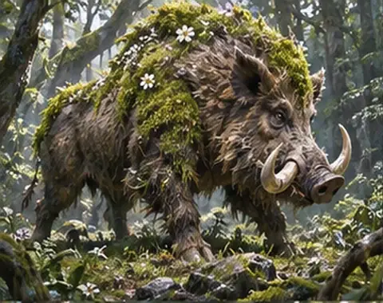

**등급**

D

**서식지**

카르반 · 엘리베른

**능력·특징**

이끼 덮인 멧돼지·영역 방어

**크기**

소형 · 약 10~90cm

**수명**

약 3~15년

**먹이**

수액·균류·곤충·작은 동물 등 종별로 다름

**번식**

알을 낳으며 유충과 성체의 활동 구역이 달라질 수 있음

**활동·습성**

온도와 빛에 민감하며 군집 발생 시 위험 증가

**취약점**

집단을 자극하지 말고 소리·빛·진동을 줄여 이탈

**채집 소재**

외골격·날개막·분비물(보호 장비 필요)

**대응 요령**

접촉을 피하고 마을 경비·길드에 위치 신고

**ecology**

주요 서식지 카르반 · 엘리베른에서 관찰된다. 이끼 덮인 멧돼지·영역 방어 특성이 핵심이며, 계절·마력 농도에 따라 출현 빈도가 달라진다.

**인간과의 관계**

거주지와 겹치면 이동로·채집지에서 우발적 충돌이 생길 수 있다.

**식용**

종별 독성 검사 후 판단

### 02. 루미나모스

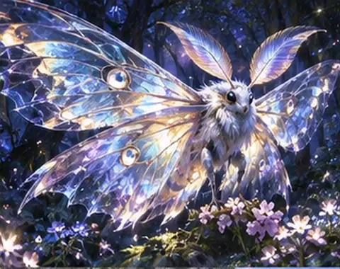

**등급**

C

**서식지**

실바족 왕국

**능력·특징**

빛나는 거대 나방·약한 환각 비늘가루

**크기**

중형 · 약 0.6~3m

**수명**

약 8~35년

**먹이**

수액·균류·곤충·작은 동물 등 종별로 다름

**번식**

알을 낳으며 유충과 성체의 활동 구역이 달라질 수 있음

**활동·습성**

온도와 빛에 민감하며 군집 발생 시 위험 증가

**취약점**

집단을 자극하지 말고 소리·빛·진동을 줄여 이탈

**채집 소재**

외골격·날개막·분비물(보호 장비 필요)

**대응 요령**

접촉을 피하고 마을 경비·길드에 위치 신고

**ecology**

주요 서식지 실바족 왕국에서 관찰된다. 빛나는 거대 나방·약한 환각 비늘가루 특성이 핵심이며, 계절·마력 농도에 따라 출현 빈도가 달라진다.

**인간과의 관계**

거주지와 겹치면 이동로·채집지에서 우발적 충돌이 생길 수 있다.

**식용**

전문 감정 전 식용 금지

### 03. 바인이터

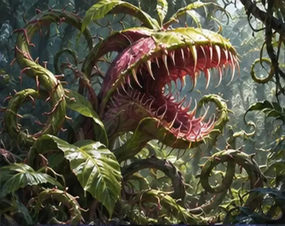

**등급**

C

**서식지**

실바족 왕국

**능력·특징**

움직이는 육식 식물·덩굴 포획

**크기**

중형 · 약 0.6~3m

**수명**

약 8~35년

**먹이**

빛·토양의 마력과 유기물; 일부 종은 작은 동물 포획

**번식**

포자·씨앗 또는 뿌리 분주로 번식하며 생육 조건에 민감

**활동·습성**

습도·일조·토양 마력에 따라 포획 반경이 변화

**취약점**

뿌리 영역을 관찰하고 바람 방향을 확보한 채 거리 유지

**채집 소재**

수액·포자·섬유(독성 검사 필수)

**대응 요령**

접촉을 피하고 마을 경비·길드에 위치 신고

**ecology**

주요 서식지 실바족 왕국에서 관찰된다. 움직이는 육식 식물·덩굴 포획 특성이 핵심이며, 계절·마력 농도에 따라 출현 빈도가 달라진다.

**인간과의 관계**

거주지와 겹치면 농경지·산림 경계에서 접촉 사고가 발생할 수 있다.

**식용**

전문 감정 전 식용 금지

### 04. 미스트울프

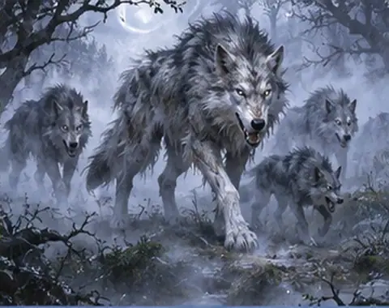

**등급**

B

**서식지**

카르반 · 루가르 · 아비에른

**능력·특징**

안개 속 무리 사냥 늑대

**크기**

중형 · 약 0.6~3m

**수명**

약 8~35년

**먹이**

서식지의 식물·소형 동물 또는 다른 몬스터; 종별 식성 차이

**번식**

대체로 번식기 영역 방어가 강해지며 어린 개체를 보호

**활동·습성**

먹이 활동 시간과 번식기에 따라 행동이 달라짐

**취약점**

무리와 새끼 사이에 들어가지 않고 퇴로를 확보

**채집 소재**

자연 탈락한 털·뿔·비늘 및 마력 부산물

**대응 요령**

숙련 토벌대의 지형 통제와 안전거리 확보 필요

**ecology**

주요 서식지 카르반 · 루가르 · 아비에른에서 관찰된다. 안개 속 무리 사냥 늑대 특성이 핵심이며, 계절·마력 농도에 따라 출현 빈도가 달라진다.

**인간과의 관계**

거주지와 겹치면 이동로·채집지에서 우발적 충돌이 생길 수 있다.

**식용**

전문 감정 전 식용 금지

### 05. 리프래빗

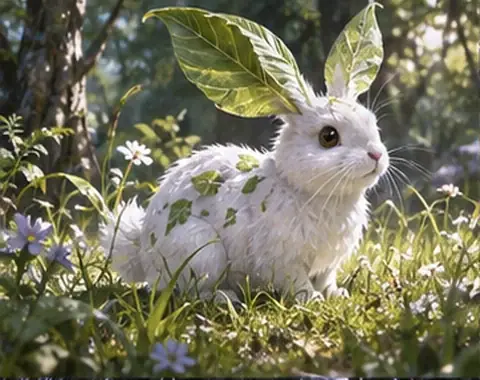

**등급**

F

**서식지**

카르반 · 엘리베른

**능력·특징**

잎 귀의 온순한 초식 토끼

**크기**

소형 · 약 10~90cm

**수명**

약 3~15년

**먹이**

서식지의 식물·소형 동물 또는 다른 몬스터; 종별 식성 차이

**번식**

대체로 번식기 영역 방어가 강해지며 어린 개체를 보호

**활동·습성**

먹이 활동 시간과 번식기에 따라 행동이 달라짐

**취약점**

무리와 새끼 사이에 들어가지 않고 퇴로를 확보

**채집 소재**

자연 탈락한 털·뿔·비늘 및 마력 부산물

**대응 요령**

접촉을 피하고 마을 경비·길드에 위치 신고

**ecology**

주요 서식지 카르반 · 엘리베른에서 관찰된다. 잎 귀의 온순한 초식 토끼 특성이 핵심이며, 계절·마력 농도에 따라 출현 빈도가 달라진다.

**인간과의 관계**

거주지와 겹치면 이동로·채집지에서 우발적 충돌이 생길 수 있다.

**식용**

종별 독성 검사 후 판단

### 06. 스톤리자드

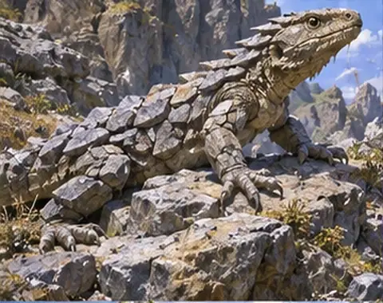

**등급**

C

**서식지**

카르반 · 포르카 옛 영토

**능력·특징**

돌비늘 도마뱀

**크기**

중형 · 약 0.6~3m

**수명**

약 8~35년

**먹이**

서식지의 식물·소형 동물 또는 다른 몬스터; 종별 식성 차이

**번식**

대체로 번식기 영역 방어가 강해지며 어린 개체를 보호

**활동·습성**

먹이 활동 시간과 번식기에 따라 행동이 달라짐

**취약점**

무리와 새끼 사이에 들어가지 않고 퇴로를 확보

**채집 소재**

자연 탈락한 털·뿔·비늘 및 마력 부산물

**대응 요령**

접촉을 피하고 마을 경비·길드에 위치 신고

**ecology**

주요 서식지 카르반 · 포르카 옛 영토에서 관찰된다. 돌비늘 도마뱀 특성이 핵심이며, 계절·마력 농도에 따라 출현 빈도가 달라진다.

**인간과의 관계**

거주지와 겹치면 이동로·채집지에서 우발적 충돌이 생길 수 있다.

**식용**

전문 감정 전 식용 금지

### 07. 크리스탈배트

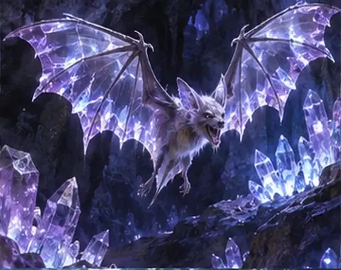

**등급**

D

**서식지**

루가르 · 포르카 옛 영토

**능력·특징**

수정 날개 박쥐·방향 감각 교란음

**크기**

소형 · 약 10~90cm

**수명**

약 3~15년

**먹이**

서식지의 식물·소형 동물 또는 다른 몬스터; 종별 식성 차이

**번식**

대체로 번식기 영역 방어가 강해지며 어린 개체를 보호

**활동·습성**

먹이 활동 시간과 번식기에 따라 행동이 달라짐

**취약점**

무리와 새끼 사이에 들어가지 않고 퇴로를 확보

**채집 소재**

자연 탈락한 털·뿔·비늘 및 마력 부산물

**대응 요령**

접촉을 피하고 마을 경비·길드에 위치 신고

**ecology**

주요 서식지 루가르 · 포르카 옛 영토에서 관찰된다. 수정 날개 박쥐·방향 감각 교란음 특성이 핵심이며, 계절·마력 농도에 따라 출현 빈도가 달라진다.

**인간과의 관계**

거주지와 겹치면 이동로·채집지에서 우발적 충돌이 생길 수 있다.

**식용**

종별 독성 검사 후 판단

### 08. 아이언혼

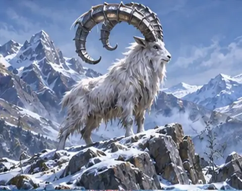

**등급**

C

**서식지**

카르반 · 루가르

**능력·특징**

쇠뿔 산양

**크기**

중형 · 약 0.6~3m

**수명**

약 8~35년

**먹이**

서식지의 식물·소형 동물 또는 다른 몬스터; 종별 식성 차이

**번식**

대체로 번식기 영역 방어가 강해지며 어린 개체를 보호

**활동·습성**

먹이 활동 시간과 번식기에 따라 행동이 달라짐

**취약점**

무리와 새끼 사이에 들어가지 않고 퇴로를 확보

**채집 소재**

자연 탈락한 털·뿔·비늘 및 마력 부산물

**대응 요령**

접촉을 피하고 마을 경비·길드에 위치 신고

**ecology**

주요 서식지 카르반 · 루가르에서 관찰된다. 쇠뿔 산양 특성이 핵심이며, 계절·마력 농도에 따라 출현 빈도가 달라진다.

**인간과의 관계**

거주지와 겹치면 이동로·채집지에서 우발적 충돌이 생길 수 있다.

**식용**

전문 감정 전 식용 금지

### 09. 글룸스파이더

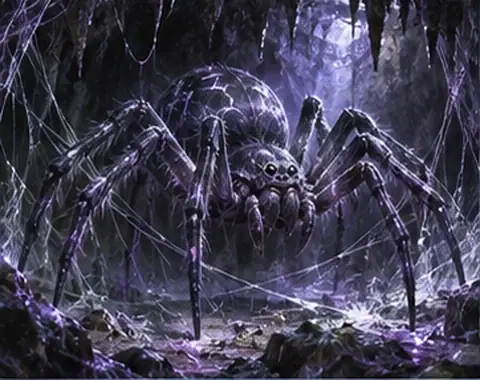

**등급**

C

**서식지**

루가르 · 포르카 옛 영토

**능력·특징**

마비 독의 동굴 거미

**크기**

중형 · 약 0.6~3m

**수명**

약 8~35년

**먹이**

수액·균류·곤충·작은 동물 등 종별로 다름

**번식**

알을 낳으며 유충과 성체의 활동 구역이 달라질 수 있음

**활동·습성**

온도와 빛에 민감하며 군집 발생 시 위험 증가

**취약점**

집단을 자극하지 말고 소리·빛·진동을 줄여 이탈

**채집 소재**

외골격·날개막·분비물(보호 장비 필요)

**대응 요령**

접촉을 피하고 마을 경비·길드에 위치 신고

**ecology**

주요 서식지 루가르 · 포르카 옛 영토에서 관찰된다. 마비 독의 동굴 거미 특성이 핵심이며, 계절·마력 농도에 따라 출현 빈도가 달라진다.

**인간과의 관계**

거주지와 겹치면 이동로·채집지에서 우발적 충돌이 생길 수 있다.

**식용**

전문 감정 전 식용 금지

### 10. 그라니트 골렘

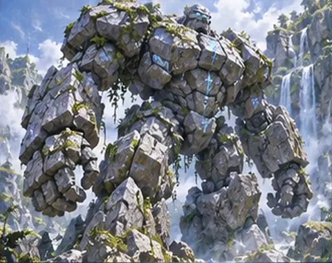

**등급**

B

**서식지**

카르반 · 포르카 옛 영토

**능력·특징**

돌로 이루어진 골렘

**크기**

중형 · 약 0.6~3m

**수명**

약 8~35년

**먹이**

서식지의 식물·소형 동물 또는 다른 몬스터; 종별 식성 차이

**번식**

대체로 번식기 영역 방어가 강해지며 어린 개체를 보호

**활동·습성**

먹이 활동 시간과 번식기에 따라 행동이 달라짐

**취약점**

무리와 새끼 사이에 들어가지 않고 퇴로를 확보

**채집 소재**

자연 탈락한 털·뿔·비늘 및 마력 부산물

**대응 요령**

숙련 토벌대의 지형 통제와 안전거리 확보 필요

**ecology**

주요 서식지 카르반 · 포르카 옛 영토에서 관찰된다. 돌로 이루어진 골렘 특성이 핵심이며, 계절·마력 농도에 따라 출현 빈도가 달라진다.

**인간과의 관계**

거주지와 겹치면 이동로·채집지에서 우발적 충돌이 생길 수 있다.

**식용**

전문 감정 전 식용 금지

### 11. 볼트일

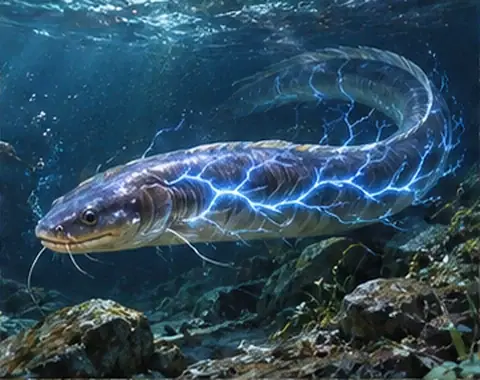

**등급**

C

**서식지**

아비에른

**능력·특징**

전기 방출 민물장어

**크기**

중형 · 약 0.6~3m

**수명**

약 8~35년

**먹이**

수중 미생물·어류·갑각류 등 종과 크기에 따른 먹이

**번식**

산란기 수온과 수질에 민감하며 알 또는 새끼를 보호하는 개체가 있음

**활동·습성**

수위·조류 변화에 맞춰 이동하고 수중에서 기습 가능

**취약점**

육지로 무리하게 유인하지 말고 얕은 수역에서 이동 경로 차단

**채집 소재**

비늘·껍질·수생 마력 결정(채취 허가 필요)

**대응 요령**

접촉을 피하고 마을 경비·길드에 위치 신고

**ecology**

주요 서식지 아비에른에서 관찰된다. 전기 방출 민물장어 특성이 핵심이며, 계절·마력 농도에 따라 출현 빈도가 달라진다.

**인간과의 관계**

거주지와 겹치면 항로·어업 시설을 위협할 수 있어 수로 감시가 필요하다.

**식용**

전문 감정 전 식용 금지

### 12. 코랄크랩

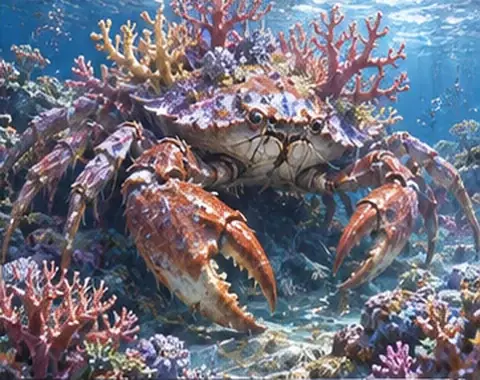

**등급**

D

**서식지**

파르디아 도시 연합

**능력·특징**

산호 껍질의 거대 게

**크기**

소형 · 약 10~90cm

**수명**

약 3~15년

**먹이**

수중 미생물·어류·갑각류 등 종과 크기에 따른 먹이

**번식**

산란기 수온과 수질에 민감하며 알 또는 새끼를 보호하는 개체가 있음

**활동·습성**

수위·조류 변화에 맞춰 이동하고 수중에서 기습 가능

**취약점**

육지로 무리하게 유인하지 말고 얕은 수역에서 이동 경로 차단

**채집 소재**

비늘·껍질·수생 마력 결정(채취 허가 필요)

**대응 요령**

접촉을 피하고 마을 경비·길드에 위치 신고

**ecology**

주요 서식지 파르디아 도시 연합에서 관찰된다. 산호 껍질의 거대 게 특성이 핵심이며, 계절·마력 농도에 따라 출현 빈도가 달라진다.

**인간과의 관계**

거주지와 겹치면 항로·어업 시설을 위협할 수 있어 수로 감시가 필요하다.

**식용**

종별 독성 검사 후 판단

### 13. 레이크서펀트

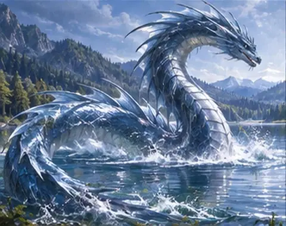

**등급**

B

**서식지**

아비에른

**능력·특징**

호수의 대형 뱀

**크기**

중형 · 약 0.6~3m

**수명**

약 8~35년

**먹이**

수중 미생물·어류·갑각류 등 종과 크기에 따른 먹이

**번식**

산란기 수온과 수질에 민감하며 알 또는 새끼를 보호하는 개체가 있음

**활동·습성**

수위·조류 변화에 맞춰 이동하고 수중에서 기습 가능

**취약점**

육지로 무리하게 유인하지 말고 얕은 수역에서 이동 경로 차단

**채집 소재**

비늘·껍질·수생 마력 결정(채취 허가 필요)

**대응 요령**

숙련 토벌대의 지형 통제와 안전거리 확보 필요

**ecology**

주요 서식지 아비에른에서 관찰된다. 호수의 대형 뱀 특성이 핵심이며, 계절·마력 농도에 따라 출현 빈도가 달라진다.

**인간과의 관계**

거주지와 겹치면 항로·어업 시설을 위협할 수 있어 수로 감시가 필요하다.

**식용**

전문 감정 전 식용 금지

### 14. 문젤리

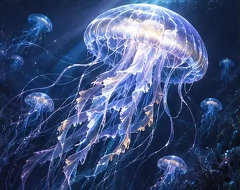

**등급**

F

**서식지**

아비에른 · 파르디아 도시 연합

**능력·특징**

달빛에 빛나는 해파리

**크기**

소형 · 약 10~90cm

**수명**

약 3~15년

**먹이**

수중 미생물·어류·갑각류 등 종과 크기에 따른 먹이

**번식**

산란기 수온과 수질에 민감하며 알 또는 새끼를 보호하는 개체가 있음

**활동·습성**

수위·조류 변화에 맞춰 이동하고 수중에서 기습 가능

**취약점**

육지로 무리하게 유인하지 말고 얕은 수역에서 이동 경로 차단

**채집 소재**

비늘·껍질·수생 마력 결정(채취 허가 필요)

**대응 요령**

접촉을 피하고 마을 경비·길드에 위치 신고

**ecology**

주요 서식지 아비에른 · 파르디아 도시 연합에서 관찰된다. 달빛에 빛나는 해파리 특성이 핵심이며, 계절·마력 농도에 따라 출현 빈도가 달라진다.

**인간과의 관계**

거주지와 겹치면 항로·어업 시설을 위협할 수 있어 수로 감시가 필요하다.

**식용**

종별 독성 검사 후 판단

### 15. 머드샐러맨더

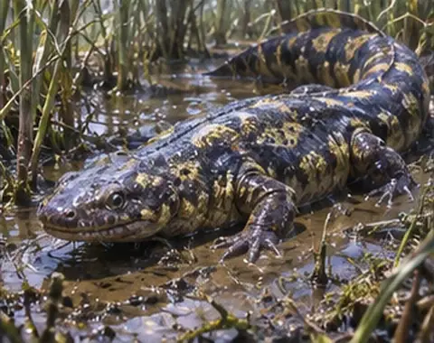

**등급**

D

**서식지**

아비에른

**능력·특징**

늪지 양서류

**크기**

소형 · 약 10~90cm

**수명**

약 3~15년

**먹이**

서식지의 식물·소형 동물 또는 다른 몬스터; 종별 식성 차이

**번식**

대체로 번식기 영역 방어가 강해지며 어린 개체를 보호

**활동·습성**

먹이 활동 시간과 번식기에 따라 행동이 달라짐

**취약점**

무리와 새끼 사이에 들어가지 않고 퇴로를 확보

**채집 소재**

자연 탈락한 털·뿔·비늘 및 마력 부산물

**대응 요령**

접촉을 피하고 마을 경비·길드에 위치 신고

**ecology**

주요 서식지 아비에른에서 관찰된다. 늪지 양서류 특성이 핵심이며, 계절·마력 농도에 따라 출현 빈도가 달라진다.

**인간과의 관계**

거주지와 겹치면 이동로·채집지에서 우발적 충돌이 생길 수 있다.

**식용**

종별 독성 검사 후 판단

### 16. 쉐이드

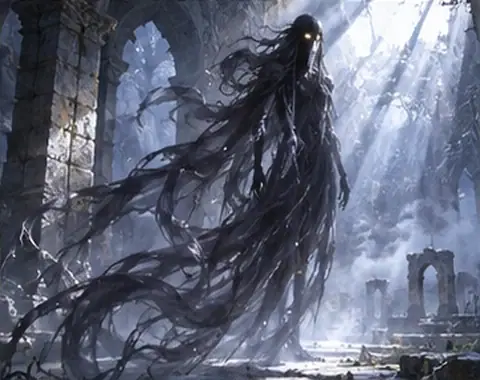

**등급**

B

**서식지**

포르카 옛 영토

**능력·특징**

그림자형 존재·강한 빛에 취약

**크기**

중형 · 약 0.6~3m

**수명**

약 8~35년

**먹이**

서식지의 식물·소형 동물 또는 다른 몬스터; 종별 식성 차이

**번식**

대체로 번식기 영역 방어가 강해지며 어린 개체를 보호

**활동·습성**

먹이 활동 시간과 번식기에 따라 행동이 달라짐

**취약점**

무리와 새끼 사이에 들어가지 않고 퇴로를 확보

**채집 소재**

자연 탈락한 털·뿔·비늘 및 마력 부산물

**대응 요령**

숙련 토벌대의 지형 통제와 안전거리 확보 필요

**ecology**

주요 서식지 포르카 옛 영토에서 관찰된다. 그림자형 존재·강한 빛에 취약 특성이 핵심이며, 계절·마력 농도에 따라 출현 빈도가 달라진다.

**인간과의 관계**

거주지와 겹치면 이동로·채집지에서 우발적 충돌이 생길 수 있다.

**식용**

전문 감정 전 식용 금지

### 17. 엠버링

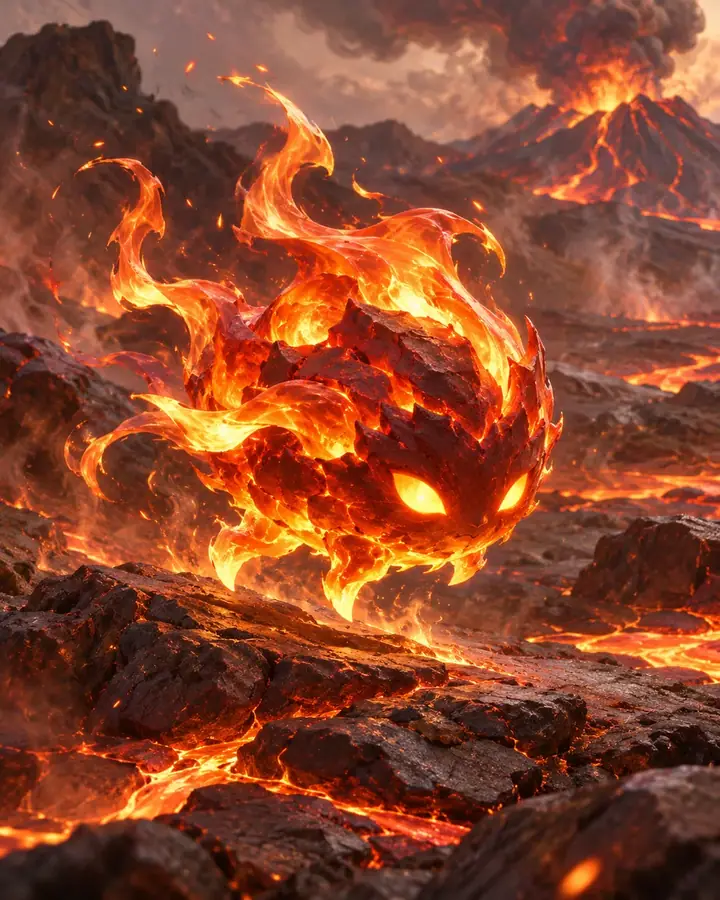

**등급**

D

**서식지**

화산·사막·특수 지대 (국가 미정)

**능력·특징**

작은 불꽃 생명체

**크기**

소형 · 약 10~90cm

**수명**

약 3~15년

**먹이**

서식지의 식물·소형 동물 또는 다른 몬스터; 종별 식성 차이

**번식**

대체로 번식기 영역 방어가 강해지며 어린 개체를 보호

**활동·습성**

지열이 높은 곳이나 건조한 계절에 활동이 증가

**취약점**

냉각·습도 변화로 활동이 둔해질 수 있으나 개체차가 큼

**채집 소재**

내열성 껍질·화염 결정(안전 처리 필수)

**대응 요령**

접촉을 피하고 마을 경비·길드에 위치 신고

**ecology**

주요 서식지 화산·사막·특수 지대 (국가 미정)에서 관찰된다. 작은 불꽃 생명체 특성이 핵심이며, 계절·마력 농도에 따라 출현 빈도가 달라진다.

**인간과의 관계**

거주지와 겹치면 이동로·채집지에서 우발적 충돌이 생길 수 있다.

**식용**

종별 독성 검사 후 판단

### 18. 프로스트폭스

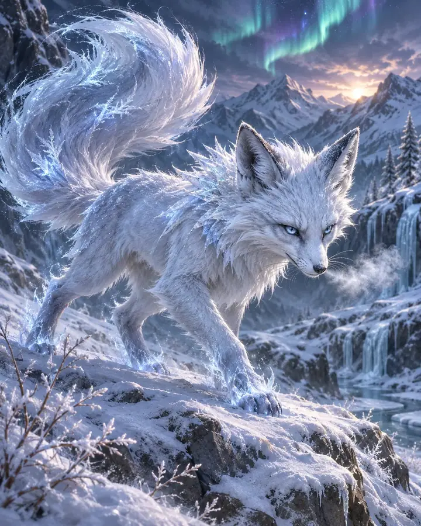

**등급**

D

**서식지**

노르벨·북방

**능력·특징**

냉기 여우

**크기**

소형 · 약 10~90cm

**수명**

약 3~15년

**먹이**

서식지의 식물·소형 동물 또는 다른 몬스터; 종별 식성 차이

**번식**

대체로 번식기 영역 방어가 강해지며 어린 개체를 보호

**활동·습성**

기온이 낮은 시간대에 활발하며 눈보라를 은신처로 활용

**취약점**

지속적인 고열보다 발밑 지형 통제와 시야 확보가 유효

**채집 소재**

털·냉기 결정(자연 탈락물 우선)

**대응 요령**

접촉을 피하고 마을 경비·길드에 위치 신고

**ecology**

주요 서식지 노르벨·북방에서 관찰된다. 냉기 여우 특성이 핵심이며, 계절·마력 농도에 따라 출현 빈도가 달라진다.

**인간과의 관계**

거주지와 겹치면 이동로·채집지에서 우발적 충돌이 생길 수 있다.

**식용**

종별 독성 검사 후 판단

### 19. 에코마스크

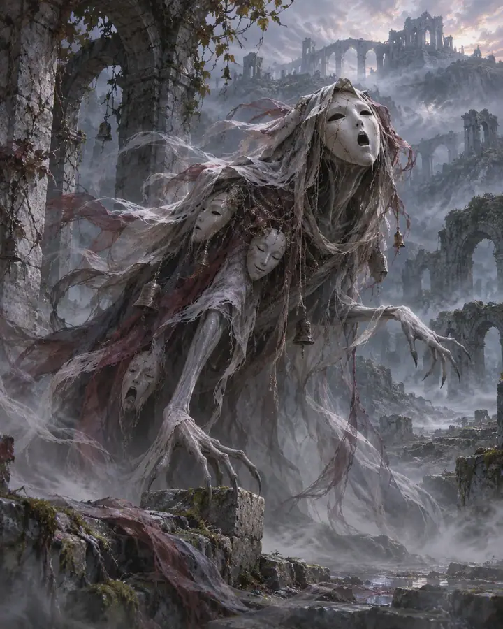

**등급**

B

**서식지**

포르카 옛 영토

**능력·특징**

폐허에서 소리를 흉내 내는 존재

**크기**

중형 · 약 0.6~3m

**수명**

약 8~35년

**먹이**

서식지의 식물·소형 동물 또는 다른 몬스터; 종별 식성 차이

**번식**

대체로 번식기 영역 방어가 강해지며 어린 개체를 보호

**활동·습성**

먹이 활동 시간과 번식기에 따라 행동이 달라짐

**취약점**

무리와 새끼 사이에 들어가지 않고 퇴로를 확보

**채집 소재**

자연 탈락한 털·뿔·비늘 및 마력 부산물

**대응 요령**

숙련 토벌대의 지형 통제와 안전거리 확보 필요

**ecology**

주요 서식지 포르카 옛 영토에서 관찰된다. 폐허에서 소리를 흉내 내는 존재 특성이 핵심이며, 계절·마력 농도에 따라 출현 빈도가 달라진다.

**인간과의 관계**

거주지와 겹치면 이동로·채집지에서 우발적 충돌이 생길 수 있다.

**식용**

전문 감정 전 식용 금지

### 20. 에인션트 트렌트

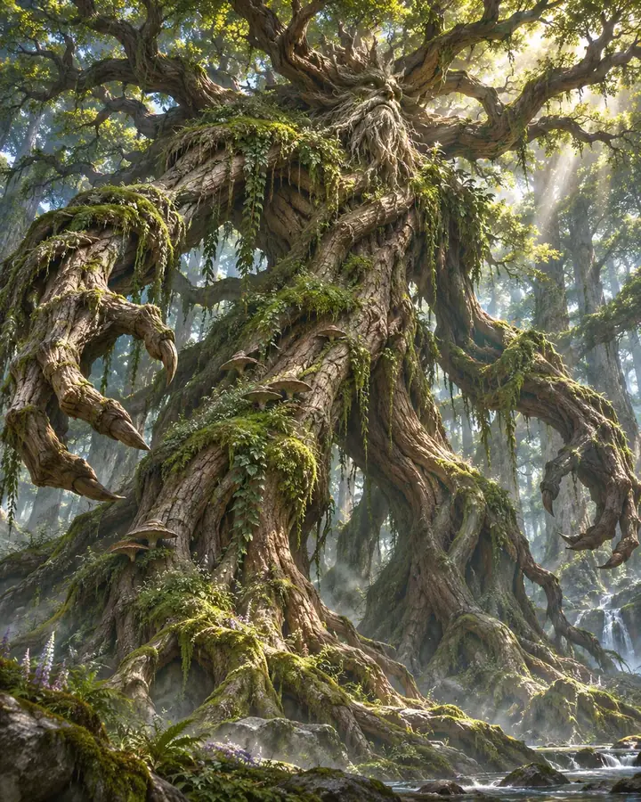

**등급**

A

**서식지**

실바족 왕국

**능력·특징**

오래된 나무 몬스터

**크기**

대형 · 약 2~8m

**수명**

약 20~80년

**먹이**

빛·토양의 마력과 유기물; 일부 종은 작은 동물 포획

**번식**

포자·씨앗 또는 뿌리 분주로 번식하며 생육 조건에 민감

**활동·습성**

습도·일조·토양 마력에 따라 포획 반경이 변화

**취약점**

뿌리 영역을 관찰하고 바람 방향을 확보한 채 거리 유지

**채집 소재**

수액·포자·섬유(독성 검사 필수)

**대응 요령**

숙련 토벌대의 지형 통제와 안전거리 확보 필요

**ecology**

주요 서식지 실바족 왕국에서 관찰된다. 오래된 나무 몬스터 특성이 핵심이며, 계절·마력 농도에 따라 출현 빈도가 달라진다.

**인간과의 관계**

거주지와 겹치면 농경지·산림 경계에서 접촉 사고가 발생할 수 있다.

**식용**

전문 감정 전 식용 금지

### 21. 오브시디언 라이노

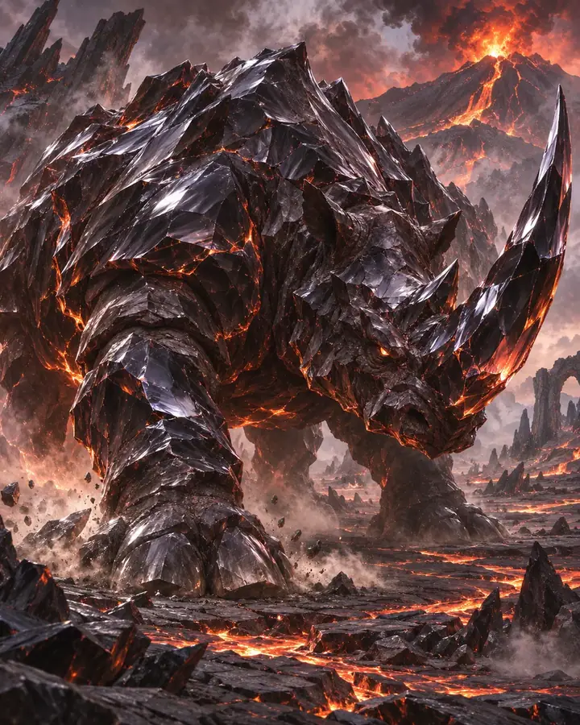

**등급**

A

**서식지**

화산·사막·특수 지대 (국가 미정)

**능력·특징**

흑요석 피부의 거대 코뿔소

**크기**

대형 · 약 2~8m

**수명**

약 20~80년

**먹이**

서식지의 식물·소형 동물 또는 다른 몬스터; 종별 식성 차이

**번식**

대체로 번식기 영역 방어가 강해지며 어린 개체를 보호

**활동·습성**

지열이 높은 곳이나 건조한 계절에 활동이 증가

**취약점**

냉각·습도 변화로 활동이 둔해질 수 있으나 개체차가 큼

**채집 소재**

내열성 껍질·화염 결정(안전 처리 필수)

**대응 요령**

숙련 토벌대의 지형 통제와 안전거리 확보 필요

**ecology**

주요 서식지 화산·사막·특수 지대 (국가 미정)에서 관찰된다. 흑요석 피부의 거대 코뿔소 특성이 핵심이며, 계절·마력 농도에 따라 출현 빈도가 달라진다.

**인간과의 관계**

거주지와 겹치면 이동로·채집지에서 우발적 충돌이 생길 수 있다.

**식용**

전문 감정 전 식용 금지

### 22. 트리헤드 바이퍼

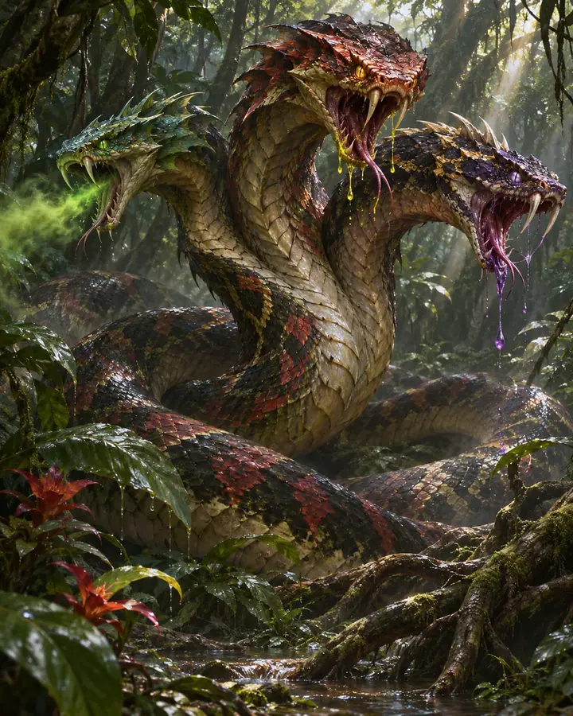

**등급**

A

**서식지**

실바족 왕국

**능력·특징**

머리마다 독이 다른 세 머리 독사

**크기**

대형 · 약 2~8m

**수명**

약 20~80년

**먹이**

서식지의 식물·소형 동물 또는 다른 몬스터; 종별 식성 차이

**번식**

대체로 번식기 영역 방어가 강해지며 어린 개체를 보호

**활동·습성**

먹이 활동 시간과 번식기에 따라 행동이 달라짐

**취약점**

무리와 새끼 사이에 들어가지 않고 퇴로를 확보

**채집 소재**

자연 탈락한 털·뿔·비늘 및 마력 부산물

**대응 요령**

숙련 토벌대의 지형 통제와 안전거리 확보 필요

**ecology**

주요 서식지 실바족 왕국에서 관찰된다. 머리마다 독이 다른 세 머리 독사 특성이 핵심이며, 계절·마력 농도에 따라 출현 빈도가 달라진다.

**인간과의 관계**

거주지와 겹치면 이동로·채집지에서 우발적 충돌이 생길 수 있다.

**식용**

전문 감정 전 식용 금지

### 23. 썬더록

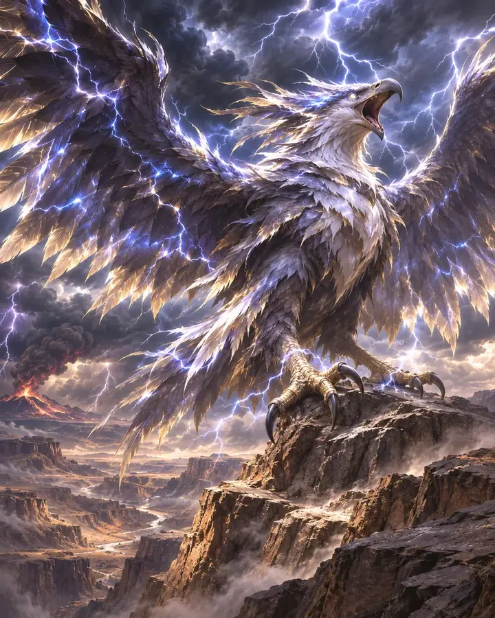

**등급**

A

**서식지**

화산·사막·특수 지대 (국가 미정)

**능력·특징**

번개를 사용하는 거대 맹금

**크기**

대형 · 약 2~8m

**수명**

약 20~80년

**먹이**

서식지의 식물·소형 동물 또는 다른 몬스터; 종별 식성 차이

**번식**

대체로 번식기 영역 방어가 강해지며 어린 개체를 보호

**활동·습성**

먹이 활동 시간과 번식기에 따라 행동이 달라짐

**취약점**

무리와 새끼 사이에 들어가지 않고 퇴로를 확보

**채집 소재**

자연 탈락한 털·뿔·비늘 및 마력 부산물

**대응 요령**

숙련 토벌대의 지형 통제와 안전거리 확보 필요

**ecology**

주요 서식지 화산·사막·특수 지대 (국가 미정)에서 관찰된다. 번개를 사용하는 거대 맹금 특성이 핵심이며, 계절·마력 농도에 따라 출현 빈도가 달라진다.

**인간과의 관계**

거주지와 겹치면 이동로·채집지에서 우발적 충돌이 생길 수 있다.

**식용**

전문 감정 전 식용 금지

### 24. 글레이셜 베어

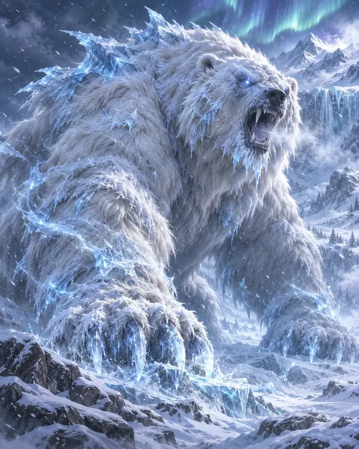

**등급**

A

**서식지**

노르벨·북방

**능력·특징**

냉기를 사용하는 거대 설곰

**크기**

대형 · 약 2~8m

**수명**

약 20~80년

**먹이**

수중 미생물·어류·갑각류 등 종과 크기에 따른 먹이

**번식**

산란기 수온과 수질에 민감하며 알 또는 새끼를 보호하는 개체가 있음

**활동·습성**

기온이 낮은 시간대에 활발하며 눈보라를 은신처로 활용

**취약점**

지속적인 고열보다 발밑 지형 통제와 시야 확보가 유효

**채집 소재**

털·냉기 결정(자연 탈락물 우선)

**대응 요령**

숙련 토벌대의 지형 통제와 안전거리 확보 필요

**ecology**

주요 서식지 노르벨·북방에서 관찰된다. 냉기를 사용하는 거대 설곰 특성이 핵심이며, 계절·마력 농도에 따라 출현 빈도가 달라진다.

**인간과의 관계**

거주지와 겹치면 항로·어업 시설을 위협할 수 있어 수로 감시가 필요하다.

**식용**

전문 감정 전 식용 금지

### 25. 인페르노 드래곤

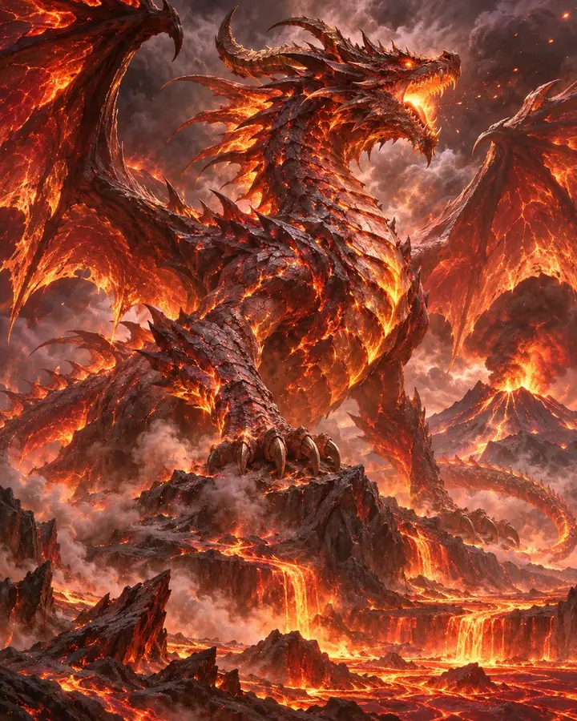

**등급**

S

**서식지**

화산·사막·특수 지대 (국가 미정)

**능력·특징**

고대 화염 드래곤

**크기**

초대형 · 약 5~35m

**수명**

약 60~300년

**먹이**

서식지의 식물·소형 동물 또는 다른 몬스터; 종별 식성 차이

**번식**

대체로 번식기 영역 방어가 강해지며 어린 개체를 보호

**활동·습성**

지열이 높은 곳이나 건조한 계절에 활동이 증가

**취약점**

냉각·습도 변화로 활동이 둔해질 수 있으나 개체차가 큼

**채집 소재**

내열성 껍질·화염 결정(안전 처리 필수)

**대응 요령**

개체와 직접 교전보다 주변 민간인 대피 및 국가급 방어 우선

**ecology**

주요 서식지 화산·사막·특수 지대 (국가 미정)에서 관찰된다. 고대 화염 드래곤 특성이 핵심이며, 계절·마력 농도에 따라 출현 빈도가 달라진다.

**인간과의 관계**

거주지와 겹치면 이동로·채집지에서 우발적 충돌이 생길 수 있다.

**식용**

전문 감정 전 식용 금지

### 26. 어비스 크라켄

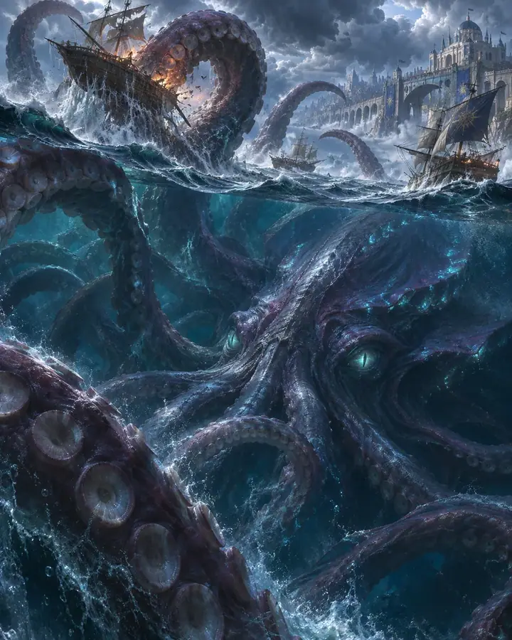

**등급**

S

**서식지**

파르디아 도시 연합

**능력·특징**

선박을 침몰시키는 심해 거대 오징어

**크기**

초대형 · 약 5~35m

**수명**

약 60~300년

**먹이**

수중 미생물·어류·갑각류 등 종과 크기에 따른 먹이

**번식**

산란기 수온과 수질에 민감하며 알 또는 새끼를 보호하는 개체가 있음

**활동·습성**

수위·조류 변화에 맞춰 이동하고 수중에서 기습 가능

**취약점**

육지로 무리하게 유인하지 말고 얕은 수역에서 이동 경로 차단

**채집 소재**

비늘·껍질·수생 마력 결정(채취 허가 필요)

**대응 요령**

개체와 직접 교전보다 주변 민간인 대피 및 국가급 방어 우선

**ecology**

주요 서식지 파르디아 도시 연합에서 관찰된다. 선박을 침몰시키는 심해 거대 오징어 특성이 핵심이며, 계절·마력 농도에 따라 출현 빈도가 달라진다.

**인간과의 관계**

거주지와 겹치면 항로·어업 시설을 위협할 수 있어 수로 감시가 필요하다.

**식용**

전문 감정 전 식용 금지

### 27. 월드루트 트렌트

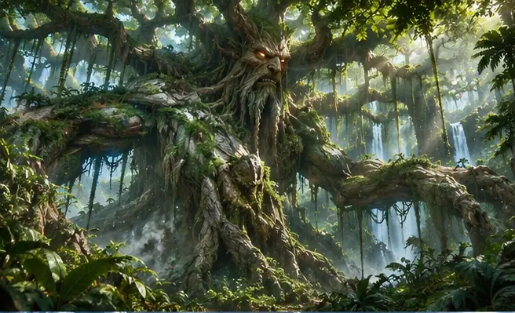

**등급**

S

**서식지**

실바족 왕국

**능력·특징**

거대한 뿌리를 조종하는 나무 몬스터

**크기**

초대형 · 약 5~35m

**수명**

약 60~300년

**먹이**

빛·토양의 마력과 유기물; 일부 종은 작은 동물 포획

**번식**

포자·씨앗 또는 뿌리 분주로 번식하며 생육 조건에 민감

**활동·습성**

습도·일조·토양 마력에 따라 포획 반경이 변화

**취약점**

뿌리 영역을 관찰하고 바람 방향을 확보한 채 거리 유지

**채집 소재**

수액·포자·섬유(독성 검사 필수)

**대응 요령**

개체와 직접 교전보다 주변 민간인 대피 및 국가급 방어 우선

**ecology**

주요 서식지 실바족 왕국에서 관찰된다. 거대한 뿌리를 조종하는 나무 몬스터 특성이 핵심이며, 계절·마력 농도에 따라 출현 빈도가 달라진다.

**인간과의 관계**

거주지와 겹치면 농경지·산림 경계에서 접촉 사고가 발생할 수 있다.

**식용**

전문 감정 전 식용 금지

### 28. 둠베히모스

**등급**

S

**서식지**

화산·사막·특수 지대 (국가 미정)

**능력·특징**

여섯 다리의 초거대 육상 괴수·지진

**크기**

초대형 · 약 5~35m

**수명**

약 60~300년

**먹이**

수액·균류·곤충·작은 동물 등 종별로 다름

**번식**

알을 낳으며 유충과 성체의 활동 구역이 달라질 수 있음

**활동·습성**

온도와 빛에 민감하며 군집 발생 시 위험 증가

**취약점**

집단을 자극하지 말고 소리·빛·진동을 줄여 이탈

**채집 소재**

외골격·날개막·분비물(보호 장비 필요)

**대응 요령**

개체와 직접 교전보다 주변 민간인 대피 및 국가급 방어 우선

**ecology**

주요 서식지 화산·사막·특수 지대 (국가 미정)에서 관찰된다. 여섯 다리의 초거대 육상 괴수·지진 특성이 핵심이며, 계절·마력 농도에 따라 출현 빈도가 달라진다.

**인간과의 관계**

거주지와 겹치면 이동로·채집지에서 우발적 충돌이 생길 수 있다.

**식용**

전문 감정 전 식용 금지

### 29. 니플헤임 드래곤

**등급**

SS

**서식지**

노르벨·북방

**능력·특징**

광역 눈보라의 고대 빙룡

**크기**

거대·특이 개체 · 크기 편차 큼

**수명**

수명 조사 중

**먹이**

서식지의 식물·소형 동물 또는 다른 몬스터; 종별 식성 차이

**번식**

대체로 번식기 영역 방어가 강해지며 어린 개체를 보호

**활동·습성**

기온이 낮은 시간대에 활발하며 눈보라를 은신처로 활용

**취약점**

지속적인 고열보다 발밑 지형 통제와 시야 확보가 유효

**채집 소재**

털·냉기 결정(자연 탈락물 우선)

**대응 요령**

개체와 직접 교전보다 주변 민간인 대피 및 국가급 방어 우선

**ecology**

주요 서식지 노르벨·북방에서 관찰된다. 광역 눈보라의 고대 빙룡 특성이 핵심이며, 계절·마력 농도에 따라 출현 빈도가 달라진다.

**인간과의 관계**

거주지와 겹치면 이동로·채집지에서 우발적 충돌이 생길 수 있다.

**식용**

전문 감정 전 식용 금지

### 30. 레비아탄

**등급**

SS

**서식지**

파르디아 도시 연합

**능력·특징**

함대를 위협하는 초거대 해수

**크기**

거대·특이 개체 · 크기 편차 큼

**수명**

수명 조사 중

**먹이**

수중 미생물·어류·갑각류 등 종과 크기에 따른 먹이

**번식**

산란기 수온과 수질에 민감하며 알 또는 새끼를 보호하는 개체가 있음

**활동·습성**

수위·조류 변화에 맞춰 이동하고 수중에서 기습 가능

**취약점**

육지로 무리하게 유인하지 말고 얕은 수역에서 이동 경로 차단

**채집 소재**

비늘·껍질·수생 마력 결정(채취 허가 필요)

**대응 요령**

개체와 직접 교전보다 주변 민간인 대피 및 국가급 방어 우선

**ecology**

주요 서식지 파르디아 도시 연합에서 관찰된다. 함대를 위협하는 초거대 해수 특성이 핵심이며, 계절·마력 농도에 따라 출현 빈도가 달라진다.

**인간과의 관계**

거주지와 겹치면 항로·어업 시설을 위협할 수 있어 수로 감시가 필요하다.

**식용**

전문 감정 전 식용 금지

### 31. 아포칼립스 스콜피온

**등급**

SS

**서식지**

화산·사막·특수 지대 (국가 미정)

**능력·특징**

마력 독·마법 저항의 거대 사막 전갈

**크기**

거대·특이 개체 · 크기 편차 큼

**수명**

수명 조사 중

**먹이**

서식지의 식물·소형 동물 또는 다른 몬스터; 종별 식성 차이

**번식**

대체로 번식기 영역 방어가 강해지며 어린 개체를 보호

**활동·습성**

먹이 활동 시간과 번식기에 따라 행동이 달라짐

**취약점**

무리와 새끼 사이에 들어가지 않고 퇴로를 확보

**채집 소재**

자연 탈락한 털·뿔·비늘 및 마력 부산물

**대응 요령**

개체와 직접 교전보다 주변 민간인 대피 및 국가급 방어 우선

**ecology**

주요 서식지 화산·사막·특수 지대 (국가 미정)에서 관찰된다. 마력 독·마법 저항의 거대 사막 전갈 특성이 핵심이며, 계절·마력 농도에 따라 출현 빈도가 달라진다.

**인간과의 관계**

거주지와 겹치면 이동로·채집지에서 우발적 충돌이 생길 수 있다.

**식용**

전문 감정 전 식용 금지

### 32. 이클립스 피닉스

**등급**

SS

**서식지**

화산·사막·특수 지대 (국가 미정)

**능력·특징**

검보라 불꽃·조건부 재생

**크기**

거대·특이 개체 · 크기 편차 큼

**수명**

수명 조사 중

**먹이**

서식지의 식물·소형 동물 또는 다른 몬스터; 종별 식성 차이

**번식**

대체로 번식기 영역 방어가 강해지며 어린 개체를 보호

**활동·습성**

지열이 높은 곳이나 건조한 계절에 활동이 증가

**취약점**

냉각·습도 변화로 활동이 둔해질 수 있으나 개체차가 큼

**채집 소재**

내열성 껍질·화염 결정(안전 처리 필수)

**대응 요령**

개체와 직접 교전보다 주변 민간인 대피 및 국가급 방어 우선

**ecology**

주요 서식지 화산·사막·특수 지대 (국가 미정)에서 관찰된다. 검보라 불꽃·조건부 재생 특성이 핵심이며, 계절·마력 농도에 따라 출현 빈도가 달라진다.

**인간과의 관계**

거주지와 겹치면 이동로·채집지에서 우발적 충돌이 생길 수 있다.

**식용**

전문 감정 전 식용 금지

### 33. 보이드 워처

**등급**

규격 외

**서식지**

화산·사막·특수 지대 (국가 미정)

**능력·특징**

마력 간섭 그림자 존재

**크기**

거대·특이 개체 · 크기 편차 큼

**수명**

수명 조사 중

**먹이**

서식지의 식물·소형 동물 또는 다른 몬스터; 종별 식성 차이

**번식**

대체로 번식기 영역 방어가 강해지며 어린 개체를 보호

**활동·습성**

먹이 활동 시간과 번식기에 따라 행동이 달라짐

**취약점**

무리와 새끼 사이에 들어가지 않고 퇴로를 확보

**채집 소재**

자연 탈락한 털·뿔·비늘 및 마력 부산물

**대응 요령**

현상 조사와 격리 우선, 불명확한 마법 효과에 접근 금지

**ecology**

주요 서식지 화산·사막·특수 지대 (국가 미정)에서 관찰된다. 마력 간섭 그림자 존재 특성이 핵심이며, 계절·마력 농도에 따라 출현 빈도가 달라진다.

**인간과의 관계**

거주지와 겹치면 이동로·채집지에서 우발적 충돌이 생길 수 있다.

**식용**

전문 감정 전 식용 금지

### 34. 프리즘 타이탄

**등급**

규격 외

**서식지**

화산·사막·특수 지대 (국가 미정)

**능력·특징**

마법 흡수·굴절 수정 거인

**크기**

거대·특이 개체 · 크기 편차 큼

**수명**

수명 조사 중

**먹이**

서식지의 식물·소형 동물 또는 다른 몬스터; 종별 식성 차이

**번식**

대체로 번식기 영역 방어가 강해지며 어린 개체를 보호

**활동·습성**

먹이 활동 시간과 번식기에 따라 행동이 달라짐

**취약점**

무리와 새끼 사이에 들어가지 않고 퇴로를 확보

**채집 소재**

자연 탈락한 털·뿔·비늘 및 마력 부산물

**대응 요령**

현상 조사와 격리 우선, 불명확한 마법 효과에 접근 금지

**ecology**

주요 서식지 화산·사막·특수 지대 (국가 미정)에서 관찰된다. 마법 흡수·굴절 수정 거인 특성이 핵심이며, 계절·마력 농도에 따라 출현 빈도가 달라진다.

**인간과의 관계**

거주지와 겹치면 이동로·채집지에서 우발적 충돌이 생길 수 있다.

**식용**

전문 감정 전 식용 금지

### 35. 나인테일 스펙터

**등급**

규격 외

**서식지**

화산·사막·특수 지대 (국가 미정)

**능력·특징**

환각·감각 교란·인간 형태 모방 영체

**크기**

거대·특이 개체 · 크기 편차 큼

**수명**

수명 조사 중

**먹이**

수중 미생물·어류·갑각류 등 종과 크기에 따른 먹이

**번식**

산란기 수온과 수질에 민감하며 알 또는 새끼를 보호하는 개체가 있음

**활동·습성**

수위·조류 변화에 맞춰 이동하고 수중에서 기습 가능

**취약점**

육지로 무리하게 유인하지 말고 얕은 수역에서 이동 경로 차단

**채집 소재**

비늘·껍질·수생 마력 결정(채취 허가 필요)

**대응 요령**

현상 조사와 격리 우선, 불명확한 마법 효과에 접근 금지

**ecology**

주요 서식지 화산·사막·특수 지대 (국가 미정)에서 관찰된다. 환각·감각 교란·인간 형태 모방 영체 특성이 핵심이며, 계절·마력 농도에 따라 출현 빈도가 달라진다.

**인간과의 관계**

거주지와 겹치면 항로·어업 시설을 위협할 수 있어 수로 감시가 필요하다.

**식용**

전문 감정 전 식용 금지

### 36. 앰버테일

**등급**

D

**서식지**

카르반 · 엘리베른

**능력·특징**

불씨 꼬리 여우

**크기**

소형 · 몸길이 50~75cm

**수명**

약 8~12년

**먹이**

곤충·작은 설치류·열매

**번식**

산란기 수온과 수질에 민감하며 알 또는 새끼를 보호하는 개체가 있음

**활동·습성**

야행성. 위협받으면 꼬리 끝에 불씨를 일으켜 경고

**취약점**

비에 젖으면 꼬리의 발화 능력이 약해짐

**채집 소재**

자연 탈락 꼬리털 · 저급 화염 마법 촉매

**대응 요령**

급히 쫓지 말고 마른 풀을 치운 뒤 안전한 방향으로 유도

**ecology**

주요 서식지 카르반 · 엘리베른에서 관찰된다. 불씨 꼬리 여우 특성이 핵심이며, 계절·마력 농도에 따라 출현 빈도가 달라진다.

**인간과의 관계**

건조한 계절에는 꼬리 불씨로 산불이 발생할 수 있어 숲길 순찰 대상

**식용**

종별 독성 검사 후 판단

### 37. 터널몰

**등급**

C

**서식지**

카르반 · 엘리베른

**능력·특징**

굴착으로 지반 침하 유발

**크기**

중형 · 약 0.6~3m

**수명**

약 8~35년

**먹이**

서식지의 식물·소형 동물 또는 다른 몬스터; 종별 식성 차이

**번식**

대체로 번식기 영역 방어가 강해지며 어린 개체를 보호

**활동·습성**

먹이 활동 시간과 번식기에 따라 행동이 달라짐

**취약점**

무리와 새끼 사이에 들어가지 않고 퇴로를 확보

**채집 소재**

자연 탈락한 털·뿔·비늘 및 마력 부산물

**대응 요령**

접촉을 피하고 마을 경비·길드에 위치 신고

**ecology**

주요 서식지 카르반 · 엘리베른에서 관찰된다. 굴착으로 지반 침하 유발 특성이 핵심이며, 계절·마력 농도에 따라 출현 빈도가 달라진다.

**인간과의 관계**

거주지와 겹치면 이동로·채집지에서 우발적 충돌이 생길 수 있다.

**식용**

전문 감정 전 식용 금지

### 38. 글래스핀

**등급**

D

**서식지**

아비에른

**능력·특징**

투명한 강물고기

**크기**

소형 · 약 10~90cm

**수명**

약 3~15년

**먹이**

수중 미생물·어류·갑각류 등 종과 크기에 따른 먹이

**번식**

산란기 수온과 수질에 민감하며 알 또는 새끼를 보호하는 개체가 있음

**활동·습성**

수위·조류 변화에 맞춰 이동하고 수중에서 기습 가능

**취약점**

육지로 무리하게 유인하지 말고 얕은 수역에서 이동 경로 차단

**채집 소재**

비늘·껍질·수생 마력 결정(채취 허가 필요)

**대응 요령**

접촉을 피하고 마을 경비·길드에 위치 신고

**ecology**

주요 서식지 아비에른에서 관찰된다. 투명한 강물고기 특성이 핵심이며, 계절·마력 농도에 따라 출현 빈도가 달라진다.

**인간과의 관계**

거주지와 겹치면 항로·어업 시설을 위협할 수 있어 수로 감시가 필요하다.

**식용**

종별 독성 검사 후 판단

### 39. 샌드스파인

**등급**

B

**서식지**

화산·사막·특수 지대 (국가 미정)

**능력·특징**

사막 가시꼬리 도마뱀

**크기**

중형 · 약 0.6~3m

**수명**

약 8~35년

**먹이**

서식지의 식물·소형 동물 또는 다른 몬스터; 종별 식성 차이

**번식**

대체로 번식기 영역 방어가 강해지며 어린 개체를 보호

**활동·습성**

먹이 활동 시간과 번식기에 따라 행동이 달라짐

**취약점**

무리와 새끼 사이에 들어가지 않고 퇴로를 확보

**채집 소재**

자연 탈락한 털·뿔·비늘 및 마력 부산물

**대응 요령**

숙련 토벌대의 지형 통제와 안전거리 확보 필요

**ecology**

주요 서식지 화산·사막·특수 지대 (국가 미정)에서 관찰된다. 사막 가시꼬리 도마뱀 특성이 핵심이며, 계절·마력 농도에 따라 출현 빈도가 달라진다.

**인간과의 관계**

거주지와 겹치면 이동로·채집지에서 우발적 충돌이 생길 수 있다.

**식용**

전문 감정 전 식용 금지

### 40. 스포어캡

**등급**

C

**서식지**

실바족 왕국

**능력·특징**

졸음 포자를 퍼뜨리는 버섯

**크기**

중형 · 약 0.6~3m

**수명**

약 8~35년

**먹이**

빛·토양의 마력과 유기물; 일부 종은 작은 동물 포획

**번식**

포자·씨앗 또는 뿌리 분주로 번식하며 생육 조건에 민감

**활동·습성**

습도·일조·토양 마력에 따라 포획 반경이 변화

**취약점**

뿌리 영역을 관찰하고 바람 방향을 확보한 채 거리 유지

**채집 소재**

수액·포자·섬유(독성 검사 필수)

**대응 요령**

접촉을 피하고 마을 경비·길드에 위치 신고

**ecology**

주요 서식지 실바족 왕국에서 관찰된다. 졸음 포자를 퍼뜨리는 버섯 특성이 핵심이며, 계절·마력 농도에 따라 출현 빈도가 달라진다.

**인간과의 관계**

거주지와 겹치면 농경지·산림 경계에서 접촉 사고가 발생할 수 있다.

**식용**

전문 감정 전 식용 금지

### 41. 실버클로

**등급**

B

**서식지**

루가르 · 노르벨·북방

**능력·특징**

산악 은발톱 스라소니

**크기**

중형 · 약 0.6~3m

**수명**

약 8~35년

**먹이**

서식지의 식물·소형 동물 또는 다른 몬스터; 종별 식성 차이

**번식**

대체로 번식기 영역 방어가 강해지며 어린 개체를 보호

**활동·습성**

먹이 활동 시간과 번식기에 따라 행동이 달라짐

**취약점**

무리와 새끼 사이에 들어가지 않고 퇴로를 확보

**채집 소재**

자연 탈락한 털·뿔·비늘 및 마력 부산물

**대응 요령**

숙련 토벌대의 지형 통제와 안전거리 확보 필요

**ecology**

주요 서식지 루가르 · 노르벨·북방에서 관찰된다. 산악 은발톱 스라소니 특성이 핵심이며, 계절·마력 농도에 따라 출현 빈도가 달라진다.

**인간과의 관계**

거주지와 겹치면 이동로·채집지에서 우발적 충돌이 생길 수 있다.

**식용**

전문 감정 전 식용 금지

### 42. 루미비틀

**등급**

F

**서식지**

카르반 · 아비에른 · 엘리베른

**능력·특징**

발광 딱정벌레

**크기**

소형 · 약 10~90cm

**수명**

약 3~15년

**먹이**

수액·균류·곤충·작은 동물 등 종별로 다름

**번식**

알을 낳으며 유충과 성체의 활동 구역이 달라질 수 있음

**활동·습성**

온도와 빛에 민감하며 군집 발생 시 위험 증가

**취약점**

집단을 자극하지 말고 소리·빛·진동을 줄여 이탈

**채집 소재**

외골격·날개막·분비물(보호 장비 필요)

**대응 요령**

접촉을 피하고 마을 경비·길드에 위치 신고

**ecology**

주요 서식지 카르반 · 아비에른 · 엘리베른에서 관찰된다. 발광 딱정벌레 특성이 핵심이며, 계절·마력 농도에 따라 출현 빈도가 달라진다.

**인간과의 관계**

거주지와 겹치면 이동로·채집지에서 우발적 충돌이 생길 수 있다.

**식용**

종별 독성 검사 후 판단

### 43. 섀도팬서

**등급**

A

**서식지**

실바족 왕국

**능력·특징**

그림자 사이 단거리 이동 흑표범

**크기**

대형 · 몸길이 2~3m

**수명**

약 20~30년

**먹이**

대형 초식 몬스터

**번식**

대체로 번식기 영역 방어가 강해지며 어린 개체를 보호

**활동·습성**

단독 생활·강한 영역 의식. 그림자를 통해 짧은 거리 이동

**취약점**

그림자가 거의 없는 균일한 조명 환경에서 이동 능력 제한

**채집 소재**

발톱·마석 · 고급 은신 마법 연구용

**대응 요령**

도주로를 먼저 확보하고 주변 그림자와 사각지대를 동시에 감시

**ecology**

주요 서식지 실바족 왕국에서 관찰된다. 그림자 사이 단거리 이동 흑표범 특성이 핵심이며, 계절·마력 농도에 따라 출현 빈도가 달라진다.

**인간과의 관계**

실바족 왕국 깊은 밀림에서 여행자와 채집대의 기습 사고 위험

**식용**

전문 감정 전 식용 금지

### 44. 크리스탈 스태그

**등급**

A

**서식지**

카르반

**능력·특징**

수정뿔 마력 충격파 사슴

**크기**

대형 · 약 2~8m

**수명**

약 20~80년

**먹이**

서식지의 식물·소형 동물 또는 다른 몬스터; 종별 식성 차이

**번식**

대체로 번식기 영역 방어가 강해지며 어린 개체를 보호

**활동·습성**

먹이 활동 시간과 번식기에 따라 행동이 달라짐

**취약점**

무리와 새끼 사이에 들어가지 않고 퇴로를 확보

**채집 소재**

자연 탈락한 털·뿔·비늘 및 마력 부산물

**대응 요령**

숙련 토벌대의 지형 통제와 안전거리 확보 필요

**ecology**

주요 서식지 카르반에서 관찰된다. 수정뿔 마력 충격파 사슴 특성이 핵심이며, 계절·마력 농도에 따라 출현 빈도가 달라진다.

**인간과의 관계**

거주지와 겹치면 이동로·채집지에서 우발적 충돌이 생길 수 있다.

**식용**

전문 감정 전 식용 금지

### 45. 블러드센티피드

**등급**

A

**서식지**

포르카 옛 영토

**능력·특징**

독성 체액의 거대 지네

**크기**

대형 · 약 2~8m

**수명**

약 20~80년

**먹이**

수액·균류·곤충·작은 동물 등 종별로 다름

**번식**

알을 낳으며 유충과 성체의 활동 구역이 달라질 수 있음

**활동·습성**

온도와 빛에 민감하며 군집 발생 시 위험 증가

**취약점**

집단을 자극하지 말고 소리·빛·진동을 줄여 이탈

**채집 소재**

외골격·날개막·분비물(보호 장비 필요)

**대응 요령**

숙련 토벌대의 지형 통제와 안전거리 확보 필요

**ecology**

주요 서식지 포르카 옛 영토에서 관찰된다. 독성 체액의 거대 지네 특성이 핵심이며, 계절·마력 농도에 따라 출현 빈도가 달라진다.

**인간과의 관계**

거주지와 겹치면 이동로·채집지에서 우발적 충돌이 생길 수 있다.

**식용**

전문 감정 전 식용 금지

### 46. 타이드레이

**등급**

A

**서식지**

파르디아 도시 연합

**능력·특징**

압축 물줄기의 거대 가오리

**크기**

대형 · 약 2~8m

**수명**

약 20~80년

**먹이**

수중 미생물·어류·갑각류 등 종과 크기에 따른 먹이

**번식**

산란기 수온과 수질에 민감하며 알 또는 새끼를 보호하는 개체가 있음

**활동·습성**

수위·조류 변화에 맞춰 이동하고 수중에서 기습 가능

**취약점**

육지로 무리하게 유인하지 말고 얕은 수역에서 이동 경로 차단

**채집 소재**

비늘·껍질·수생 마력 결정(채취 허가 필요)

**대응 요령**

숙련 토벌대의 지형 통제와 안전거리 확보 필요

**ecology**

주요 서식지 파르디아 도시 연합에서 관찰된다. 압축 물줄기의 거대 가오리 특성이 핵심이며, 계절·마력 농도에 따라 출현 빈도가 달라진다.

**인간과의 관계**

거주지와 겹치면 항로·어업 시설을 위협할 수 있어 수로 감시가 필요하다.

**식용**

전문 감정 전 식용 금지

### 47. 스톰램

**등급**

A

**서식지**

루가르

**능력·특징**

정전기·번개의 거대 산양

**크기**

대형 · 약 2~8m

**수명**

약 20~80년

**먹이**

서식지의 식물·소형 동물 또는 다른 몬스터; 종별 식성 차이

**번식**

대체로 번식기 영역 방어가 강해지며 어린 개체를 보호

**활동·습성**

먹이 활동 시간과 번식기에 따라 행동이 달라짐

**취약점**

무리와 새끼 사이에 들어가지 않고 퇴로를 확보

**채집 소재**

자연 탈락한 털·뿔·비늘 및 마력 부산물

**대응 요령**

숙련 토벌대의 지형 통제와 안전거리 확보 필요

**ecology**

주요 서식지 루가르에서 관찰된다. 정전기·번개의 거대 산양 특성이 핵심이며, 계절·마력 농도에 따라 출현 빈도가 달라진다.

**인간과의 관계**

거주지와 겹치면 이동로·채집지에서 우발적 충돌이 생길 수 있다.

**식용**

전문 감정 전 식용 금지

### 48. 리프서펀트

**등급**

A

**서식지**

파르디아 도시 연합

**능력·특징**

산호초 독가시 바다뱀

**크기**

대형 · 약 2~8m

**수명**

약 20~80년

**먹이**

서식지의 식물·소형 동물 또는 다른 몬스터; 종별 식성 차이

**번식**

대체로 번식기 영역 방어가 강해지며 어린 개체를 보호

**활동·습성**

먹이 활동 시간과 번식기에 따라 행동이 달라짐

**취약점**

무리와 새끼 사이에 들어가지 않고 퇴로를 확보

**채집 소재**

자연 탈락한 털·뿔·비늘 및 마력 부산물

**대응 요령**

숙련 토벌대의 지형 통제와 안전거리 확보 필요

**ecology**

주요 서식지 파르디아 도시 연합에서 관찰된다. 산호초 독가시 바다뱀 특성이 핵심이며, 계절·마력 농도에 따라 출현 빈도가 달라진다.

**인간과의 관계**

거주지와 겹치면 이동로·채집지에서 우발적 충돌이 생길 수 있다.

**식용**

전문 감정 전 식용 금지

### 49. 아우렐리온 그리핀

**등급**

S

**서식지**

루가르

**능력·특징**

네 날개·바람 마법 그리핀

**크기**

초대형 · 약 5~35m

**수명**

약 60~300년

**먹이**

서식지의 식물·소형 동물 또는 다른 몬스터; 종별 식성 차이

**번식**

대체로 번식기 영역 방어가 강해지며 어린 개체를 보호

**활동·습성**

먹이 활동 시간과 번식기에 따라 행동이 달라짐

**취약점**

무리와 새끼 사이에 들어가지 않고 퇴로를 확보

**채집 소재**

자연 탈락한 털·뿔·비늘 및 마력 부산물

**대응 요령**

개체와 직접 교전보다 주변 민간인 대피 및 국가급 방어 우선

**ecology**

주요 서식지 루가르에서 관찰된다. 네 날개·바람 마법 그리핀 특성이 핵심이며, 계절·마력 농도에 따라 출현 빈도가 달라진다.

**인간과의 관계**

거주지와 겹치면 이동로·채집지에서 우발적 충돌이 생길 수 있다.

**식용**

전문 감정 전 식용 금지

### 50. 네크로바실리스크

**등급**

S

**서식지**

포르카 옛 영토

**능력·특징**

시선으로 근육 경직·석화

**크기**

초대형 · 약 5~35m

**수명**

약 60~300년

**먹이**

서식지의 식물·소형 동물 또는 다른 몬스터; 종별 식성 차이

**번식**

대체로 번식기 영역 방어가 강해지며 어린 개체를 보호

**활동·습성**

먹이 활동 시간과 번식기에 따라 행동이 달라짐

**취약점**

무리와 새끼 사이에 들어가지 않고 퇴로를 확보

**채집 소재**

자연 탈락한 털·뿔·비늘 및 마력 부산물

**대응 요령**

개체와 직접 교전보다 주변 민간인 대피 및 국가급 방어 우선

**ecology**

주요 서식지 포르카 옛 영토에서 관찰된다. 시선으로 근육 경직·석화 특성이 핵심이며, 계절·마력 농도에 따라 출현 빈도가 달라진다.

**인간과의 관계**

거주지와 겹치면 이동로·채집지에서 우발적 충돌이 생길 수 있다.

**식용**

전문 감정 전 식용 금지

### 51. 아스트랄 모스

**등급**

S

**서식지**

노르벨·북방

**능력·특징**

마법 발동을 방해하는 거대 나방

**크기**

초대형 · 약 5~35m

**수명**

약 60~300년

**먹이**

수액·균류·곤충·작은 동물 등 종별로 다름

**번식**

알을 낳으며 유충과 성체의 활동 구역이 달라질 수 있음

**활동·습성**

온도와 빛에 민감하며 군집 발생 시 위험 증가

**취약점**

집단을 자극하지 말고 소리·빛·진동을 줄여 이탈

**채집 소재**

외골격·날개막·분비물(보호 장비 필요)

**대응 요령**

개체와 직접 교전보다 주변 민간인 대피 및 국가급 방어 우선

**ecology**

주요 서식지 노르벨·북방에서 관찰된다. 마법 발동을 방해하는 거대 나방 특성이 핵심이며, 계절·마력 농도에 따라 출현 빈도가 달라진다.

**인간과의 관계**

거주지와 겹치면 이동로·채집지에서 우발적 충돌이 생길 수 있다.

**식용**

전문 감정 전 식용 금지

### 52. 아이언포트리스

**등급**

S

**서식지**

엘리베른

**능력·특징**

언덕 크기의 극단적 방어력 거북

**크기**

초대형 · 약 5~35m

**수명**

약 60~300년

**먹이**

서식지의 식물·소형 동물 또는 다른 몬스터; 종별 식성 차이

**번식**

대체로 번식기 영역 방어가 강해지며 어린 개체를 보호

**활동·습성**

먹이 활동 시간과 번식기에 따라 행동이 달라짐

**취약점**

무리와 새끼 사이에 들어가지 않고 퇴로를 확보

**채집 소재**

자연 탈락한 털·뿔·비늘 및 마력 부산물

**대응 요령**

개체와 직접 교전보다 주변 민간인 대피 및 국가급 방어 우선

**ecology**

주요 서식지 엘리베른에서 관찰된다. 언덕 크기의 극단적 방어력 거북 특성이 핵심이며, 계절·마력 농도에 따라 출현 빈도가 달라진다.

**인간과의 관계**

거주지와 겹치면 이동로·채집지에서 우발적 충돌이 생길 수 있다.

**식용**

전문 감정 전 식용 금지

### 53. 템페스트 드래곤

**등급**

SS

**서식지**

파르디아 도시 연합

**능력·특징**

광역 폭풍·번개의 초고대 용

**크기**

거대·특이 개체 · 크기 편차 큼

**수명**

수명 조사 중

**먹이**

서식지의 식물·소형 동물 또는 다른 몬스터; 종별 식성 차이

**번식**

대체로 번식기 영역 방어가 강해지며 어린 개체를 보호

**활동·습성**

먹이 활동 시간과 번식기에 따라 행동이 달라짐

**취약점**

무리와 새끼 사이에 들어가지 않고 퇴로를 확보

**채집 소재**

자연 탈락한 털·뿔·비늘 및 마력 부산물

**대응 요령**

개체와 직접 교전보다 주변 민간인 대피 및 국가급 방어 우선

**ecology**

주요 서식지 파르디아 도시 연합에서 관찰된다. 광역 폭풍·번개의 초고대 용 특성이 핵심이며, 계절·마력 농도에 따라 출현 빈도가 달라진다.

**인간과의 관계**

거주지와 겹치면 이동로·채집지에서 우발적 충돌이 생길 수 있다.

**식용**

전문 감정 전 식용 금지

### 54. 그랜드 샌드웜

**등급**

SS

**서식지**

화산·사막·특수 지대 (국가 미정)

**능력·특징**

지하 이동·지반 붕괴 초거대 사막 벌레

**크기**

거대·특이 개체 · 크기 편차 큼

**수명**

수명 조사 중

**먹이**

서식지의 식물·소형 동물 또는 다른 몬스터; 종별 식성 차이

**번식**

대체로 번식기 영역 방어가 강해지며 어린 개체를 보호

**활동·습성**

먹이 활동 시간과 번식기에 따라 행동이 달라짐

**취약점**

무리와 새끼 사이에 들어가지 않고 퇴로를 확보

**채집 소재**

자연 탈락한 털·뿔·비늘 및 마력 부산물

**대응 요령**

개체와 직접 교전보다 주변 민간인 대피 및 국가급 방어 우선

**ecology**

주요 서식지 화산·사막·특수 지대 (국가 미정)에서 관찰된다. 지하 이동·지반 붕괴 초거대 사막 벌레 특성이 핵심이며, 계절·마력 농도에 따라 출현 빈도가 달라진다.

**인간과의 관계**

거주지와 겹치면 이동로·채집지에서 우발적 충돌이 생길 수 있다.

**식용**

전문 감정 전 식용 금지

### 55. 에테르노스

**등급**

규격 외

**서식지**

실바족 왕국

**능력·특징**

공간 감각·마력 흐름 왜곡의 신비한 사슴

**크기**

거대·특이 개체 · 크기 편차 큼

**수명**

수명 조사 중

**먹이**

서식지의 식물·소형 동물 또는 다른 몬스터; 종별 식성 차이

**번식**

대체로 번식기 영역 방어가 강해지며 어린 개체를 보호

**활동·습성**

먹이 활동 시간과 번식기에 따라 행동이 달라짐

**취약점**

무리와 새끼 사이에 들어가지 않고 퇴로를 확보

**채집 소재**

자연 탈락한 털·뿔·비늘 및 마력 부산물

**대응 요령**

현상 조사와 격리 우선, 불명확한 마법 효과에 접근 금지

**ecology**

주요 서식지 실바족 왕국에서 관찰된다. 공간 감각·마력 흐름 왜곡의 신비한 사슴 특성이 핵심이며, 계절·마력 농도에 따라 출현 빈도가 달라진다.

**인간과의 관계**

거주지와 겹치면 이동로·채집지에서 우발적 충돌이 생길 수 있다.

**식용**

전문 감정 전 식용 금지

### 56. 모스디어

**등급**

D

**서식지**

카르반 · 엘리베른

**능력·특징**

이끼 뿔의 온순한 사슴·이끼 약초

**크기**

소형 · 약 10~90cm

**수명**

약 3~15년

**먹이**

풀·이끼·어린 잎

**번식**

알을 낳으며 유충과 성체의 활동 구역이 달라질 수 있음

**활동·습성**

온도와 빛에 민감하며 군집 발생 시 위험 증가

**취약점**

집단을 자극하지 말고 소리·빛·진동을 줄여 이탈

**채집 소재**

외골격·날개막·분비물(보호 장비 필요)

**대응 요령**

접촉을 피하고 마을 경비·길드에 위치 신고

**ecology**

주요 서식지 카르반 · 엘리베른에서 관찰된다. 이끼 뿔의 온순한 사슴·이끼 약초 특성이 핵심이며, 계절·마력 농도에 따라 출현 빈도가 달라진다.

**인간과의 관계**

온순한 초식종. 자연 탈락한 뿔 이끼를 약초로 채집

**식용**

종별 독성 검사 후 판단

### 57. 스톤퀼

**등급**

D

**서식지**

카르반 · 루가르

**능력·특징**

돌가시로 방어하는 고슴도치

**크기**

소형 · 약 10~90cm

**수명**

약 3~15년

**먹이**

서식지의 식물·소형 동물 또는 다른 몬스터; 종별 식성 차이

**번식**

대체로 번식기 영역 방어가 강해지며 어린 개체를 보호

**활동·습성**

먹이 활동 시간과 번식기에 따라 행동이 달라짐

**취약점**

무리와 새끼 사이에 들어가지 않고 퇴로를 확보

**채집 소재**

자연 탈락한 털·뿔·비늘 및 마력 부산물

**대응 요령**

접촉을 피하고 마을 경비·길드에 위치 신고

**ecology**

주요 서식지 카르반 · 루가르에서 관찰된다. 돌가시로 방어하는 고슴도치 특성이 핵심이며, 계절·마력 농도에 따라 출현 빈도가 달라진다.

**인간과의 관계**

거주지와 겹치면 이동로·채집지에서 우발적 충돌이 생길 수 있다.

**식용**

종별 독성 검사 후 판단

### 58. 블루펄 쉬림프

**등급**

F

**서식지**

아비에른

**능력·특징**

식용 가능한 수질 지표 민물새우

**크기**

소형 · 약 10~90cm

**수명**

약 3~15년

**먹이**

수중 미생물·어류·갑각류 등 종과 크기에 따른 먹이

**번식**

산란기 수온과 수질에 민감하며 알 또는 새끼를 보호하는 개체가 있음

**활동·습성**

수위·조류 변화에 맞춰 이동하고 수중에서 기습 가능

**취약점**

육지로 무리하게 유인하지 말고 얕은 수역에서 이동 경로 차단

**채집 소재**

비늘·껍질·수생 마력 결정(채취 허가 필요)

**대응 요령**

접촉을 피하고 마을 경비·길드에 위치 신고

**ecology**

주요 서식지 아비에른에서 관찰된다. 식용 가능한 수질 지표 민물새우 특성이 핵심이며, 계절·마력 농도에 따라 출현 빈도가 달라진다.

**인간과의 관계**

수질 변화에 민감한 지표종. 어업·수질 관리에 도움

**식용**

식용 가능 · 깨끗한 수역에서 채집한 개체만 권장

### 59. 블레이드호퍼

**등급**

C

**서식지**

엘리베른

**능력·특징**

칼날 뒷다리 메뚜기·농작물 피해

**크기**

중형 · 약 0.6~3m

**수명**

약 8~35년

**먹이**

수중 미생물·어류·갑각류 등 종과 크기에 따른 먹이

**번식**

산란기 수온과 수질에 민감하며 알 또는 새끼를 보호하는 개체가 있음

**활동·습성**

수위·조류 변화에 맞춰 이동하고 수중에서 기습 가능

**취약점**

육지로 무리하게 유인하지 말고 얕은 수역에서 이동 경로 차단

**채집 소재**

비늘·껍질·수생 마력 결정(채취 허가 필요)

**대응 요령**

접촉을 피하고 마을 경비·길드에 위치 신고

**ecology**

주요 서식지 엘리베른에서 관찰된다. 칼날 뒷다리 메뚜기·농작물 피해 특성이 핵심이며, 계절·마력 농도에 따라 출현 빈도가 달라진다.

**인간과의 관계**

거주지와 겹치면 항로·어업 시설을 위협할 수 있어 수로 감시가 필요하다.

**식용**

전문 감정 전 식용 금지

### 60. 스노우윙

**등급**

D

**서식지**

노르벨·북방

**능력·특징**

냉기 안개 올빼미

**크기**

소형 · 약 10~90cm

**수명**

약 3~15년

**먹이**

서식지의 식물·소형 동물 또는 다른 몬스터; 종별 식성 차이

**번식**

대체로 번식기 영역 방어가 강해지며 어린 개체를 보호

**활동·습성**

기온이 낮은 시간대에 활발하며 눈보라를 은신처로 활용

**취약점**

지속적인 고열보다 발밑 지형 통제와 시야 확보가 유효

**채집 소재**

털·냉기 결정(자연 탈락물 우선)

**대응 요령**

접촉을 피하고 마을 경비·길드에 위치 신고

**ecology**

주요 서식지 노르벨·북방에서 관찰된다. 냉기 안개 올빼미 특성이 핵심이며, 계절·마력 농도에 따라 출현 빈도가 달라진다.

**인간과의 관계**

거주지와 겹치면 이동로·채집지에서 우발적 충돌이 생길 수 있다.

**식용**

종별 독성 검사 후 판단

### 61. 에코토드

**등급**

C

**서식지**

실바족 왕국 · 아비에른

**능력·특징**

청각·균형 교란 개구리

**크기**

중형 · 약 0.6~3m

**수명**

약 8~35년

**먹이**

서식지의 식물·소형 동물 또는 다른 몬스터; 종별 식성 차이

**번식**

대체로 번식기 영역 방어가 강해지며 어린 개체를 보호

**활동·습성**

먹이 활동 시간과 번식기에 따라 행동이 달라짐

**취약점**

무리와 새끼 사이에 들어가지 않고 퇴로를 확보

**채집 소재**

자연 탈락한 털·뿔·비늘 및 마력 부산물

**대응 요령**

접촉을 피하고 마을 경비·길드에 위치 신고

**ecology**

주요 서식지 실바족 왕국 · 아비에른에서 관찰된다. 청각·균형 교란 개구리 특성이 핵심이며, 계절·마력 농도에 따라 출현 빈도가 달라진다.

**인간과의 관계**

거주지와 겹치면 이동로·채집지에서 우발적 충돌이 생길 수 있다.

**식용**

전문 감정 전 식용 금지

### 62. 아이언비틀

**등급**

B

**서식지**

루가르 · 포르카 옛 영토

**능력·특징**

광석을 먹는 금속 딱정벌레·광산 피해

**크기**

중형 · 약 0.6~3m

**수명**

약 8~35년

**먹이**

수액·균류·곤충·작은 동물 등 종별로 다름

**번식**

알을 낳으며 유충과 성체의 활동 구역이 달라질 수 있음

**활동·습성**

온도와 빛에 민감하며 군집 발생 시 위험 증가

**취약점**

집단을 자극하지 말고 소리·빛·진동을 줄여 이탈

**채집 소재**

외골격·날개막·분비물(보호 장비 필요)

**대응 요령**

숙련 토벌대의 지형 통제와 안전거리 확보 필요

**ecology**

주요 서식지 루가르 · 포르카 옛 영토에서 관찰된다. 광석을 먹는 금속 딱정벌레·광산 피해 특성이 핵심이며, 계절·마력 농도에 따라 출현 빈도가 달라진다.

**인간과의 관계**

거주지와 겹치면 이동로·채집지에서 우발적 충돌이 생길 수 있다.

**식용**

전문 감정 전 식용 금지

### 63. 프리즘패럿

**등급**

D

**서식지**

실바족 왕국

**능력·특징**

소리를 모방하는 열대 조류·밀렵 위험

**크기**

소형 · 약 10~90cm

**수명**

약 3~15년

**먹이**

서식지의 식물·소형 동물 또는 다른 몬스터; 종별 식성 차이

**번식**

대체로 번식기 영역 방어가 강해지며 어린 개체를 보호

**활동·습성**

먹이 활동 시간과 번식기에 따라 행동이 달라짐

**취약점**

무리와 새끼 사이에 들어가지 않고 퇴로를 확보

**채집 소재**

자연 탈락한 털·뿔·비늘 및 마력 부산물

**대응 요령**

접촉을 피하고 마을 경비·길드에 위치 신고

**ecology**

주요 서식지 실바족 왕국에서 관찰된다. 소리를 모방하는 열대 조류·밀렵 위험 특성이 핵심이며, 계절·마력 농도에 따라 출현 빈도가 달라진다.

**인간과의 관계**

거주지와 겹치면 이동로·채집지에서 우발적 충돌이 생길 수 있다.

**식용**

종별 독성 검사 후 판단

### 64. 리버클로

**등급**

C

**서식지**

아비에른

**능력·특징**

어망을 훼손하는 물갈퀴 수달

**크기**

중형 · 약 0.6~3m

**수명**

약 8~35년

**먹이**

수중 미생물·어류·갑각류 등 종과 크기에 따른 먹이

**번식**

산란기 수온과 수질에 민감하며 알 또는 새끼를 보호하는 개체가 있음

**활동·습성**

수위·조류 변화에 맞춰 이동하고 수중에서 기습 가능

**취약점**

육지로 무리하게 유인하지 말고 얕은 수역에서 이동 경로 차단

**채집 소재**

비늘·껍질·수생 마력 결정(채취 허가 필요)

**대응 요령**

접촉을 피하고 마을 경비·길드에 위치 신고

**ecology**

주요 서식지 아비에른에서 관찰된다. 어망을 훼손하는 물갈퀴 수달 특성이 핵심이며, 계절·마력 농도에 따라 출현 빈도가 달라진다.

**인간과의 관계**

거주지와 겹치면 항로·어업 시설을 위협할 수 있어 수로 감시가 필요하다.

**식용**

전문 감정 전 식용 금지

### 65. 듄리스너

**등급**

B

**서식지**

화산·사막·특수 지대 (국가 미정)

**능력·특징**

지중 움직임을 감지하는 큰귀 여우

**크기**

중형 · 약 0.6~3m

**수명**

약 8~35년

**먹이**

서식지의 식물·소형 동물 또는 다른 몬스터; 종별 식성 차이

**번식**

대체로 번식기 영역 방어가 강해지며 어린 개체를 보호

**활동·습성**

먹이 활동 시간과 번식기에 따라 행동이 달라짐

**취약점**

무리와 새끼 사이에 들어가지 않고 퇴로를 확보

**채집 소재**

자연 탈락한 털·뿔·비늘 및 마력 부산물

**대응 요령**

숙련 토벌대의 지형 통제와 안전거리 확보 필요

**ecology**

주요 서식지 화산·사막·특수 지대 (국가 미정)에서 관찰된다. 지중 움직임을 감지하는 큰귀 여우 특성이 핵심이며, 계절·마력 농도에 따라 출현 빈도가 달라진다.

**인간과의 관계**

거주지와 겹치면 이동로·채집지에서 우발적 충돌이 생길 수 있다.

**식용**

전문 감정 전 식용 금지

### 66. 크림슨 펜리르

**등급**

A

**서식지**

루가르

**능력·특징**

수정 갈기 거대 늑대·무리 지휘

**크기**

대형 · 약 2~8m

**수명**

약 20~80년

**먹이**

서식지의 식물·소형 동물 또는 다른 몬스터; 종별 식성 차이

**번식**

대체로 번식기 영역 방어가 강해지며 어린 개체를 보호

**활동·습성**

먹이 활동 시간과 번식기에 따라 행동이 달라짐

**취약점**

무리와 새끼 사이에 들어가지 않고 퇴로를 확보

**채집 소재**

자연 탈락한 털·뿔·비늘 및 마력 부산물

**대응 요령**

숙련 토벌대의 지형 통제와 안전거리 확보 필요

**ecology**

주요 서식지 루가르에서 관찰된다. 수정 갈기 거대 늑대·무리 지휘 특성이 핵심이며, 계절·마력 농도에 따라 출현 빈도가 달라진다.

**인간과의 관계**

거주지와 겹치면 이동로·채집지에서 우발적 충돌이 생길 수 있다.

**식용**

전문 감정 전 식용 금지

### 67. 아쿠아가르

**등급**

A

**서식지**

아비에른

**능력·특징**

물살로 배를 뒤집는 거대 악어

**크기**

대형 · 약 2~8m

**수명**

약 20~80년

**먹이**

수중 미생물·어류·갑각류 등 종과 크기에 따른 먹이

**번식**

산란기 수온과 수질에 민감하며 알 또는 새끼를 보호하는 개체가 있음

**활동·습성**

수위·조류 변화에 맞춰 이동하고 수중에서 기습 가능

**취약점**

육지로 무리하게 유인하지 말고 얕은 수역에서 이동 경로 차단

**채집 소재**

비늘·껍질·수생 마력 결정(채취 허가 필요)

**대응 요령**

숙련 토벌대의 지형 통제와 안전거리 확보 필요

**ecology**

주요 서식지 아비에른에서 관찰된다. 물살로 배를 뒤집는 거대 악어 특성이 핵심이며, 계절·마력 농도에 따라 출현 빈도가 달라진다.

**인간과의 관계**

거주지와 겹치면 항로·어업 시설을 위협할 수 있어 수로 감시가 필요하다.

**식용**

전문 감정 전 식용 금지

### 68. 블러드오키드

**등급**

A

**서식지**

실바족 왕국

**능력·특징**

향기로 유인하는 육식 난초

**크기**

대형 · 약 2~8m

**수명**

약 20~80년

**먹이**

빛·토양의 마력과 유기물; 일부 종은 작은 동물 포획

**번식**

포자·씨앗 또는 뿌리 분주로 번식하며 생육 조건에 민감

**활동·습성**

습도·일조·토양 마력에 따라 포획 반경이 변화

**취약점**

뿌리 영역을 관찰하고 바람 방향을 확보한 채 거리 유지

**채집 소재**

수액·포자·섬유(독성 검사 필수)

**대응 요령**

숙련 토벌대의 지형 통제와 안전거리 확보 필요

**ecology**

주요 서식지 실바족 왕국에서 관찰된다. 향기로 유인하는 육식 난초 특성이 핵심이며, 계절·마력 농도에 따라 출현 빈도가 달라진다.

**인간과의 관계**

거주지와 겹치면 농경지·산림 경계에서 접촉 사고가 발생할 수 있다.

**식용**

전문 감정 전 식용 금지

### 69. 아이언이글

**등급**

A

**서식지**

루가르 · 포르카 옛 영토

**능력·특징**

금속 깃 투사체 거대 독수리

**크기**

대형 · 약 2~8m

**수명**

약 20~80년

**먹이**

서식지의 식물·소형 동물 또는 다른 몬스터; 종별 식성 차이

**번식**

대체로 번식기 영역 방어가 강해지며 어린 개체를 보호

**활동·습성**

먹이 활동 시간과 번식기에 따라 행동이 달라짐

**취약점**

무리와 새끼 사이에 들어가지 않고 퇴로를 확보

**채집 소재**

자연 탈락한 털·뿔·비늘 및 마력 부산물

**대응 요령**

숙련 토벌대의 지형 통제와 안전거리 확보 필요

**ecology**

주요 서식지 루가르 · 포르카 옛 영토에서 관찰된다. 금속 깃 투사체 거대 독수리 특성이 핵심이며, 계절·마력 농도에 따라 출현 빈도가 달라진다.

**인간과의 관계**

거주지와 겹치면 이동로·채집지에서 우발적 충돌이 생길 수 있다.

**식용**

전문 감정 전 식용 금지

### 70. 딥씨 히포캄프

**등급**

A

**서식지**

파르디아 도시 연합

**능력·특징**

고수압에 적응한 거대 해마

**크기**

대형 · 약 2~8m

**수명**

약 20~80년

**먹이**

수중 미생물·어류·갑각류 등 종과 크기에 따른 먹이

**번식**

산란기 수온과 수질에 민감하며 알 또는 새끼를 보호하는 개체가 있음

**활동·습성**

수위·조류 변화에 맞춰 이동하고 수중에서 기습 가능

**취약점**

육지로 무리하게 유인하지 말고 얕은 수역에서 이동 경로 차단

**채집 소재**

비늘·껍질·수생 마력 결정(채취 허가 필요)

**대응 요령**

숙련 토벌대의 지형 통제와 안전거리 확보 필요

**ecology**

주요 서식지 파르디아 도시 연합에서 관찰된다. 고수압에 적응한 거대 해마 특성이 핵심이며, 계절·마력 농도에 따라 출현 빈도가 달라진다.

**인간과의 관계**

거주지와 겹치면 항로·어업 시설을 위협할 수 있어 수로 감시가 필요하다.

**식용**

전문 감정 전 식용 금지

### 71. 프로스트레오파드

**등급**

A

**서식지**

노르벨·북방

**능력·특징**

지면을 얼리는 거대 설표

**크기**

대형 · 약 2~8m

**수명**

약 20~80년

**먹이**

서식지의 식물·소형 동물 또는 다른 몬스터; 종별 식성 차이

**번식**

대체로 번식기 영역 방어가 강해지며 어린 개체를 보호

**활동·습성**

기온이 낮은 시간대에 활발하며 눈보라를 은신처로 활용

**취약점**

지속적인 고열보다 발밑 지형 통제와 시야 확보가 유효

**채집 소재**

털·냉기 결정(자연 탈락물 우선)

**대응 요령**

숙련 토벌대의 지형 통제와 안전거리 확보 필요

**ecology**

주요 서식지 노르벨·북방에서 관찰된다. 지면을 얼리는 거대 설표 특성이 핵심이며, 계절·마력 농도에 따라 출현 빈도가 달라진다.

**인간과의 관계**

거주지와 겹치면 이동로·채집지에서 우발적 충돌이 생길 수 있다.

**식용**

전문 감정 전 식용 금지

### 72. 그림리퍼

**등급**

A

**서식지**

포르카 옛 영토

**능력·특징**

네 낫다리 곤충

**크기**

대형 · 약 2~8m

**수명**

약 20~80년

**먹이**

수액·균류·곤충·작은 동물 등 종별로 다름

**번식**

알을 낳으며 유충과 성체의 활동 구역이 달라질 수 있음

**활동·습성**

온도와 빛에 민감하며 군집 발생 시 위험 증가

**취약점**

집단을 자극하지 말고 소리·빛·진동을 줄여 이탈

**채집 소재**

외골격·날개막·분비물(보호 장비 필요)

**대응 요령**

숙련 토벌대의 지형 통제와 안전거리 확보 필요

**ecology**

주요 서식지 포르카 옛 영토에서 관찰된다. 네 낫다리 곤충 특성이 핵심이며, 계절·마력 농도에 따라 출현 빈도가 달라진다.

**인간과의 관계**

거주지와 겹치면 이동로·채집지에서 우발적 충돌이 생길 수 있다.

**식용**

전문 감정 전 식용 금지

### 73. 에메랄드 히드라

**등급**

S

**서식지**

실바족 왕국

**능력·특징**

다섯 머리·조건부 재생·독

**크기**

초대형 · 약 5~35m

**수명**

약 60~300년

**먹이**

서식지의 식물·소형 동물 또는 다른 몬스터; 종별 식성 차이

**번식**

대체로 번식기 영역 방어가 강해지며 어린 개체를 보호

**활동·습성**

다섯 머리가 각기 주변을 경계. 특정 조건에서 절단된 목이 재생

**취약점**

목을 무작정 절단하면 재생 위험. 재생 조건을 조사하고 독을 차단

**채집 소재**

자연 탈락한 털·뿔·비늘 및 마력 부산물

**대응 요령**

개체와 직접 교전보다 주변 민간인 대피 및 국가급 방어 우선

**ecology**

주요 서식지 실바족 왕국에서 관찰된다. 다섯 머리·조건부 재생·독 특성이 핵심이며, 계절·마력 농도에 따라 출현 빈도가 달라진다.

**인간과의 관계**

거주지와 겹치면 이동로·채집지에서 우발적 충돌이 생길 수 있다.

**식용**

전문 감정 전 식용 금지

### 74. 글레이셜 맘모스

**등급**

S

**서식지**

노르벨·북방

**능력·특징**

수정 상아의 거대 초식 맘모스

**크기**

초대형 · 어깨높이 6~9m

**수명**

약 100~150년

**먹이**

설원 식물·나무껍질·이끼

**번식**

산란기 수온과 수질에 민감하며 알 또는 새끼를 보호하는 개체가 있음

**활동·습성**

가족 중심 무리 이동. 새끼를 강하게 보호하며 수정 상아로 냉기를 방출

**취약점**

급격한 방향 전환과 좁은 지형에서의 기동성이 제한적

**채집 소재**

자연 탈락 수정 상아 · 고급 냉기 마법 재료

**대응 요령**

공격보다 이동 경로 우회·주민 대피·거리 확보 우선

**ecology**

주요 서식지 노르벨·북방에서 관찰된다. 수정 상아의 거대 초식 맘모스 특성이 핵심이며, 계절·마력 농도에 따라 출현 빈도가 달라진다.

**인간과의 관계**

무리 이동 경로에 정착지가 있으면 대규모 재산 피해 가능

**식용**

전문 감정 전 식용 금지

### 75. 오션 크라운

**등급**

S

**서식지**

파르디아 외해

**능력·특징**

산호 등껍질·해류의 초거대 바다거북

**크기**

초대형 · 약 5~35m

**수명**

약 60~300년

**먹이**

해조류·부유 생물

**번식**

산란기 수온과 수질에 민감하며 알 또는 새끼를 보호하는 개체가 있음

**활동·습성**

수위·조류 변화에 맞춰 이동하고 수중에서 기습 가능

**취약점**

육지로 무리하게 유인하지 말고 얕은 수역에서 이동 경로 차단

**채집 소재**

비늘·껍질·수생 마력 결정(채취 허가 필요)

**대응 요령**

개체와 직접 교전보다 주변 민간인 대피 및 국가급 방어 우선

**ecology**

주요 서식지 파르디아 외해에서 관찰된다. 산호 등껍질·해류의 초거대 바다거북 특성이 핵심이며, 계절·마력 농도에 따라 출현 빈도가 달라진다.

**인간과의 관계**

해류 변화로 항로가 흔들릴 수 있으나 공격적인 종으로 단정할 수 없음

**식용**

전문 감정 전 식용 금지

### 76. 룬서펀트

**등급**

S

**서식지**

고대 마법 유적 · 국가 미정

**능력·특징**

마법 문양·일부 마법 모방

**크기**

초대형 · 약 5~35m

**수명**

약 60~300년

**먹이**

서식지의 식물·소형 동물 또는 다른 몬스터; 종별 식성 차이

**번식**

대체로 번식기 영역 방어가 강해지며 어린 개체를 보호

**활동·습성**

먹이 활동 시간과 번식기에 따라 행동이 달라짐

**취약점**

무리와 새끼 사이에 들어가지 않고 퇴로를 확보

**채집 소재**

자연 탈락한 털·뿔·비늘 및 마력 부산물

**대응 요령**

개체와 직접 교전보다 주변 민간인 대피 및 국가급 방어 우선

**ecology**

주요 서식지 고대 마법 유적 · 국가 미정에서 관찰된다. 마법 문양·일부 마법 모방 특성이 핵심이며, 계절·마력 농도에 따라 출현 빈도가 달라진다.

**인간과의 관계**

거주지와 겹치면 이동로·채집지에서 우발적 충돌이 생길 수 있다.

**식용**

전문 감정 전 식용 금지

### 77. 마그마 아라크네

**등급**

S

**서식지**

화산 지대 · 국가 미정

**능력·특징**

고열 체액·내열 거미줄

**크기**

초대형 · 약 5~35m

**수명**

약 60~300년

**먹이**

수액·균류·곤충·작은 동물 등 종별로 다름

**번식**

알을 낳으며 유충과 성체의 활동 구역이 달라질 수 있음

**활동·습성**

지열이 높은 곳이나 건조한 계절에 활동이 증가

**취약점**

냉각·습도 변화로 활동이 둔해질 수 있으나 개체차가 큼

**채집 소재**

내열성 껍질·화염 결정(안전 처리 필수)

**대응 요령**

개체와 직접 교전보다 주변 민간인 대피 및 국가급 방어 우선

**ecology**

주요 서식지 화산 지대 · 국가 미정에서 관찰된다. 고열 체액·내열 거미줄 특성이 핵심이며, 계절·마력 농도에 따라 출현 빈도가 달라진다.

**인간과의 관계**

거주지와 겹치면 이동로·채집지에서 우발적 충돌이 생길 수 있다.

**식용**

전문 감정 전 식용 금지

### 78. 카오스 드래곤

**등급**

SS

**서식지**

고대 산악 지대 · 국가 미정

**능력·특징**

세 머리·서로 다른 속성 복합 마법

**크기**

거대·특이 개체 · 크기 편차 큼

**수명**

수명 조사 중

**먹이**

서식지의 식물·소형 동물 또는 다른 몬스터; 종별 식성 차이

**번식**

대체로 번식기 영역 방어가 강해지며 어린 개체를 보호

**활동·습성**

세 머리가 서로 다른 속성의 복합 마법을 사용

**취약점**

무리와 새끼 사이에 들어가지 않고 퇴로를 확보

**채집 소재**

자연 탈락한 털·뿔·비늘 및 마력 부산물

**대응 요령**

SS급 국가 비상 대응, 복합 속성 방어 및 대규모 대피

**ecology**

주요 서식지 고대 산악 지대 · 국가 미정에서 관찰된다. 세 머리·서로 다른 속성 복합 마법 특성이 핵심이며, 계절·마력 농도에 따라 출현 빈도가 달라진다.

**인간과의 관계**

거주지와 겹치면 이동로·채집지에서 우발적 충돌이 생길 수 있다.

**식용**

전문 감정 전 식용 금지

### 79. 아비스 고래

**등급**

SS

**서식지**

대양 심층 · 국가 미정

**능력·특징**

해류 변화 초거대 고래

**크기**

거대·특이 개체 · 크기 편차 큼

**수명**

수명 조사 중

**먹이**

대양의 플랑크톤과 소형 어군

**번식**

산란기 수온과 수질에 민감하며 알 또는 새끼를 보호하는 개체가 있음

**활동·습성**

수위·조류 변화에 맞춰 이동하고 수중에서 기습 가능

**취약점**

육지로 무리하게 유인하지 말고 얕은 수역에서 이동 경로 차단

**채집 소재**

비늘·껍질·수생 마력 결정(채취 허가 필요)

**대응 요령**

개체와 직접 교전보다 주변 민간인 대피 및 국가급 방어 우선

**ecology**

주요 서식지 대양 심층 · 국가 미정에서 관찰된다. 해류 변화 초거대 고래 특성이 핵심이며, 계절·마력 농도에 따라 출현 빈도가 달라진다.

**인간과의 관계**

이동만으로도 해류 변화가 발생하므로 항로 경보 대상

**식용**

전문 감정 전 식용 금지

### 80. 크로노 버터플라이

**등급**

규격 외

**서식지**

고대 마법 유적 · 국가 미정

**능력·특징**

시간 감각 왜곡·실제 시간 역행 불가

**크기**

거대·특이 개체 · 크기 편차 큼

**수명**

수명 조사 중

**먹이**

수액·균류·곤충·작은 동물 등 종별로 다름

**번식**

알을 낳으며 유충과 성체의 활동 구역이 달라질 수 있음

**활동·습성**

온도와 빛에 민감하며 군집 발생 시 위험 증가

**취약점**

실제 시간 역행은 불가능. 시간 감각 착란을 막기 위해 관찰자 교대·기록 유지

**채집 소재**

외골격·날개막·분비물(보호 장비 필요)

**대응 요령**

접근 격리, 관찰 시각을 외부 기준으로 이중 기록

**ecology**

주요 서식지 고대 마법 유적 · 국가 미정에서 관찰된다. 시간 감각 왜곡·실제 시간 역행 불가 특성이 핵심이며, 계절·마력 농도에 따라 출현 빈도가 달라진다.

**인간과의 관계**

거주지와 겹치면 이동로·채집지에서 우발적 충돌이 생길 수 있다.

**식용**

전문 감정 전 식용 금지

## 본편·길드 스토리

### 본편 스토리 장별 구성

- 1부 | 제1장 · 일곱 번째 동료 | 1~8화 | 에일린의 합류, 첫 실종 아동 구조 의뢰, 여섯 영웅과 관계 형성
- 1부 | 제2장 · 영웅도 평범한 사람이다 | 9~17화 | 축제·시장·여관·사과농장 편지, 일상 속 카이엔과 에일린의 친밀감
- 1부 | 제3장 · 사라진 사람들의 흔적 | 18~26화 | 아리아의 시간의 탑, 바렌과 조이, 로제와 루나의 과거, 신전 복선
- 1부 | 제4장 · 전쟁은 이미 시작되어 있었다 | 27~35화 | 난민과 군량 수송, 전쟁의 현실과 전술적 선택
- 1부 | 제5장 · 마지막 전쟁의 시작 | 36~44화 | 에일린 합류 약 5개월 후 마지막 한 달간의 전쟁 시작
- 1부 | 제6장 · 녹스에게 가는 길 | 45~54화 | 간부들과 다중 전선, 일곱 영웅의 중앙 돌파
- 1부 | 제7장 · 영웅이 사라진 날 | 55~62화 | 카이엔의 완전 소멸 봉인, 아리아의 죽음, 에일린의 상실
- 2부 | 제1장 · 무너진 왕궁 | 1~9화 | 왕궁 습격·부모 사망·카이 실종·카엘과 루나의 출발
- 2부 | 제2장 · 물의 검을 든 소년 | 10~18화 | 렌 합류, 항구 실종 사건, 생활력과 우정
- 2부 | 제3장 · 숲의 국왕 | 19~27화 | 실바족 왕국의 고사 사건, 아샤와 아르준
- 2부 | 제4장 · 바르가스와 갈라진 길 | 28~36화 | 바르가스전, 카엘·렌과 아샤·루나 분리, 카이 발견과 에일린 첫 만남
- 2부 | 제5장 · 성녀와 구마사 | 37~45화 | 시온·세라 합류, 새벽등불 치료원 영적 침식
- 2부 | 제6장 · 공간의 사냥꾼 | 46~54화 | 세르칸의 공간 봉쇄 유적, 카이의 정밀 마법
- 2부 | 제7장 · 거짓 기억의 도시 | 55~64화 | 벨로스의 환각 도시, 루나와 에일린의 과거
- 2부 | 제8장 · 같은 마력, 다른 영혼 | 65~74화 | 네르시아와 마법 기록 보관소, 카엘·카이엔의 동일 마력 지문
- 2부 | 제9장 · 죽음이 지나간 자리 | 75~85화 | 모르텐의 함정, 시온의 희생, 아샤의 모르텐 처단
- 2부 | 제10장 · 영웅이 아닌 카엘로 | 86~100화 | 에일린의 저항과 죽음, 카이의 희생, 카엘의 승리와 왕국 재건

### 길드 이야기 장별 구성

- 시즌 1 | 제1장 · 새로운 길드장 | 1~6화 | 길드 인수, 직원들과의 첫 업무, 실종 약초 채집꾼 수색
- 시즌 1 | 제2장 · 의뢰서에 없는 이야기 | 7~12화 | 의뢰인이 숨긴 위험 정보, 계약 갈등과 직원 간 협업
- 시즌 1 | 제3장 · 수정구가 가리킨 것 | 13~18화 | 유적 마력 분석과 탐지 장비, 테오와 로웬의 협력
- 시즌 1 | 제4장 · 돌아오지 않은 모험가 | 19~24화 | 실종 모험가 구조, 로웬의 보수적인 위험 판단
- 시즌 1 | 제5장 · 길드의 이름으로 | 25~30화 | 교역로 책임, 길드·상단·행정기관 협상
- 시즌 1 | 제6장 · 등불이 꺼지지 않는 밤 | 31~36화 | 폭우와 다리 붕괴, 전 직원·단골 모험가 협력 구조
- 시즌 2 | 미지의 탐사 지역 | 기획 | 유적, 몬스터 생태 조사, 지도 오류, 공동 탐사
- 시즌 3 | 파르디아의 길드들 | 기획 | 길드 간 경쟁·협력, 계약 제도와 모험가 권리
- 시즌 4 | 새로운 모험가들 | 기획 | 신입 모험가들의 실패·성장·독립

## 길드와 자료 메모

**name**

길의 등불

**series**

《길의 등불》 · 시즌 1 총 36화(6장), 시즌 2~4 확장

**description**

파르디아 벨로른의 민간 모험가 길드. 이전 길드장의 도주 후 지아가 국가 경매에서 건물을 인수했다. 의뢰 중개·탐사·구조가 핵심 업무다. 모험가에게 길을 밝히는 등불이 있다면, 돌아오기를 기다리는 사람에게도 등불이 필요하다.

**magicRules**

마력의 총량만을 기준으로 F · E · D · C · B · A · S · SS의 8단계로 평가한다. SS는 매우 희귀하다.

**adventureRules**

종합 평가로 결정되는 별도 등급. 마력이 높다고 모험 등급도 높아지지는 않는다. 구체적인 평가 항목과 등급 전체 단계는 미정.
[확정] 모험 등급도 F~SS 단계를 사용하되 평가 기준은 마력 총량과 분리. 기존 공식 등급 수치는 유지하고 산정 기준은 편집 가능.

**notes**

길드장 지아(29), 현장 조사·위험 심사 로웬(35), 접수·운영 에린(25), 계약·회계 마레트(32), 마법 장비·탐지 테오(22). 단골 모험가 에반(27)과 미레나(26)는 고정 파티가 아닌 상황별 협력 관계.
1층 접수실·게시판·대기실·상담실·장비 보관실, 2층 길드장실·회의실·자료실, 별관 연구실, 뒤뜰 훈련장.
의뢰 절차: 에린 접수 → 로웬 현장·위험 조사 → 필요시 테오 마법 분석 → 마레트 계약·보수 검토 → 지아/담당 직원 배정 → 모험가 수행·보고 → 마레트·에린 정산·기록.
지아가 과거 처단한 적은 녹스 간부가 아닌 강력한 악당. 이름·종족·능력·소속·전투 경위 미정. 카르디온은 기존 미채택 기록으로, 별도 최신 승인 없이는 정사에 포함하지 않음.
500년 후 영웅들은 녹스 처단을 위해 결성된 비등록 파티. 《신의 저택》 길드 등급은 비공식 상황극과 구분.

**사용자 기록**

2026-11-22 검증 개정: 칠죄종 외형은 업로드 PDF 설명에 맞춰 교체. 녹스 검은 눈 고정, 금빛 세로 눈은 과거 시안. 지아·테오는 외형 미확인으로 직업 기반 임시 시안. 2026-11-22: 루나/아엘리아 외형의 고양이 귀·포니테일·주황 머리·주황 눈을 확정 반영. 새 인물 이미지(지아·테오·녹스·바르가스)는 일러스트 시안이며 실제 확인된 외형을 대체하지 않는다. 2026-11-22 최신 수정: 루나의 확정 머리색과 눈색은 둘 다 주황색. 과거 은발·자주색 눈 루나 콘셉트는 사용하지 않음. 대륙 지도는 지역별 환경을 반영하여 임의 배치한 양피지풍 참고 이미지이며 국경과 정확한 좌표는 아직 정사가 아님. 인물 콘셉트 이미지는 직접 업로드한 정식 그림으로 교체 가능. 2026-11-22: 아엘리아는 루나의 예전 이름이므로 중복 인물 카드 제거. 가족관계·가계 정보, 주요 인물 콘셉트 이미지, 편집 가능한 대륙 지도 참고 이미지 포함. 신규 그림의 머리색·복식·눈 색은 시안이며 공식 이미지로 확정되지 않는다. 지도상의 모든 배치는 가상 지형 참고 배치이므로 공식 국경·국가 배치가 아니다. 브라우저 저장 자료는 이전 버전에서 자동 이전되지 않으니 JSON 백업 권장.
2026-11-22 설정 보강 기록: 사용자가 업로드한 48명·17국 백업을 토대로 기존 입력을 보존하고 빈칸 보충, 확정된 종족 오류 정정, 17개국 정치·경제·문화·지형·역사 자료 추가. [확정]은 사용자가 승인한 설정으로 적용하되, 폐기 국가와 최신 캐논에 충돌하는 과거 기록은 제외한다. HTML에는 별도 이미지 시안 포함.

[2026-11-22 JSON 백업에서 가져온 길드 설명]
아스테리아 후대 별도 소설 《지아와 모험가 길드 「길의 등불」》의 길드. 500년 후 영웅 13인 등급 결과는 《신의 저택》 비공식 사건이며 본편 정사로 자동 편입하지 않는다.

### 대륙 지도

## 추가 편찬 설정과 교차 검증 기록

아래 기록은 아카이브 스크립트에 별도로 수록된 편찬·교차 검증 자료입니다. 원문 표기는 보존하며, 동일 사건에 구버전이 섞여 있다면 확정된 최신 설정을 우선합니다.

### 카이 아르벨라제 — 선천적 마력맥 폐쇄증

**분류**

마력·질환

**세부 설정**

500년 후 영웅 카이의 질환이다. 태어날 때부터 마력맥이 폐쇄되어 막대한 선천 마력을 정상적으로 순환·운용할 수 없다. 마력의 선천 총량과 안정적으로 사용할 수 있는 마력, 종합 전투력은 별개다. 카이엔 아르벨라제에게 이 질환을 부여하지 않는다.

### 바렌의 무연성 즉발 마법

**분류**

마력·질환

**세부 설정**

바렌 드 프리드리히는 마법 발동 시 술식 연성 과정 자체가 없다. 보이지 않는 연성진이나 초고속 계산이 아니다. 얼음 마법을 공격·방어·이동·감금·봉쇄에 응용하고 검술·속도·판단과 결합한다. 효과 발현, 마력 소모, 환경 및 상성에는 한계가 있다.

### 렌의 수중 호흡·보행과 물 조작

**분류**

마력·질환

**세부 설정**

렌 피츠는 물속에서 숨을 쉬고 바닥을 육지처럼 걸으며 물을 자유롭게 조종한다. 이 능력이 동료에게 자동 적용되거나 수압·수온 등 모든 제약을 없애는 것은 아니다.

### 카엘의 초고온 화염과 절제된 검술

**분류**

마력·질환

**세부 설정**

카엘은 불 속성 마법과 검술을 사용하며 매우 작고 정확한 동작으로 우아하고 냉정하게 싸운다. 불꽃은 순간 차갑다고 착각할 만큼 극도로 뜨거운 열을 발생시키지만 냉기 속성은 아니다. 바렌의 무연성 능력을 카엘에게 적용하지 않는다.

### 루나의 기원·기억·불멸

**분류**

인물·관계

**세부 설정**

루나의 본래 이름은 아엘리아. 주황색 머리카락과 눈을 가진 네코라족이다. 신이 인간을 관찰하려 만든 최초의 인간으로 불로불사를 본래 부여받았으나, 자신이 신과 관계된 존재라는 사실은 모른다. 아리아를 만나기 전 수천 년의 기억은 전혀 없고, 자전적으로 기억하는 삶은 약 500년이다. 아리아의 제자이자 기록자이며 불멸을 거둘 방법을 탐구한다.

### 루나의 도덕적 지향과 에일린에 대한 태도

**분류**

인물·관계

**세부 설정**

루나는 소중한 사람을 잃는 고독을 경험하여 에일린의 상실을 깊이 이해한다. 그러나 에일린이 스스로 선택한 가해 행위는 상실로 정당화하지 않는다. 연구만 하는 인물로 축소하지 않고 일상과 관계, 장난과 설렘도 누리는 인물이다. 아리아를 스승님이라 부르고 존댓말을 쓴다.

### 에일린의 정신 지배와 책임

**분류**

인물·관계

**세부 설정**

에일린은 벨로스에게 오랫동안 정신 지배당했고 당시에는 이를 인식하지 못했다. 녹스 진영을 떠나 카엘에게 향한 후 녹스가 직접 말해 주어 처음 알았다. 그전에는 행동을 전부 자신의 의지로 했다고 믿었다. 지배 기간과 지배 종료 후 자발적 행위의 책임을 구분한다. 모르텐은 이 진상을 악용해 에일린을 괴롭힌다.

### 카이엔과 14세 에일린

**분류**

인물·관계

**세부 설정**

1부에서 14세 에일린은 카이엔을 사랑했고 카이엔은 그 감정을 어렴풋이 알아차렸으나 너무 어리다고 판단하여 연애하지 않았다. 전쟁 중 살아남을지도 불확실해 감정을 모르는 척했으며 장래를 약속하지 않았다.

### 카르코의 전문성과 후일담

**분류**

인물·관계

**세부 설정**

카르코는 12세부터 혼자 모험했고 음식과 장난을 좋아하지만 야외 생존·수로·지형·식량 확보에 능하며 기록 수첩을 쓴다. 전문 영역에서는 단호하고 집중력이 높다. 후대 개정 도감에는 식용·독성·회피법·위험 신호가 수록된다. 미래 연인은 엘리나 베르디스다.

### 카이엔과 바렌, 카엘과 렌의 우정 대비

**분류**

인물·관계

**세부 설정**

카이엔과 바렌은 성향이 달라도 서로 존중하고 운동의 호흡이 잘 맞으며 자연스러운 스킨십이 있다. 카엘과 렌은 취향·생활 방식이 거의 맞지 않지만 대화는 오래 이어지며 이유 없는 신체 접촉에는 서로 불편함을 느낀다.

### 카이와 세라의 감정선

**분류**

인물·관계

**세부 설정**

카이는 새벽등불 치료원에서 세라를 처음 본 순간부터 반했다. 세라의 친절과 세심한 치료가 처음 감정을 더 깊게 한다. 세라는 처음부터 같은 강도로 반하지 않고 상호작용을 통해 천천히 마음을 키운다.

### 아샤의 통치와 부모

**분류**

인물·관계

**세부 설정**

아샤는 실바족 왕국의 공식 국왕이며, 부재 중 동생 아르준은 왕위 계승자가 아닌 국정대리다. 선왕 라젠 베르디아는 국가 재앙 중 모르텐에게 살해되었고 당시 아샤는 현장에 없었다. 원로들의 협조로 신속히 즉위했다. 왕비 미라야 베르디아는 아샤와 이든의 관계에 반대했다.

### 실바족 왕국의 1년 재앙

**분류**

역사·본편

**세부 설정**

세르칸이 일으킨 질병과 기근을 포함한 국가적 재앙은 약 1년 지속되었다. 모르텐은 당시 국왕 라젠 베르디아를 살해했다. 두 간부의 범행을 혼동하지 않는다.

### 아리아의 시간의 탑과 벨로스

**분류**

역사·본편

**세부 설정**

아리아는 약 100년간 시간의 탑 꼭대기에 감금됐다. 그곳은 공간·시간의 흐름이 멈췄지만 아리아의 사고·이동·마법 연구는 가능했고 노화하지 않았다. 벨로스는 재미로 가두려 했고 다른 탑을 마련하기 귀찮아 기존 탑을 이용했으며 시간의 탑인 사실도 잊고 있었다.

### 녹스 진영 전투력 서열

**분류**

역사·본편

**세부 설정**

녹스 > 모르텐 > 벨로스 > 바르가스 > 세르칸 > 에일린 발렌시아 = 네르시아. 에일린과 네르시아는 별개 인물이며 전투력이 같다. 에일린은 과거 녹스 진영에 있었으나 비공식 저택 현재는 녹스 편이 아니다.

### 포르카의 제로와 멸망

**분류**

역사·본편

**세부 설정**

제로는 포르카의 왕녀였으며 멸망 과정에서 국왕인 아버지, 왕비인 어머니, 형제자매가 모두 죽었다. 제로는 이 죽음에 자신이 관여했다는 사실을 짊어지지만 구체적 행위와 강요 여부는 임의로 단정하지 않는다. 녹스·모르텐이 국가 붕괴의 근본 가해자다.

### 1부 장편 구조와 전쟁 시간

**분류**

역사·본편

**세부 설정**

1부 약 55~65화, 7장 구성. 에일린 합류 이후 일상·실종 아동 구조·시간의 탑·전쟁 준비·다중 전선이 이어지고, 합류 5개월 뒤 최종전이 시작돼 약 1개월간 진행된다. 카이엔의 완전 소멸 봉인, 아리아의 죽음, 에일린의 상실로 마무리된다.

### 2부 장편 구조와 결말

**분류**

역사·본편

**세부 설정**

2부 약 85~100화, 10장 구성. 카엘·루나의 출발, 렌·아샤·카이·시온·세라의 합류, 각 간부와의 사건, 시온과 카이의 희생, 에일린의 저항과 죽음, 카엘이 카이엔의 대체자가 아닌 자기 자신으로 녹스를 쓰러뜨리는 결말을 다룬다.

### 루나의 최종 소망

**분류**

역사·본편

**세부 설정**

녹스를 쓰러뜨린 후 신들의 공간에서 루나는 고대 기억을 모두 되찾고, 당장 죽게 해 달라는 것이 아니라 불멸을 거두어 늙고 자연스럽게 죽을 수 있는 유한한 삶을 요청한다. 신들이 수락하는지와 방식은 별도 확정 전까지 정하지 않는다.

### 아샤의 전후 삶

**분류**

역사·본편

**세부 설정**

2부 전쟁 후 아샤는 실바족 왕국의 왕으로 살아가며 전쟁에서 죽은 두 연인을 평생 기억한다. 두 연인의 이름과 사망 경위는 기존에 확정되지 않은 범위를 함부로 만들어 넣지 않는다.

### 신의 저택 사건과 본편 정사 구분

**분류**

신의 저택·정사 구분

**세부 설정**

신의 저택은 비공식적인 신의 공간으로 본편과 달리 신·영웅이 직접 만날 수 있다. 저택의 구체적 하루 체험, 가상 미래, 현대 AU의 사건은 본편 실제 역사로 자동 편입되지 않는다. 사용자 승인된 인물 특성·능력·과거 사실만 선별 반영한다.

### 500년 전후 영웅들의 가상 미래 체험

**분류**

신의 저택·정사 구분

**세부 설정**

저택에서는 500년 전과 500년 후 영웅들이 각자의 시대에서 전쟁 후 하루를 체험하고 다른 세대는 관찰한다. 하루가 끝나면 저택으로 돌아오며 500년의 간격을 무시하고 한 시대에 거주하지 않는다. 불멸의 루나만 자연적으로 시대를 넘어 생존한다.

### 500년 전 영웅 생존 가상 미래

**분류**

신의 저택·정사 구분

**세부 설정**

기르기오는 왕이 되고 엘레네·니카·레반과 부모 산드라·허버트는 왕궁에 살며, 카이엔과 에일린만 고향 사과농장에 남는다. 바렌은 조이가 아닌 왕녀와 정략결혼한다. 카르코는 생태 연구자, 로제는 의사, 아리아는 사랑한 여성과 삶을 보내고, 루나는 불멸을 연구한다. 이는 본편 실제 역사 아닌 대체 미래다.

### 저택의 신과 비공식 사건

**분류**

신의 저택·정사 구분

**세부 설정**

사랑의 신 아이는 태초부터 존재한 강력한 신으로 영웅을 사랑하고 응원한다. 신들은 윈디 외에는 저택에서 거의 등장하지 않으며 태양신을 친근한 안내자로 재해석하지 않는다. 모르텐은 에일린과 과거부터 알고 지낸 사이이며 저택에서 처음 만나는 것처럼 묘사하지 않는다.

### 모험가 길드 길의 등불과 에드릭 벨몬트

**분류**

세계관·제도

**세부 설정**

전 길드장 에드릭 벨몬트는 43세 인간 남성으로 갈색 머리, 얇은 콧수염, 구겨진 정장을 지녔다. 계약 수주는 능숙하지만 무리한 의뢰와 낙관적 재정 계산으로 자금이 고갈되어 길드원 급여를 주지 못했다. 지급을 약속한 뒤 야밤에 도망쳤고 행방불명이다. 방어·지휘 특화 전직 모험가라는 폐기 설정을 적용하지 않는다.

### 노르벨의 교육과 공공 의료

**분류**

세계관·제도

**세부 설정**

노르벨은 7~13세 의무 기초교육과 무료 공립 기초학교 수업료를 운영한다. 공공 의료시설의 기본 치료는 저렴하고 취약계층은 무료이며 일반 의술·약품과 치유 마법을 병행한다. 지역별 접근성 격차는 존재한다.

### 몬스터 토벌과 재난 대응

**분류**

세계관·제도

**세부 설정**

F~D급은 마을 경비·초급 모험가, C~B급은 숙련 파티·지역 토벌대, A급은 전문 토벌대·기사단·군대, S급은 국가 군사 대응·대피, SS급은 국가 비상사태와 국제 협력 검토, 규격 외는 조사·격리 우선. 신고→조사→길드 등록 및 배정→토벌·포획·퇴치→기록·보상 순이며 반드시 살해하지는 않는다.

### 확정 국가·도시 색인

**분류**

국가·도시

**세부 설정**

카르반 수도 아르켄시아, 고향 마을 애플린. 루가르 수도 에르하임, 라우하·발트하임·그라웬. 실바족 왕국 수도 바나리야, 중심도시 아라냐. 아비에른 수도 벨리오스, 세르비안. 엘리베른 수도 엘데리아, 밀로엔·아르베크. 파르디아 도시 연합 벨카리아·마레티아·카르세노·오르벨로·루미에라. 노르벨 수도 에스테른, 니벨른. 포르카 옛 수도 카르모스, 구왕도 포르카. 폐기 국가를 국가 목록에 재등록하지 않는다.

### 경제와 길드 재정 기록의 구분

**분류**

경제·사회

**세부 설정**

경제 설정은 국가별 화폐·교역·농업·광업·수운 등 기존 승인 내용을 유지한다. 길의 등불의 급여 체불과 에드릭의 도주는 확정 사실이다. 금액·환율·담보 조건 등 원문에서 구체적 수치가 확인되지 않은 항목은 사실처럼 임의로 숫자를 부여하지 않는다.

### 에일린의 불로 저주와 죽음의 조건

**분류**

본편·결말

**세부 설정**

에일린의 저주는 노화와 노환에 의한 죽음을 막지만 외상 등 치명상에 의한 사망은 막지 못한다. 카이엔을 되살리려다 녹스를 깨운 뒤 지배·기만을 겪었다. 녹스에게 속은 피해 사실과, 정신 지배에서 벗어난 뒤 자유의지로 저지른 행위의 책임은 구분한다.

### 에일린의 마지막 방어전

**분류**

본편·결말

**세부 설정**

녹스와의 최종 결전 전에 벌어진 사건. 에일린이 적의 대규모 공격 계획을 알리고 일행이 이를 저지하자 녹스가 도시를 습격한다. 에일린은 높은 지형에서 궁술과 보조 마법으로 피난로를 지키며 시민 대피 시간을 벌고 녹스에게 작은 상처를 남긴다. 카엘은 다른 전선의 시민 구조 후 도착하며, 에일린은 카엘의 품에서 '나…… 조금 더 살고 싶었는데.'라고 말하고 사망한다. 에일린은 최종 결전에 참석하지 않는다.

### 시온과 카이의 희생 시점

**분류**

본편·결말

**세부 설정**

시온은 최종 결전 이전 바르가스와의 싸움에서 아샤를 지키고 사망한다. 카이는 선천성 마력맥 폐쇄증이 완치되지 않은 상태에서 녹스의 카엘 공격을 막기 위해 자신의 모든 마력을 바쳐 강력한 방어막을 펼치고 사망한다. 방어막은 녹스가 사망한 뒤에도 남는다.

### 카엘의 귀환과 왕실 장례

**분류**

본편·결말

**세부 설정**

카엘은 전쟁 후 왕궁으로 돌아와 부모 레오나르 국왕·엘리시아 왕비와 동생 카이의 장례를 정식으로 치르고 왕실 가족 공동묘지에 안장한다. 에일린과 시온은 이미 사망했으므로 참석하지 않는다. 카엘은 즉위 후 대신들과 회의하며 국정·재정·군사 행정을 배워 간다.

### 카엘의 입양 가족

**분류**

본편·결말

**세부 설정**

카엘은 결혼하지 않은 채 카르반의 왕이 되고 오랜 시간이 지난 후 전쟁 고아 리안과 에스텔을 입양한다. 두 아이는 친형제자매가 아니며 카엘은 아이들의 의사를 존중한다. 후대에 입양 자녀 중 한 명이 왕위를 잇는다.

### 카이엔의 가족과 애플린

**분류**

인물·역사

**세부 설정**

카이엔은 애플린의 사과농장에서 자랐으며 형 기르기오와 조카 니카·레반이 있다. 카이엔은 익은 사과를 고르고 나무를 상하지 않게 따는 법을 안다. 카이엔 사망 후 기존 왕가가 위기에 도망친 상황에서 사람들은 기르기오를 왕으로 추대했다. 카엘과 카이는 카이엔의 직계가 아니라 기르기오의 혈통이다.

### 카르반 왕조의 성립

**분류**

인물·역사

**세부 설정**

500년 전 전쟁이 끝나고 카이엔이 죽은 뒤, 도망친 기존 왕가 대신 시민들은 영웅의 형 기르기오를 국왕으로 추대했다. 기르기오는 처음에 왕위를 거절했다. 카이엔의 영웅적 명성이 추대의 주요 배경이었다.

### 바렌과 조이의 비극적 결별

**분류**

인물·역사

**세부 설정**

바렌은 10세부터 동갑인 조이를 사랑했고 15세에 연애했다. 바렌의 아버지는 조이를 투옥해 고문과 멸시를 가했지만 바렌은 당시 몰랐다. 전쟁 후 국가가 프리드리히 공작가를 왕실 편으로 끌어들이기 위해 왕녀 엘레오노라와의 정략결혼을 추진했다. 바렌은 조이와 결혼하고 싶었으나 조이가 울며 왕녀와 결혼해 달라고 부탁하고 떠났다. 조이는 바렌에게 존댓말을 사용한다.

### 조이의 라우하 정착과 렌의 혈통

**분류**

인물·역사

**세부 설정**

조이는 라우하에서 힘든 삶을 살다가 소박한 뱃사람과 결혼하고 아이를 낳는다. 그 후손이 렌 피츠로 이어진다. 바렌과 조이는 다시 결혼하지 않는다. 바렌은 엘레오노라와 정략결혼한 지 3년 후에도 조이를 잊지 못하면서 아내를 존중한다.

### 렌의 부모와 토끼 인형

**분류**

인물·역사

**세부 설정**

렌의 아버지는 렌이 태어나기 몇 달 전 어선 침몰로 죽었으며, 나중에 블라이드족 귀족이 어선을 격침한 사건으로 밝혀진다. 렌은 아버지를 만난 적이 없다. 어머니는 렌이 다섯 살 때 라우하 습격으로 죽었다. 렌은 어머니가 준 낡은 토끼 인형을 간직하며, 어머니는 아들의 생사를 몰라 저승과 이승 사이 갈대밭에서 강을 건너지 않고 머문다.

### 렌의 절약과 문자 생활

**분류**

인물·역사

**세부 설정**

렌은 어린 시절 빈곤과 노숙을 겪어 숙박비와 식비를 아끼고 저렴한 여관을 찾는 데 능하다. 렌은 글을 읽지 못한다. 카르코의 기록을 계승한 도감의 그림을 보거나 동료에게 설명을 들어 야생 식량과 위험 생물을 구별한다.

### 시온과 세라의 어린 시절

**분류**

인물·역사

**세부 설정**

시온은 태어날 때부터 귀신과 악마 등 보이지 않는 존재를 보았고 처음에는 모두가 볼 수 있다고 여겼다. 부모는 이를 두려워해 시온을 버렸다. 세라는 버려지지 않았으나 오빠를 따라 집을 나왔다. 남매는 떠돌다 난민촌의 신전에서 메인 사제의 보호를 받았고, 이것이 시온이 성직자의 길로 들어선 계기다.

### 아샤·아르준의 3년간 국정 운영

**분류**

인물·역사

**세부 설정**

라젠 사망 뒤 아샤는 충분한 통치 교육 없이 왕위에 올랐고 장례·국정·전염병 복구·어머니 보호를 떠안았다. 남동생 아르준은 3년간 정치·행정·재정·법률·군사·외교를 공부하고 회의에 참관해 실무를 익혔다. 아샤가 녹스 토벌을 위해 떠날 때 왕위를 양도하지 않고 아르준에게 국정 대행을 맡긴다.

### 아샤와 이든의 사랑과 상실

**분류**

인물·역사

**세부 설정**

아샤는 왕실 마부 이든과 진심으로 사랑하고 교제했으나 왕실이 관계를 허락하지 않았다. 이든은 유배 전 아샤에게 꽃 한 송이를 자주 선물하며 공주가 아닌 한 사람으로 대했다. 이든은 유배된 지 2년 뒤 기근 중 전염병으로 사망하고 화장되어 무덤이 남지 않았다. 아샤는 매년 그의 생일에 화장 장소에 꽃을 놓는다.

### 라젠·미라야 베르디아

**분류**

인물·역사

**세부 설정**

라젠은 실바족 왕국 선왕으로 사망 당시 49세, 짙은 갈색 머리·녹색 눈·단정한 수염, 식물 성장과 목재 강화 마법 및 방어·지형 운용에 능하다. 모르텐에게 살해되었다. 왕비 미라야는 47세, 검은 머리·호박색 눈, 전통과 의무를 중시하며 독 정화와 약초 효능 강화 마법을 다룬다. 아샤와 이든의 관계를 반대했다.

### 루비의 죽음과 아리아의 어둠 마법

**분류**

인물·역사

**세부 설정**

루비는 탑에 갇힌 아리아에게 음식과 물품을 가져다주다 발각되어 주민들에게 살해당했다. 녹스의 부하가 배후에 있었다. 아리아는 분노 속에 마법을 연구했고, 본래 속성이 없었지만 루비가 죽은 지 5년 후 어둠의 신에게 어둠 속성과 가호를 받았다. 외부에서 누군가 결계를 부수기를 100년 동안 기다렸다.

### 아리아의 독학과 교육 철학

**분류**

인물·역사

**세부 설정**

아리아는 고아원에서 자라 16세에 독립했고 낡은 마법 입문서를 구해 독학했다. 촛불 하나를 켜는 마법조차 여러 번 실패한 뒤 성공했다. 루나와 카이를 지도할 때 학생의 마력 흐름과 습관을 관찰하고 원리를 이해시킨 뒤 직접 시도하게 하며 안전과 신체 부담을 중시한다.

### 카이의 연구형 마법

**분류**

인물·역사

**세부 설정**

카이는 어린 시절 병약해 검술보다 책으로 독학할 수 있는 마법을 좋아했다. 불 마법의 열전달·범위·마력 소모 효율과 흐름을 연구해 공책에 정리한다. 광역 마법에 익숙해 작은 주문에도 마력을 과하게 퍼뜨리는 습관이 있어 아리아에게 집중·안정 운용을 배운다. 갈색 머리를 길게 길러 꽁지머리로 묶는다.

### 루나·렌의 숨겨진 키스

**분류**

인물·관계

**세부 설정**

렌은 루나를 처음부터 좋아했으나 표현이 서툴렀고 먼저 키스했다. 두 사람이 키스했다는 사실은 다른 동료 누구도 모른다. 렌은 루나가 다치거나 사라지는 것을 두려워하며, 루나도 렌이 곁에 있어 주는 것을 고마워한다.

### 카이엔과 에일린의 관계

**분류**

인물·관계

**세부 설정**

카이엔이 에일린을 부르는 별명은 '린'이다. 에일린의 카이엔에 대한 사랑과 상실은 벨로스가 만든 감정이 아니다. 500년 후 카엘과의 관계는 카이엔을 대신하는 관계가 아니며, 카엘을 독립된 사람으로 받아들이는 과정과 연결한다.

### 아리아와 루나의 전투 방식 대비

**분류**

마법·전투

**세부 설정**

아리아는 빈틈없는 정확한 공격 연계와 넓은 방어 마법을 동시에 운용하는 치밀한 마법사다. 루나는 압도적인 마력 총량으로 고화력 마법을 사용하며 공중에 떠오르거나 비행해 유리한 공격 위치를 잡는다. 루나는 지상 이동 속도가 특히 빠른 인물은 아니다. 두 사람의 강점은 서로 다르다.

### 카르코의 몬스터·식용 생물 기록

**분류**

마법·전투

**세부 설정**

카르코는 몬스터 외형·서식지·행동 습성·위험 신호를 기록했고 식용 식물·버섯·동물의 독성과 식용 여부도 정리했다. 500년 후 연구자들이 이를 보완해 몬스터 도감과 야외 생존 안내서의 기초로 사용한다.

### 로제의 강한 몸과 섬세한 손

**분류**

마법·전투

**세부 설정**

로제는 치료자이자 주먹과 근접 격투에 능한 전투형 인물이다. 반복된 격투로 아귀힘과 완력이 강하지만 상처와 붕대를 다루는 손놀림은 매우 섬세하다. 눈치가 빨라 인물 사이의 숨겨진 감정과 어색함도 잘 알아챈다.

### 마력 총량 측정과 전투력의 구별

**분류**

마법·전투

**세부 설정**

《신의 저택》 길드 「길의 등불」 측정에서 13인 마력 총량 등급은 카이엔 C, 바렌 A, 카르코 A, 로제 B, 시온 A, 아샤 A, 에일린 B, 카엘 A, 렌 B, 세라 B, 루나 SS, 아리아 SS, 카이 SS이다. 카이의 측정 직후 수정구가 깨진다. 등급은 보유 마력 총량만 나타내며 실제 전투력이나 모험가 등급과 다르다. 해당 측정 사건은 비공식 저택 상황극이다.

### 신들의 등급과 혈통

**분류**

신·신화

**세부 설정**

태양신·사랑의 신은 S급, 금속의 신·신령한 빛의 신·어둠의 신 에레보스·물의 신은 A급, 바람의 신·달빛의 신·불의 신 하리·자연의 신은 B급이다. 물의 신과 자연의 신의 딸은 바람의 신이며, 사랑의 신과 달빛의 신의 자녀는 신령한 빛의 신이다. 신의 등급은 부모 등급을 그대로 계승하지 않는다.

### 루나와 고대 엘루시아

**분류**

신·신화

**세부 설정**

루나는 태양신이 만든 최초의 인간이다. 고대 네코라족 국가 엘루시아의 수도 세레니온에서 신들과 소통하고 신탁을 전했다. 신의 뜻이 왕권보다 우선하던 국가에서 국왕은 처음에는 루나를 경계하지 않았으나, 사람들이 루나를 신성시할수록 왕권 위협으로 인식했다. 세계 재창조를 거부한 루나는 신들이 기억을 지우는 과정에서 신들에 대한 기억까지 잃고 봉인되었다.

### 망자의 강과 기억

**분류**

신·신화

**세부 설정**

저승과 이승의 중간에는 갈대밭과 강이 있다. 망자는 강을 건널 때 강물을 마셔 모든 기억을 잊어야 하며, 강을 건넌 뒤 천국 또는 지옥으로 향하고 환생 또는 소멸을 선택할 수 있다. 세부 심판 절차는 별도로 고정하지 않는다.

### 니벨른의 환각과 중앙정부 조사

**분류**

역사·국가

**세부 설정**

노르벨의 니벨른은 실제 주민과 건물이 있는 현실의 도시이며 녹스 측이 주민의 감각과 기억을 조작한다. 주민들은 조작을 알아차리지 못한다. 도시 내부에 아리아가 갇힌 시간의 탑이 있다. 중앙정부는 행정 기록과 외부 자료의 불일치, 방문객 증언 차이를 발견해 조사관을 보냈지만 원인을 밝혀내지 못했다.

### 포르카의 왕실 일곱 남매

**분류**

역사·국가

**세부 설정**

포르카 멸망 당시 일곱 남매는 아델하르트(29·남·외교정치), 카산드라(27·여·검술), 에드리안(24·남·학문마법), 제로(19·여·공감), 리아나(18·여·음악예술), 테오도르(16·남·의학치유), 엘리제(12·여·언어기억력)이다. 제로는 멸망 과정에서 부모와 형제자매 모두의 죽음에 관여한 사실을 짊어지며, 19세에 모르텐에게 두 눈을 잃고 악마가 되었다. 구체적 강요·선택 경위는 임의로 단정하지 않는다.

### 포르카의 국가 형성과 쇠락

**분류**

역사·국가

**세부 설정**

포르카는 산악 공동체들이 자발적으로 통합한 국가로, 각 공동체의 자치권을 보장했다. 장로회 의장은 내부 투표로 선출되며 임기는 3년이다. 한때 아스테리아 국력 3위였지만 녹스와 모르텐의 약 15년간 붕괴 공작으로 최하위까지 추락한 뒤 멸망했다. 멸망은 몬스터 습격이 근본 원인이 아니다.

### 포르카의 주요 도시와 산업

**분류**

역사·국가

**세부 설정**

포르카의 기존 확정 도시로 아르카디온(수도), 드라베른(광업·석공업), 세리안(농업·목축), 루카벨(교역·교통), 미르카(학문·기록)가 있다. 이후 아카이브 제안에서 '카르모스'를 옛 수도로 확정한 기록도 있으므로, 서로 충돌하는 두 수도 명칭은 동시 확정된 단일 수도라고 단정하지 말고 정합성 검토 대상으로 보존한다.

### 카르반과 루가르의 지리 관계

**분류**

역사·국가

**세부 설정**

카르반과 루가르는 서로 가장 가까운 이웃 국가로 국경을 접한다. 루가르는 물이 풍부한 나라로 강·호수·해안 생활권이 발달했고 라우하는 수변 지역이다. 루가르의 수도 에르하임, 발트하임 공작가 중심지, 그라웬의 중남부 농업·하천 교역을 함께 기록한다.

### 국가 경제와 통용 화폐

**분류**

경제·생활

**세부 설정**

아스테리아 각국은 자체 화폐를 사용하며 교역권에서는 금화·은화·동화가 쓰인다. 농업·광업·상업·마법 관련 직업이 경제를 구성한다. 교통은 도보·말·마차·선박이 중심이며 공간 이동은 드물고 어렵다. 국가별 정확한 환율과 이동 시간은 출처에 없는 수치를 임의로 붙이지 않는다.

### 길의 등불 에드릭의 급여 체불과 도주

**분류**

경제·생활

**세부 설정**

전 길드장 에드릭 벨몬트는 43세 인간 남성으로 갈색 머리·얇은 콧수염·구겨진 정장 차림이다. 말솜씨와 계약 수주 능력은 좋지만 책임감이 부족하다. 무리한 의뢰 수주와 낙관적인 재정 계산으로 자금이 고갈되자 길드원에게 급여를 주지 못했고, 지급을 약속한 뒤 밤에 도망쳤다. 전투·방어·지휘 특화 전직 모험가라는 과거 제안은 폐기한다.

### 위험 등급별 사회 대응

**분류**

몬스터·사회

**세부 설정**

F~D급은 마을 경비와 초급 모험가, C~B급은 숙련 파티와 지역 토벌대, A급은 전문 토벌대·기사단·군대가 대응한다. S급은 국가 군사 대응과 주민 대피가 필요하고 SS급은 국가 비상사태로 대규모 피난과 국제 협력을 검토한다. 규격 외는 조사·격리를 우선한다.

### 몬스터 의뢰·재난 대응 순서

**분류**

몬스터·사회

**세부 설정**

일반 토벌 의뢰는 신고→위험 조사→길드 등록·인력 배정→토벌·포획·퇴치→기록·보상 순서다. 반드시 살해할 필요는 없다. S급 이상이 생활권에 접근하면 경보·대피→방어선 구축→구조·치료→복구를 우선한다.

### 국가별 몬스터 피해 환경

**분류**

몬스터·사회

**세부 설정**

카르반 농경지·숲·산악로, 루가르 광산·산악 마을, 실바족 왕국 밀림·강변, 아비에른 강·호수, 엘리베른 농경지, 파르디아 항구·해역, 포르카 옛 영토 폐허·동굴, 노르벨 설산이 주요 접점이다. 도시·마을 내부는 경비로 상대적으로 안전하고 외곽 도로와 미개척지는 위험이 커진다.

### 2부의 합류와 분리 순서

**분류**

본편·구성

**세부 설정**

카엘의 2부 여정에서 합류 순서는 렌→아샤→카이→시온·세라이다. 바르가스전 뒤 카엘+렌과 아샤+루나로 나뉘며, 카이는 아샤+루나가 발견한다. 에일린과의 첫 만남은 카엘+렌이 겪는다. 큰 사건은 카르반 습격, 라우하 갈등, 실바 왕국 사건, 포르카 멸망 진상, 간부전, 녹스전, 신들의 공간, 후일담으로 이어진다.

### 녹스 간부 5명의 역할

**분류**

본편·구성

**세부 설정**

바르가스는 힘과 전쟁을 숭배하는 전사, 세르칸은 질병·생명 변형과 통제에 집착하는 연구자, 벨로스는 기억·감정·자유의지 지배를 추구하는 인물, 네르시아는 녹스를 사랑하며 인정받고 싶어 하고 에일린을 질투한다. 모르텐은 국가·문명 붕괴를 도모하며 인간의 선의와 신뢰를 악용하는 책략가다.

### 바렌의 과거를 조종한 멜킨과 모르텐

**분류**

본편·구성

**세부 설정**

바렌이 16세에 모험을 떠나도록 아버지의 허락을 유도하고 종족 간 갈등을 거짓말로 악화시킨 실행자는 멜킨이다. 모르텐이 배후에서 멜킨을 조종했다. 이 음모를 벨로스의 짓으로 설명하는 이전 설정은 폐기한다.

### 신의 저택과 본편의 구별

**분류**

집필·정사

**세부 설정**

《신의 저택》에서 캐릭터가 실제로 만났거나 신의 저택에서 특정 물건·능력·미래를 경험한 사건은 별도 채택 없이는 본편 역사에 발생한 일이 아니다. 본편으로 채택된 과거·능력·감정의 사실과, 이를 드러낸 비공식 에피소드의 사건·정확한 대사를 분리한다.

### 대화와 호칭의 공식 규칙

**분류**

집필·정사

**세부 설정**

판타지 《신의 저택》에서 바렌은 모든 인물에게 존댓말을 쓰지만 이름 뒤에 '님'은 붙이지 않는다. 루나는 500년 전 인물에게만 존댓말, 500년 후 인물에게 반말한다. 카엘도 500년 전 인물에게 존댓말, 500년 후 인물에게 반말한다. 카이는 형 카엘에게, 세라는 오빠 시온에게 반말하며 카이와 세라도 서로 반말한다. 시온은 동료들에게 반말한다.

### 현대 AU와 본편 분리

**분류**

집필·정사

**세부 설정**

현대 고등학교 AU·통합 현대 AU 및 그 제1·제2세계관의 진로·결혼·연애·가족 사건은 판타지 본편 캐논으로 자동 편입하지 않는다. 《신의 저택》의 가상 미래 체험 역시 실제 미래 확정이 아니다.

### 길의 등불 — 국가 경매와 체불임금

**분류**

길드·계약

**세부 설정**

전 길드장이 국가 채무를 갚지 못해 길드 부동산이 담보로 잡혔고, 도주 후 국가 경매에서 지아가 길드를 인수했다. 직원 체불임금은 국가가 먼저 지급한 뒤 책임자에게 추후 회수한다. 직원들은 저마다의 이유로 남았다. 이는 지아가 인수한 길드의 과거이며 에드릭 벨몬트의 급여 체불·도주 설정과 연결된다.

### 길의 등불 — 의뢰 보수의 여섯 단계

**분류**

길드·계약

**세부 설정**

길의 등불 고유 방침: ① 계약 시 성공 조건과 완료 증거 합의 ② 의뢰인이 보수 전액 예치, 운영비와 분리 ③ 임시 등록·위험도·능력 검토 후 수행 ④ 토벌 증표·회수품·도착 확인·지도 등 증명 ⑤ 보고서·증거·필요 시 현장 검증 ⑥ 계약 충족 시 지급. 실패·부분 완료·분쟁도 계약 기준으로 처리한다. 모든 길드에 자동 적용되는 보편 규칙은 아니다.

### 길의 등불 — 모험가 등록과 등급

**분류**

길드·계약

**세부 설정**

길드 등록 없이도 모험할 수 있고 신원 미확인자를 곧바로 범죄자로 보지 않는다. 임시 등록·제한적 의뢰를 허용하며 다른 길드 기록, 확인된 모험가의 증언, 소속 확인, 활동 이력을 보증 수단으로 삼는다. 등급은 초급→중급→상급→최상급이고 실전 능력·판단·협력·전문성을 평가한다. 원문에는 정식 허가 요건으로 몬스터 100마리 토벌과 100골드 수수료가 별도로 기재되어 있다.

### 길의 등불 — 실종·사고·연락 기록

**분류**

길드·계약

**세부 설정**

귀환 지연, 연락 두절, 실종, 사망 확인을 구분하며 미귀환을 곧바로 사망으로 처리하지 않는다. 연락 확인·수색·유품·미지급 보수·유가족 안내를 맡는다. 의뢰·등록·지도·사고·예치금·대여 장비 기록에 출처와 확인 시점을 남긴다. 경비대는 치안·도시 방어, 길드는 의뢰 중개·탐사·구조·토벌을 맡고 영웅협회는 별개 조직이다.

### 길의 등불 — 직원과 협력 인물

**분류**

길드·계약

**세부 설정**

지아(길드장), 로웬(현장 조사·위험 검토), 에린(실무), 마레트(회계·계약), 테오(마법 장비), 에반·미레나·노엘·세린(단골 모험가), 토마스 베른(상인), 리네아(약초상), 엘로디아(의료인), 가렌(장비 상인), 마리안(주민), 이베르트·베르단(영웅협회), 피노(우편 배달원), 셀마(행정), 도란(운송업자). 이들의 소속과 담당을 혼동하지 않는다.

### 신생아 이름과 마법 적성 관습

**분류**

세계관·생활

**세부 설정**

신생아 출생 후 약 한 달간 마법 적성을 관찰하고 속성이나 부모의 바람에 따라 이름을 짓는 관습이 널리 있으나 의무는 아니다. 에일린의 이름에는 '사랑스러운 작은 꽃'이라는 뜻이 담겼고 시온·세라의 이름에는 성스러움과 기쁨·선함에 대한 바람이 담겼다.

### 마력 부여 의복과 경제적 격차

**분류**

세계관·생활

**세부 설정**

마력 부여 의복은 가볍고 유연한 직물로도 높은 방어 성능을 지닐 수 있다. 바렌의 고급 보호 의복과 렌의 초기에 평범한 옷은 경제적 격차를 드러낸다. 렌은 나중에 루나에게 튼튼한 마력 부여 의복을 선물받는다.

### 마력맥 폐쇄증의 일반 의학적 특징

**분류**

세계관·생활

**세부 설정**

마력맥 폐쇄증은 선천 마력을 지닌 사람에게만 나타나는 치명적 희귀 질환이다. 대체로 유아기에 발견되고 마력 통로가 막히며 완치법이 없다. 선천 마력이 강할수록 증상이 심각할 수 있다. 카이와 주치의는 불치 사실을 알고 있으나 카엘 등 주변은 완치됐다고 믿는다. 테오는 성장하며 진상을 이해했다.

### 던전·유적 탐사 분류

**분류**

세계관·생활

**세부 설정**

던전은 자연 동굴형, 인공 시설형, 마력 이상형 등으로 구분할 수 있다. 탐사 시 전투뿐 아니라 기록·소유권·철수 판단을 고려한다. 몬스터는 먹이·영역·번식·마력 현상에 따라 이동하며 발견했다고 무조건 죽여야 하는 것은 아니다.

### 칠죄종 모티브와 상징

**분류**

녹스·간부

**세부 설정**

녹스=교만·독사, 모르텐=탐욕·독화살개구리, 에일린=색욕(카이엔을 향한 사랑과 상실·갈망의 변질을 상징), 바르가스=분노·사자, 네르시아=질투·여우, 벨로스=나태·나무늘보, 세르칸=폭식·해파리. 모티브는 종족과 실제 생물학적 형태를 자동으로 고정하지 않는다.

### 녹스와 에일린 — 소유욕과 자발적 선택

**분류**

녹스·간부

**세부 설정**

녹스는 카이엔 부활 약속으로 에일린을 붙잡았고 애착·질투·소유욕과 통제 욕구를 보였다. 에일린은 오랜 세월 카이엔의 목소리·얼굴·향기를 선명하게 떠올리기 어려워졌으나 사랑은 남았다. 녹스의 원치 않은 입맞춤에 명시적으로 거부하지 못한 것은 동의가 아니다. 에일린이 카엘에게 먼저 자발적으로 입 맞춘 선택과 대비된다.

### 녹스와 에일린 — 마지막 거절과 저항

**분류**

녹스·간부

**세부 설정**

에일린이 카엘에게 자발적으로 입 맞춘 후 녹스의 성으로 돌아왔을 때, 녹스의 입맞춤을 처음으로 밀어내며 거절한다. 녹스의 질투는 카이엔과 카엘을 향한다. 관계의 파국은 단 한 번의 거절 때문이 아니라 누적된 의심과 저항, 통제 상실에서 비롯된다. 구체적인 《신의 저택》 장면·대사는 본편 정사로 자동 편입하지 않는다.

### 아샤의 즉위와 왕비의 상실 반응

**분류**

인물·과거

**세부 설정**

아샤는 아버지 사망 당시 충분한 통치 교육을 받지 못한 상태였고 장례·재정·군사 위협·전염병 피해 수습·어머니의 보호를 동시에 맡았다. 어머니 미라야는 남편의 죽음을 부정하거나 남편을 찾는 심각한 혼란을 겪었다. 아르준은 3년 동안 공부와 회의 참관으로 실무 능력을 길렀고 아샤가 떠난 뒤 국정을 대행했다.

### 카이엔·카엘의 동일 마력 지문과 정체성

**분류**

인물·과거

**세부 설정**

카엘은 카이엔과 마력 지문을 100% 공유하지만 기억·인격·의지·영혼이 다른 독립된 인물이다. 카이엔의 환생이나 영혼 파편, 복제품으로 취급하지 않는다. 마법적 동일성은 정체성의 동일함을 뜻하지 않는다.

### 에일린의 강압 피해와 가해 책임의 분리

**분류**

인물·과거

**세부 설정**

녹스는 에일린의 상실과 카이엔 부활 소망을 악용해 오랜 세월 심리적으로 조종했다. 에일린의 첫 성적 관계는 녹스의 강압에 의한 비자발적 성폭력이었으며 사랑이나 동의로 해석하지 않는다. 벨로스의 정신 지배 기간 행동은 자유의지에 따른 것으로 단정하지 않고, 지배 종료 후 자신의 의지로 저지른 모험가 유인·죽음의 책임과 구분한다. 노골적인 폭력 장면은 묘사하지 않는다.
